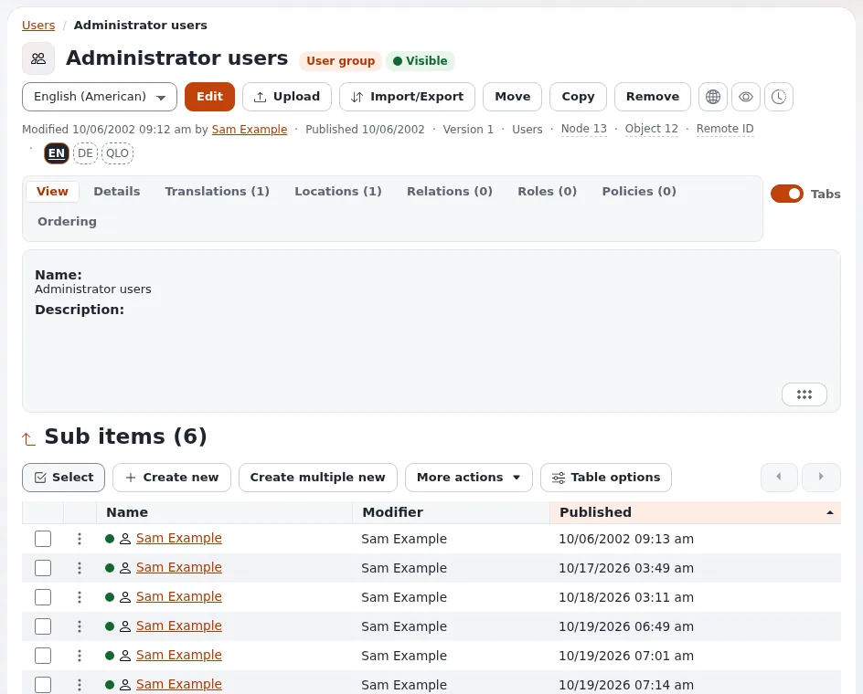

# Lektion 2.2: Benutzerkonten anlegen und verwalten

Konten anzulegen ist die Aufgabe, die ein Administrator am häufigsten erledigt. Diese Lektion behandelt das ganze
Leben eines Kontos bis kurz vor seiner Entfernung: es in der richtigen Gruppe anlegen, eine zweite Gruppe hinzufügen,
es verschieben und es aus- und wieder einschalten.

> **Hinweis**
> Testkonten verwenden immer Adressen unter `example.invalid`. Diese Domain ist reserviert und kann nie E-Mails
> empfangen, sodass eine Schulungs-Website nie einer echten Person schreiben kann.

## Auf einen Blick

| | |
|---|---|
| Kurs | [Website-Administration](../README.md) |
| Modul | [Modul 2: Benutzer und Gruppen](README.md) |
| Dauer | 40 Minuten (15 Präsentation, 25 Übung) |
| Niveau | Fortgeschrittene |
| Zielgruppe | Website-Administratoren |
| Voraussetzungen | [Lektion 2.1](benutzer-und-benutzergruppen.md): Die Gruppe `Training team` existiert |

## Lernziele

Nach dieser Lektion können die Teilnehmenden:

- einen Benutzer in einer gewählten Gruppe mit einem Passwort anlegen, das die Regeln der Website erfüllt;
- einen zweiten Ort hinzufügen, sodass ein Benutzer zu zwei Gruppen gehört;
- einen Benutzer von einer Gruppe in eine andere verschieben;
- ein Konto mit **Benutzerkonten-Einstellungen konfigurieren** deaktivieren und aktivieren;
- erklären, warum sich der Benutzername später nicht ändern lässt.

## Hinweise für Trainer

### So präsentieren Sie es

Quelle: [Das Administratorpasswort ändern](../../../administratorpasswort-aendern.md) und
[Rollen, Richtlinien und nicht aktivierte Benutzer](../../../../anleitungen/rollen-und-richtlinien.md).

1. **Anlegen** (4 Minuten). In einer Gruppe **Neu erstellen** > **Benutzer**. Das Feld **User account** enthält
   **Benutzername**, **E-Mail**, **Passwort** und **Passwort bestätigen**. Das Passwort muss
   `site.ini [UserSettings] MinPasswordLength` erreichen (10 auf einer neuen Installation); weitere Regeln lassen sich
   in `[PasswordSettings]` einschalten.
2. **Der Benutzername ist dauerhaft** (2 Minuten). Hat ein Konto einmal einen Benutzernamen, lässt er sich nicht mehr
   ändern. Legen Sie ein Schema fest (Vor- und Nachname oder eine Personalnummer), bevor Sie viele Konten anlegen.
3. **Zwei Gruppen** (3 Minuten). Fügen Sie im Reiter **Orte** eines Benutzers einen Ort in einer zweiten Gruppe hinzu.
   Der Benutzer hat jetzt die Rollen beider Gruppen.
4. **Verschieben** (2 Minuten). **Verschieben** in den Aktionen des Elements ändert die Hauptgruppe. Die Rechte ändern
   sich sofort.
5. **Ausschalten** (4 Minuten). Unter dem Feld **User account** auf der Seite des Benutzers bietet
   **Benutzerkonten-Einstellungen konfigurieren** (`user/setting/<user id>`) die Einstellungen
   **Benutzerkonto aktivieren**, die maximale Anzahl fehlgeschlagener Anmeldeversuche und **Zurücksetzen** für die
   fehlgeschlagenen Versuche. Ein deaktiviertes Konto kann sich nicht anmelden, und seine Sitzungen enden; seine
   Inhalte bleiben erhalten.

### Häufige Fragen

**Kann ich einem Benutzer eine Rolle direkt geben, ohne Gruppe?** Ja, eine Rolle lässt sich einem einzelnen Benutzer
zuweisen, aber die Zuweisung an Gruppen ist leichter zu überblicken. Modul 3 erklärt das.

**Was geschieht mit den Inhalten, die ein Benutzer erstellt hat, wenn das Konto deaktiviert wird?** Nichts. Sie
bleiben veröffentlicht, mit dem Benutzer als Eigentümer.

**Kann ich viele Benutzer auf einmal importieren?** Nicht über diese Seiten. Große Importe sind eine Aufgabe für
Entwickler; dieser Kurs legt Konten einzeln an.

### Stolperfallen

- **Echte Adressen.** Die Teilnehmenden geben aus Gewohnheit ihre eigene Adresse ein. Prüfen Sie jedes Konto auf
  `example.invalid`.
- **Schwache Passwörter werden abgelehnt.** Das Formular lehnt Passwörter ab, die kürzer als das Minimum sind, und
  bekannte Wörter. Lassen Sie die Teilnehmenden die Meldung lesen; sie nennt die Regel.
- **`admin` oder sich selbst deaktivieren.** Deaktivieren Sie nie das Konto, mit dem Sie angemeldet sind. Unter
  **Benutzerkonten prüfen** wird das ohnehin abgelehnt (Lektion 2.4); auf der Einstellungsseite des Benutzers nicht.

## Praktische Übung

Auf Ihrer Schulungsinstallation, als Administrator angemeldet:

1. Öffnen Sie **Benutzer** und dann die Gruppe `Training team` aus Lektion 2.1.
2. Klicken Sie unter **Unterelemente** auf **Neu erstellen** und wählen Sie **Benutzer**.
3. Füllen Sie **First name** `Tess`, **Last name** `Trainee`, **Benutzername** `tess.trainee` und **E-Mail**
   `tess.trainee@example.invalid` aus.
4. Geben Sie das Passwort `short` in **Passwort** und **Passwort bestätigen** ein und klicken Sie auf
   **Zur Veröffentlichung schicken**. Lesen Sie die Meldung.
5. Geben Sie zweimal ein Passwort mit mindestens 10 Zeichen ein und klicken Sie auf **Zur Veröffentlichung schicken**.
6. Legen Sie auf dieselbe Weise einen zweiten Benutzer an: `Sam Sample`, Benutzername `sam.sample`, Adresse
   `sam.sample@example.invalid`.
7. Öffnen Sie `tess.trainee` und dann den Reiter **Orte**. Fügen Sie einen Ort in der Gruppe **Editors** hinzu.
8. Öffnen Sie den Reiter **Rollen** des Benutzers: Welche Rollen stammen aus welcher Gruppe?
9. Verschieben Sie `sam.sample` von `Training team` nach **Members**.
10. Öffnen Sie die Seite von `sam.sample` und dann **Benutzerkonten-Einstellungen konfigurieren**. Entfernen Sie das
    Häkchen bei **Benutzerkonto aktivieren** und speichern Sie.
11. Öffnen Sie in einem privaten Browserfenster die Anmeldeseite der öffentlichen Website
    (`http://localhost:8088/user/login` in der Übungsumgebung) und versuchen Sie, sich als `sam.sample` anzumelden.
    Notieren Sie die Meldung.
12. Aktivieren Sie das Konto wieder und melden Sie sich im privaten Fenster erneut an.

## Erwartetes Ergebnis

- Schritt 4 wird mit einer Meldung zur Mindestlänge abgelehnt.
- `tess.trainee` hat zwei Orte, in `Training team` und in **Editors**, und zeigt die Rollen von **Editors**.
- `sam.sample` liegt in **Members**.
- Schritt 11: Die Anmeldung wird abgelehnt, solange das Konto deaktiviert ist; Schritt 12 gelingt.
- Der Trainer prüft das, indem er **Benutzerkonten prüfen** öffnet (Lektion 2.4 zeigt die Seite) oder die Gruppe
  `Training team` jeder Person.

## Quiz

1. Aus welchen Feldern besteht das Feld **User account**?
2. Lässt sich ein Benutzername ändern, nachdem das Konto angelegt wurde?
3. Ein Benutzer ist in zwei Gruppen platziert. Welche Rollen hat er?
   A. Die der ersten Gruppe B. Nur die des Hauptorts C. Die beider Gruppen D. Keine, bis sie zugewiesen werden
4. Wo deaktivieren Sie ein Konto?
5. Warum verwenden Testkonten `example.invalid`?

Antworten

1. **Benutzername**, **E-Mail**, **Passwort** und **Passwort bestätigen**.
2. Nein. Der Anmeldename lässt sich nicht mehr ändern, sobald ein Konto einen hat
   ([Das Administratorpasswort ändern](../../../administratorpasswort-aendern.md#das-passwort-eines-anderen-benutzers-als-administrator-ändern)).
3. **C.** Ein Benutzer gehört zu jeder Gruppe, in der er einen Ort hat.
4. Auf der Seite des Benutzers unter **Benutzerkonten-Einstellungen konfigurieren**, **Benutzerkonto aktivieren**;
   oder für mehrere auf einmal unter **Benutzerkonten prüfen**.
5. Die Domain kann keine E-Mails empfangen, sodass keine Testnachricht eine echte Person erreicht.

## Weiterführende Literatur

- [Das Administratorpasswort ändern](../../../administratorpasswort-aendern.md): das Passwort und die Kontoeinstellungen
  eines anderen Benutzers.
- [Ihr Passwort ändern](../../../../../eng-us/features/6.0/modern-password-change.md): die Passwortregeln.
- [Rollen, Richtlinien und nicht aktivierte Benutzer](../../../../anleitungen/rollen-und-richtlinien.md): was Gruppen vergeben.

## Verwandte Seiten

- [Modul 2: Benutzer und Gruppen](README.md)
- [Website-Administration: Kursüberblick](../README.md)
- [Trainer: hier beginnen](../../trainer-hier-beginnen.md)
- [Freie Dokumentation](../../../freie-dokumentation.md): Diese Seite darf unter der GNU FDL 1.3 frei kopiert, übersetzt und verbessert werden.

<!-- exp-partner-block:start -->
**Werden Sie Exponential-Partner.** Partner teilen ihre Informationen, stellen Mittel bereit, geben Beiträge zurück
und entwickeln die Produkte mit uns, und so wächst Exponential. Eine Partner-Website und ein Dashboard sind für Mitte
2027 geplant: Werden Sie noch heute Partner, damit wir schneller wachsen und neue Funktionen früher liefern. Beginnen
Sie mit [Partner: hier beginnen](../../../partner/partner-hier-beginnen.md) und
[Wie Sie sich bewerben](../../../partner/wie-sie-sich-bewerben.md).
<!-- exp-partner-block:end -->
