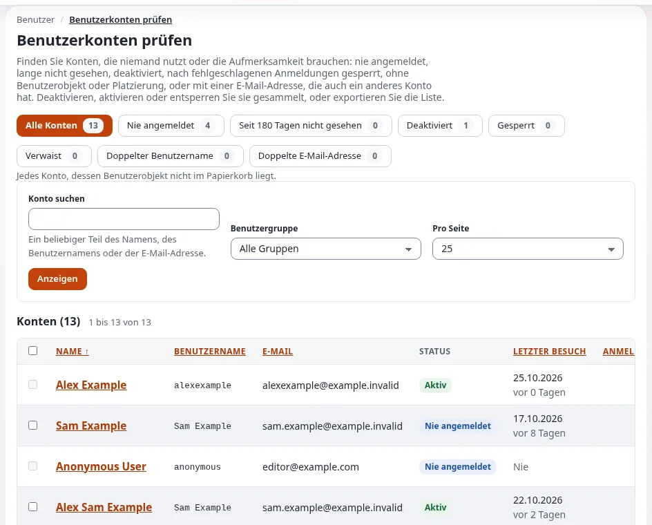
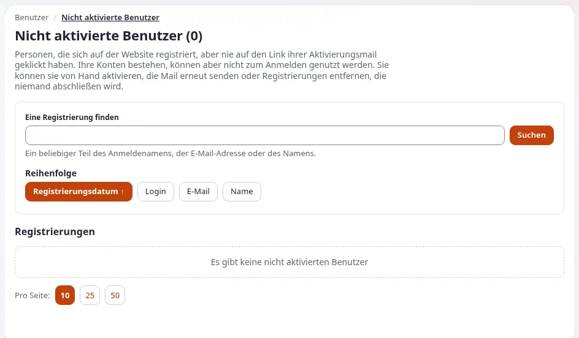

# Lektion 2.4: Nicht aktivierte Benutzer und die Prüfung von Benutzerkonten

Konten sammeln sich an: Registrierungen, die niemand abgeschlossen hat, Mitarbeiter, die gegangen sind, Testkonten
aus einem längst vergangenen Projekt. Jedes ungenutzte Konto, das sich noch anmelden kann, ist ein Risiko. Diese
Lektion nutzt zwei Seiten unter **Benutzer > Zugangskontrolle**, um solche Konten zu finden und viele auf einmal zu
bearbeiten: **Nicht aktivierte Benutzer** und **Benutzerkonten prüfen**.

## Auf einen Blick

| | |
|---|---|
| Kurs | [Website-Administration](../README.md) |
| Modul | [Modul 2: Benutzer und Gruppen](README.md) |
| Dauer | 40 Minuten (15 Präsentation, 25 Übung) |
| Niveau | Fortgeschrittene |
| Zielgruppe | Website-Administratoren |
| Voraussetzungen | [Lektion 2.3](passwoerter-ruecksetzungen-und-sperren.md): Die Benutzer `tess.trainee` und `sam.sample` existieren |

## Lernziele

Nach dieser Lektion können die Teilnehmenden:

- die Liste der nicht aktivierten Benutzer lesen und Registrierungen aktivieren, erneut anschreiben oder entfernen;
- mit den Filtern von **Benutzerkonten prüfen** Konten finden, die einen Blick verdienen;
- mehrere Konten auf einmal deaktivieren, aktivieren und entsperren und lesen, was ausgelassen wurde und warum;
- eine Kontenliste als CSV exportieren;
- erklären, warum das Entfernen eines Benutzers endgültig ist und was **Deaktivieren und verschieben** stattdessen
  bietet.

## Hinweise für Trainer

### So präsentieren Sie es

Quelle: [Rollen, Richtlinien und nicht aktivierte Benutzer](../../../../anleitungen/rollen-und-richtlinien.md#7-nicht-aktivierte-benutzer-aufräumen)
und [Benutzerkonten prüfen](../../../../funktionen/6.0/benutzerpflege.md).

1. **Nicht aktivierte Benutzer** (4 Minuten). **Benutzer > Nicht aktivierte Benutzer** listet Personen auf, die sich
   registriert, aber nie auf den Link ihrer Aktivierungsmail geklickt haben. Registrierungen, die älter als 30 Tage
   sind, werden als **Alt** gekennzeichnet. Aktionen: **Ausgewählte Benutzer aktivieren**,
   **Aktivierungsmail erneut senden**, **Ausgewählte Benutzer entfernen** und
   **Alle unaktivierten Benutzer entfernen**. Der anonyme Benutzer, das Konto `admin` und Sie selbst werden nie
   entfernt.
2. **Benutzerkonten prüfen** (6 Minuten). **Benutzer > Benutzerkonten prüfen** hat die Filter **Alle Konten**,
   **Nie angemeldet**, **Seit 180 Tagen nicht gesehen**, **Deaktiviert**, **Gesperrt**, **Verwaist**,
   **Doppelter Benutzername** und **Doppelte E-Mail-Adresse**, jeder mit seiner Anzahl; **Konto suchen**,
   **Benutzergruppe** und **Pro Seite** grenzen die Liste ein. Jede Zeile zeigt Status, letzten Besuch, Anmeldungen,
   Gruppen und Rollen.
3. **Aktionen für mehrere Konten** (3 Minuten). **Angehakte Konten deaktivieren**, **Angehakte Konten aktivieren** und **Angehakte Konten entsperren**. Die Bestätigung sagt, wie
   viele Konten sich ändern werden und welche ausgelassen werden, und warum. Nichts auf dieser Seite entfernt ein
   Konto.
4. **Stilllegen statt entfernen** (2 Minuten). Benutzerobjekte landen nie im Papierkorb. Mit
   `[UserSettings] DeactivateAndMove=enabled` (standardmäßig aus) deaktiviert **Deaktivieren und verschieben** Konten
   und verschiebt sie in eine versteckte Gruppe ohne Rollen, wobei es sich merkt, wo sie vorher lagen.

### Häufige Fragen

**Wer darf diese Seiten verwenden?** **Benutzerkonten prüfen** braucht die Funktion `user/hygiene`; E-Mail-Adressen
werden nur mit `role/assign` angezeigt. Nicht aktivierte Benutzer braucht `user/activation`. Eine frische
Installation gibt sie nur der Rolle Administrator.

**Warum wird der anonyme Benutzer als nie angemeldet aufgeführt? Kann ich ihn deaktivieren?** Er kann sich seiner
Natur nach nicht anmelden. Er wird bei jeder Aktion ausgelassen, ebenso wie der Benutzer, der die Aktion auslöst, das
Konto `admin` und Sie selbst.

**Was ist ein verwaistes Konto?** Ein Konto, dessen Benutzerobjekt fehlt, nie veröffentlicht wurde oder keinen Ort
hat.

**Wird der CSV-Export protokolliert?** Ja, als `data.export.csv` mit der Zahl der Zeilen und dem Filter, nie mit den
Werten.

### Stolperfallen

- **Alle unaktivierten Benutzer entfernen bei aktiver Suche.** Die Schaltfläche entfernt dann nur die passenden; ohne
  Suche entfernt sie jeden nicht aktivierten Benutzer auf jeder Seite. Lesen Sie die Zahl in der Bestätigung laut
  vor.
- **CSV-Dateien mit Adressen.** Ein Export kann personenbezogene Daten enthalten. Bewahren Sie ihn auf einer
  Live-Website wie alle personenbezogenen Daten auf und löschen Sie ihn, wenn Sie fertig sind. In der Übungsumgebung
  liegt jede Adresse unter `example.invalid`.
- **Deaktiviert ist nicht entfernt.** Ein deaktiviertes Konto zählt weiterhin in Lizenzen, Listen und Exporten.
  Entscheiden Sie mit der Organisation, wann Konten endgültig entfernt werden.

## Praktische Übung

Auf Ihrer Schulungsinstallation, als Administrator angemeldet:

1. Bietet die öffentliche Website eine Registrierung an, registrieren Sie in einem privaten Fenster ein Konto mit
   einer Adresse unter `example.invalid` und aktivieren Sie es nicht. (E-Mails werden in der Übungsumgebung in
   Dateien geschrieben und nie versendet.)
2. Öffnen Sie **Benutzer > Nicht aktivierte Benutzer**. Notieren Sie die Anzahl in der Überschrift und, falls
   vorhanden, Ihre Registrierung.
3. Setzen Sie das Häkchen bei Ihrer Registrierung und wählen Sie **Ausgewählte Benutzer aktivieren**. Lesen Sie die
   Bestätigung und bestätigen Sie dann.
4. Öffnen Sie **Benutzer > Benutzerkonten prüfen**. Schreiben Sie die Anzahl jedes Filters auf.
5. Wählen Sie **Nie angemeldet**. Welche Ihrer Konten werden aufgeführt?
6. Setzen Sie die Häkchen bei `tess.trainee` und `sam.sample` und beim anonymen Benutzer, falls er sich anhaken lässt, und klicken Sie auf **Angehakte Konten deaktivieren**. Lesen
   Sie die Bestätigung: Wie viele ändern sich, wie viele werden ausgelassen?
7. Bestätigen Sie. Wählen Sie den Filter **Deaktiviert** und prüfen Sie das Ergebnis.
8. Setzen Sie wieder die Häkchen bei beiden Konten, klicken Sie auf **Angehakte Konten aktivieren** und bestätigen
   Sie.
9. Verwenden Sie **Konto suchen** mit `example.invalid` und wählen Sie bei **Pro Seite** 25.
10. Klicken Sie auf **Liste als CSV exportieren** (die Schaltfläche zeigt die Zahl der Konten) und öffnen Sie die Datei. Prüfen Sie, dass nur Adressen unter `example.invalid` darin stehen.

## Erwartetes Ergebnis

- Schritt 3 aktiviert die Registrierung; sie verschwindet aus **Nicht aktivierte Benutzer**.
- Schritt 6: Der anonyme Benutzer lässt sich nicht anhaken; die Bestätigung zählt zwei Konten, die sich ändern.
- Nach Schritt 7 stehen beide Konten unter **Deaktiviert**; nach Schritt 8 sind sie wieder aktiv.
- Schritt 10: eine CSV-Datei in UTF-8 mit der gefilterten Liste.
- Der Trainer prüft die Zahlen aus Schritt 4 auf einem Bildschirm und die CSV-Datei einer Person.

## Quiz

1. Welche Konten werden von **Alle unaktivierten Benutzer entfernen** nie entfernt?
2. Welcher Filter listet Konten, die sich mindestens einmal angemeldet haben, aber schon lange nicht mehr?
   A. **Nie angemeldet** B. **Seit 180 Tagen nicht gesehen** C. **Deaktiviert** D. **Verwaist**
3. Richtig oder falsch: **Benutzerkonten prüfen** kann Konten entfernen.
4. Welche Funktion braucht eine Rolle, um **Benutzerkonten prüfen** zu öffnen?
5. Was bewirkt **Deaktivieren und verschieben**, und ist es standardmäßig eingeschaltet?

Antworten

1. Jeder, der inzwischen aktiviert wurde, der anonyme Benutzer, das Konto `admin` und Sie selbst
   ([Nicht aktivierte Benutzer aufräumen](../../../../anleitungen/rollen-und-richtlinien.md#7-nicht-aktivierte-benutzer-aufräumen)).
2. **B.** Die Zahl der Tage ist standardmäßig 180.
3. **Falsch.** Die Seite deaktiviert, aktiviert und entsperrt; das Entfernen bleibt bei **Entfernen** am Knoten selbst.
4. `user/hygiene` ([Wer sie verwenden darf](../../../../funktionen/6.0/benutzerpflege.md#wer-sie-verwenden-darf)).
5. Es deaktiviert Konten und verschiebt sie in eine versteckte Gruppe ohne Rollen, wobei es sich merkt, wo sie vorher
   lagen; es ist standardmäßig ausgeschaltet (`DeactivateAndMove=disabled`).

## Weiterführende Literatur

- [Benutzerkonten prüfen](../../../../funktionen/6.0/benutzerpflege.md): jeder Filter, jede Aktion und jede Einstellung.
- [Rollen, Richtlinien und nicht aktivierte Benutzer](../../../../anleitungen/rollen-und-richtlinien.md): die Seite der nicht
  aktivierten Benutzer und die Registrierungsmail.
- [Sicherheit und Audit](../../../../anleitungen/sicherheit-und-audit.md): wo die Änderungen an Konten protokolliert werden.

## Verwandte Seiten

- [Modul 2: Benutzer und Gruppen](README.md)
- [Website-Administration: Kursüberblick](../README.md)
- [Trainer: hier beginnen](../../trainer-hier-beginnen.md)
- [Freie Dokumentation](../../../freie-dokumentation.md): Diese Seite darf unter der GNU FDL 1.3 frei kopiert, übersetzt und verbessert werden.

<!-- exp-partner-block:start -->
**Werden Sie Exponential-Partner.** Partner teilen ihre Informationen, stellen Mittel bereit, geben Beiträge zurück
und entwickeln die Produkte mit uns, und so wächst Exponential. Eine Partner-Website und ein Dashboard sind für Mitte
2027 geplant: Werden Sie noch heute Partner, damit wir schneller wachsen und neue Funktionen früher liefern. Beginnen
Sie mit [Partner: hier beginnen](../../../partner/partner-hier-beginnen.md) und
[Wie Sie sich bewerben](../../../partner/wie-sie-sich-bewerben.md).
<!-- exp-partner-block:end -->
