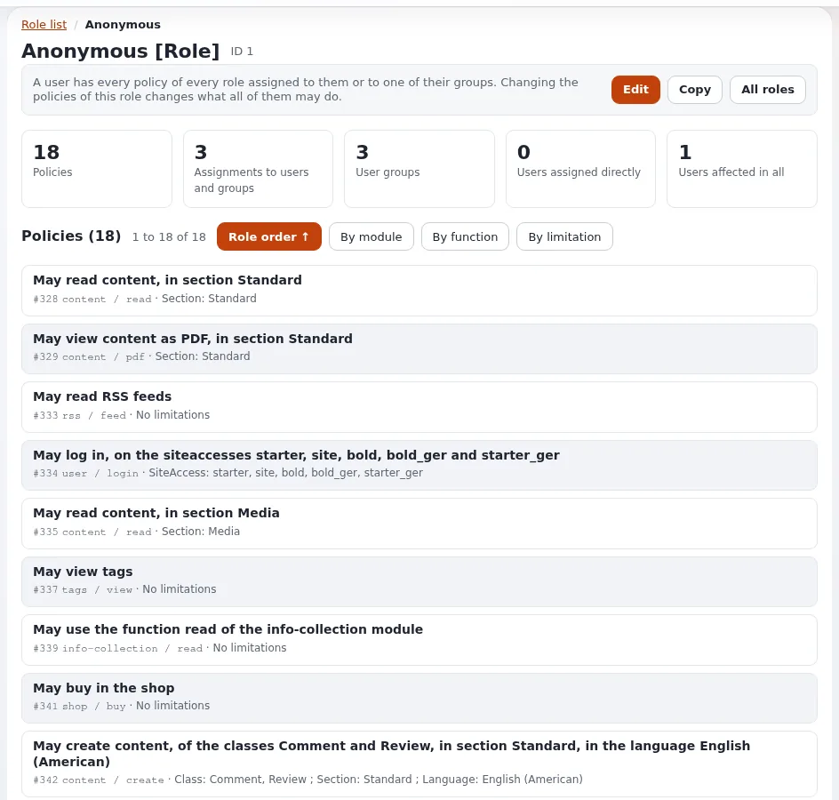

# Lektion 3.5: Anonymer Zugriff und offene Registrierung

Jeder Besucher, der sich nicht angemeldet hat, ist der anonyme Benutzer, und die Rollen der Gruppe
**Anonymous Users** entscheiden, was die gesamte Öffentlichkeit sehen und tun darf. Eine unbedachte Änderung dort kann
das Benutzerverzeichnis veröffentlichen oder die Website schließen. Diese Lektion liest die Rolle Anonymous, testet
sie als Besucher und nimmt eine gezielte Änderung vor: die Registrierung öffnen und wieder schließen.

## Auf einen Blick

| | |
|---|---|
| Kurs | [Website-Administration](../README.md) |
| Modul | [Modul 3: Rollen und Richtlinien](README.md) |
| Dauer | 40 Minuten (15 Präsentation, 25 Übung) |
| Niveau | Fortgeschrittene |
| Zielgruppe | Website-Administratoren |
| Voraussetzungen | [Lektion 3.4](testen-was-ein-benutzer-darf.md) |

## Lernziele

Nach dieser Lektion können die Teilnehmenden:

- die Rolle Anonymous lesen und sagen, was jeder Besucher lesen und tun darf;
- erklären, warum Inhalte außerhalb der Sektion Standard vor Besuchern verborgen sind;
- den anonymen Zugriff in einem privaten Browserfenster testen;
- die Registrierung öffnen, indem sie der Rolle Anonymous `user/register` hinzufügen, und sie wieder schließen;
- erklären, wie eine aktualisierte Website die Registrierung über `PolicyOmitList[]` offen hält.

## Hinweise für Trainer

### So präsentieren Sie es

Quelle: [Sektionen in Rollen und Richtlinien](../../../../anleitungen/sektionen.md#9-sektionen-in-rollen-und-richtlinien) und
[Entscheiden, wer sich registrieren darf](../../../../anleitungen/rollen-und-richtlinien.md#8-festlegen-wer-sich-registrieren-und-wer-knotendaten-lesen-darf).

1. **Die Rolle Anonymous** (4 Minuten). Öffnen Sie sie am Beamer. Richtlinien wie `content/read` und `content/pdf`,
   eingeschränkt auf die Sektion Standard, `user/login` auf den öffentlichen Siteaccesses und das Lesen von Feeds. Ihr
   Seitenpaket fügt womöglich weitere hinzu.
2. **Warum Standard wichtig ist** (3 Minuten). Eine neue Installation hat fünf Sektionen: Standard (1), Users (2),
   Media (3), Setup (4) und Design (5). Anonymous liest nur Standard, und das hält Benutzerkonten und alles in einer
   anderen Sektion von Besuchern fern. Bilder in Media werden angezeigt, wenn sie in Seiten eingebettet sind, die der
   Besucher lesen darf, je nach den Richtlinien des Seitenpakets.
3. **Registrierung** (5 Minuten). Auf einer neuen Installation braucht die Registrierung die Richtlinie
   `user/register`. Fügen Sie der Rolle Anonymous *User / Register* für die offene Registrierung hinzu; die
   Anmeldeseiten zeigen dann den Link zur Registrierung, und nur dann. Eine aktualisierte Website hält die
   Registrierung über `site.ini [RoleSettings] PolicyOmitList[]` offen; um sie zu schließen, fügen Sie im globalen
   Override `PolicyOmitListExclude[]=user/register` hinzu und leeren den INI-Cache.
4. **Caches** (3 Minuten). Besuchern werden möglicherweise Seiten aus dem Cache ausgeliefert. Leeren Sie nach einer
   Rollenänderung den Inhalts-Cache (Modul 5), bevor Sie schließen, dass es nicht funktioniert hat.

### Häufige Fragen

**Kann ich Besuchern Zugriff auf eine weitere Sektion geben?** Ja: Bearbeiten Sie die Richtlinie `content/read` der
Rolle Anonymous und setzen Sie das Häkchen bei der Sektion neben Standard. Modul 4 baut eine Sektion dafür.

**Besucher sehen eine Seite immer noch, die ich ihnen weggenommen habe.** Ein statischer Cache, der HTTP-Cache oder ein
Proxy hält sie womöglich noch. Leeren Sie sie.

**Ist der anonyme Benutzer ein Konto, mit dem sich jemand anmelden kann?** Nein. Er kann sich nicht anmelden; er ist
die Identität jedes Besuchers, der sich nicht angemeldet hat.

### Stolperfallen

- **Anonymous `content/read` ohne Einschränkung geben.** Besucher können dann Benutzerkonten, Medienordner und alles
  andere lesen. Entfernen Sie nie die Einschränkung nach Sektion.
- **Testen im angemeldeten Zustand.** Verwenden Sie immer ein privates Fenster und prüfen Sie, dass die Kopfzeile
  zeigt, dass Sie nicht angemeldet sind.
- **Registrierung mit echtem E-Mail-Versand.** Das Öffnen der Registrierung auf einer Live-Website verschickt
  Aktivierungsmails; in der Übungsumgebung werden E-Mails in Dateien geschrieben.

## Praktische Übung

Auf Ihrer Schulungsinstallation, als Administrator angemeldet:

1. Öffnen Sie **Benutzer > Rollen und Richtlinien** und die Rolle **Anonymous**. Schreiben Sie ihre Richtlinien als
   Sätze auf.
2. Öffnen Sie in der Administration die Gruppe **Users** und notieren Sie die Knoten-ID eines Benutzers (im Reiter
   **Details** oder in der Adresse).
3. Öffnen Sie in einem privaten Fenster, abgemeldet, die öffentliche Website und dann
   `/content/view/full/<that node id>`. Notieren Sie das Ergebnis.
4. Öffnen Sie im privaten Fenster die öffentliche Anmeldeseite (`/user/login`). Gibt es einen Link zur
   Registrierung?
5. Klicken Sie als Administrator bei der Rolle Anonymous auf **Bearbeiten**, dann auf **Neue Richtlinie**: Modul
   `user`, Funktion `register`, **Vollen Zugriff gewähren**. Klicken Sie auf **Speichern**.
6. Leeren Sie den Inhalts-Cache: **Cache leeren** in der rechten Spalte mit **Inhalt** oder
   `php bin/php/ezcache.php --clear-tag=content` in einem Terminal.
7. Laden Sie die Anmeldeseite im privaten Fenster neu. Ist der Link zur Registrierung jetzt da?
8. Öffnen Sie ihn und sehen Sie sich das Registrierungsformular an. Registrieren Sie sich nicht.
9. Entfernen Sie als Administrator die Richtlinie `user / register` wieder aus der Rolle Anonymous und klicken Sie auf
   **Speichern**.
10. Laden Sie die Anmeldeseite im privaten Fenster neu und prüfen Sie, dass der Link verschwunden ist (leeren Sie bei
    Bedarf erneut den Inhalts-Cache).

## Erwartetes Ergebnis

- Schritt 3 wird verweigert: Das Benutzerkonto liegt in der Sektion Users, die Anonymous nicht lesen darf.
- Auf einer neuen Installation ohne offene Registrierung zeigt Schritt 4 keinen Link zur Registrierung; die Schritte
  5 bis 7 lassen ihn erscheinen; die Schritte 9 und 10 entfernen ihn. (Eine aktualisierte Website zeigt ihn
  möglicherweise von Anfang an, über `PolicyOmitList[]`.)
- Der Trainer prüft nach Schritt 9 die Rolle Anonymous auf dem Bildschirm einer Person: Es ist keine Richtlinie
  `user / register` mehr übrig.

## Quiz

1. Welche Sektion dürfen anonyme Besucher auf einer neuen Installation lesen?
   A. Alle B. Standard C. Users und Standard D. Media
2. Warum können Besucher auf der öffentlichen Website keine Benutzerkonten öffnen?
3. Welche Richtlinie öffnet auf einer neuen Installation die Registrierung?
4. Eine aktualisierte Website zeigt den Link zur Registrierung, obwohl keine Rolle `user/register` hat. Warum?
5. Sie haben eine Richtlinie aus Anonymous entfernt, aber ein Besucher sieht die Seite immer noch. Was prüfen Sie?

Antworten

1. **B.** `content/read` und `content/pdf` eingeschränkt auf die Sektion Standard
   ([Sektionen](../../../../anleitungen/sektionen.md#2-die-sektionen-einer-neuen-installation)).
2. Benutzerkonten liegen in der Sektion Users, und die Rolle Anonymous liest nur Standard.
3. `user/register` (*User / Register*) an der Rolle Anonymous.
4. `user/register` steht dort in `PolicyOmitList[]`, wodurch die Prüfung übersprungen wird; schließen Sie die
   Registrierung mit `PolicyOmitListExclude[]`.
5. Die Caches: den Cache der Inhaltsansichten, den statischen Cache, den HTTP-Cache oder einen Proxy.

## Weiterführende Literatur

- [Rollen, Richtlinien und nicht aktivierte Benutzer](../../../../anleitungen/rollen-und-richtlinien.md): Registrierung und
  Knotendaten.
- [Sektionen](../../../../anleitungen/sektionen.md): die Sektionen und die Rolle Anonymous.
- [Sicherheitshärtung](../../../sicherheitshaertung.md): was Sie prüfen, bevor eine Website öffentlich wird.

## Verwandte Seiten

- [Modul 3: Rollen und Richtlinien](README.md)
- [Website-Administration: Kursüberblick](../README.md)
- [Trainer: hier beginnen](../../trainer-hier-beginnen.md)
- [Freie Dokumentation](../../../freie-dokumentation.md): Diese Seite darf unter der GNU FDL 1.3 frei kopiert, übersetzt und verbessert werden.

<!-- exp-partner-block:start -->
**Werden Sie Exponential-Partner.** Partner teilen ihre Informationen, stellen Mittel bereit, geben Beiträge
zurück und entwickeln die Produkte gemeinsam mit uns weiter, und so wächst Exponential. Eine Partner-Website und
ein Partner-Dashboard sind für Mitte 2027 geplant: Werden Sie noch heute Partner, damit wir schneller wachsen und
neue Funktionen früher bereitstellen können. Beginnen Sie mit [Partner: hier beginnen](../../../partner/partner-hier-beginnen.md) und
[Wie Sie sich bewerben](../../../partner/wie-sie-sich-bewerben.md).
<!-- exp-partner-block:end -->
