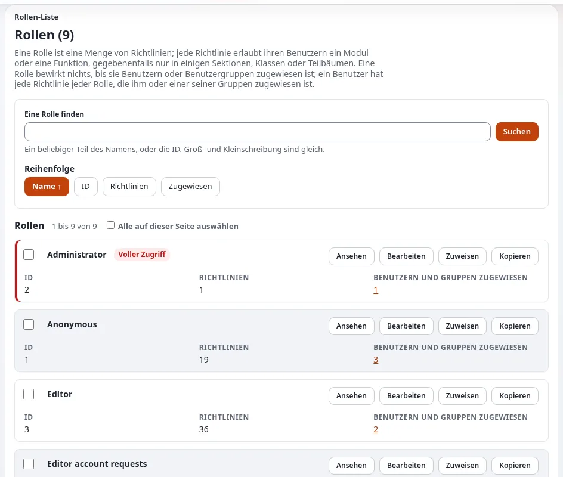

# Lektion 3.1: Rollen, Richtlinien und Einschränkungen

Jede Frage „Darf ich?“ beantworten in Exponential die Rollen. Diese Lektion baut das Modell auf, das die
Teilnehmenden für das ganze Modul brauchen: Eine Rolle ist eine Menge von Richtlinien, eine Richtlinie nennt ein
Modul und eine Funktion, Einschränkungen engen sie ein, und eine Rolle bewirkt nichts, bis sie zugewiesen ist. Dann
lesen die Teilnehmenden echte Rollen auf den Rollenseiten, die jede Richtlinie als Satz ausschreiben.

## Auf einen Blick

| | |
|---|---|
| Kurs | [Website-Administration](../README.md) |
| Modul | [Modul 3: Rollen und Richtlinien](README.md) |
| Dauer | 35 Minuten (15 Präsentation, 20 Übung) |
| Niveau | Fortgeschrittene |
| Zielgruppe | Website-Administratoren |
| Voraussetzungen | [Modul 2](../modul-02-benutzer-und-gruppen/README.md); ein Administratorkonto auf der Schulungsinstallation |

## Lernziele

Nach dieser Lektion können die Teilnehmenden:

- Rolle, Richtlinie, Modul, Funktion und Einschränkung mit eigenen Worten erklären;
- sagen, wie Einschränkungen innerhalb einer Richtlinie und wie Richtlinien untereinander zusammenwirken;
- die Seite einer Rolle und ihre Zahlen lesen (Richtlinien, Zuweisungen, insgesamt betroffene Benutzer);
- die Abzeichen *Voller Zugriff*, *Kann Rollen ändern* und *Nicht zugewiesen* in der Rollenliste erkennen.

## Hinweise für Trainer

### So präsentieren Sie es

Quelle: [Rollen, Richtlinien und nicht aktivierte Benutzer](../../../../anleitungen/rollen-und-richtlinien.md) und
[Sektionen in Rollen und Richtlinien](../../../../anleitungen/sektionen.md#9-sektionen-in-rollen-und-richtlinien).

1. **Das Modell** (5 Minuten). Zeichnen Sie es auf: Eine *Rolle* enthält *Richtlinien*; eine *Richtlinie* =
   *Modul* (`content`, `user`, `setup`, ...) + *Funktion* (`read`, `edit`, `login`, ...) + optionale
   *Einschränkungen* (Section, Class, Subtree, Owner, SiteAccess, Language, State ...). Eine Rolle wird Benutzern oder
   Gruppen *zugewiesen*. Ein Benutzer hat jede Richtlinie jeder Rolle, die ihm oder einer seiner Gruppen zugewiesen
   ist.
2. **Zusammenwirken** (4 Minuten). Mehrere Einschränkungen an einer Richtlinie müssen **alle** erfüllt sein (UND);
   mehrere Werte einer Einschränkung sind Alternativen (ODER); mehrere Richtlinien derselben Funktion addieren sich
   (ODER). Es gibt kein „Verbieten“: Was nicht gewährt ist, wird verweigert.
3. **Die Rollenliste** (3 Minuten). **Benutzer > Rollen und Richtlinien**: eine Karte pro Rolle mit ihrer ID, ihren
   Richtlinien und Zuweisungen, den Aktionen **Ansehen**, **Bearbeiten**, **Zuweisen**, **Kopieren** und den
   Abzeichen *Voller Zugriff* (rot), *Kann Rollen ändern* (gelb) und *Nicht zugewiesen*.
4. **Eine Rollenseite** (3 Minuten). Öffnen Sie **Anonymous**: die Zahlen, dann jede Richtlinie als Satz, zum Beispiel
   „Darf Inhalte lesen, in der Sektion Standard“ mit der gespeicherten Form darunter
   (`content / read · Section: Standard`).

### Häufige Fragen

**Kann eine Richtlinie etwas verbieten?** Nein. Richtlinien gewähren nur. Um etwas wegzunehmen, entfernen oder
verengen Sie die Richtlinie, die es gewährt, oder die Zuweisung.

**Warum ist die Rolle Administrator rot markiert?** Sie hat eine Richtlinie über alle Module (`*/*`), und das ist
voller Zugriff.

**Warum ist „Kann Rollen ändern“ eine Warnung?** Ein Benutzer, der Rollen ändern darf, kann sich selbst jeden Zugriff
geben. Seit 6.0.15 verhindert `[RoleSettings] PreventPrivilegeEscalation=enabled`, dass er mehr vergibt, als er selbst
hat, aber vergeben Sie diese Berechtigung trotzdem mit Bedacht.

**Was bedeutet „(ohne Auswertung, verweigert)“ unter einer Einschränkung?** Kein Code wertet diese Einschränkung aus,
deshalb gewährt die Richtlinie keinen Zugriff. Das stammt meist von einer entfernten Erweiterung.

### Stolperfallen

- **Die Teilnehmenden erwarten eine Verbotsregel.** Wiederholen Sie es: Es wird nur gewährt, mit ODER zwischen den
  Richtlinien.
- **Sektionen und den Baum verwechseln.** Eine Einschränkung nach Sektion ist kein Teilbaum; Objekte einer Sektion
  können überall liegen. Modul 4 erklärt Sektionen ausführlich.

## Praktische Übung

Auf Ihrer Schulungsinstallation, als Administrator angemeldet:

1. Öffnen Sie **Benutzer > Rollen und Richtlinien**. Schreiben Sie jede Rolle mit der Zahl ihrer Richtlinien und
   Zuweisungen auf.
2. Notieren Sie, welche Rollen die Abzeichen *Voller Zugriff*, *Kann Rollen ändern* oder *Nicht zugewiesen* tragen.
3. Suchen Sie mit **Eine Rolle finden** die Rolle **Editor**. Ändern Sie die Sortierung auf **Richtlinien** und
   zurück auf **Name**.
4. Öffnen Sie die Rolle **Anonymous**. Lesen Sie die Zahlen: Wie viele Benutzer sind insgesamt betroffen?
5. Lesen Sie die Richtlinien von **Anonymous** als Sätze. Welche Sektionen dürfen anonyme Besucher lesen?
6. Suchen Sie die Richtlinie `user / login`. Auf welchen Siteaccesses dürfen sich anonyme Besucher anmelden?
7. Sortieren Sie die Richtlinien **Nach Modul** und notieren Sie, wie sich die Liste ändert.
8. Öffnen Sie die Rolle **Editor** und suchen Sie eine Richtlinie mit mehr als einer Einschränkung. Schreiben Sie sie
   mit eigenen Worten als Satz auf und sagen Sie, ob ihre Einschränkungen mit UND oder ODER zusammenwirken.

## Erwartetes Ergebnis

- **Administrator** trägt *Voller Zugriff*. **Anonymous** hat Richtlinien wie das Lesen von Inhalten in der Sektion
  Standard und das Anmelden auf den öffentlichen Siteaccesses.
- Der Satz aus Schritt 8 nennt jede Einschränkung, verbunden mit „und“.
- Der Trainer prüft das, indem er zwei Teilnehmende bittet, ihren Satz aus Schritt 8 laut vorzulesen.

## Quiz

1. Was bewirkt eine Rolle, bevor sie zugewiesen ist?
2. Eine Richtlinie hat die Einschränkungen Class( Article ) und Section( Standard ). Welche Objekte deckt sie ab?
   A. Alle Artikel und alles in Standard B. Artikel in der Sektion Standard C. Nichts D. Nur die Klasse Article
3. Zwei Richtlinien gewähren `content/read` für die Sektion Standard und für die Sektion Media. Was darf der Benutzer
   lesen?
4. Welches Abzeichen kennzeichnet eine Rolle mit einer Richtlinie über alle Module?
5. Richtig oder falsch: Eine Richtlinie kann einen Zugriff verbieten, den eine andere Rolle gewährt.

Antworten

1. Nichts. Eine Rolle bewirkt nichts, bis sie Benutzern oder Gruppen zugewiesen ist
   ([Rollen, Richtlinien und nicht aktivierte Benutzer](../../../../anleitungen/rollen-und-richtlinien.md#kurz-gesagt)).
2. **B.** Die Einschränkungen einer Richtlinie wirken mit UND zusammen.
3. Inhalte in Standard oder in Media: Richtlinien derselben Funktion wirken mit ODER zusammen.
4. *Voller Zugriff*, in Rot.
5. **Falsch.** Richtlinien gewähren nur.

## Weiterführende Literatur

- [Rollen, Richtlinien und nicht aktivierte Benutzer](../../../../anleitungen/rollen-und-richtlinien.md): die Rollenliste, eine
  Rollenseite, der Editor.
- [Sektionen](../../../../anleitungen/sektionen.md): Einschränkungen nach Sektion und auf eine Sektion beschränkte
  Zuweisungen.
- [Handler für Inhaltseinschränkungen](../../../../funktionen/6.0/handler-fuer-inhaltseinschraenkungen.md): wie Einschränkungen
  ausgewertet werden.

## Verwandte Seiten

- [Modul 3: Rollen und Richtlinien](README.md)
- [Website-Administration: Kursüberblick](../README.md)
- [Trainer: hier beginnen](../../trainer-hier-beginnen.md)
- [Freie Dokumentation](../../../freie-dokumentation.md): Diese Seite darf unter der GNU FDL 1.3 frei kopiert, übersetzt und verbessert werden.

<!-- exp-partner-block:start -->
**Werden Sie Exponential-Partner.** Partner teilen ihre Informationen, stellen Mittel bereit, geben Beiträge zurück
und entwickeln die Produkte mit uns, und so wächst Exponential. Eine Partner-Website und ein Dashboard sind für Mitte
2027 geplant: Werden Sie noch heute Partner, damit wir schneller wachsen und neue Funktionen früher liefern. Beginnen
Sie mit [Partner: hier beginnen](../../../partner/partner-hier-beginnen.md) und
[Wie Sie sich bewerben](../../../partner/wie-sie-sich-bewerben.md).
<!-- exp-partner-block:end -->
