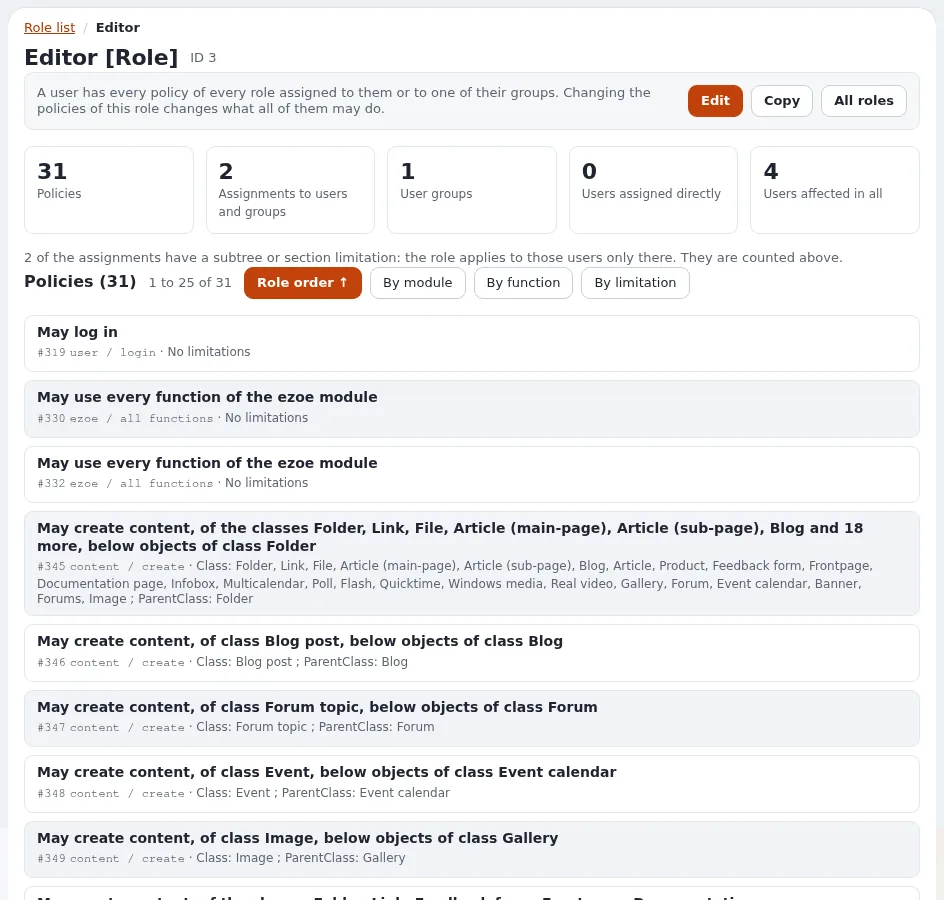

# Lektion 3.3: Rollen zuweisen, mit und ohne Einschränkung

Eine Rolle wirkt erst, wenn sie zugewiesen ist. Sie einer Gruppe statt einzelnen Benutzern zuzuweisen, hält den
Zugriff überschaubar; sie mit einer Einschränkung zuzuweisen, lässt eine Rolle mehreren Teams dienen, jedem in seinem
eigenen Teil der Website. Diese Lektion weist die in Lektion 3.2 gebaute Rolle auf beide Arten zu.

## Auf einen Blick

| | |
|---|---|
| Kurs | [Website-Administration](../README.md) |
| Modul | [Modul 3: Rollen und Richtlinien](README.md) |
| Dauer | 40 Minuten (15 Präsentation, 25 Übung) |
| Niveau | Fortgeschrittene |
| Zielgruppe | Website-Administratoren |
| Voraussetzungen | [Lektion 3.2](eine-rolle-mit-eingeschraenkten-richtlinien-aufbauen.md): die Rolle `News editors`; die Gruppe `Training team` aus Lektion 2.1 |

## Lernziele

Nach dieser Lektion können die Teilnehmenden:

- eine Rolle mit **Zuweisen** einer Benutzergruppe zuweisen;
- eine Rolle mit **Mit Einschränkungen zuordnen** eingeschränkt auf einen Teilbaum oder eine Sektion zuweisen;
- die Zahlen der Rolle lesen: Zuweisungen, Gruppen, direkt zugewiesene Benutzer, insgesamt betroffene Benutzer;
- eine Zuweisung entfernen, ohne Benutzer oder die Rolle zu entfernen;
- erklären, warum dieselbe Rolle mehrmals mit unterschiedlichen Einschränkungen zugewiesen werden kann.

## Hinweise für Trainer

### So präsentieren Sie es

Quelle: [Die Rolle zuweisen](../../../../anleitungen/rollen-und-richtlinien.md#5-die-rolle-zuweisen) und
[Eine Rolle, die mit der Einschränkung auf eine Sektion zugewiesen ist](../../../../anleitungen/sektionen.md#92-eine-mit-der-einschränkung-auf-eine-sektion-zugewiesene-rolle).

1. **Gruppen zuweisen** (3 Minuten). Auf der Rollenseite öffnet **Zuweisen** den Inhaltsbrowser im Benutzerbaum.
   Wählen Sie Gruppen: Jedes Mitglied, jetzt und künftig, bekommt die Rolle. Weisen Sie einem einzelnen Benutzer nur
   für eine vorübergehende Ausnahme zu.
2. **Mit Einschränkung zuweisen** (5 Minuten). Wählen Sie *Teilbaum* oder *Sektion*, dann den Teilbaum oder die
   Sektion, dann die Benutzer oder Gruppen. Jede Richtlinie der Rolle gilt dann nur dort. Eine Rolle „Editor“, dem
   Marketing eingeschränkt auf dessen Sektion und dem Vertrieb eingeschränkt auf dessen eigene zugewiesen, ersetzt
   zwei fast identische Rollen.
3. **Die Reichweite ablesen** (3 Minuten). Die Zahlen auf der Rollenseite: Zuweisungen, Benutzergruppen, direkt
   zugewiesene Benutzer und **insgesamt betroffene Benutzer** (Mitglieder ihrer Gruppen einmal gezählt). Die Zeile
   darunter sagt, wie viele Zuweisungen eingeschränkt sind. Der Reiter **Rollen** der Gruppe zeigt dasselbe von der
   anderen Seite.
4. **Entfernen** (2 Minuten). Setzen Sie Häkchen bei Zuweisungen, **Ausgewählte entfernen**, bestätigen Sie mit
   *Angekreuzte Zuweisungen entfernen*. Die Benutzer und Gruppen verlieren die Rolle sofort; sonst wird nichts
   entfernt.

### Häufige Fragen

**Was ist der Unterschied zwischen einer Einschränkung Subtree an einer Richtlinie und einer auf einen Teilbaum
eingeschränkten Zuweisung?** Die erste engt eine Richtlinie überall dort ein, wo die Rolle zugewiesen ist; die zweite
engt die ganze Rolle für diese eine Zuweisung ein.

**Kann ich eine Rolle einer Gruppe deaktivierter Benutzer zuweisen?** Nein. **Zuweisen** lässt die Gruppe für
deaktivierte Konten aus und sagt das auf der Rollenseite.

**Warum wurde meine Zuweisung abgelehnt?** Mit `PreventPrivilegeEscalation=enabled` kann ein Benutzer, der kein
vollständiger Administrator ist, keine Rolle zuweisen, die mehr gewährt, als er selbst hat
(*Die Rolle wurde nicht zugewiesen*).

### Stolperfallen

- **Einer Person statt der Gruppe zuweisen.** Funktioniert, aber sechs Monate später weiß niemand mehr, warum. Bitten
  Sie die Teilnehmenden, jede direkte Zuweisung zu begründen.
- **Auf den falschen Teilbaum eingeschränkt.** Der Inhaltsbrowser startet für die Benutzer im Benutzerbaum; der
  Teilbaum für die Einschränkung wird zuerst gewählt. Gehen Sie am Beamer langsam vor.
- **Eine Einschränkung nach Sektion, die auf nichts passt.** Inhalte, die nicht in der Sektion liegen, sind nicht
  abgedeckt; prüfen Sie das mit Lektion 3.4, bevor Sie dem Team sagen, dass es funktioniert.

## Praktische Übung

Auf Ihrer Schulungsinstallation, als Administrator angemeldet:

1. Erstellen Sie in der **Inhaltsstruktur** einen Ordner `News` unterhalb der obersten Ebene der Website (hat Ihr
   Seitenpaket bereits einen Nachrichtenordner, verwenden Sie diesen).
2. Öffnen Sie **Benutzer > Rollen und Richtlinien** und dann die Rolle `News editors`.
3. Wählen Sie bei **Mit Einschränkungen zuordnen** *Teilbaum*, wählen Sie den Ordner `News` und dann die Gruppe
   `Training team`.
4. Lesen Sie die Rollenseite: die Zahlen und die Zeile der Zuweisung mit ihrer Einschränkung.
5. Öffnen Sie die Gruppe `Training team` und ihren Reiter **Rollen**. Prüfen Sie, dass die Rolle und ihre
   Einschränkung aufgeführt sind.
6. Verwenden Sie zurück auf der Rollenseite **Zuweisen** ohne Einschränkung und wählen Sie nur den Benutzer
   `sam.sample`.
7. Lesen Sie die Zahlen erneut: Wie viele Benutzer sind direkt zugewiesen, und wie viele sind insgesamt betroffen?
8. Setzen Sie das Häkchen bei der direkten Zuweisung von `sam.sample`, klicken Sie auf **Ausgewählte entfernen** und
   bestätigen Sie.
9. Prüfen Sie, dass `sam.sample` unter **Benutzer** noch existiert.
10. Erklären Sie Ihrer Nachbarin oder Ihrem Nachbarn in einem Satz, was Mitglieder von `Training team` jetzt tun
    dürfen.

## Erwartetes Ergebnis

- `News editors` ist einmal zugewiesen, an `Training team`, eingeschränkt auf den Teilbaum von `News`.
- Nach Schritt 6 zählen die Zahlen einen direkt zugewiesenen Benutzer; nach Schritt 8 keinen.
- `sam.sample` existiert noch; nur die Zuweisung wurde entfernt.
- Der Trainer prüft die Rollenseite einer Person und den Satz aus Schritt 10.

## Quiz

1. Warum weisen Sie Rollen eher Gruppen als Benutzern zu?
2. Welche Schaltfläche gibt eine Rolle nur innerhalb eines Teilbaums?
   A. **Zuweisen** B. **Mit Einschränkungen zuordnen** C. **Kopieren** D. **Bearbeiten**
3. Was geschieht mit den Benutzern, wenn Sie eine Zuweisung entfernen?
4. Eine Rolle „Editor“ soll für das Marketing und für den Vertrieb funktionieren, jeweils nur in der eigenen Sektion.
   Wie?
5. Was zählt die Zahl „insgesamt betroffene Benutzer“?

Antworten

1. Jedes Mitglied der Gruppe, jetzt und künftig, bekommt die Rolle
   ([Die Rolle zuweisen](../../../../anleitungen/rollen-und-richtlinien.md#5-die-rolle-zuweisen)).
2. **B.** Wählen Sie zuerst *Teilbaum* oder *Sektion*.
3. Ihnen geschieht nichts, außer dass sie die Rolle sofort verlieren; sie werden nicht entfernt.
4. Weisen Sie die Rolle zweimal mit Einschränkung zu: dem Marketing eingeschränkt auf dessen Sektion, dem Vertrieb
   eingeschränkt auf dessen Sektion
   ([Sektionen](../../../../anleitungen/sektionen.md#92-eine-mit-der-einschränkung-auf-eine-sektion-zugewiesene-rolle)).
5. Jeden Benutzer, den die Rolle erreicht, wobei Mitglieder ihrer Gruppen je einmal gezählt werden, einschließlich
   eingeschränkter Zuweisungen.

## Weiterführende Literatur

- [Rollen, Richtlinien und nicht aktivierte Benutzer](../../../../anleitungen/rollen-und-richtlinien.md): Zuweisungen und die
  Prüfung auf Rechteausweitung.
- [Sektionen](../../../../anleitungen/sektionen.md): auf Sektionen eingeschränkte Rollen, mit ausgearbeiteten Beispielen.
- [Seitenweise Anzeige von Rollenzuweisungen](../../../../../eng-us/features/6.0/role-assignment-paging.md): Rollen mit vielen
  Zuweisungen.

## Verwandte Seiten

- [Modul 3: Rollen und Richtlinien](README.md)
- [Website-Administration: Kursüberblick](../README.md)
- [Trainer: hier beginnen](../../trainer-hier-beginnen.md)
- [Freie Dokumentation](../../../freie-dokumentation.md): Diese Seite darf unter der GNU FDL 1.3 frei kopiert, übersetzt und verbessert werden.

<!-- exp-partner-block:start -->
**Werden Sie Exponential-Partner.** Partner teilen ihre Informationen, stellen Mittel bereit, geben Beiträge
zurück und entwickeln die Produkte gemeinsam mit uns weiter, und so wächst Exponential. Eine Partner-Website und
ein Partner-Dashboard sind für Mitte 2027 geplant: Werden Sie noch heute Partner, damit wir schneller wachsen und
neue Funktionen früher bereitstellen können. Beginnen Sie mit [Partner: hier beginnen](../../../partner/partner-hier-beginnen.md) und
[Wie Sie sich bewerben](../../../partner/wie-sie-sich-bewerben.md).
<!-- exp-partner-block:end -->
