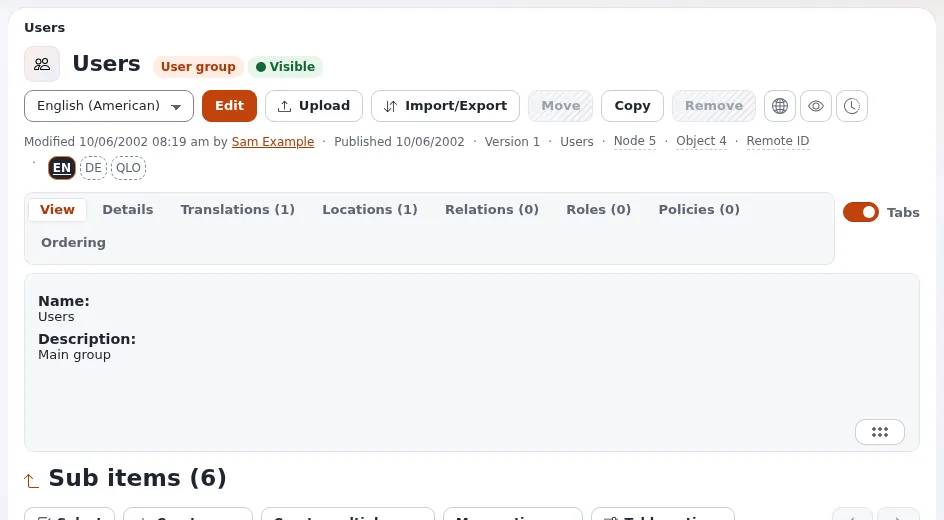

# Lektion 3.4: Testen, was ein Benutzer tun darf

Eine Rolle stimmt erst, wenn jemand sie ausprobiert hat. Der verlässliche Test: Melden Sie sich mit einem Testkonto
an, das die Rolle hat, erledigen Sie die Arbeit, für die die Rolle gedacht ist, und probieren Sie auch aus, was sie
nicht erlauben soll. Diese Lektion vermittelt diese Routine und zeigt, wie Sie ablesen, warum ein Zugriff verweigert
wird.

## Auf einen Blick

| | |
|---|---|
| Kurs | [Website-Administration](../README.md) |
| Modul | [Modul 3: Rollen und Richtlinien](README.md) |
| Dauer | 35 Minuten (10 Präsentation, 25 Übung) |
| Niveau | Fortgeschrittene |
| Zielgruppe | Website-Administratoren |
| Voraussetzungen | [Lektion 3.3](rollen-zuweisen.md): `News editors` ist `Training team` zugewiesen, eingeschränkt auf den Teilbaum `News` |

## Lernziele

Nach dieser Lektion können die Teilnehmenden:

- eine Rolle mit einem eigens dafür angelegten Testkonto in einem privaten Browserfenster testen;
- die Reiter **Rollen** und **Richtlinien** eines Benutzers lesen, um zu sehen, was er hat und woher es stammt;
- die typischen Symptome einer fehlenden Richtlinie erkennen (keine Anmeldung, fehlende Menüs, *Zugriff verweigert*);
- eine Rolle korrigieren und erneut testen.

## Hinweise für Trainer

### So präsentieren Sie es

Quelle: [Rollen, Richtlinien und nicht aktivierte Benutzer](../../../../anleitungen/rollen-und-richtlinien.md) und
[Konten und Anmeldung](../../../konten-und-anmeldung.md).

1. **Die Routine** (3 Minuten). Ein Testkonto pro Rolle, in einer Gruppe, die nur diese Rolle hat, mit einer Adresse
   unter `example.invalid`. Melden Sie sich in einem privaten Fenster an, damit die Administratorsitzung offen bleibt.
   Probieren Sie drei Dinge aus, die das Konto tun soll, und zwei, die es nicht tun soll.
2. **Ablesen, was ein Benutzer hat** (3 Minuten). Auf der Seite des Benutzers listet der Reiter **Rollen** die Rollen
   des Benutzers und der Gruppen über ihm auf, mit Einschränkungen; der Reiter **Richtlinien** listet die Richtlinien,
   die sie vergeben.
3. **Symptome** (4 Minuten):

   | Symptom | Übliche Ursache |
   |---|---|
   | Die Anmeldung an der Administration wird abgelehnt | kein `user/login` für diesen Siteaccess |
   | Angemeldet, aber ein Eintrag im oberen Menü fehlt | keine Richtlinie für dieses Modul |
   | **Neu erstellen** bietet eine Klasse nicht an | `content/create` fehlt diese Klasse, oder das übergeordnete Element liegt außerhalb der Einschränkung |
   | *Zugriff verweigert* auf einer Seite | das Modul oder die Funktion ist dort nicht gewährt |

### Häufige Fragen

**Kann ich einfach ohne sein Passwort zu einem anderen Benutzer wechseln?** Nicht in der Standard-Administration.
Verwenden Sie ein Testkonto, das Sie dafür angelegt haben.

**Der Benutzer sollte Zugriff haben, hat ihn aber nicht, und die Rolle sieht richtig aus.** Prüfen Sie die
Einschränkung der Zuweisung (Teilbaum oder Sektion), die Sektion der Inhalte (Modul 4) und ob der Benutzer wirklich in
der Gruppe ist: seinen Reiter **Orte**.

**Wirken geänderte Rollen sofort?** Ja, nach **Speichern**. Ein angemeldeter Benutzer muss die Seite eventuell neu
laden.

### Stolperfallen

- **Als Administrator testen.** Voller Zugriff verdeckt jeden Fehler. Testen Sie immer mit dem Testkonto.
- **Testkonten in mehreren Gruppen.** Zusätzliche Rollen aus einer anderen Gruppe verdecken das Problem. Halten Sie
  Testkonten in nur einer Gruppe, oder lesen Sie zuerst ihren Reiter **Rollen**.
- **Testkonten auf einer Live-Website aktiv lassen.** Deaktivieren Sie sie nach dem Test (Lektion 2.4).

## Praktische Übung

Auf Ihrer Schulungsinstallation, als Administrator angemeldet:

1. Legen Sie einen Benutzer `nina.news` mit der Adresse `nina.news@example.invalid` nur in der Gruppe `Training team`
   an.
2. Öffnen Sie `nina.news` und lesen Sie die Reiter **Rollen** und **Richtlinien**.
3. Melden Sie sich in einem privaten Browserfenster als `nina.news` an der Administration (`/admin`) an. Notieren Sie,
   was geschieht.
4. Wird die Anmeldung abgelehnt: Prüfen Sie zurück als Administrator, dass `News editors` die Richtlinie `user` /
   `login` für den Siteaccess `admin` hat (Lektion 3.2, Schritt 7). Korrigieren Sie die Rolle bei Bedarf und
   speichern Sie.
5. Notieren Sie, als `nina.news` angemeldet, welche Einträge im oberen Menü sichtbar sind.
6. Öffnen Sie den Ordner `News` und erstellen Sie darin einen **Article**. Veröffentlichen Sie ihn.
7. Versuchen Sie, einen Artikel in einem anderen Ordner außerhalb von `News` zu erstellen. Notieren Sie, was
   geschieht.
8. Versuchen Sie, einen Artikel zu bearbeiten, den jemand anderes erstellt hat. Notieren Sie, was geschieht.
9. Schreiben Sie als Administrator für die Schritte 6 bis 8 auf, welche Richtlinie die jeweilige Aktion erlaubt oder
   verweigert hat.
10. Melden Sie sich im privaten Fenster ab.

## Erwartetes Ergebnis

- `nina.news` kann sich anmelden, sobald `user/login` den Siteaccess `admin` abdeckt.
- Der Artikel in `News` wird erstellt und veröffentlicht; außerhalb von `News` bietet der Ordner kein
  **Neu erstellen** für Artikel an, oder die Aktion wird verweigert.
- Das Bearbeiten des Artikels eines anderen Benutzers wird verweigert, wenn die Richtlinie `content/edit` auf den
  Eigentümer *Self* eingeschränkt war.
- Der Trainer prüft die Liste einer Person aus Schritt 9.

## Quiz

1. Warum testen Sie mit einem eigenen Testkonto und nicht mit dem Administratorkonto?
2. Ein Testbenutzer kann sich nicht an der Administration anmelden. Welche Richtlinie fehlt am wahrscheinlichsten?
   A. `content/read` B. `user/login` für diesen Siteaccess C. `setup/system_info` D. `role/assign`
3. Wo sehen Sie alle Richtlinien, die ein Benutzer hat?
4. Die Rolle sieht richtig aus, aber der Benutzer kann trotzdem nicht bearbeiten. Nennen Sie zwei weitere Dinge, die
   Sie prüfen.
5. Richtig oder falsch: Eine gespeicherte Änderung an einer Rolle gilt erst nach der nächsten Anmeldung des Benutzers.

Antworten

1. Voller Zugriff verdeckt jede fehlende oder falsche Richtlinie.
2. **B.** Ohne `user/login` auf diesem Siteaccess wird die Anmeldung abgelehnt.
3. Im Reiter **Richtlinien** des Benutzers (und im Reiter **Rollen**, um zu sehen, woher sie stammen).
4. Die Einschränkung der Zuweisung, die Sektion oder den Ort der Inhalte, die Gruppen des Benutzers (seinen Reiter
   **Orte**).
5. **Falsch.** Sie gilt sofort nach **Speichern**; laden Sie die Seite neu.

## Weiterführende Literatur

- [Rollen, Richtlinien und nicht aktivierte Benutzer](../../../../anleitungen/rollen-und-richtlinien.md): Der Abschnitt zu
  Problemen nennt weitere Symptome.
- [Berechtigungsprüfungen für Benutzer mit vielen Rollenzuweisungen](../../../../funktionen/6.0/berechtigungspruefung-bei-vielen-zuweisungen.md):
  große Websites.
- [Konten und Anmeldung](../../../konten-und-anmeldung.md): was ein Benutzer bei der Anmeldung sieht.

## Verwandte Seiten

- [Modul 3: Rollen und Richtlinien](README.md)
- [Website-Administration: Kursüberblick](../README.md)
- [Trainer: hier beginnen](../../trainer-hier-beginnen.md)
- [Freie Dokumentation](../../../freie-dokumentation.md): Diese Seite darf unter der GNU FDL 1.3 frei kopiert, übersetzt und verbessert werden.

<!-- exp-partner-block:start -->
**Werden Sie Exponential-Partner.** Partner teilen ihre Informationen, stellen Mittel bereit, geben Beiträge zurück
und entwickeln die Produkte mit uns, und so wächst Exponential. Eine Partner-Website und ein Dashboard sind für Mitte
2027 geplant: Werden Sie noch heute Partner, damit wir schneller wachsen und neue Funktionen früher liefern. Beginnen
Sie mit [Partner: hier beginnen](../../../partner/partner-hier-beginnen.md) und
[Wie Sie sich bewerben](../../../partner/wie-sie-sich-bewerben.md).
<!-- exp-partner-block:end -->
