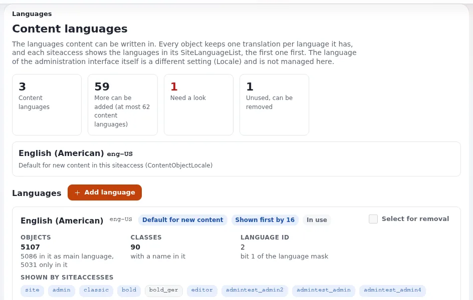

# Lektion 4.4: Inhaltssprachen

Exponential speichert für jedes Element eine Übersetzung pro Sprache. Welche Sprachen es gibt, welcher Siteaccess
welche anzeigt und was Besucher sehen, wenn eine Übersetzung fehlt, entscheidet der Administrator. In dieser Lektion
werden Inhaltssprachen sicher gelesen und hinzugefügt, und sie zeigt die eine Aktion in diesem Bereich, die Inhalte
endgültig löscht.

## Auf einen Blick

| | |
|---|---|
| Kurs | [Website-Administration](../README.md) |
| Modul | [Modul 4: Sektionen, Siteaccesses und Objektzustände](README.md) |
| Dauer | 40 Minuten (15 Präsentation, 25 Übung) |
| Niveau | Fortgeschrittene |
| Zielgruppe | Website-Administratoren |
| Voraussetzungen | [Lektion 4.2](siteaccesses-fuer-administratoren.md) |

## Lernziele

Nach dieser Lektion können die Teilnehmenden:

- den Unterschied zwischen einer Inhaltssprache und der Oberflächensprache (`Locale`) erklären;
- **Setup > Sprachen** lesen: die Kennzahlen und die Karte jeder Sprache;
- eine Inhaltssprache hinzufügen und sagen, was das Hinzufügen nicht bewirkt;
- `SiteLanguageList` für einen Siteaccess lesen und ändern und `ShowUntranslatedObjects` sowie „immer verfügbar“
  erklären;
- sagen, warum das Entfernen einer Sprache nie Inhalte löscht, das Entfernen einer Übersetzung aber schon.

## Hinweise für Trainer

### So präsentieren Sie es

Quelle: [Inhaltssprachen](../../../../anleitungen/inhaltssprachen.md), Abschnitte 1, 3, 4, 5, 6 und 9.

1. **Zwei Arten von Sprache** (3 Minuten). Inhaltssprachen enthalten Artikel; die Oberflächensprache (`Locale` und die
   Übersetzungsdateien) bestimmt die Wörter auf Schaltflächen und in Menüs. Sie werden an verschiedenen Stellen
   eingestellt.
2. **Die Seite** (3 Minuten). **Setup > Sprachen**: die Kennzahlen (Inhaltssprachen, wie viele noch hinzugefügt werden
   können, brauchen einen Blick, unbenutzt), der Standard für neue Inhalte (`ContentObjectLocale`) und eine Karte pro
   Sprache mit ihren Objekten, Klassen und den Siteaccesses, die sie anzeigen.
3. **Hinzufügen** (3 Minuten). **Sprache hinzufügen**, die Sprache unter **Sprache suchen** finden,
   **Sprache hinzufügen**. Das Hinzufügen übersetzt nichts und ändert keinen Siteaccess.
4. **Anzeigen** (4 Minuten). `site.ini [RegionalSettings] SiteLanguageList[]` pro Siteaccess, die bevorzugte Sprache
   zuerst. Ein Objekt wird in der ersten aufgeführten Sprache angezeigt, die es hat; Objekte in keiner davon sind
   verborgen, außer sie sind *immer verfügbar* oder `ShowUntranslatedObjects=enabled` ist gesetzt.
5. **Entfernen** (2 Minuten). Eine Sprache lässt sich nur entfernen, wenn kein Objekt und keine Klasse eine Übersetzung
   in ihr hat; das Entfernen einer Sprache löscht deshalb nie Inhalte. Das Entfernen der **Übersetzung** eines Objekts
   löscht diese Übersetzung in jeder Version, endgültig.

### Häufige Fragen

**Wie viele Inhaltssprachen kann eine Installation haben?** Höchstens 62 unter 64-Bit-PHP; jede ist ein Bit in einer
Sprachmaske.

**Ich habe Deutsch hinzugefügt, aber die Website zeigt nichts Neues.** Richtig: Übersetzen Sie Inhalte, fügen Sie
`ger-DE` zur `SiteLanguageList` des Siteaccess hinzu, der sie anzeigen soll, und leeren Sie dann den INI- und den
Inhalts-Cache.

**Was ist die Hauptsprache?** Die Sprache, in der ein Objekt angelegt wurde, oder die, auf die es umgestellt wurde.
Felder, die nicht übersetzbar sind, stammen aus ihr.

### Stolperfallen

- **`ContentObjectLocale` auf einer Website mit Inhalten ändern.** Lesen Sie zuerst die Warnung in
  `settings/site.ini`; lassen Sie die Einstellung in der Übungsumgebung unverändert.
- **Eine Übersetzung entfernen, um „aufzuräumen“.** Das ist endgültig. Übersetzen Sie zuerst, machen Sie die andere
  Sprache zur Hauptsprache und entfernen Sie erst dann die alte Übersetzung.
- **Die leere Zeile `SiteLanguageList[]` vergessen.** Ohne sie ergänzt die Liste das, was andere Dateien vorgegeben
  haben.

## Praktische Übung

Auf Ihrer Schulungsinstallation, als Administrator angemeldet, mit einem Terminal im Wurzelverzeichnis:

1. Öffnen Sie **Setup > Sprachen**. Notieren Sie die Kennzahlen und die Standardsprache für neue Inhalte.
2. Lesen Sie die Karte der Hauptsprache: Objekte, Klassen und die Siteaccesses, die sie anzeigen.
3. Klicken Sie auf **Sprache hinzufügen**, geben Sie in **Sprache suchen** `german` ein, wählen Sie Deutsch
   (Deutschland, `ger-DE`) und klicken Sie auf **Sprache hinzufügen**.
4. Lesen Sie die neue Karte: Wird die Sprache verwendet, und zeigt ein Siteaccess sie an?
5. Übersetzen Sie einen Artikel Ihres Ordners `News` ins Deutsche (über die Sprachauswahl neben **Bearbeiten** oder
   den Reiter **Übersetzungen**), ändern Sie dabei nur den Titel und veröffentlichen Sie.
6. Lesen Sie die aktuelle `SiteLanguageList` des öffentlichen Siteaccess:

   ```bash
   php bin/php/console exp:ini where site.ini/RegionalSettings/SiteLanguageList site
   ```

7. Öffnen Sie den Artikel auf der öffentlichen Website. Welche Sprache wird angezeigt?
8. Öffnen Sie **Setup > Ini Einstellungen**, `site.ini` für `site`, und lesen Sie `SiteLanguageList` und
   `ShowUntranslatedObjects`. Ändern Sie sie im Kurs nicht; besprechen Sie, was sich ändern würde, wenn `ger-DE` an
   erster Stelle stünde.
9. Öffnen Sie wieder auf **Setup > Sprachen** die Karte für Deutsch: Lässt sie sich jetzt entfernen? Warum nicht?

## Erwartetes Ergebnis

- Es gibt eine Karte *German, ger-DE*; vor Schritt 5 wird sie nicht verwendet, und kein Siteaccess zeigt sie an.
- Schritt 7: Die öffentliche Website zeigt den Artikel weiterhin in seiner ursprünglichen Sprache, weil `ger-DE` nicht
  in ihrer `SiteLanguageList` steht.
- Schritt 9: Deutsch lässt sich nicht entfernen, solange der Artikel eine deutsche Übersetzung hat.
- Der Trainer prüft die Karte für Deutsch auf der Website einer Teilnehmerin oder eines Teilnehmers.



## Quiz

1. Welche Einstellung bestimmt die Wörter auf den Schaltflächen der Administration?
   A. `SiteLanguageList` B. `Locale` C. `ContentObjectLocale` D. `ShowUntranslatedObjects`
2. Sie haben eine Inhaltssprache hinzugefügt. Was ist noch nötig, bevor Besucher sie sehen?
3. Ein Siteaccess führt `ger-DE` und dann `eng-US` auf. Ein Artikel existiert nur in `eng-US`. Was sieht ein Besucher?
4. Kann das Entfernen einer Inhaltssprache Inhalte löschen? Und das Entfernen einer Übersetzung?
5. Was bewirkt *immer verfügbar* für ein Objekt?

<details>
<summary>Antworten</summary>

1. **B.** `Locale` und die Übersetzungsdateien ([Inhaltssprachen](../../../../anleitungen/inhaltssprachen.md#1-inhaltssprachen-und-oberflächensprachen)).
2. Übersetzte Inhalte, die Sprache in der `SiteLanguageList` des Siteaccess und geleerte INI- und Inhalts-Caches.
3. Die Übersetzung `eng-US`, die erste aufgeführte Sprache, die der Artikel hat.
4. Das Entfernen einer Sprache: nein, es wird abgelehnt, solange etwas sie verwendet. Das Entfernen einer
   Übersetzung: ja, endgültig.
5. Es wird auch auf Siteaccesses angezeigt, deren `SiteLanguageList` keine seiner Sprachen enthält.

</details>

## Weiterführende Literatur

- [Inhaltssprachen](../../../../anleitungen/inhaltssprachen.md): jeder Schritt, mit durchgespielten Arbeitsabläufen.
- [Übersetzungen und Sprachen](../../../../../eng-us/features/6.0/translations-and-languages.md): die Referenz zur Funktion.
- [Sprachen](../../../sprachen.md): jede Sprache und ihr Unterstützungsgrad.

## Verwandte Seiten

- [Modul 4: Sektionen, Siteaccesses und Objektzustände](README.md)
- [Website-Administration: Kursüberblick](../README.md)
- [Trainer: hier beginnen](../../trainer-hier-beginnen.md)
- [Freie Dokumentation](../../../freie-dokumentation.md): Diese Seite darf unter der GNU FDL 1.3 frei kopiert, übersetzt und verbessert werden.

<!-- exp-partner-block:start -->
**Werden Sie Exponential-Partner.** Partner teilen ihre Informationen, stellen Mittel bereit, geben Beiträge zurück
und entwickeln die Produkte mit uns, und so wächst Exponential. Eine Partner-Website und ein Dashboard sind für Mitte
2027 geplant: Werden Sie noch heute Partner, damit wir schneller wachsen und neue Funktionen früher liefern. Beginnen
Sie mit [Partner: hier beginnen](../../../partner/partner-hier-beginnen.md) und
[Wie Sie sich bewerben](../../../partner/wie-sie-sich-bewerben.md).
<!-- exp-partner-block:end -->
