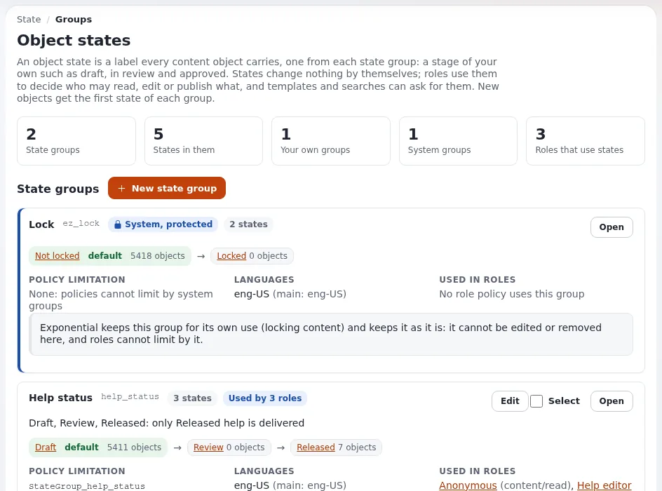

# Lektion 4.3: Objektzustände

Ein Objektzustand ist eine Markierung, die jedes Inhaltsobjekt trägt, eine aus jeder Zustandsgruppe: ein Stadium, das
Sie selbst festlegen, etwa Entwurf, In Prüfung und Freigegeben. Zustände bewirken für sich genommen nichts; erst Rollen
geben ihnen Bedeutung. Diese Lektion baut das kleinste sinnvolle Beispiel: eine Prüfgruppe und Besucher, die nur
freigegebene Inhalte sehen.

## Auf einen Blick

| | |
|---|---|
| Kurs | [Website-Administration](../README.md) |
| Modul | [Modul 4: Sektionen, Siteaccesses und Objektzustände](README.md) |
| Dauer | 45 Minuten (15 Präsentation, 30 Übung) |
| Niveau | Experten |
| Zielgruppe | Website-Administratoren |
| Voraussetzungen | [Lektion 4.1](sektionen.md); [Modul 3](../modul-03-rollen-und-richtlinien/README.md) |

## Lernziele

Nach dieser Lektion können die Teilnehmenden:

- **Setup > Zustände** lesen und Gruppen, Zustände und den Standardzustand erklären;
- eine Zustandsgruppe und ihre Zustände in der richtigen Reihenfolge anlegen;
- auf dem Reiter **Details** einen Zustand für ein Objekt und für einen Teilbaum setzen;
- eine Richtlinie mit `StateGroup_<identifier>` einschränken und das Setzen von Zuständen mit `NewState` erlauben;
- erklären, warum die Systemgruppe `ez_lock` weder bearbeitet noch in Richtlinien verwendet werden kann.

## Hinweise für Trainer

### So präsentieren Sie es

Quelle: [Objektzustände](../../../../anleitungen/objektzustaende.md), Abschnitte 1 bis 4, 7, 8 und 9.

1. **Die Idee** (3 Minuten). Sektionen gruppieren Inhalte nach Bereich, Zustände gruppieren Inhalte nach Stadium. Eine
   Richtlinie kann beides verwenden.
2. **Die Seite** (3 Minuten). **Setup > Zustände** (erfordert `state/administrate`): Kennzahlen, dann eine Karte pro
   Gruppe mit ihren Zuständen als Kette, `default` am ersten, den Objekten in jedem Zustand, der
   Richtlinieneinschränkung und den Rollen, die sie verwenden. Die mitgelieferte Gruppe **Lock** (`ez_lock`, Not
   locked und Locked) ist *System, geschützt*.
3. **Der Standard** (2 Minuten). Der erste Zustand einer Gruppe ist der Standard für neue Objekte; der erste Zustand,
   der in einer neuen Gruppe angelegt wird, wird jedem bestehenden Objekt zugewiesen. Legen Sie die Zustände also der
   Reihe nach an, und setzen Sie bestehende öffentliche Inhalte auf den Zustand „freigegeben“, **bevor** Sie Besucher
   darauf beschränken.
4. **Wirkung geben** (5 Minuten). `StateGroup_review` an `content/read`, `content/edit` und anderen: Die Richtlinie
   gilt nur für Objekte in den gewählten Zuständen. `NewState` an `state/assign`: welche Zustände ein Benutzer setzen
   darf.
5. **Zustände setzen** (2 Minuten). Reiter **Details** des Knotens, Kasten **Zustand des Objekts**, eine Auswahl pro
   Gruppe, **Zustände einstellen**; setzen Sie für einen Teilbaum das Häkchen bei
   **Auch für alles unterhalb dieses Knotens**. Es entsteht keine neue Version.

### Häufige Fragen

**Ersetzen Zustände Workflows?** Nein. Zustände sind Markierungen mit Berechtigungen; Workflows ([Modul 6](../modul-06-cronjobs-workflows-und-benachrichtigungen/README.md)) führen bei
Ereignissen Aktionen aus und können auf eine Zustandsänderung reagieren.

**Kann ich die Namen von Zuständen übersetzen?** Ja, jede Gruppe und jeder Zustand hat pro Sprache einen Namen und
eine Beschreibung.

**Was passiert mit Objekten, wenn ich einen Zustand entferne?** Sie wechseln in den ersten verbleibenden Zustand; die
Seite sagt vor der Bestätigung, was betroffen ist.

### Stolperfallen

- **Die ganze Website verbergen.** Wer der Rolle Anonymous `StateGroup_review = Approved` hinzufügt, bevor die
  bestehenden Inhalte auf Approved gesetzt sind, verbirgt alles vor den Besuchern. Halten Sie die Reihenfolge der
  Übung ein.
- **Bezeichner, die mit `ez` beginnen.** Sie sind reserviert; das Formular lehnt sie ab.
- **Große Teilbäume.** Zustände für einen großen Teilbaum zu setzen wird zu einem Inhaltsauftrag; in der
  Übungsumgebung läuft er sofort.

## Praktische Übung

Auf Ihrer Schulungsinstallation, als Administrator angemeldet, mit einem privaten Fenster zum Testen:

1. Öffnen Sie **Setup > Zustände**. Lesen Sie die Karte der Gruppe **Lock**.
2. Klicken Sie auf **Neue Zustandsgruppe**. **Bezeichner**: `review`; Name `Review`; eine einzeilige Beschreibung.
   Klicken Sie auf **Erstellen**.
3. Klicken Sie auf der Seite der Gruppe auf **Neuer Zustand** und legen Sie in dieser Reihenfolge an: `draft`
   (Draft), `in_review` (In review), `approved` (Approved).
4. Lesen Sie wieder auf **Setup > Zustände** die Kette der neuen Gruppe und wie viele Objekte in jedem Zustand sind.
5. Öffnen Sie den obersten Knoten der öffentlichen Website, den Reiter **Details**, Kasten **Zustand des Objekts**.
   Wählen Sie für **Review** den Zustand **Approved**, setzen Sie das Häkchen bei
   **Auch für alles unterhalb dieses Knotens** und klicken Sie auf **Zustände einstellen**.
6. Legen Sie im Ordner `News` einen neuen Artikel `Waiting article` an. Prüfen Sie seinen Zustand auf dem Reiter
   **Details**.
7. Öffnen Sie die Rolle **Anonymous**, **Bearbeiten**, und ändern Sie ihre Richtlinie `content` / `read` für die
   Sektion Standard: Fügen Sie die Einschränkung `StateGroup_review` mit dem Wert **Approved** hinzu. **Speichern**.
8. Leeren Sie den Inhalts-Cache und öffnen Sie dann im privaten Fenster den Ordner `News`. Wird `Waiting article`
   aufgeführt?
9. Setzen Sie als Administrator `Waiting article` auf dem Reiter **Details** auf **Approved**. Laden Sie das private
   Fenster neu.
10. Öffnen Sie auf **Setup > Zustände** die Gruppe **Review** und lesen Sie **Rollen, die diese Gruppe verwenden**.
11. Machen Sie Schritt 7 rückgängig: Entfernen Sie die Einschränkung `StateGroup_review` aus der Richtlinie von
    Anonymous und klicken Sie auf **Speichern**.

## Erwartetes Ergebnis

- Die Gruppe **Review** hat drei Zustände, **Draft** ist als Standard gekennzeichnet.
- Schritt 6: Der neue Artikel ist im Zustand **Draft**.
- Schritt 8: Der Artikel ist vor Besuchern verborgen; nach Schritt 9 erscheint er.
- Schritt 10 listet die Rolle **Anonymous** mit ihrer Richtlinie `content/read`.
- Der Trainer prüft die Karte der Gruppe und das private Fenster auf der Website einer Teilnehmerin oder eines
  Teilnehmers.

## Quiz

1. Welchen Zustand bekommt ein neues Objekt in einer Gruppe?
   A. Den letzten B. Den ersten C. Keinen D. Immer den, den der Redakteur im Bearbeitungsformular wählt
2. Warum setzt man bestehende Inhalte auf Approved, bevor man Besucher auf Approved beschränkt?
3. Was entscheidet die Einschränkung `NewState`?
4. Kann eine Richtlinie über die Gruppe `ez_lock` eingeschränkt werden?
5. Erzeugt das Setzen eines Zustands eine neue Version des Objekts?

Antworten

1. **B.** Der erste Zustand jeder Gruppe ist ihr Standard ([Objektzustände](../../../../anleitungen/objektzustaende.md#kurz-gesagt)).
2. Sonst sind alle bestehenden Inhalte im Standardzustand Draft und verschwinden für Besucher.
3. Welche Zustände ein Benutzer mit `state/assign` setzen darf.
4. Nein. Gruppen, die mit `ez` beginnen, sind Systemgruppen; Richtlinien können nicht nach ihnen eingeschränkt werden.
5. Nein. Das Objekt wird sofort mit dem neuen Zustand gespeichert, ohne neue Version.

## Weiterführende Literatur

- [Objektzustände](../../../../anleitungen/objektzustaende.md): die vollständige Anleitung mit dem ganzen Prüf-Workflow.
- [Inhaltsaufträge](../../../../../eng-us/features/6.0/content-jobs.md): Zustände für große Teilbäume.
- [Sektionen](../../../../anleitungen/sektionen.md): der andere Weg, Inhalte für Berechtigungen zu gruppieren.

## Verwandte Seiten

- [Modul 4: Sektionen, Siteaccesses und Objektzustände](README.md)
- [Website-Administration: Kursüberblick](../README.md)
- [Trainer: hier beginnen](../../trainer-hier-beginnen.md)
- [Freie Dokumentation](../../../freie-dokumentation.md): Diese Seite darf unter der GNU FDL 1.3 frei kopiert, übersetzt und verbessert werden.

<!-- exp-partner-block:start -->
**Werden Sie Exponential-Partner.** Partner teilen ihre Informationen, stellen Mittel bereit, geben Beiträge
zurück und entwickeln die Produkte gemeinsam mit uns weiter, und so wächst Exponential. Eine Partner-Website und
ein Partner-Dashboard sind für Mitte 2027 geplant: Werden Sie noch heute Partner, damit wir schneller wachsen und
neue Funktionen früher bereitstellen können. Beginnen Sie mit [Partner: hier beginnen](../../../partner/partner-hier-beginnen.md) und
[Wie Sie sich bewerben](../../../partner/wie-sie-sich-bewerben.md).
<!-- exp-partner-block:end -->
