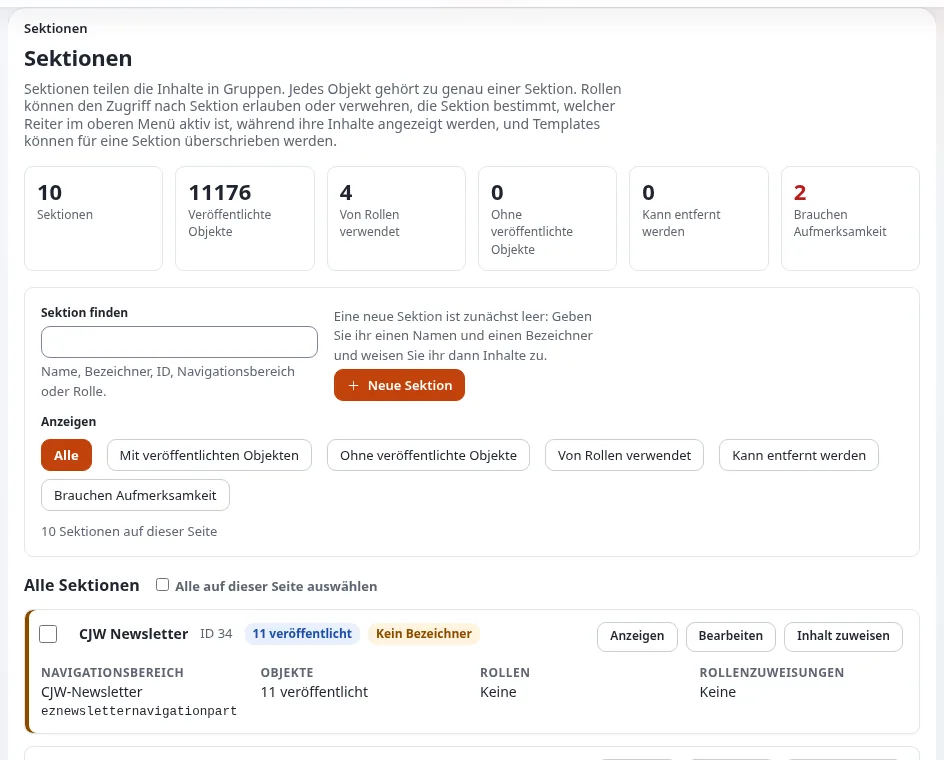

# Lektion 4.1: Sektionen

Eine Sektion ist eine benannte Gruppe von Inhaltsobjekten. Jedes Objekt gehört zu genau einer, und Rollen, das obere
Menü der Administration und Designs können alle davon abhängen. Sektionen sind das wichtigste Werkzeug des
Administrators für „Dieser Teil der Website ist nur für Mitglieder“ oder „Dieses Team bearbeitet nur seine eigenen
Seiten“. In dieser Lektion entsteht ein Mitgliederbereich von Grund auf.

## Auf einen Blick

| | |
|---|---|
| Kurs | [Website-Administration](../README.md) |
| Modul | [Modul 4: Sektionen, Siteaccesses und Objektzustände](README.md) |
| Dauer | 45 Minuten (15 Präsentation, 30 Übung) |
| Niveau | Fortgeschrittene |
| Zielgruppe | Website-Administratoren |
| Voraussetzungen | [Modul 3](../modul-03-rollen-und-richtlinien/README.md): Rollen, Zuweisungen und Tests |

## Lernziele

Nach dieser Lektion können die Teilnehmenden:

- **Setup > Sektionen** lesen: die Kennzahlen, die Filter und die Karte jeder Sektion;
- erklären, was eine Sektion ist und was nicht (kein Ort im Baum, kein Siteaccess, kein Zustand);
- eine Sektion mit einem gültigen Bezeichner anlegen;
- mit **Inhalt zuweisen** einen Teilbaum in eine Sektion legen;
- einer Gruppe Lesezugriff auf eine Sektion geben und das als Besucher und als Mitglied testen.

## Hinweise für Trainer

### So präsentieren Sie es

Quelle: [Sektionen](../../../../anleitungen/sektionen.md), besonders die Abschnitte 1, 2, 5, 8.3, 9 und 13.1.

1. **Was eine Sektion ist** (4 Minuten). Ein Name, ein Bezeichner, eine ID und ein Navigationsbereich. Sie hat keinen
   Wurzelknoten und keine URL: Objekte einer Sektion können überall im Baum liegen. Ein Objekt mit zwei Orten hat eine
   Sektion.
2. **Die fünf Sektionen einer neuen Installation** (2 Minuten): Standard (1), Users (2), Media (3), Setup (4), Design
   (5). Anonymous darf nur Standard lesen; dadurch bleiben die Benutzer- und Medienordner vor Besuchern verborgen.
3. **Die Liste** (3 Minuten). **Setup > Sektionen**: die Kennzahlen der Übersicht (Sektionen, veröffentlichte
   Objekte, von Rollen verwendet, ohne veröffentlichte Objekte, kann entfernt werden, brauchen Aufmerksamkeit),
   **Sektion finden**, die Filter und eine Karte pro Sektion mit **Ansehen**, **Bearbeiten** und **Inhalt zuweisen**.
4. **Neue Inhalte und Verschiebungen** (3 Minuten). Neue Inhalte übernehmen die Sektion ihres Elternelements. Um
   bestehende Inhalte zu ändern, verwenden Sie **Inhalt zuweisen** in der Sektion; das ändert das gewählte Element und
   alles darunter, dessen Hauptort dort liegt.
5. **Entfernen** (3 Minuten). Eine Sektion lässt sich nur entfernen, wenn nichts sie verwendet: kein Objekt (Entwürfe
   eingeschlossen), keine Richtlinie und keine eingeschränkte Zuweisung. Die Seite nennt, was das Entfernen verhindert.

### Häufige Fragen

**Soll ich für Berechtigungen Sektionen oder Teilbäume verwenden?** Teilbäume folgen dem Baum; Sektionen folgen den
Objekten, wo immer sie liegen. Verwenden Sie eine Sektion, wenn Inhalte einer Art über den Baum verteilt sind oder
wenn dieselbe Teilbaumregel in vielen Rollen wiederholt würde.

**Besucher sehen Inhalte, die ich in den Mitgliederbereich verschoben habe, immer noch.** Eine zwischengespeicherte
Seite: Leeren Sie auch den statischen Cache und jeden HTTP-Cache. **Inhalt zuweisen** leert den Cache der
Inhaltsansichten selbst.

**Warum zeigen manche Sektionen „Brauchen Aufmerksamkeit“?** Meist ist es eine Sektion ohne Bezeichner, die Templates
und Einstellungen nicht benennen können.

### Stolperfallen

- **Inhalte verschwinden für Besucher.** Nach **Inhalt zuweisen** an eine neue Sektion verlieren Besucher den Zugriff,
  bis eine Richtlinie die Sektion erlaubt. Genau darum geht es in der Übung, aber auf einer Live-Website sollten Sie
  das planen.
- **Ungültige Bezeichner.** Der Bezeichner muss mit einem Buchstaben beginnen und darf nur Buchstaben, Ziffern und `_`
  enthalten. Das Formular füllt ihn aus dem Namen aus; lassen Sie die Teilnehmenden die Meldung einmal sehen.
- **Weitere Orte.** Objekte, deren Hauptort woanders liegt, behalten ihre alte Sektion.

## Praktische Übung

Auf Ihrer Schulungsinstallation, als Administrator angemeldet, mit einem privaten Fenster zum Testen:

1. Öffnen Sie **Setup > Sektionen**. Notieren Sie die Kennzahlen der Übersicht und die Sektionen mit ihren IDs.
2. Klicken Sie auf **Neue Sektion**. **Name**: `Members area`; prüfen Sie den ausgefüllten **Bezeichner**
   (`members_area`); lassen Sie als Navigationsbereich die Inhaltsstruktur stehen. Klicken Sie auf
   **Sektion anlegen**.
3. Legen Sie in der **Inhaltsstruktur** einen Ordner `Members` mit einem Artikel darin an.
4. Öffnen Sie im privaten Fenster, abgemeldet, den Ordner `Members` auf der öffentlichen Website. Stellen Sie fest,
   dass Sie ihn lesen können.
5. Klicken Sie auf der Karte `Members area` auf **Inhalt zuweisen**, wählen Sie den Ordner `Members` und klicken Sie
   auf **Auswählen**.
6. Laden Sie die Seite im privaten Fenster neu. Notieren Sie das Ergebnis.
7. Öffnen Sie **Benutzer > Rollen und Richtlinien**. Legen Sie eine Rolle `Members area readers` mit einer Richtlinie
   an: `content` / `read`, eingeschränkt auf die Sektion `Members area`. **Speichern**.
8. Weisen Sie die Rolle der Gruppe **Members** (oder `Training team`) zu.
9. Melden Sie sich im privaten Fenster auf der öffentlichen Website als `sam.sample` an (seit Lektion 2.2 Mitglied)
   und öffnen Sie `Members`.
10. Öffnen Sie wieder in **Setup > Sektionen** die Seite **Ansehen** der Karte `Members area`: Welche Rollen verwenden
    sie, und lässt sie sich entfernen?

## Erwartetes Ergebnis

- Schritt 6: Abgemeldet wird der Ordner verweigert (Zugriff verweigert oder nicht in den Menüs zu finden).
- Schritt 9: Als Mitglied angemeldet sind der Ordner und sein Artikel lesbar.
- Schritt 10: Die Seite der Sektion listet `Members area readers` und die Objekte; solange diese sie verwenden, lässt
  sie sich nicht entfernen.
- Der Trainer prüft das, indem er auf der Website einer Teilnehmerin oder eines Teilnehmers den Ordner `Members` in
  einem privaten Fenster öffnet.

## Quiz

1. Zu wie vielen Sektionen kann ein Objekt gehören?
2. Welche Sektion dürfen anonyme Besucher auf einer neuen Installation lesen?
3. Was ändert **Inhalt zuweisen**?
   A. Nur das gewählte Element B. Das gewählte Element und alles darunter, dessen Hauptort dort liegt C. Jeden Ort der
   Website D. Nur neue Inhalte
4. Nennen Sie die drei Dinge, die verhindern, dass eine Sektion entfernt wird.
5. Warum verschwand der Ordner nach Schritt 5 für Besucher?

Antworten

1. Zu genau einer ([Sektionen](../../../../anleitungen/sektionen.md#kurz-gesagt)).
2. Standard.
3. **B.** ([Inhalt zuweisen](../../../../anleitungen/sektionen.md#83-einem-teilbaum-inhalte-zuweisen-sectionassign)).
4. Objekte (auch Entwürfe und archivierte), Richtlinien mit einer Sektionseinschränkung, die sie nennt, und
   Rollenzuweisungen, die auf sie eingeschränkt sind.
5. Die Rolle Anonymous darf nur die Sektion Standard lesen, und der Ordner liegt jetzt in `Members area`.

## Weiterführende Literatur

- [Sektionen](../../../../anleitungen/sektionen.md): die vollständige Anleitung mit weiteren durchgerechneten Beispielen
  (Abteilungen im Intranet, Staging).
- [Inhaltsaufträge](../../../../funktionen/6.0/inhaltsauftraege.md): große Zuweisungen im Hintergrund.
- [Rollen, Richtlinien und nicht aktivierte Benutzer](../../../../anleitungen/rollen-und-richtlinien.md): Sektionseinschränkungen.

## Verwandte Seiten

- [Modul 4: Sektionen, Siteaccesses und Objektzustände](README.md)
- [Website-Administration: Kursüberblick](../README.md)
- [Trainer: hier beginnen](../../trainer-hier-beginnen.md)
- [Freie Dokumentation](../../../freie-dokumentation.md): Diese Seite darf unter der GNU FDL 1.3 frei kopiert, übersetzt und verbessert werden.

<!-- exp-partner-block:start -->
**Werden Sie Exponential-Partner.** Partner teilen ihre Informationen, stellen Mittel bereit, geben Beiträge zurück
und entwickeln die Produkte mit uns, und so wächst Exponential. Eine Partner-Website und ein Dashboard sind für Mitte
2027 geplant: Werden Sie noch heute Partner, damit wir schneller wachsen und neue Funktionen früher liefern. Beginnen
Sie mit [Partner: hier beginnen](../../../partner/partner-hier-beginnen.md) und
[Wie Sie sich bewerben](../../../partner/wie-sie-sich-bewerben.md).
<!-- exp-partner-block:end -->
