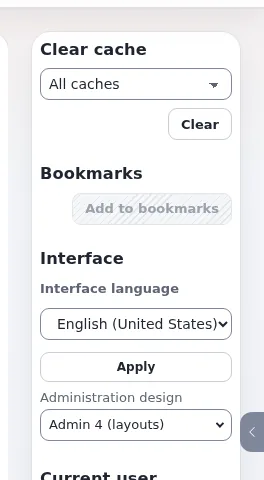

# Lektion 4.2: Siteaccesses für Administratoren

Besucher, Redakteure und Administratoren erreichen dieselbe Installation über verschiedene Siteaccesses: einen Namen,
ein Verzeichnis mit Einstellungen und eine Regel, die entscheidet, welche Anfragen er beantwortet. Ein Administrator
muss Siteaccesses nicht entwerfen, aber er muss sie lesen können: welche es gibt, wie eine Anfrage jeden davon
erreicht und welche Einstellungen sich unterscheiden. Diese Lektion vermittelt dieses Lesen; neue Websites aufzubauen
ist Thema des Kurses Multisite und Seitenpakete.

## Auf einen Blick

| | |
|---|---|
| Kurs | [Website-Administration](../README.md) |
| Modul | [Modul 4: Sektionen, Siteaccesses und Objektzustände](README.md) |
| Dauer | 40 Minuten (15 Präsentation, 25 Übung) |
| Niveau | Fortgeschrittene |
| Zielgruppe | Website-Administratoren |
| Voraussetzungen | [Lektion 1.4](../modul-01-orientierung/die-einstellungsseite.md) und [Lektion 1.5](../modul-01-orientierung/ini-dateien-und-exp-ini.md) |

## Lernziele

Nach dieser Lektion können die Teilnehmenden:

- die Siteaccesses aus `settings/siteaccess/` und aus `AvailableSiteAccessList[]` auflisten;
- `MatchOrder`, `DefaultAccess` und `RelatedSiteAccessList[]` erklären;
- den Teil **Siteaccesses** der **Systeminformationen** lesen: die Regel, die eine Anfrage zugeordnet hat, die
  Zuordnungstabelle und eine Karte pro Siteaccess;
- die Einstellungen zweier Siteaccesses vergleichen;
- die Einstellungen für die Host-Zuordnung und für die Weiterleitung auf die Sprache eines Besuchers nennen.

## Hinweise für Trainer

### So präsentieren Sie es

Quelle: [Systeminformationen, Siteaccesses](../../../../anleitungen/systeminformationen.md#5a-siteaccesses),
[10.2 Siteaccesses und Website-Adressen](../../../../installation/10-nach-der-installation.md#102-siteaccesses-und-adressen-der-site) und
[Siteaccess nach Host-Präfix und die Weiterleitung auf die Sprache](../../../../funktionen/6.0/siteaccess-zuordnung-nach-host-und-sprache.md).

1. **Die Definition** (3 Minuten). *Siteaccess = Name + Einstellungen in `settings/siteaccess/<name>/` + eine Regel.*
   Eine mit `exp:install` erstellte Installation hat `site`, `admin` und `editor`.
2. **Die Liste und die Regeln** (5 Minuten). In `site.ini [SiteAccessSettings]`: `AvailableSiteAccessList[]` (welche
   antworten dürfen), `RelatedSiteAccessList[]` (welche sich die Datenbank teilen), `MatchOrder` (die Reihenfolge der
   Regeln, zum Beispiel `uri;host;port`). `[SiteSettings] DefaultAccess` antwortet, wenn keine Regel passt.
3. **Im Browser lesen** (4 Minuten). **Setup > Systeminformationen**, Teil **Siteaccesses**: *Diese Anfrage*, die
   *Zuordnungstabelle* (Regeln von oben, der erste Treffer entscheidet, der Standard zuletzt) und *Alle Siteaccesses*
   mit Art, Design, Sprachen und den Einträgen, die zu ihm führen. **Öffnen** öffnet einen Siteaccess dort, wo ein
   Besucher ihn finden würde.
4. **Hosts und Sprachen** (3 Minuten). Bei der Host-Zuordnung lässt `HostMatchMethod` (`strict`, `start`, `end`,
   `part`) Test-Hosts den Live-Siteaccess erreichen; `DefaultHostUriMatchMapItems[]` leitet `/` auf die Sprache des
   Besuchers weiter (`/ger`, `/eng`). Beides ist aus, solange es nicht gesetzt ist.

### Häufige Fragen

**Ist ein Siteaccess eine Website?** Nein. Eine Website kann mehrere Siteaccesses haben (einen pro Sprache), und die
Administration und der Redaktionszugang sind Siteaccesses, ohne Websites zu sein.

**Warum kann die Anmeldung als Administrator auf einem Siteaccess fehlschlagen und auf einem anderen funktionieren?**
Richtlinien für `user/login` werden nach SiteAccess eingeschränkt (Lektion 3.4).

**Warum gibt es in der Kopfzeile „Website oder einen anderen Siteaccess öffnen“?** Damit öffnen Sie die öffentliche
Website oder einen anderen Siteaccess unter der Adresse, die ihm die Zuordnungsregeln geben.

### Stolperfallen

- **Die Zuordnung auf einer Live-Website ändern.** Ein falsches `MatchOrder` oder eine falsche Host-Tabelle kann
  Besucher in die Administration oder ins Nichts schicken. Ändern Sie sie im Kurs nie außer in der Übungsumgebung, und
  immer mit einer zweiten offenen Sitzung.
- **Das falsche Verzeichnis bearbeiten.** `settings/siteaccess/admin` ist die Administration; eine Änderung dort für
  die öffentliche Website wirkt nicht dort, wo man es erwartet. Prüfen Sie es mit `exp:ini where`.

## Praktische Übung

Auf Ihrer Schulungsinstallation, als Administrator angemeldet, mit einem Terminal im Wurzelverzeichnis:

1. Listen Sie die Verzeichnisse der Siteaccesses auf:

   ```bash
   ls settings/siteaccess/
   ```

2. Lesen Sie die Liste und die Regeln:

   ```bash
   php bin/php/console exp:ini get site.ini/SiteAccessSettings/AvailableSiteAccessList
   php bin/php/console exp:ini get site.ini/SiteAccessSettings/MatchOrder
   php bin/php/console exp:ini get site.ini/SiteSettings/DefaultAccess
   ```

3. Öffnen Sie **Setup > Systeminformationen** und den eingeklappten Teil **Siteaccesses**. Notieren Sie die Regel, die
   diese Seite zugeordnet hat.
4. Lesen Sie die Zuordnungstabelle. Welcher Eintrag führt zu `editor`?
5. Lesen Sie die Karte von `site`: ihr Design, ihre Sprachen und ob sie eine Anmeldung verlangt.
6. Klicken Sie auf der Karte von `editor` auf **Öffnen**. Notieren Sie die Adresse, die sich öffnet.
7. Öffnen Sie **Setup > Ini Einstellungen**, `site.ini` für `site`, und vergleichen Sie sie mit `admin`
   (**Mit Siteaccess vergleichen**). Notieren Sie zwei Unterschiede in `[SiteSettings]` oder `[DesignSettings]`.
8. Verwenden Sie die Schaltfläche **Website oder einen anderen Siteaccess öffnen** in der Kopfzeile und wählen Sie die
   öffentliche Website.
9. Lesen Sie auf der unten verlinkten Funktionsseite den Abschnitt über die Host-Tabelle nach dem Anfang eines Hosts
   und schreiben Sie die Zeile auf, mit der `www.example.com.test.local` den Siteaccess von `www.example.com`
   erreichen würde. Speichern Sie sie nicht.

## Erwartetes Ergebnis

- Schritt 1 listet mindestens `site`, `admin` und `editor`.
- Schritt 3 nennt bei einer Übungsumgebung mit URL-Zuordnung die Regel nach URI-Element für `admin`.
- Schritt 6 öffnet `/editor` unter der Adresse der Übungsumgebung.
- Schritt 9: `HostMatchMethod=start` (oder der Eintrag `HostMatchMapItems[]=www.example.com;site;start`).
- Der Trainer prüft das, indem er eine Teilnehmerin oder einen Teilnehmer die Zuordnungstabelle laut erklären lässt.



## Quiz

1. Aus welchen drei Teilen besteht ein Siteaccess?
2. Welche Einstellung antwortet, wenn keine Zuordnungsregel zu einer Anfrage passt?
   A. `MatchOrder` B. `DefaultAccess` C. `RelatedSiteAccessList[]` D. `SiteURL`
3. Was bedeutet `RelatedSiteAccessList[]`?
4. Wo in der Administration sehen Sie, welche Regel die aktuelle Anfrage zugeordnet hat?
5. Was ändert `HostMatchMethod=start`?

<details>
<summary>Antworten</summary>

1. Ein Name, ein Verzeichnis mit Einstellungen und eine Zuordnungsregel.
2. **B.** `[SiteSettings] DefaultAccess`.
3. Die Siteaccesses, die sich dieselbe Datenbank und dieselben Inhalte teilen.
4. **Setup > Systeminformationen**, Teil **Siteaccesses**, *Diese Anfrage*
   ([Systeminformationen](../../../../anleitungen/systeminformationen.md#5a-siteaccesses)).
5. Die Host-Tabelle trifft einen Host, der mit dem eingetragenen Host beginnt, nicht nur den exakten Host
   ([Host-Zuordnung](../../../../funktionen/6.0/siteaccess-zuordnung-nach-host-und-sprache.md#die-host-zuordnungstabelle-nach-dem-anfang-eines-hosts)).

</details>

## Weiterführende Literatur

- [10.2 Siteaccesses und Website-Adressen](../../../../installation/10-nach-der-installation.md#102-siteaccesses-und-adressen-der-site):
  wie die Zuordnung eingerichtet wird.
- [Siteaccess nach Host-Präfix und die Weiterleitung auf die Sprache](../../../../funktionen/6.0/siteaccess-zuordnung-nach-host-und-sprache.md).
- [INI-Overrides für mehrere Websites](../../../../funktionen/6.0/ini-ueberschreibungen-fuer-mehrere-websites.md): Einstellungen für mehrere
  Websites.
- Der Kurs Multisite und Seitenpakete setzt hier an (siehe den [Kurskatalog](../../kurskatalog.md)).

## Verwandte Seiten

- [Modul 4: Sektionen, Siteaccesses und Objektzustände](README.md)
- [Website-Administration: Kursüberblick](../README.md)
- [Trainer: hier beginnen](../../trainer-hier-beginnen.md)
- [Freie Dokumentation](../../../freie-dokumentation.md): Diese Seite darf unter der GNU FDL 1.3 frei kopiert, übersetzt und verbessert werden.

<!-- exp-partner-block:start -->
**Werden Sie Exponential-Partner.** Partner teilen ihre Informationen, stellen Mittel bereit, geben Beiträge zurück
und entwickeln die Produkte mit uns, und so wächst Exponential. Eine Partner-Website und ein Dashboard sind für Mitte
2027 geplant: Werden Sie noch heute Partner, damit wir schneller wachsen und neue Funktionen früher liefern. Beginnen
Sie mit [Partner: hier beginnen](../../../partner/partner-hier-beginnen.md) und
[Wie Sie sich bewerben](../../../partner/wie-sie-sich-bewerben.md).
<!-- exp-partner-block:end -->
