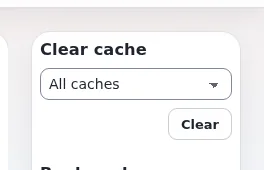

# Lektion 5.2: Caches in der Administration leeren

„Leeren Sie den Cache“ ist der am häufigsten wiederholte Rat im Content-Management, und der am meisten überstrapazierte.
Alles zu leeren funktioniert, macht aber die ganze Website eine Weile langsam. Diese Lektion vermittelt die Regel
„Leeren Sie das Kleinste, das das Problem behebt“ mit den Schaltflächen der Seite Caches und dem schnellen Leeren in
der rechten Spalte.

## Auf einen Blick

| | |
|---|---|
| Kurs | [Website-Administration](../README.md) |
| Modul | [Modul 5: Caches](README.md) |
| Dauer | 35 Minuten (10 Präsentation, 25 Übung) |
| Niveau | Fortgeschrittene |
| Zielgruppe | Website-Administratoren und Support-Mitarbeiter |
| Voraussetzungen | [Lektion 5.1](was-die-caches-enthalten.md) |

## Lernziele

Nach dieser Lektion können die Teilnehmenden:

- für eine bestimmte Änderung wählen, welcher Cache zu leeren ist;
- auf der Seite Caches ausgewählte Caches, eine Gruppe, einen Tag oder alles leeren;
- **Cache leeren** in der rechten Spalte der Administration verwenden;
- die Ergebnismeldung lesen: was geleert wurde, wie lange es dauerte, was als Nächstes zu tun ist;
- den Antwort-Cache von Velocity leeren, wenn eine Seite noch alt aussieht.

## Hinweise für Trainer

### So präsentieren Sie es

Quelle: [Caches](../../../../anleitungen/caches.md) und
[Den richtigen Cache leeren](../../../../anleitungen/betrieb-einer-website.md#2-den-richtigen-cache-leeren).

1. **Welcher Cache** (3 Minuten). Zeigen Sie die Tabelle am Beamer:

   | Sie haben geändert | Leeren Sie |
   |---|---|
   | Eine Einstellung | die INI-Caches (Tag `ini`), dann Velocity neu starten |
   | Ein Template | die Template-Caches (Tag `template`) |
   | Inhalte sehen veraltet aus | die Inhalts-Caches (Tag `content`) |
   | Ein neues Template oder eine neue Erweiterung | den Template-Override-Cache und `design_base` |
   | Sie sind unsicher | alles, als letztes Mittel |

2. **Die Schaltflächen** (3 Minuten). Caches anhaken und **Ausgewähltes leeren**; **Diese Gruppe leeren …** pro
   Gruppe; **Cache des Inhalts leeren …**, **Template-Cache leeren …**, **INI-Caches leeren …** nach Tag;
   **Alle Caches leeren …**. Jedes Leeren nennt zuerst, was entfernt wird, und endet dann mit einer Meldung: was
   geleert wurde, wie viele Millisekunden es dauerte, was als Nächstes zu tun ist und der Befehl für die Shell.
3. **Die rechte Spalte** (2 Minuten). Auf jeder Seite der Administration hat die rechte Spalte **Cache leeren** mit
   einer Liste (**Gesamter Cache**, **Inhalt**, **Template**, **Template & Inhalt**, **Ini Einstellungen**,
   **Statisch**) und **Leeren**. Auf der Seite eines Elements bietet sie zusätzlich den Inhalt dieses Knotens oder
   Teilbaums an.
4. **Velocity** (2 Minuten). Eine Seite kann nach dem Leeren noch einige Sekunden alt aussehen, weil sie aus dem
   Antwort-Cache von Velocity kommt. Leeren Sie ihn mit **Antwort-Cache von Velocity leeren** in der letzten Gruppe,
   oder warten Sie.

### Häufige Fragen

**Die Seite zeigt noch die alte Version.** Leeren Sie den Antwort-Cache von Velocity oder warten Sie einige Sekunden;
starten Sie Velocity nach einer Änderung an den Einstellungen neu.

**Warum ist ein Cache ausgegraut?** Er ist in den Einstellungen deaktiviert, es gibt also nichts zu leeren.

**Was bedeutet „Expiring all view cache“ im Log?** Eine Änderung betraf mehr Knoten als
`[ContentSettings] CacheThreshold` (standardmäßig 250), deshalb wurde jeder Ansichts-Cache auf einmal verworfen. Nach
dem Verschieben eines großen Teilbaums ist das zu erwarten; geschieht es bei gewöhnlichen Bearbeitungen, lohnt sich
ein genauerer Blick.

### Stolperfallen

- **„Alles leeren“ als Gewohnheit.** Es funktioniert und verdeckt die Ursache. Bitten Sie die Teilnehmenden, den Cache
  zu benennen, bevor sie leeren.
- **Leeren, bevor der Code live ist.** Leeren Sie auf einem Server die Seiten-Caches erst, wenn PHP-FPM oder Velocity
  den neuen Code ausführt; sonst wird wieder eine alte Seite gespeichert. Lektion 4.1 von [Hosting und Betrieb](../../hosting-betrieb/README.md) greift das wieder auf.

## Praktische Übung

Auf Ihrer Schulungsinstallation, als Administrator angemeldet:

1. Öffnen Sie **Setup > Ini Einstellungen**, ändern Sie `SiteName` für den Siteaccess `site` (wie in Lektion 1.4) und
   klicken Sie auf **Speichern**. Notieren Sie, welche Caches laut Meldung geleert wurden.
2. Öffnen Sie **Setup > Cache-Verwaltung**. Haken Sie nur den Cache der Inhaltsansichten an und klicken Sie auf
   **Ausgewähltes leeren**. Lesen Sie die Bestätigung, bestätigen Sie und lesen Sie die Ergebnismeldung: benötigte
   Zeit und nächster Schritt.
3. Klicken Sie auf **Template-Cache leeren …**, lesen Sie die genannte Liste und bestätigen Sie.
4. Klicken Sie in der Gruppe **Templates** auf **Diese Gruppe leeren …**, lesen Sie die Liste und brechen Sie ab oder
   gehen Sie zurück, ohne zu bestätigen.
5. Öffnen Sie den Ordner `News` in der **Inhaltsstruktur**. Wählen Sie in der rechten Spalte unter **Cache leeren**
   den Eintrag **Inhalt** und klicken Sie auf **Leeren**. Notieren Sie, welche Möglichkeiten die Liste auf der Seite
   eines Knotens anbietet.
6. Bearbeiten Sie einen Artikel in `News`, ändern Sie seinen Titel und veröffentlichen Sie. Öffnen Sie sofort die
   öffentliche Seite und laden Sie sie nach einigen Sekunden neu.
7. Klicken Sie in der Gruppe **Seiten, Abfragen und der Server** auf **Antwort-Cache von Velocity leeren** und laden
   Sie die öffentliche Seite neu.
8. Lesen Sie die Spalte der letzten Leerung für den Cache der Inhaltsansichten: Jetzt nennt sie Sie.
9. Machen Sie die Änderung an `SiteName` aus Schritt 1 auf der Einstellungsseite rückgängig.

## Erwartetes Ergebnis

- Jedes Leeren endet mit einer Meldung, die die Caches, die Millisekunden und den Shell-Befehl nennt.
- Schritt 5 bietet auf der Seite eines Knotens in der rechten Spalte die Möglichkeiten für Knoten und Teilbaum an.
- Schritt 6: Die Änderung erscheint nach dem Veröffentlichen (das Veröffentlichen leert die Ansichts-Caches der
  betroffenen Seiten selbst); eine kurze Verzögerung kommt vom Antwort-Cache von Velocity.
- Schritt 8 nennt das Konto der Teilnehmerin oder des Teilnehmers.
- Der Trainer prüft die Ergebnismeldung bei einer Person und fragt, welchen Shell-Befehl sie gezeigt hat.

## Quiz

1. Sie haben ein Template geändert. Welche Caches leeren Sie?
   A. INI B. Template C. Alle D. Bildvarianten
2. Was sagt Ihnen die Ergebnismeldung eines Leerens?
3. Auf einer Website mit Velocity sieht eine Seite einige Sekunden nach dem Leeren noch alt aus. Warum?
4. Müssen Sie nach dem Veröffentlichen eines Artikels den Inhalts-Cache leeren?
5. Wo ist das schnelle Leeren auf jeder Seite der Administration verfügbar?

Antworten

1. **B.** Die Template-Caches (Tag `template`).
2. Was geleert wurde, wie lange es dauerte, was als Nächstes zu tun ist, und den Befehl für die Shell
   ([Caches](../../../../anleitungen/caches.md#kurz-gesagt)).
3. Der Antwort-Cache von Velocity antwortet weiter, solange seine Lebensdauer läuft; leeren Sie ihn oder warten Sie.
4. Normalerweise nicht: Das Veröffentlichen leert die Ansichts-Caches der betroffenen Seiten.
5. **Cache leeren** in der rechten Spalte.

## Weiterführende Literatur

- [Caches](../../../../anleitungen/caches.md): die Seite und die üblichen Fragen dazu.
- [Eine Website betreiben](../../../../anleitungen/betrieb-einer-website.md#2-den-richtigen-cache-leeren): welcher Cache bei welcher Änderung.
- [Cache-Leerungen, die Verzeichnisse beiseiteschieben](../../../../funktionen/6.0/cache-leeren-durch-umbenennen.md): warum
  Anfragen beim Leeren nicht warten müssen.

## Verwandte Seiten

- [Modul 5: Caches](README.md)
- [Website-Administration: Kursüberblick](../README.md)
- [Trainer: hier beginnen](../../trainer-hier-beginnen.md)
- [Freie Dokumentation](../../../freie-dokumentation.md): Diese Seite darf unter der GNU FDL 1.3 frei kopiert, übersetzt und verbessert werden.

<!-- exp-partner-block:start -->
**Werden Sie Exponential-Partner.** Partner teilen ihre Informationen, stellen Mittel bereit, geben Beiträge zurück
und entwickeln die Produkte mit uns, und so wächst Exponential. Eine Partner-Website und ein Dashboard sind für Mitte
2027 geplant: Werden Sie noch heute Partner, damit wir schneller wachsen und neue Funktionen früher liefern. Beginnen
Sie mit [Partner: hier beginnen](../../../partner/partner-hier-beginnen.md) und
[Wie Sie sich bewerben](../../../partner/wie-sie-sich-bewerben.md).
<!-- exp-partner-block:end -->
