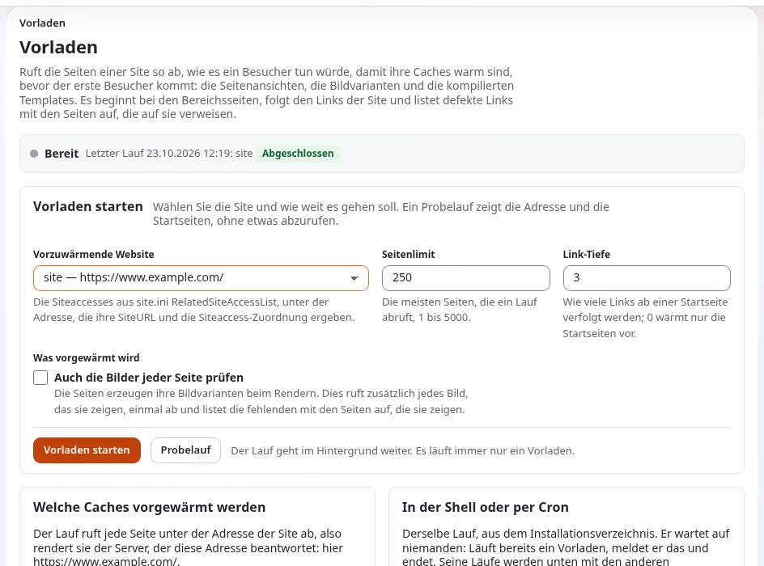

# Lektion 5.4: Caches vorab füllen

Nach dem Leeren aller Caches oder nach einer Bereitstellung bezahlen die ersten Besucher für die leeren Caches. Das
Vorladen fragt die Seiten einer Website so ab, wie es ein anonymer Besucher täte, damit die Caches warm sind, bevor
Besucher kommen, und listet die defekten Links auf, die es unterwegs findet. Diese Lektion führt es über die Seite und
aus der Shell aus.

## Auf einen Blick

| | |
|---|---|
| Kurs | [Website-Administration](../README.md) |
| Modul | [Modul 5: Caches](README.md) |
| Dauer | 35 Minuten (10 Präsentation, 25 Übung) |
| Niveau | Fortgeschrittene |
| Zielgruppe | Website-Administratoren |
| Voraussetzungen | [Lektion 5.3](caches-auf-der-kommandozeile-leeren.md) |

## Lernziele

Nach dieser Lektion können die Teilnehmenden:

- einen Probelauf starten und die Adresse und die Startseiten lesen, die er verwenden würde;
- ein Vorladen mit einem Seitenlimit und einer Link-Tiefe starten und verfolgen;
- das Ergebnis lesen: aufgewärmte Seiten, erzeugte Bildvarianten, defekte Links und die Seiten, die auf sie verlinken;
- dasselbe aus der Shell ausführen und eine Cron-Zeile schreiben;
- erklären, was ein Vorladen aufwärmt und was nicht.

## Hinweise für Trainer

### So präsentieren Sie es

Quelle: [Caches vorab füllen](../../../../anleitungen/caches-vorwaermen.md).

1. **Was es aufwärmt** (3 Minuten). Den Cache der Seitenansichten, die Bildvarianten, die die Seiten zeigen, und die
   kompilierten Templates, als Dateien, die sich Apache mit PHP-FPM und Velocity teilen. Nicht die Seiten für
   angemeldete Benutzer (der Lauf ist anonym) und den Antwort-Cache von Velocity nicht für lange (er hält eine Seite
   standardmäßig etwa 30 Sekunden).
2. **Die Seite** (4 Minuten). **Setup > Seiten vorladen**: die Statusleiste (**Bereit** oder **Läuft**),
   **Vorladen starten** mit **Vorzuwärmende Website**, **Seitenlimit** (250, 1 bis 5000), **Link-Tiefe** (3, 0 bis
   10) und **Auch die Bilder jeder Seite prüfen**, dann die Schaltflächen **Vorladen starten** und **Probelauf** und
   die letzten Läufe.
3. **Immer nur ein Lauf** (1 Minute). Ein zweiter Lauf, ob über die Seite, die Shell oder Cron, wird abgelehnt,
   solange einer läuft.
4. **Die Shell** (2 Minuten). `php bin/php/preload.php --siteaccess=site`, mit `--dry-run`, `--max-pages`,
   `--max-depth`, `--images`, `-q`. Die letzten drei Zeilen fassen den Lauf zusammen; der Exit-Code 0 bedeutet
   beendet.

### Häufige Fragen

**Warum sieht die Adresse im Probelauf falsch aus?** Der Lauf verwendet die `SiteURL` des Siteaccess und sein
Zuordnungspräfix. Eine Übungsumgebung, die mit einer anderen `--url` installiert wurde als der, unter der sie
ausgeliefert wird, ergibt eine falsche Adresse; korrigieren Sie `SiteURL`.

**Ersetzt ein Vorladen den statischen Cache?** Nein. Es wärmt die Caches hinter dem Rendern der Seiten auf; der
statische Cache speichert Seiten als Dateien (Lektion 5.5).

**Sind defekte Links ein Fehler?** Sie sind ein Befund: Der Lauf endet trotzdem mit dem Exit-Code 0 und listet jede
defekte Adresse mit den Seiten auf, die auf sie verlinken.

### Stolperfallen

- **Ein riesiges Seitenlimit auf einer Live-Website.** Tausende Anfragen hintereinander belasten den Server. Fangen Sie
  klein an.
- **Die Administration aufwärmen.** Der Siteaccess der Administration wird nicht angeboten: Er wärmt nichts auf, was
  ein Besucher sieht.
- **Fehlende Erweiterung curl.** Der Befehl braucht die PHP-Erweiterung curl.

## Praktische Übung

Auf Ihrer Schulungsinstallation, als Administrator angemeldet, mit einem Terminal im Wurzelverzeichnis:

1. Leeren Sie die Inhalts-Caches: **Setup > Cache-Verwaltung**, **Cache des Inhalts leeren …**, bestätigen.
2. Öffnen Sie **Setup > Seiten vorladen**. Lesen Sie die Statusleiste.
3. Wählen Sie unter **Vorladen starten** die Website `site`, **Seitenlimit** 50, **Link-Tiefe** 2, und klicken Sie
   auf **Probelauf**.
4. Lesen Sie den Probelauf: den Siteaccess, die Adresse, die Startseiten und den Shell-Befehl.
5. Klicken Sie auf **Vorladen starten** und verfolgen Sie die Ausgabe, bis der Lauf beendet ist.
6. Lesen Sie die Kennzahlen: aufgewärmte Seiten, erzeugte Bildvarianten, defekte Links. Öffnen Sie eine Zeile mit
   einem defekten Link, falls es eine gibt.
7. Führen Sie im Terminal ein kleines Vorladen mit Bildprüfung aus:

   ```bash
   php bin/php/preload.php --siteaccess=site --max-pages=20 --max-depth=1 --images
   ```

8. Lesen Sie seine letzten drei Zeilen.
9. Suchen Sie auf der Seite den Lauf aus Schritt 7 in der Liste der letzten Läufe.
10. Kopieren Sie die Crontab-Zeile, die die Seite vorschlägt. Installieren Sie sie nicht in der Übungsumgebung.

## Erwartetes Ergebnis

- Schritt 4 zeigt die Adresse der Übungsumgebung und die Startseiten; nichts wird abgefragt.
- Schritt 5 endet mit einer Zahl aufgewärmter Seiten von höchstens 50.
- Schritt 8: `Preload finished in ...`, `Pages warmed ...`, `Image aliases made ...`.
- Die Liste der letzten Läufe zeigt beide Läufe, einen von der Seite und einen aus der Shell.
- Der Trainer prüft die Liste der letzten Läufe auf der Seite einer Teilnehmerin oder eines Teilnehmers.



## Quiz

1. Welche Caches wärmt ein Vorladen auf?
2. Warum werden Seiten für angemeldete Benutzer nicht aufgewärmt?
3. Was passiert, wenn ein zweites Vorladen startet, während eines läuft?
   A. Beide laufen B. Das erste hält an C. Das zweite wird abgelehnt D. Sie werden zusammengeführt
4. Was zeigt der Probelauf?
5. Ein Lauf findet defekte Links. Wie lautet sein Exit-Code?

<details>
<summary>Antworten</summary>

1. Den Cache der Seitenansichten, die Bildvarianten und die kompilierten Templates
   ([Caches vorab füllen](../../../../anleitungen/caches-vorwaermen.md#kurz-gesagt)).
2. Der Lauf fragt die Seiten als anonymer Besucher ab.
3. **C.** Immer nur ein Lauf.
4. Den Siteaccess, die Adresse, das Präfix, die Grenzen, die Startseiten und den Shell-Befehl.
5. 0: Defekte Links sind ein Befund, kein Fehlschlag.

</details>

## Weiterführende Literatur

- [Caches vorab füllen](../../../../anleitungen/caches-vorwaermen.md): die Seite, der Befehl und die Adresse eines Siteaccess.
- [Seiten vorladen](../../../../funktionen/6.0/ansicht-websites-vorladen.md): die Referenz zur Funktion.
- [Caches leeren und aufwärmen](../../../hosting/leistung/caches-leeren-und-vorwaermen.md): die Sicht des Hosters.

## Verwandte Seiten

- [Modul 5: Caches](README.md)
- [Website-Administration: Kursüberblick](../README.md)
- [Trainer: hier beginnen](../../trainer-hier-beginnen.md)
- [Freie Dokumentation](../../../freie-dokumentation.md): Diese Seite darf unter der GNU FDL 1.3 frei kopiert, übersetzt und verbessert werden.

<!-- exp-partner-block:start -->
**Werden Sie Exponential-Partner.** Partner teilen ihre Informationen, stellen Mittel bereit, geben Beiträge zurück
und entwickeln die Produkte mit uns, und so wächst Exponential. Eine Partner-Website und ein Dashboard sind für Mitte
2027 geplant: Werden Sie noch heute Partner, damit wir schneller wachsen und neue Funktionen früher liefern. Beginnen
Sie mit [Partner: hier beginnen](../../../partner/partner-hier-beginnen.md) und
[Wie Sie sich bewerben](../../../partner/wie-sie-sich-bewerben.md).
<!-- exp-partner-block:end -->
