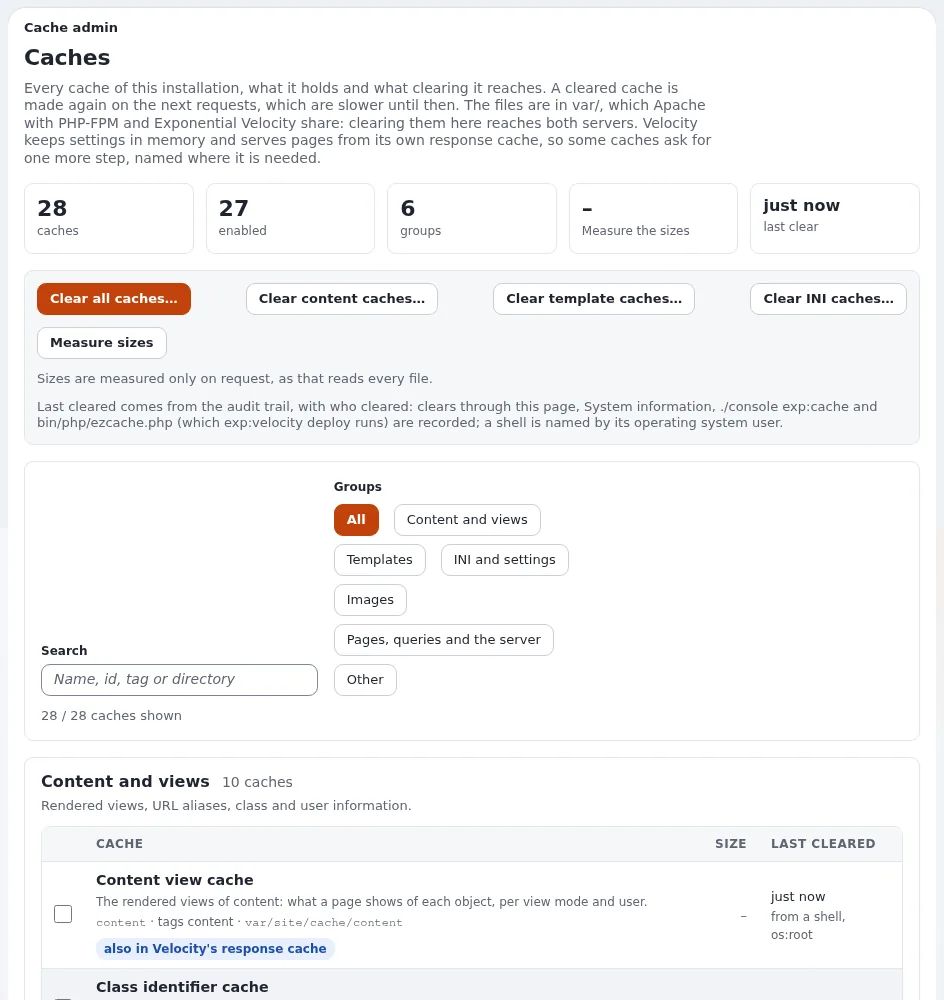

# Lektion 5.1: Was die Caches enthalten

Exponential speichert fast alles zwischen, was sich zwischenspeichern lässt: gerenderte Ansichten, kompilierte
Templates, Einstellungen, Bildgrößen, ganze Seiten. Caches machen die Website schnell, und hinter den meisten Fragen
der Art „Meine Änderung wird nicht angezeigt“ steckt ein veralteter Cache. Bevor ein Administrator etwas leert, sollte
er wissen, was jeder Cache enthält. In dieser Lektion wird **Setup > Cache-Verwaltung** gelesen, ohne eine einzige
Schaltfläche zum Leeren zu drücken.

## Auf einen Blick

| | |
|---|---|
| Kurs | [Website-Administration](../README.md) |
| Modul | [Modul 5: Caches](README.md) |
| Dauer | 35 Minuten (15 Präsentation, 20 Übung) |
| Niveau | Fortgeschrittene |
| Zielgruppe | Website-Administratoren und Support-Mitarbeiter |
| Voraussetzungen | [Modul 1](../modul-01-orientierung/README.md); ein Administratorkonto auf der Schulungsinstallation |

## Lernziele

Nach dieser Lektion können die Teilnehmenden:

- die Seite Caches öffnen und ihre sechs Gruppen nennen;
- sagen, was der Cache der Inhaltsansichten, die Template-Caches, die INI-Caches und die Bildvarianten enthalten;
- den Unterschied zwischen der ID eines Caches und seinen Tags erklären;
- die Spalte der letzten Leerung lesen und wer sie vorgenommen hat;
- erklären, welche Caches sich Apache mit PHP-FPM und Velocity teilen und welche nicht.

## Hinweise für Trainer

### So präsentieren Sie es

Quelle: [Caches](../../../../anleitungen/caches.md) und [Eine Website betreiben](../../../../anleitungen/betrieb-einer-website.md).

1. **Warum Caches** (2 Minuten). Eine Seite jedes Mal aus der Datenbank und den Templates zu rendern ist langsam. Jeder
   Cache hebt ein Ergebnis auf, damit die nächste Anfrage schnell ist. Ein geleerter Cache entsteht bei den nächsten
   Anfragen neu, die bis dahin langsamer sind.
2. **Die Seite** (3 Minuten). **Setup > Cache-Verwaltung** öffnet die Seite **Caches**: Kennzahlen (Caches,
   aktiviert, Gruppen, Größe nach dem Messen, letzte Leerung), die Schaltflächen **Alle Caches leeren …**,
   **Cache des Inhalts leeren …**, **Template-Cache leeren …**, **INI-Caches leeren …** und **Größen messen**,
   dann **Suchen** und die **Gruppen**.
3. **Die Gruppen** (5 Minuten): **Inhalte und Ansichten** (der Cache der Inhaltsansichten, URL-Aliase,
   Benutzerinformationen), **Templates** (kompilierte Templates, Template-Blöcke, der Override-Cache),
   **INI und Einstellungen**, **Bilder** (Bildvarianten), **Seiten, Abfragen und der Server** (der HTTP-Cache, der
   Cache der SQL-Abfragen, der Antwort-Cache von Velocity, OPcache und APCu), **Sonstige** (Caches von Erweiterungen).
4. **IDs und Tags** (2 Minuten). Jeder Cache zeigt seine ID (`content`, `template-block`, `ini` ...) und seine Tags
   (`content`, `template`, `ini` ...). Ein Tag leert jeden Cache, der ihn trägt. Leeren Sie nach einer Änderung an
   den Einstellungen über den Tag `ini`, nicht über die ID.
5. **Geteilt oder nicht** (3 Minuten). Die Cache-Dateien liegen in `var/`, das sich Apache mit PHP-FPM und Velocity
   teilen. Velocity hält die Einstellungen im Speicher (starten Sie ihn nach dem Leeren der INI-Caches neu) und hat
   seinen eigenen Antwort-Cache.

### Häufige Fragen

**Kann ich mir diese Seite auf einer Live-Website gefahrlos ansehen?** Ja, das Lesen ist gefahrlos. **Größen messen**
liest jede Cache-Datei; auf einer großen Website kostet das bis zu drei Sekunden Serverzeit.

**Wer darf sie öffnen?** Benutzer mit `setup/managecache`. Jede Schaltfläche sendet mit dem Formular-Token.

**Woher stammt „zuletzt geleert“?** Das Audit-Protokoll erfasst jedes Leeren, ob über die Seite, die
Systeminformationen, `exp:cache` oder `ezcache.php`, und nennt den Benutzer oder bei einer Shell den Benutzer des
Betriebssystems.

### Stolperfallen

- **Aus Neugier eine Schaltfläche zum Leeren drücken.** In der Übungsumgebung ist das harmlos; auf einer Live-Website
  lässt jedes Leeren die nächsten Besucher warten. In dieser Lektion leert niemand etwas.
- **Einen Cache pro Seite erwarten.** Der Cache der Inhaltsansichten enthält Ansichten pro Objekt, Ansichtsmodus und
  Benutzerberechtigungen, nicht pro Adresse.

## Praktische Übung

Auf Ihrer Schulungsinstallation, als Administrator angemeldet:

1. Öffnen Sie **Setup > Cache-Verwaltung**. Notieren Sie die Kennzahlen oben: wie viele Caches, wie viele aktiviert,
   wie viele Gruppen.
2. Klicken Sie auf **Größen messen**. Notieren Sie die Gesamtgröße und den größten Cache.
3. Wählen Sie unter **Gruppen** die Gruppe **Inhalte und Ansichten**. Suchen Sie den Cache der Inhaltsansichten: seine
   ID, seine Tags und sein Verzeichnis.
4. Wählen Sie die Gruppe **Templates**. Welcher Cache enthält die kompilierten Templates? Welcher enthält die
   Template-Blöcke?
5. Wählen Sie **INI und Einstellungen**. Welche Caches tragen das Abzeichen zum Neustart von Velocity?
6. Wählen Sie **Seiten, Abfragen und der Server**. Ist der HTTP-Cache in Ihrer Übungsumgebung an oder aus? Wird der
   Antwort-Cache von Velocity angezeigt?
7. Geben Sie in **Suchen** `image` ein. Welcher Cache bleibt übrig?
8. Lesen Sie die Spalte der letzten Leerung für den Cache der Inhaltsansichten: wann, und von wem?
9. Füllen Sie auf Papier eine Tabelle mit drei Spalten (Cache, was er enthält, Tag) für fünf Caches Ihrer Wahl aus.

## Erwartetes Ergebnis

- Die Teilnehmenden nennen die sechs Gruppen und geben ID und Tag des Caches der Inhaltsansichten an (`content`, Tag
  `content`).
- Schritt 5: Die INI-Caches tragen das Abzeichen zum Neustart von Velocity.
- Schritt 7 lässt den Cache der Bildvarianten übrig (`imagealias`).
- Der Trainer prüft die Tabelle aus Schritt 9 bei zwei Teilnehmenden.

## Quiz

1. Welche Gruppe enthält die Bildvarianten?
   A. **Inhalte und Ansichten** B. **Templates** C. **Bilder** D. **Sonstige**
2. Was ist der Unterschied zwischen der ID eines Caches und seinen Tags?
3. Welchen Tag leeren Sie, nachdem Sie eine Einstellung geändert haben?
4. Warum muss Velocity nach dem Leeren der INI-Caches neu gestartet werden?
5. Woher nimmt die Seite die Angabe „zuletzt geleert ... von“?

Antworten

1. **C.** ([Caches, die Gruppen](../../../../anleitungen/caches.md#2-die-gruppen)).
2. Die ID benennt einen Cache; ein Tag wird von mehreren Caches geteilt, und das Leeren eines Tags leert sie alle.
3. `ini`.
4. Ein laufendes Velocity hat die Einstellungen in den Speicher gelesen ([Caches, Velocity](../../../../anleitungen/caches.md#4-velocity)).
5. Aus dem Audit-Protokoll (`system.cache.clear`) und den Ablaufzeiten des Kernels.

## Weiterführende Literatur

- [Caches](../../../../anleitungen/caches.md): jeder Cache und jede Schaltfläche der Seite.
- [Cache-Ebenen](../../../hosting/leistung/cache-schichten.md): die zwölf Ebenen vom Browser bis zu OPcache.
- [Eine Website betreiben](../../../../anleitungen/betrieb-einer-website.md): erst hinsehen, dann leeren.

## Verwandte Seiten

- [Modul 5: Caches](README.md)
- [Website-Administration: Kursüberblick](../README.md)
- [Trainer: hier beginnen](../../trainer-hier-beginnen.md)
- [Freie Dokumentation](../../../freie-dokumentation.md): Diese Seite darf unter der GNU FDL 1.3 frei kopiert, übersetzt und verbessert werden.

<!-- exp-partner-block:start -->
**Werden Sie Exponential-Partner.** Partner teilen ihre Informationen, stellen Mittel bereit, geben Beiträge zurück
und entwickeln die Produkte mit uns, und so wächst Exponential. Eine Partner-Website und ein Dashboard sind für Mitte
2027 geplant: Werden Sie noch heute Partner, damit wir schneller wachsen und neue Funktionen früher liefern. Beginnen
Sie mit [Partner: hier beginnen](../../../partner/partner-hier-beginnen.md) und
[Wie Sie sich bewerben](../../../partner/wie-sie-sich-bewerben.md).
<!-- exp-partner-block:end -->
