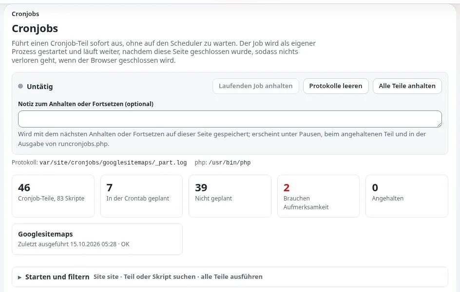

# Lektion 6.1: Cronjob-Teile und die Crontab

Vieles, was eine Website tut, geschieht, wenn niemand hinsieht: Benachrichtigungen gehen hinaus, freigegebene Artikel
werden veröffentlicht, abgelaufene Inhalte werden verborgen, Sitemaps werden erstellt. All das erledigen Cronjobs. Eine
Website, deren Cronjobs nicht laufen, sieht tagelang gut aus und versagt dann auf eine Weise, die schwer
nachzuverfolgen ist. Diese Lektion gibt den Teilnehmenden das Modell (Teile und Skripte) und die Shell-Befehle, mit
denen sie ausgeführt und eingeplant werden.

> **Hinweis**
> Verwenden Sie eine Schulungsinstallation, niemals eine Live-Website. Ein Teil, der auf einer Live-Website ausgeführt
> wird, versendet echte E-Mails und veröffentlicht wartende Inhalte.

## Auf einen Blick

| | |
|---|---|
| Kurs | [Website-Administration](../README.md) |
| Modul | [Modul 6: Cronjobs, Workflows und Benachrichtigungen](README.md) |
| Dauer | 40 Minuten (15 Präsentation, 25 Übung) |
| Niveau | Fortgeschrittene |
| Zielgruppe | Website-Administratoren, Support-Mitarbeiter |
| Voraussetzungen | Eine Schulungsinstallation mit Shell-Zugang; Grundkenntnisse der Kommandozeile |

## Lernziele

Nach dieser Lektion können die Teilnehmenden:

- den Unterschied zwischen einem Cronjob-Skript und einem Cronjob-Teil erklären und sagen, was der *globale* Teil ist;
- jeden Teil und seine Skripte mit `runcronjobs.php --list` auflisten;
- einen Teil und ein einzelnes Skript für einen gewählten Siteaccess ausführen;
- eine Crontab-Zeile schreiben, die den Teil `frequent` alle fünf Minuten aus dem Wurzelverzeichnis der Installation
  ausführt;
- zwei Folgen eines Teils nennen, der nie läuft.

## Hinweise für Trainer

### So präsentieren Sie es

Quelle: [Cronjobs: ausführen, einplanen und verfolgen](../../../../anleitungen/cronjobs.md), Abschnitte 1, 12 und 13.

1. **Skripte und Teile** (4 Minuten). Ein *Skript* ist eine PHP-Datei in einem Verzeichnis `cronjobs/`, die eine
   Aufgabe erledigt. Ein *Teil* fasst Skripte zusammen, die gemeinsam nach einem Zeitplan laufen; er ist ein Abschnitt
   `[CronjobPart-<name>]` mit Zeilen `Scripts[]` in `settings/cronjob.ini`. Zeigen Sie den mitgelieferten Teil
   `frequent` am Beamer: Er führt `notification.php`, `workflow.php`, `contentjobs.php`, `audit.php` und
   `mailbounces.php` in dieser Reihenfolge in einem Prozess aus. Erweiterungen fügen in ihrer eigenen
   `cronjob.ini.append.php` Teile hinzu.
2. **Der globale Teil** (2 Minuten). Die Skripte von `[CronjobSettings] Scripts[]` laufen, wenn `runcronjobs.php`
   keinen Teilnamen bekommt. Die Administration nennt das den **globalen** Teil. Eines seiner Skripte, `hide.php`,
   verbirgt Inhalte, deren Datum abgelaufen ist.
3. **Von Hand ausführen** (4 Minuten). Zeigen Sie `--list`, einen Teil und `--script=`. Erklären Sie
   `-s <siteaccess>`: Ein Job liest die Einstellungen des Siteaccess, unter dem er läuft, sodass Benachrichtigungen und
   Sitemaps mit den Inhalten und URLs dieser Website arbeiten.
4. **Sperren** (2 Minuten). Jedes Skript setzt eine Sperre, solange es läuft. Ein zweiter Lauf desselben Skripts gibt
   *Cronjob part locked by other process* aus und überspringt es. Das ist die Sperre bei der Arbeit, kein Fehler.
5. **Einplanen** (3 Minuten). Zeigen Sie eine Crontab-Zeile, die mit `cd <installation root> &&` beginnt. Führen Sie
   sie als der Benutzer aus, unter dem der Webserver läuft, damit die Dateien, die ein Job schreibt, für die Website
   beschreibbar bleiben.

### Häufige Fragen

**Wie oft soll der Teil frequent laufen?** Die Anleitung zu den Benachrichtigungen empfiehlt alle fünf Minuten als guten
Standard; ein Lauf, der nichts zu tun hat, kostet wenig.

**Gibt es für jeden Teil einen Konsolenbefehl?** Ja. Jeder Teil ist in der Konsole auch `cron:<part>`, zum Beispiel
`php bin/php/console cron:frequent -s <site>`. Der globale Teil hat keinen `cron:`-Befehl; führen Sie ihn mit
`runcronjobs.php` ohne Teilnamen aus.

**Warum zeigt `--list` dasselbe Skript dreimal?** Es gibt jedes Skript einmal für jedes Cronjob-Verzeichnis aus, in
dem es gefunden wird. Wenn mehrere Einstellungsdateien dasselbe Verzeichnis anhängen, wiederholt sich das Skript.

**Lässt sich ein Teil während eines Release zurückhalten?** Ja, mit **Anhalten** auf der Cronjob-Seite; Lektion 6.2
zeigt das.

### Stolperfallen

- **Als root ausführen.** Als root braucht jeder Befehl `--allow-root-user`, und die Dateien, die er schreibt, können
  für den Webserver unbeschreibbar werden. Verwenden Sie auf echten Servern lieber den Benutzer der Website; sagen Sie
  im Kurs, welcher Benutzer Sie sind.
- **Ein Pfad über einen symbolischen Link in der Crontab.** Die Cronjob-Seite erkennt eine Zeile nur, wenn sie den
  echten Pfad des Wurzelverzeichnisses der Installation enthält. Verwenden Sie nach `cd` den echten Pfad.
- **Der falsche Siteaccess.** Ohne `-s` wird der Standard-Siteaccess verwendet; auf einer Schulungsinstallation mit
  mehreren Websites ist das unter Umständen nicht die Website, die sich die Teilnehmenden ansehen.

## Praktische Übung

Verwenden Sie Ihre eigene Schulungsinstallation (zum Beispiel eine, die mit `php bin/php/console exp:install`
installiert wurde, siehe [Die Installation über die Konsole](../../../../installation/07-installation-ueber-die-konsole.md)). Arbeiten Sie
in einem Terminal im Wurzelverzeichnis der Installation.

1. Öffnen Sie `settings/cronjob.ini` nur zum Lesen (`less settings/cronjob.ini`) und suchen Sie
   `[CronjobPart-frequent]`. Notieren Sie seine Skripte.
2. Suchen Sie `[CronjobSettings]` und seine Zeilen `Scripts[]`. Sie bilden den globalen Teil.
3. Listen Sie jeden Teil und seine Skripte auf:

   ```bash
   php runcronjobs.php --list
   ```

4. Ermitteln Sie den Namen Ihres öffentlichen Siteaccess: Er steht in `settings/override/site.ini.append.php` unter
   `[SiteAccessSettings] AvailableSiteAccessList[]`. Verwenden Sie ihn unten als `<site>`.
5. Führen Sie nur das Benachrichtigungsskript aus:

   ```bash
   php runcronjobs.php -s <site> --script=notification.php
   ```

   Lesen Sie die Ausgabe: den verwendeten Siteaccess, das gestartete und abgeschlossene Skript und die verstrichene
   Zeit.
6. Führen Sie den ganzen Teil `frequent` über die Konsole aus:

   ```bash
   php bin/php/console cron:frequent -s <site>
   ```

7. Zeigen Sie an, was die Konsole über den Teil weiß: `php bin/php/console help cron:frequent`.
8. Geben Sie Ihre Crontab aus, ohne sie zu ändern: `php bin/php/console crontab:list` (oder `crontab -l`).
9. Schreiben Sie auf Papier (noch nicht installieren) die Zeile, die `frequent` alle fünf Minuten aus dem
   Wurzelverzeichnis Ihrer Installation ausführt und die Ausgabe an `var/log/cron-frequent.log` anhängt.
10. Vergleichen Sie Ihre Zeile mit der Ihres Nachbarn und mit dem Beispiel in der Anleitung zu den Benachrichtigungen.

## Erwartetes Ergebnis

- Schritt 3 gab eine Liste aus, die mit den Teilen des Kernels beginnt, etwa `CronjobPart-frequent:` gefolgt von seinen
  Skripten.
- Schritt 5 gab Zeilen wie *Running cronjobs/notification.php*, *Completing cronjobs/notification.php* und
  *Elapsed time* aus.
- Schritt 9 ergab eine Zeile dieser Form:

  ```cron
  */5 * * * * cd /path/to/installation && php runcronjobs.php -s <site> frequent >> var/log/cron-frequent.log 2>&1
  ```

- Der Trainer prüft das, indem er zwei Teilnehmende ihre Zeile laut vorlesen und auf `cd`, den Siteaccess und den
  Teilnamen zeigen lässt.



## Quiz

1. Was ist ein Cronjob-Teil?
   A. Ein PHP-Skript B. Eine benannte Liste von Skripten in `cronjob.ini` C. Eine Zeile in der Crontab D. Eine
   Datenbanktabelle
2. Welchen Teil führt `php runcronjobs.php` aus, wenn Sie keinen Teilnamen angeben?
3. Ein Lauf gibt *Cronjob part locked by other process* aus. Was bedeutet das, und was tun Sie?
4. Warum soll eine Crontab-Zeile mit `cd <installation root> &&` beginnen?
5. Nennen Sie zwei Dinge, die auf einer Website nicht mehr geschehen, deren Teil `frequent` nie läuft.

<details>
<summary>Antworten</summary>

1. **B.** Ein Teil ist ein Abschnitt `[CronjobPart-<name>]` mit Zeilen `Scripts[]`
   ([Cronjobs, Abschnitt 1](../../../../anleitungen/cronjobs.md#1-teile-skripte-und-der-globale-teil)).
2. Die Skripte von `[CronjobSettings] Scripts[]`, die die Administration als **globalen** Teil zeigt.
3. Dasselbe Skript läuft gerade in einem anderen Prozess (zum Beispiel aus der Crontab). Warten Sie; die Sperre hält
   die beiden Läufe auseinander.
4. `runcronjobs.php` wird aus dem Wurzelverzeichnis der Installation ausgeführt, und die Cronjob-Seite erkennt eine
   Zeile am echten Pfad dieses Verzeichnisses.
5. Zwei beliebige von: Benachrichtigungen werden nicht versendet, freigegebene Inhalte werden nicht veröffentlicht
   (Workflow), Inhaltsaufträge laufen nicht, die Warteschlangen des Audit-Protokolls werden nicht verarbeitet,
   unzustellbare E-Mails werden nicht gelesen.

</details>

## Weiterführende Literatur

- [Cronjobs: ausführen, einplanen und verfolgen](../../../../anleitungen/cronjobs.md): die vollständige Anleitung mit jeder
  Einstellung.
- [Nach der Installation, 10.3 Cronjobs](../../../../installation/10-nach-der-installation.md#103-cronjobs): der Cronjob-Schritt
  des Installationshandbuchs.
- [Cronjobs für Hoster](../../../hosting/betrieb/cronjobs.md): das Einplanen auf einem Hosting-Server.

## Verwandte Seiten

- [Modul 6: Cronjobs, Workflows und Benachrichtigungen](README.md)
- [Website-Administration: Kursüberblick](../README.md)
- [Trainer: hier beginnen](../../trainer-hier-beginnen.md)
- [Freie Dokumentation](../../../freie-dokumentation.md): Diese Seite darf unter der GNU FDL 1.3 frei kopiert, übersetzt und verbessert werden.

<!-- exp-partner-block:start -->
**Werden Sie Exponential-Partner.** Partner teilen ihre Informationen, stellen Mittel bereit, geben Beiträge zurück
und entwickeln die Produkte mit uns, und so wächst Exponential. Eine Partner-Website und ein Dashboard sind für Mitte
2027 geplant: Werden Sie noch heute Partner, damit wir schneller wachsen und neue Funktionen früher liefern. Beginnen
Sie mit [Partner: hier beginnen](../../../partner/partner-hier-beginnen.md) und
[Wie Sie sich bewerben](../../../partner/wie-sie-sich-bewerben.md).
<!-- exp-partner-block:end -->
