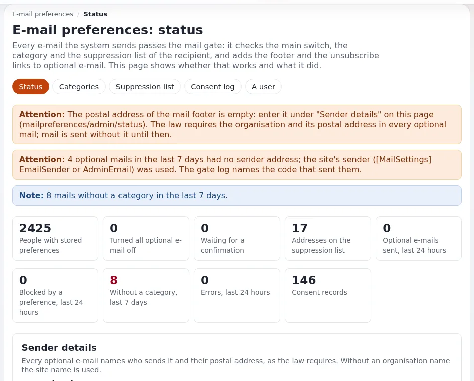

# Lektion 6.5: E-Mail-Einstellungen und die Mail-Sperre

Jede E-Mail, die Exponential versendet, passiert die *Mail-Sperre*. Optionale E-Mails (Benachrichtigungen zu Inhalten,
Newsletter, Angebote) gehen nur an Menschen, die sie eingeschaltet haben, nie an eine Adresse auf der Sperrliste und
immer mit einer Fußzeile, die sagt, wer sie versendet und wie man sie abbestellt. Notwendige E-Mails (Sicherheit,
Bestellungen) gehen immer. Diese Lektion zeigt Administratoren, wie sie die Sperre einrichten und prüfen und wie sie
die Anfrage einer Person beantworten, ohne im Kurs eine E-Mail zu versenden.

> **Hinweis**
> Testen Sie nie, indem Sie über die Webseiten versenden: Einen Newsletter einschalten, „Schicken Sie mir einen Link“
> und eine Adressänderung versenden echte E-Mails über den Transport der Website. Verwenden Sie die Konsolenbefehle
> unten, die in Dateien schreiben.

## Auf einen Blick

| | |
|---|---|
| Kurs | [Website-Administration](../README.md) |
| Modul | [Modul 6: Cronjobs, Workflows und Benachrichtigungen](README.md) |
| Dauer | 35 Minuten (15 Präsentation, 20 Übung) |
| Niveau | Fortgeschrittene |
| Zielgruppe | Website-Administratoren, Personen, die Datenschutzanfragen beantworten |
| Voraussetzungen | [Lektion 6.4](benachrichtigungen-ausfuehren.md); ein Administratorkonto und eine Shell auf der Schulungsinstallation |

## Lernziele

Nach dieser Lektion können die Teilnehmenden:

- den Unterschied zwischen optionalen und notwendigen E-Mails erklären und sagen, was die Sperre mit jeder Art macht;
- **Setup > E-Mail-Einstellungen** und `exp:mail:status` lesen und eine fehlende Absenderangabe ergänzen;
- mit `exp:mail:gate` testen, was die Sperre für eine Adresse entscheiden würde, wobei E-Mails nur in Dateien
  geschrieben werden;
- eine Adresse auf die Sperrliste setzen, sie prüfen und wieder freigeben;
- sagen, warum das Website-Geheimnis zusammen mit der Installation gesichert werden muss.

## Hinweise für Trainer

### So präsentieren Sie es

Quelle: [E-Mail-Einstellungen: einrichten und betreiben](../../../../anleitungen/mail-einstellungen-administrator.md),
Abschnitte 1 bis 10. Was Besucher sehen: [E-Mail-Einstellungen](../../../../../eng-us/features/6.0/mail-preferences.md).

1. **Die Sperre in einem Absatz** (3 Minuten). Jede E-Mail passiert `eZMailTransport::send()`. Eine E-Mail mit einer
   Kategorie wird mit den Einstellungen der Person, der Sperrliste und einem noch offenen Double-Opt-in abgeglichen.
   Eine E-Mail ohne Kategorie wird wie bisher versendet und gezählt, sodass Sie den Code finden können, der sie
   versendet.
2. **Die Statusseite** (4 Minuten). **Setup**, dann **E-Mail-Einstellungen** (Richtlinie
   `mailpreferences/administrate`). Zeigen Sie **Absenderangaben** mit **Name der Organisation** und
   **Postanschrift**, **Verwendete Einstellungen** und die Links zu **Kategorien**, **Sperrliste**,
   **Einwilligungsprotokoll** und **Ein Benutzer**.
3. **Das Website-Geheimnis** (2 Minuten). Links in E-Mails werden mit einem Geheimnis signiert, das in
   `settings/override/mailpreferences.ini.append.php` erzeugt wird. Ein neues Geheimnis macht jeden bereits
   versendeten Link ungültig und lässt die Sperrliste nicht mehr greifen. Sichern Sie es zusammen mit der Installation
   (Modul 9).
4. **Anfragen** (4 Minuten). „Was haben Sie über mich gespeichert?“, „Hören Sie auf, mir zu schreiben“, „Löschen Sie
   meine Daten“: Die Tabelle der Anleitung ordnet jeder Anfrage eine Seite oder einen Befehl zu. Das
   Einwilligungsprotokoll bewahrt den Nachweis auf, dass der Versand eingestellt wurde.
5. **Aufbewahrung** (2 Minuten). Der Teil `mailpreferences` in der Gruppe `infrequent` entfernt alte
   Einwilligungseinträge und abgelaufene Bestätigungen.

### Häufige Fragen

**Kann ich eine Kategorie standardmäßig einschalten?** Bei einer optionalen Kategorie nie: Sie würde E-Mails an
Menschen versenden, die nicht darum gebeten haben.

**Warum kann ich die Sperrliste nicht lesen?** Gespeichert wird nur ein Hash jeder Adresse. Sie finden einen Eintrag,
indem Sie die Adresse eingeben.

**Wer sieht den Export des Einwilligungsprotokolls?** Benutzer mit der Richtlinie `mailpreferences/export`. Die
CSV-Datei enthält Adressen und IP-Adressen: Bewahren Sie sie wie alle personenbezogenen Daten auf und löschen Sie sie,
wenn die Anfrage beantwortet ist.

### Stolperfallen

- **Echte Adressen im Kurs.** Verwenden Sie nur Adressen unter `example.invalid`; die Befehle maskieren Adressen, außer
  Sie fügen `--addresses` hinzu.
- **`settings/mailpreferences.ini` bearbeiten.** Einstellungen gehören in einen Override, nie in die mitgelieferte
  Datei. Verwenden Sie zuerst `exp:ini set ... --dry-run`.
- **Änderungen erscheinen unter Velocity nicht.** Eine Änderung an den Einstellungen braucht wie jede andere einen
  geleerten INI-Cache und unter Velocity einen Neustart seiner Worker.

## Praktische Übung

Verwenden Sie Ihre eigene Schulungsinstallation, in einem Terminal im Wurzelverzeichnis der Installation.

1. Öffnen Sie in der Administration **Setup**, dann **E-Mail-Einstellungen**. Lesen Sie die aufgeführten Probleme und
   **Verwendete Einstellungen**.
2. Führen Sie den Status in der Konsole aus und vergleichen Sie:

   ```bash
   php bin/php/console exp:mail:status
   ```

3. Sehen Sie vorab an, wie der Name der Organisation in einem Override gesetzt würde, ohne zu schreiben:

   ```bash
   php bin/php/console exp:ini set mailpreferences.ini/FooterSettings/OrganisationName "Training Organization" global --dry-run
   ```

4. Füllen Sie auf der Statusseite **Name der Organisation** (`Training Organization`) und **Postanschrift**
   (`Example Street 1`) aus und klicken Sie auf **Absenderangaben speichern**. Laden Sie neu: Die Warnung zur
   Fußzeile ist verschwunden.
5. Fragen Sie die Sperre, was sie für zwei Testadressen entscheiden würde, und schreiben Sie die E-Mails in Dateien:

   ```bash
   php bin/php/console exp:mail:gate --category=content --to=reader@example.invalid,other@example.invalid --write --mail-file-dir=var/tmp/gate-mail
   ```

6. Öffnen Sie die geschriebene Datei `.mail` in `var/tmp/gate-mail` und suchen Sie die Fußzeile und den Header
   `List-Unsubscribe`.
7. Setzen Sie eine Testadresse auf die Sperrliste und prüfen Sie sie:

   ```bash
   php bin/php/console exp:mail:suppression add --email=other@example.invalid --reason=legal --note="Training"
   php bin/php/console exp:mail:suppression check --email=other@example.invalid
   ```

8. Führen Sie Schritt 5 noch einmal aus und vergleichen Sie die Entscheidung für `other@example.invalid`.
9. Öffnen Sie **Setup > E-Mail-Einstellungen > Sperrliste**, verwenden Sie **Eine Adresse prüfen** für dieselbe
   Adresse und geben Sie sie dann in der Konsole wieder frei:
   `php bin/php/console exp:mail:suppression lift --email=other@example.invalid`.
10. Sehen Sie das Aufräumen nach Aufbewahrungsfrist vorab an: `php bin/php/console exp:mail:consent cleanup --dry-run`.

## Erwartetes Ergebnis

- Schritt 2 listet fünf Tabellen als `ok`, die Sperre, das Website-Geheimnis und die Kategorien.
- Schritt 3 gab einen Diff der Override-Datei und *nothing written* aus.
- Schritt 5 gab pro Adresse eine Entscheidung und *Written: 1 file(s)* aus und endete mit `PASS`.
- Schritt 8: Die gesperrte Adresse ist jetzt für die optionale Kategorie blockiert.
- Schritt 9: Der Eintrag wird gefunden und dann freigegeben.
- Der Trainer prüft die Datei `.mail` einer Teilnehmerin oder eines Teilnehmers am Beamer: Die Fußzeile nennt die
  Schulungsorganisation.



## Quiz

1. Welche Art von E-Mail geht weiterhin an eine Adresse auf der Sperrliste?
   A. Newsletter B. Benachrichtigungen zu Inhalten C. Notwendige E-Mails wie Sicherheitsmails D. Überhaupt keine
2. Was geschieht mit den Links in bereits versendeten E-Mails, wenn das Website-Geheimnis ersetzt wird?
3. Welcher Befehl zeigt, was die Sperre entscheiden würde, ohne einen Mailserver zu kontaktieren?
4. Warum dürfen optionale Kategorien nie standardmäßig eingeschaltet sein?
5. Wohin gehören die Absenderangaben: in `settings/mailpreferences.ini` oder in einen Override?

<details>
<summary>Antworten</summary>

1. **C.** Notwendige E-Mails gehen immer; optionale werden blockiert
   ([E-Mail-Einstellungen, Abschnitt 7](../../../../anleitungen/mail-einstellungen-administrator.md#7-die-sperrliste)).
2. Sie funktionieren nicht mehr, und kein Eintrag der Sperrliste greift mehr
   ([Abschnitt 2.4](../../../../anleitungen/mail-einstellungen-administrator.md#24-das-site-geheimnis)).
3. `exp:mail:gate`; mit `--write` und `--mail-file-dir` schreibt es die E-Mails in Dateien.
4. Sie würden E-Mails an Menschen versenden, die nicht darum gebeten haben, was Datenschutz- und Anti-Spam-Regeln
   verbieten.
5. In einen Override (die Statusseite oder `exp:ini set ... global`), nie in die mitgelieferte Datei.

</details>

## Weiterführende Literatur

- [E-Mail-Einstellungen: einrichten und betreiben](../../../../anleitungen/mail-einstellungen-administrator.md): die
  vollständige Anleitung für Administratoren mit einer Checkliste.
- [E-Mail-Einstellungen für Entwickler](../../../../anleitungen/mail-einstellungen-entwickler.md): wie Code E-Mails durch die
  Sperre versendet.
- [E-Mail, Einwilligung und Rückläufer für Hoster](../../../hosting/betrieb/einwilligung-und-bounces-bei-mails.md): die Seite
  des Servers.

## Verwandte Seiten

- [Modul 6: Cronjobs, Workflows und Benachrichtigungen](README.md)
- [Website-Administration: Kursüberblick](../README.md)
- [Trainer: hier beginnen](../../trainer-hier-beginnen.md)
- [Freie Dokumentation](../../../freie-dokumentation.md): Diese Seite darf unter der GNU FDL 1.3 frei kopiert, übersetzt und verbessert werden.

<!-- exp-partner-block:start -->
**Werden Sie Exponential-Partner.** Partner teilen ihre Informationen, stellen Mittel bereit, geben Beiträge
zurück und entwickeln die Produkte gemeinsam mit uns weiter, und so wächst Exponential. Eine Partner-Website und
ein Partner-Dashboard sind für Mitte 2027 geplant: Werden Sie noch heute Partner, damit wir schneller wachsen und
neue Funktionen früher bereitstellen können. Beginnen Sie mit [Partner: hier beginnen](../../../partner/partner-hier-beginnen.md) und
[Wie Sie sich bewerben](../../../partner/wie-sie-sich-bewerben.md).
<!-- exp-partner-block:end -->
