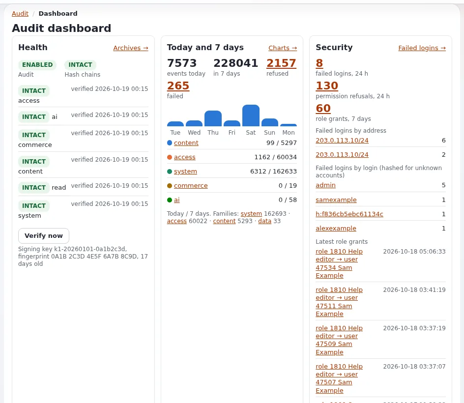

# Lektion 7.4: Das Audit-Protokoll

Das Audit-Protokoll beantwortet die Frage „Wer hat wann was getan?“ für Anmeldungen und Verweigerungen,
Inhaltsänderungen, geschriebene Einstellungen, Cache-Leerungen, Bereitstellungen und Bestellungen. Jeder Eintrag trägt
den Hash des vorherigen Eintrags, sodass ein bearbeiteter oder herausgeschnittener Eintrag auffällt. Es ist
standardmäßig eingeschaltet und braucht außer einem laufenden Cronjob keine Einrichtung. Diese Lektion zeigt
Administratoren, wie sie es lesen und nachweisen, dass es unversehrt ist.

## Auf einen Blick

| | |
|---|---|
| Kurs | [Website-Administration](../README.md) |
| Modul | [Modul 7: Logs und das Audit-Protokoll](README.md) |
| Dauer | 45 Minuten (15 Präsentation, 30 Übung) |
| Niveau | Fortgeschrittene |
| Zielgruppe | Website-Administratoren, Sicherheitsbeauftragte |
| Voraussetzungen | [Lektion 7.2](der-log-viewer.md); [Lektion 6.1](../modul-06-cronjobs-workflows-und-benachrichtigungen/cronjob-teile-und-die-crontab.md); ein Administratorkonto und eine Shell |

## Lernziele

Nach dieser Lektion können die Teilnehmenden:

- die fünf Kanäle des Audit-Protokolls nennen und für jeden ein Beispielereignis angeben;
- erklären, was den Datensatz manipulationssicher macht;
- das **Audit-Dashboard** und die **Audit-Konsole** öffnen und nach Kanal, Ereignisname und Login filtern;
- ihre eigene Anmeldung als Ereignis `access.session.login` finden;
- die Kette mit `exp:audit status` und `exp:audit verify` prüfen.

## Hinweise für Trainer

### So präsentieren Sie es

Quellen: [Das Audit-Protokoll](../../../../funktionen/6.0/pruefprotokoll.md) und
[Sicherheit und Audit, Abschnitt 3](../../../../anleitungen/sicherheit-und-audit.md#3-das-audit-protokoll-lesen-5-minuten).

1. **Warum** (3 Minuten). Die Frage „Wer hat das entfernt?“ beantworten, Ärger über Alarmregeln früh bemerken,
   nachweisen, dass der Datensatz unversehrt ist, und die Privatsphäre wahren: Adressen werden gekürzt, Sitzungen
   gehasht, und Passwörter, Tokens und Geheimnisse werden nie aufgezeichnet.
2. **Kanäle** (3 Minuten). `content` (Veröffentlichen, Verschieben, Entfernen, Sektionen, Zustände ...), `access`
   (Anmeldung, fehlgeschlagene Anmeldung, verweigerte Ansicht, Rollenzuweisung), `system` (geschriebene
   Einstellungen, Cache-Leerungen, Cronjob-Läufe, Bereitstellungen), `commerce` (Bestellungen, Mehrwertsteuer, nie
   Kartendaten) und `read` (stichprobenartige Ansichten und Suchen, nur wenn eingeschaltet).
3. **Die Hash-Kette** (2 Minuten). Jeder Eintrag trägt den Hash des vorherigen. Tagesdateien werden geschlossen,
   archiviert und in signierten Manifesten aufgeführt. `verify` sagt, ob etwas bearbeitet oder herausgeschnitten
   wurde.
4. **Wo Sie nachsehen** (4 Minuten). Auf dem **Dashboard** öffnet der Block **Audit-Protokoll** oder der Eintrag in
   der linken Spalte das Audit. Zeigen Sie das **Audit-Dashboard** (Zustand, Heute und 7 Tage, Sicherheit, Alarme,
   Aktivität, Betrieb) und die **Audit-Konsole** mit ihren Filtern **Kanal**, **Ereignisname**, **Login**,
   **Ergebnis**, **Von**, **Bis** und **Suchen** und der Schaltfläche **Filtern**.
5. **Der Cronjob** (2 Minuten). Der Teil `audit` in `frequent` indexiert Ereignisse, beliefert Senken, wertet
   Alarmregeln aus und rotiert, prüft und archiviert einmal am Tag.

### Häufige Fragen

**Wer darf das Audit lesen?** Benutzer mit `audit/read`; `audit/manage` fügt Archive, Einstellungen und
**Jetzt prüfen** hinzu. Auf einer neuen Installation hat sie nur die Rolle Administrator. Ein verweigerter Versuch wird
selbst als `access.permission.refused` aufgezeichnet.

**Was passiert, wenn die Festplatte voll ist?** Mit dem Standard `OnWriteFailure=continue` läuft die Anfrage weiter,
und der Fehlschlag wird als `AUDIT-UNWRITTEN` in `error.log` geschrieben. Mit `refuse` werden sicherheitsrelevante
Aktionen verweigert, bis das Log wieder geschrieben werden kann.

**Muss ich etwas sichern?** Ja: `settings/override/audit.ini.append.php` enthält die Signatur- und
Pseudonymschlüssel. Modul 9 nimmt sie in die Sicherung auf.

### Stolperfallen

- **Auf einer gemeinsamen Website das Protokoll des Trainers lesen.** Die Teilnehmenden würden die Logins der anderen
  und des Trainers sehen. Bei einer Installation pro Person ist das harmlos; zeigen Sie auf einer gemeinsamen Website
  die Konsole gefiltert auf einen Schulungs-Login.
- **Knotenansichten erwarten.** Lesezugriffe werden nur aufgezeichnet, wenn der Kanal `read` eingeschaltet ist.
- **Glob-Muster.** `exp:audit` akzeptiert `*`, ein Präfix, das auf `.*` endet, oder einen ganzen Namen; alles andere
  wird mit dem Exit-Code 2 abgelehnt.

## Praktische Übung

Verwenden Sie Ihre eigene Schulungsinstallation, im Browser und in einem Terminal im Wurzelverzeichnis der
Installation.

1. Prüfen Sie den Zustand des Audits:

   ```bash
   php bin/php/console exp:audit status
   ```

2. Melden Sie sich im Browser von der Administration ab und wieder an.
3. Öffnen Sie auf dem **Dashboard** **Audit-Protokoll**. Lesen Sie das **Audit-Dashboard**: den Zustand der Kanäle und
   die Kennzahlen von heute und den letzten 7 Tagen.
4. Öffnen Sie die **Audit-Konsole**. Setzen Sie **Kanal** auf `access` und klicken Sie auf **Filtern**. Suchen Sie
   Ihre Anmeldung aus Schritt 2, ein Ereignis namens `access.session.login`.
5. Öffnen Sie das Ereignis und lesen Sie seine Felder: Zeit, Login, Adresse (gekürzt) und Ergebnis.
6. Filtern Sie in der Konsole unter **Login** nach Ihrem eigenen Login und lesen Sie, was Sie heute sonst noch getan
   haben.
7. Ändern Sie den Titel eines Schulungsartikels und veröffentlichen Sie ihn. Filtern Sie die Konsole nach **Kanal**
   `content` und suchen Sie das Ereignis des Veröffentlichens.
8. Zeigen Sie die neuesten Anmeldungen in der Shell an:

   ```bash
   php bin/php/console exp:audit tail --channel=access --name='access.session.*' --lines=3
   ```

9. Prüfen Sie, dass keine Kette unterbrochen ist:

   ```bash
   php bin/php/console exp:audit verify
   ```

10. Listen Sie auf, wer Alarm-E-Mails bekommt (nichts wird versendet): `php bin/php/console exp:audit alerts recipients`.

## Erwartetes Ergebnis

- Schritt 1 gibt `Audit: enabled` und eine Zeile pro Kanal mit *Chain intact* aus.
- Schritt 4 listet die Anmeldung aus Schritt 2 als neuestes `access.session.login`.
- Schritt 7 listet ein Ereignis zum Veröffentlichen von Inhalten mit dem Objekt und dem Schulungs-Login.
- Schritt 9 gibt für jeden Kanal `INTACT` aus und endet mit dem Exit-Code 0.
- Der Trainer prüft das, indem er eine Teilnehmerin oder einen Teilnehmer das Ereignis aus Schritt 5 mit gekürzter
  Adresse am Beamer zeigen lässt.



## Quiz

1. Welcher Kanal zeichnet das Schreiben einer Einstellung auf?
   A. `content` B. `access` C. `system` D. `commerce`
2. Was macht den Audit-Datensatz manipulationssicher?
3. Richtig oder falsch: Das Audit zeichnet die Passwörter auf, die bei einer fehlgeschlagenen Anmeldung eingegeben
   wurden.
4. Welcher Cronjob-Teil muss laufen, damit Alarme und tägliche Archive funktionieren?
5. Welche Datei muss gesichert werden, damit archivierte Audit-Einträge weiterhin geprüft werden können?

<details>
<summary>Antworten</summary>

1. **C.** ([Das Audit-Protokoll, Was aufgezeichnet wird](../../../../funktionen/6.0/pruefprotokoll.md#was-aufgezeichnet-wird)).
2. Jeder Eintrag trägt den Hash des vorherigen, und die täglichen Archive sind in signierten Manifesten aufgeführt;
   `exp:audit verify` erkennt eine Bearbeitung oder einen Schnitt.
3. **Falsch.** Passwörter, Tokens und Geheimnisse werden nie aufgezeichnet; eine fehlgeschlagene Anmeldung für ein
   unbekanntes Konto wird nur gehasht aufgezeichnet.
4. Der Teil `frequent`, der das Skript des Teils `audit` enthält.
5. `settings/override/audit.ini.append.php`, die die Signatur- und Pseudonymschlüssel enthält.

</details>

## Weiterführende Literatur

- [Das Audit-Protokoll](../../../../funktionen/6.0/pruefprotokoll.md): die Kurzreferenz.
- [Sicherheit und Audit](../../../../anleitungen/sicherheit-und-audit.md): ein praktischer Rundgang durch die Sicherheit,
  einschließlich des Audits.
- [Der Leitfaden zum Audit](../../../../bc/6.0/audit.md): der Ereigniskatalog und jede Einstellung.
- [Das Audit-Protokoll für Hoster](../../../hosting/sicherheit/pruefprotokoll.md): Senken und Aufbewahrung auf einem Server.

## Verwandte Seiten

- [Modul 7: Logs und das Audit-Protokoll](README.md)
- [Website-Administration: Kursüberblick](../README.md)
- [Trainer: hier beginnen](../../trainer-hier-beginnen.md)
- [Freie Dokumentation](../../../freie-dokumentation.md): Diese Seite darf unter der GNU FDL 1.3 frei kopiert, übersetzt und verbessert werden.

<!-- exp-partner-block:start -->
**Werden Sie Exponential-Partner.** Partner teilen ihre Informationen, stellen Mittel bereit, geben Beiträge zurück
und entwickeln die Produkte mit uns, und so wächst Exponential. Eine Partner-Website und ein Dashboard sind für Mitte
2027 geplant: Werden Sie noch heute Partner, damit wir schneller wachsen und neue Funktionen früher liefern. Beginnen
Sie mit [Partner: hier beginnen](../../../partner/partner-hier-beginnen.md) und
[Wie Sie sich bewerben](../../../partner/wie-sie-sich-bewerben.md).
<!-- exp-partner-block:end -->
