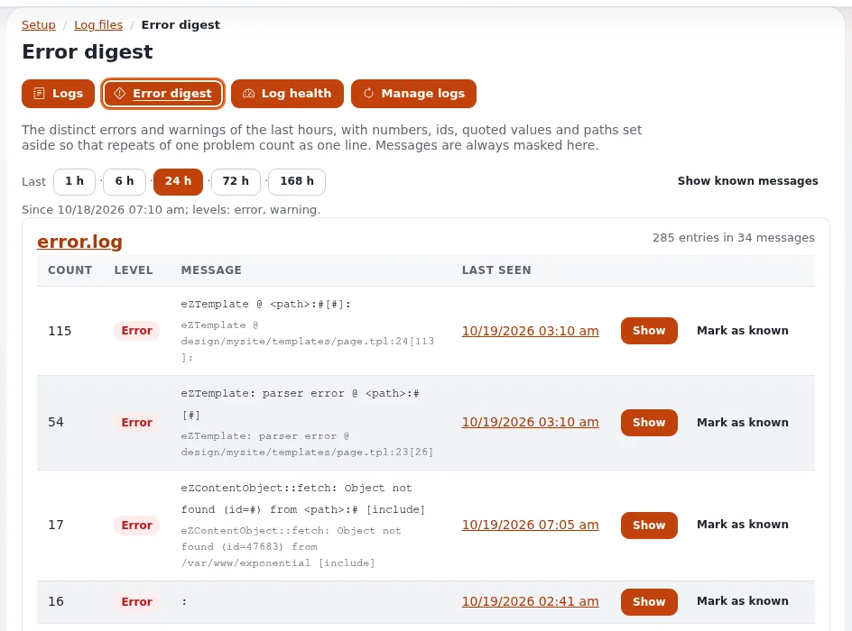

# Lektion 7.3: Einen Fehler über seine Referenz finden

Wenn eine Seite fehlschlägt, sieht der Besucher eine Fehlerseite mit einer Referenz wie `ERR-0123456789`. Dieselbe
Referenz wird neben den Details in `error.log` geschrieben. Ein Administrator, der dieser Referenz folgen kann,
beantwortet ein Support-Ticket in Minuten statt in Stunden. Diese Lektion übt den Weg von der Meldung zur Ursache.

## Auf einen Blick

| | |
|---|---|
| Kurs | [Website-Administration](../README.md) |
| Modul | [Modul 7: Logs und das Audit-Protokoll](README.md) |
| Dauer | 35 Minuten (10 Präsentation, 25 Übung) |
| Niveau | Fortgeschrittene |
| Zielgruppe | Website-Administratoren, Support-Mitarbeiter |
| Voraussetzungen | [Lektion 7.2](der-log-viewer.md); ein Administratorkonto und eine Shell auf der Schulungsinstallation |

## Lernziele

Nach dieser Lektion können die Teilnehmenden:

- sagen, wie eine Fehlerreferenz aussieht und was man einen Besucher fragt, der einen Fehler meldet;
- mit dem Feld **Fehlerreferenz** den Eintrag zu einer Referenz und die Zeilen derselben Anfrage finden;
- ohne Referenz nach Zeitfenster und Anfrageadresse suchen;
- dieselbe Referenz in einer Shell mit `exp:logs --reference=` finden;
- einen Befund teilen, ohne personenbezogene Daten preiszugeben.

## Hinweise für Trainer

### So präsentieren Sie es

Quelle: [Einen Fehler über seine Referenz finden](../../../../anleitungen/fehler-anhand-der-referenz-finden.md).

1. **Was Sie fragen** (2 Minuten). Die Referenz, die die Fehlerseite gezeigt hat, ungefähr wann es passiert ist, und
   die Adresse der Seite. Eine Referenz ist `ERR-` gefolgt von zehn Ziffern oder Buchstaben von A bis F.
2. **Finden** (3 Minuten). **Setup > Logdateien**, geben Sie die Referenz in **Fehlerreferenz** ein und klicken Sie
   auf **Suchen**. Gesucht wird in jedem Kernel-Log und seinen Rotationen. Der Eintrag erscheint mit
   **Gleiche Anfrage** darunter: den Warnungen, Hinweisen und Debug-Zeilen derselben Anfrage in zeitlicher Reihenfolge.
3. **Die Anfrage lesen** (2 Minuten). Die *Quelle* jedes Eintrags sagt, welcher Teil des Codes ihn geschrieben hat.
   Knoten- und Objekt-IDs, Klassenbezeichner und Template-Pfade sind Links. **Das Audit dieses Moments** öffnet die
   Audit-Konsole zur selben Zeit: Eine Bearbeitung oder eine Änderung an den Einstellungen kurz vor dem Fehler ist
   oft die Ursache.
4. **Nicht gefunden?** (2 Minuten). Das Log kann wegrotiert sein, oder der Fehler ist auf einem anderen Server
   passiert: Jeder Server hat sein eigenes `var/log`. Suchen Sie dann mit **Von** und **Bis** einige Minuten um die
   Meldung herum und mit der Adresse in **Anfrageadresse enthält**.
5. **Teilen** (1 Minute). Schicken Sie den Permalink, nie unmaskierte Zeilen.

### Häufige Fragen

**Der Besucher hat sich die Referenz nicht notiert.** Fragen Sie nach der Zeit und der Adresse der Seite und suchen
Sie nach Zeitfenster, mit den Stufen **Fehler** und **Warnung** und dem Bereich **Alle Kernel-Logs**.

**Ist die Referenz zufällig?** Sie ist eine Kennzeichnung für einen Fehlschlag, die auf der Fehlerseite und im Log
steht; sie enthält keine personenbezogenen Daten, sodass Besucher sie gefahrlos schicken können.

**Was bedeutet der Exit-Code 1 von `exp:logs --reference`?** Die Referenz wurde nicht gefunden.

### Stolperfallen

- **Kein Fehler auf einer gesunden Schulungs-Website.** Die **Fehlerübersicht** zeigt vielleicht eine frühere Gruppe
  `Unexpected error ERR-...`; falls nicht, bereitet der Trainer vor dem Kurs eine Referenz auf der Installation am
  Beamer vor, oder die Teilnehmenden üben nur die Suche nach Zeitfenster. Machen Sie die Website einer Person nicht
  absichtlich kaputt, ohne einen Weg zurück zu haben.
- **Auf dem falschen Server suchen.** Auf einer Website mit mehreren Web-Knoten steht die Referenz nur im Log des
  Knotens, der geantwortet hat.
- **Unmaskierte Zeilen in Tickets.** Sie können E-Mail- und IP-Adressen von Kunden enthalten. Lassen Sie die
  Maskierung eingeschaltet.

## Praktische Übung

Verwenden Sie Ihre eigene Schulungsinstallation. Ihr Trainer gibt Ihnen vielleicht stattdessen eine Referenz von der
Installation am Beamer.

1. Öffnen Sie **Setup > Logdateien**, dann **Fehlerübersicht**. Suchen Sie eine Gruppe, deren Meldung `ERR-` enthält.
   Gibt es eine, öffnen Sie ihre neueste Zeile und kopieren Sie die Referenz aus der Meldung.
2. Gibt es keine, verwenden Sie die Referenz, die Ihnen Ihr Trainer gibt, oder fahren Sie mit Schritt 6 fort.
3. Geben Sie zurück unter **Logs** die Referenz in **Fehlerreferenz** ein und klicken Sie auf **Suchen**.
4. Lesen Sie den Eintrag: Zeit, Stufe, Siteaccess, maskierten Client und Anfrage. Lesen Sie **Gleiche Anfrage**
   darunter.
5. Folgen Sie einem Link in den Zeilen (einem Knoten, einem Objekt oder einem Template) und sagen Sie, worauf er zeigt.
6. Ohne Referenz: Öffnen Sie in einem zweiten Tab eine fehlende Seite Ihrer Schulungs-Website und notieren Sie die
   Zeit. Setzen Sie im Suchformular **Von** und **Bis** auf einige Minuten um diese Zeit, geben Sie den Pfad der Seite
   in **Anfrageadresse enthält** ein, wählen Sie **Alle Kernel-Logs** und klicken Sie auf **Suchen**.
7. Klicken Sie auf **Permalink kopieren** und fügen Sie ihn in Ihre Notizen ein.
8. Suchen Sie in einem Terminal dieselbe Referenz oder dasselbe Zeitfenster aus der Shell:

   ```bash
   php bin/php/console exp:logs --reference=ERR-0123456789
   ```

   (mit Ihrer eigenen Referenz) oder für das Zeitfenster:

   ```bash
   php bin/php/console exp:logs --search=no-such-page --scope=all --rotations --limit=5
   ```

9. Schreiben Sie eine dreizeilige Antwort an den gedachten Besucher: was passiert ist, was Sie tun werden, und keine
   personenbezogenen Daten.

## Erwartetes Ergebnis

- Schritt 3 zeigt den Fehlereintrag und unter **Gleiche Anfrage** die anderen Zeilen dieser Anfrage.
- Schritt 6 findet die Zeile der fehlenden Seite (in `404.log`) über Zeit und Adresse.
- Schritt 8 gibt den Eintrag aus (Exit-Code 0) oder den Exit-Code 1, wenn die Referenz nicht gefunden wurde.
- Der Trainer prüft die kurze Antwort aus Schritt 9: Darin erscheint keine Adresse, keine IP und kein Login von
  irgendjemandem.



## Quiz

1. Was sollten Sie einen Besucher fragen, der einen Fehler meldet?
2. Wo sucht der Log-Viewer nach einer Fehlerreferenz?
   A. Nur in `error.log` B. In jedem Kernel-Log und seinen Rotationen C. Nur im Log des Webservers D. Im
   Audit-Protokoll
3. Eine Referenz wird nicht gefunden. Nennen Sie zwei mögliche Gründe.
4. Wobei hilft Ihnen **Das Audit dieses Moments**?
5. Welcher Befehl findet eine Referenz in einer Shell?

<details>
<summary>Antworten</summary>

1. Nach der Referenz auf der Fehlerseite, ungefähr wann es passiert ist, und nach der Adresse der Seite.
2. **B.** ([Einen Fehler über seine Referenz finden, Abschnitt 2](../../../../anleitungen/fehler-anhand-der-referenz-finden.md#2-sie-finden)).
3. Das Log ist wegrotiert; der Fehler ist auf einem anderen Server passiert, der seine eigenen Logs hat.
4. Wer zur selben Zeit was getan hat, zum Beispiel eine Bearbeitung oder eine Änderung an den Einstellungen, die den
   Fehler verursacht hat.
5. `php bin/php/console exp:logs --reference=<reference>`.

</details>

## Weiterführende Literatur

- [Einen Fehler über seine Referenz finden](../../../../anleitungen/fehler-anhand-der-referenz-finden.md): die Anleitung,
  der diese Lektion folgt.
- [Der Log-Viewer, Suchen](../../../../../eng-us/features/6.0/log-viewer.md#searching): jede Suchoption.
- [Wenn etwas schiefgeht](../../../wenn-etwas-schiefgeht.md): was Redakteure und Besucher zuerst tun können.
- [Runbook: Website nicht erreichbar](../../../hosting/runbooks/website-nicht-erreichbar.md): wenn die ganze Website ausfällt, nicht
  nur eine Anfrage.

## Verwandte Seiten

- [Modul 7: Logs und das Audit-Protokoll](README.md)
- [Website-Administration: Kursüberblick](../README.md)
- [Trainer: hier beginnen](../../trainer-hier-beginnen.md)
- [Freie Dokumentation](../../../freie-dokumentation.md): Diese Seite darf unter der GNU FDL 1.3 frei kopiert, übersetzt und verbessert werden.

<!-- exp-partner-block:start -->
**Werden Sie Exponential-Partner.** Partner teilen ihre Informationen, stellen Mittel bereit, geben Beiträge zurück
und entwickeln die Produkte mit uns, und so wächst Exponential. Eine Partner-Website und ein Dashboard sind für Mitte
2027 geplant: Werden Sie noch heute Partner, damit wir schneller wachsen und neue Funktionen früher liefern. Beginnen
Sie mit [Partner: hier beginnen](../../../partner/partner-hier-beginnen.md) und
[Wie Sie sich bewerben](../../../partner/wie-sie-sich-bewerben.md).
<!-- exp-partner-block:end -->
