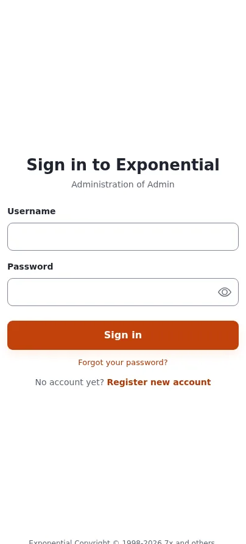

# Lektion 8.2: Passwörter und Anmelderichtlinie

Die Anmeldung ist die meistangegriffene Adresse jeder Website. Exponential speichert Passwörter als bcrypt-Hashes,
lehnt bekannte Passwörter ab, verrät nicht, welche Konten existieren, und kann ein Konto nach fehlgeschlagenen
Versuchen sperren. Diese Lektion zeigt Administratoren die Einstellungen hinter diesen Abwehrmaßnahmen, wie sie eine
vernünftige Richtlinie wählen und wie sie einem ausgesperrten Benutzer helfen.

> **Hinweis**
> Ändern Sie Einstellungen nur auf Ihrer eigenen Schulungsinstallation. Jedes Testkonto verwendet eine Adresse unter
> `example.invalid`.

## Auf einen Blick

| | |
|---|---|
| Kurs | [Website-Administration](../README.md) |
| Modul | [Modul 8: Sicherheit](README.md) |
| Dauer | 40 Minuten (15 Präsentation, 25 Übung) |
| Niveau | Fortgeschrittene |
| Zielgruppe | Website-Administratoren |
| Voraussetzungen | [Lektion 8.1](wie-ein-angreifer-denken.md); ein Administratorkonto und ein Testbenutzer auf der Schulungsinstallation |

## Lernziele

Nach dieser Lektion können die Teilnehmenden:

- die wirksamen Passworteinstellungen mit `exp:ini` lesen;
- in einem Override eine Mindestlänge für Passwörter setzen und erklären, warum Länge mehr bringt als Regeln zur
  Zusammensetzung;
- zeigen, wie die Prüfung auf schwache Passwörter ein gängiges Passwort ablehnt;
- eine Sperre nach fehlgeschlagenen Anmeldungen einrichten und ein Konto unter **Benutzerkonten prüfen** entsperren;
- erklären, was `EndOtherSessions` nach einer Passwortänderung bewirkt.

## Hinweise für Trainer

### So präsentieren Sie es

Quelle: [Kapitel 13, 13.6 Passwörter und Anmeldung](../../../../installation/13-sicherheitshaertung.md#136-passwörter-und-anmeldung).

1. **Die Einstellungen** (4 Minuten). `site.ini [UserSettings]`: `MinPasswordLength` (ausgeliefert 10 Byte),
   `GeneratePasswordLength`, `WeakPasswordCheck`, `ForgotPasswordKeyLifetime` (eine Stunde), `HashType=php_default`
   (bcrypt). `[PasswordSettings]`: Regeln zur Zusammensetzung, alle standardmäßig aus; `ForbidLogin`,
   `ForbidCurrentPassword`, `EndOtherSessions`, `ChangeNotificationMail`, die Stärkeanzeige und der Link
   **Sicheres Passwort erzeugen**.
2. **Eine vernünftige Richtlinie** (3 Minuten). Das Kapitel schlägt `MinPasswordLength=15` mit `ForbidLogin` und
   `ForbidCurrentPassword` vor, nach aktuellen Empfehlungen, die Länge gegenüber Regeln zur Zusammensetzung
   bevorzugen. Eine höhere Mindestlänge sperrt niemanden aus: Sie gilt, wenn ein Passwort das nächste Mal gesetzt
   wird.
3. **Sitzungen nach einer Änderung** (3 Minuten). Mit `EndOtherSessions=enabled` wird jede andere Sitzung des
   Benutzers bei ihrer nächsten Anfrage abgemeldet, und die Sitzung, die das Passwort geändert hat, bekommt eine neue
   ID. Genau das macht eine Passwortänderung nach der Übernahme eines Kontos wirksam.
4. **Fehlgeschlagene Anmeldungen** (3 Minuten). `MaxNumberOfFailedLogin=0` bedeutet keine Sperre. Ein Wert wie 10
   sperrt ein Konto, bis ein Administrator es entsperrt. Wägen Sie ab: Dann kann jeder ein bekanntes Konto sperren.
   Die Brute-Force-Warnungen des Audits melden Angriffe in beiden Fällen.
5. **Entsperren** (2 Minuten). **Benutzer > Benutzerkonten prüfen**, Filter **Gesperrt**, anhaken,
   **Angehakte Konten entsperren**, bestätigen.

### Häufige Fragen

**Warum nicht eine Ziffer und ein Sonderzeichen verlangen?** Regeln zur Zusammensetzung führen zu vorhersehbaren
Passwörtern wie `Summer2026!`. Die `Require*`-Regeln gibt es für Organisationen, deren eigene Richtlinie sie
vorschreibt.

**Enthält die E-Mail zur Passwortänderung das Passwort?** Nein. Sie teilt der Kontoinhaberin oder dem Kontoinhaber
mit, dass das Passwort geändert wurde, damit sie von einer Änderung erfahren, die sie nicht selbst vorgenommen haben.

**Ein Benutzer hat sein Passwort vergessen.** **Passwort vergessen?** antwortet für jede Adresse gleich, und sein Link
funktioniert standardmäßig einmal und eine Stunde lang. Ein Administrator kann auch ein neues Passwort setzen; jeden
Weg beschreibt [Das Administratorpasswort ändern](../../../administratorpasswort-aendern.md).

### Stolperfallen

- **`settings/site.ini` bearbeiten.** Einstellungen gehören in `settings/override/site.ini.append.php`. Verwenden Sie
  `exp:ini set` zuerst mit `--dry-run`.
- **Den Administrator sperren.** Testen Sie die Sperre mit einem Testbenutzer, nie mit Ihrem einzigen
  Administratorkonto.
- **Caches und Velocity.** Leeren Sie nach einer Änderung der Einstellungen den INI-Cache; starten Sie Velocity neu
  oder führen Sie ein Deploy aus, damit die Worker die Einstellung lesen.

## Praktische Übung

Verwenden Sie Ihre eigene Schulungsinstallation, mit einem Terminal im Wurzelverzeichnis der Installation und zwei
Browserfenstern.

1. Lesen Sie die wirksamen Einstellungen:

   ```bash
   php bin/php/console exp:ini get site.ini/UserSettings/MinPasswordLength
   php bin/php/console exp:ini get site.ini/UserSettings/WeakPasswordCheck
   php bin/php/console exp:ini get site.ini/UserSettings/MaxNumberOfFailedLogin
   ```

2. Sehen Sie sich die höhere Mindestlänge in der Vorschau an und schreiben Sie sie dann:

   ```bash
   php bin/php/console exp:ini set site.ini/UserSettings/MinPasswordLength 15 global --dry-run
   php bin/php/console exp:ini set site.ini/UserSettings/MinPasswordLength 15 global
   ```

3. Richten Sie auf dieselbe Weise eine Sperre nach fünf fehlgeschlagenen Anmeldungen ein
   (`site.ini/UserSettings/MaxNumberOfFailedLogin`, Wert `5`).
4. Leeren Sie den INI-Cache: `php bin/php/ezcache.php --clear-tag=ini`. Läuft die Website auf Velocity, starten Sie
   sie so neu, wie Ihr Trainer es zeigt.
5. Melden Sie sich in einem privaten Fenster als Testbenutzer an und öffnen Sie die Seite zur Passwortänderung des
   Kontos. Probieren Sie ein kurzes Passwort, dann ein gängiges wie `password1234567`. Lesen Sie beide Meldungen.
6. Setzen Sie ein langes Passwort, das **Sicheres Passwort erzeugen** vorschlägt, oder eine eigene lange Passphrase,
   und speichern Sie es.
7. Melden Sie sich ab. Melden Sie sich sechsmal mit einem falschen Passwort als Testbenutzer an.
8. Öffnen Sie als Administrator **Benutzer > Benutzerkonten prüfen**, wählen Sie den Filter **Gesperrt** und klicken
   Sie auf **Anzeigen**. Suchen Sie den Testbenutzer.
9. Haken Sie ihn an, klicken Sie auf **Angehakte Konten entsperren** und bestätigen Sie.
10. Melden Sie sich mit dem richtigen Passwort als Testbenutzer an.

## Erwartetes Ergebnis

- Schritt 1 gibt die ausgelieferten Werte aus (10, enabled, 0), sofern Ihre Installation sie nicht überschreibt.
- Schritt 5: Das Formular lehnt das kurze Passwort wegen seiner Länge ab und das gängige als bekannt.
- Schritt 8 listet den Testbenutzer als gesperrt; nach Schritt 9 listet der Filter ihn nicht mehr, und Schritt 10
  funktioniert.
- Der Trainer prüft bei einer Person `settings/override/site.ini.append.php`: Die zwei neuen Einstellungen stehen
  dort, in `settings/site.ini` hat sich nichts geändert.



## Quiz

1. Welche Einstellung entscheidet, nach wie vielen fehlgeschlagenen Anmeldungen ein Konto gesperrt wird, und was
   bedeutet `0`?
2. Warum bevorzugen aktuelle Empfehlungen eine lange Mindestlänge gegenüber „eine Ziffer, ein Sonderzeichen“?
3. Richtig oder falsch: Eine höhere `MinPasswordLength` sperrt Benutzer mit kürzeren Passwörtern aus.
4. Das Konto eines Benutzers wurde übernommen. Er ändert sein Passwort. Was geschieht mit der Sitzung des Angreifers?
5. Wo entsperren Sie in der Administration ein gesperrtes Konto?
   A. **Setup > Sitzungen** B. **Benutzer > Benutzerkonten prüfen** C. **Setup > Ini Einstellungen**
   D. **Setup > Logdateien**

<details>
<summary>Antworten</summary>

1. `site.ini [UserSettings] MaxNumberOfFailedLogin`; `0` bedeutet keine Sperre.
2. Regeln zur Zusammensetzung führen zu vorhersehbaren Passwörtern; Länge macht das Erraten teuer
   ([Kapitel 13, 13.6](../../../../installation/13-sicherheitshaertung.md#136-passwörter-und-anmeldung)).
3. **Falsch.** Bestehende Passwörter funktionieren weiter; die Regel gilt, wenn ein Passwort das nächste Mal gesetzt
   wird.
4. Mit `EndOtherSessions=enabled` wird sie bei ihrer nächsten Anfrage abgemeldet.
5. **B.** Mit dem Filter **Gesperrt** und **Angehakte Konten entsperren**
   ([Benutzerkonten prüfen](../../../../funktionen/6.0/benutzerpflege.md)).

</details>

## Weiterführende Literatur

- [Kapitel 13: Sicherheitshärtung für den Produktivbetrieb](../../../../installation/13-sicherheitshaertung.md): die
  Abschnitte 13.6 und 13.7.
- [Ihr Passwort ändern](../../../../funktionen/6.0/moderne-passwortaenderung.md): was Benutzer sehen.
- [Benutzerkonten prüfen](../../../../funktionen/6.0/benutzerpflege.md): jeder Filter und jede Aktion.
- [Erste Anmeldung und Standardpasswörter für Hoster](../../../hosting/sicherheit/erste-anmeldung-und-standardpasswoerter.md).

## Verwandte Seiten

- [Modul 8: Sicherheit](README.md)
- [Website-Administration: Kursüberblick](../README.md)
- [Trainer: hier beginnen](../../trainer-hier-beginnen.md)
- [Freie Dokumentation](../../../freie-dokumentation.md): Diese Seite darf unter der GNU FDL 1.3 frei kopiert, übersetzt und verbessert werden.

<!-- exp-partner-block:start -->
**Werden Sie Exponential-Partner.** Partner teilen ihre Informationen, stellen Mittel bereit, geben Beiträge zurück
und entwickeln die Produkte mit uns, und so wächst Exponential. Eine Partner-Website und ein Dashboard sind für Mitte
2027 geplant: Werden Sie noch heute Partner, damit wir schneller wachsen und neue Funktionen früher liefern. Beginnen
Sie mit [Partner: hier beginnen](../../../partner/partner-hier-beginnen.md) und
[Wie Sie sich bewerben](../../../partner/wie-sie-sich-bewerben.md).
<!-- exp-partner-block:end -->
