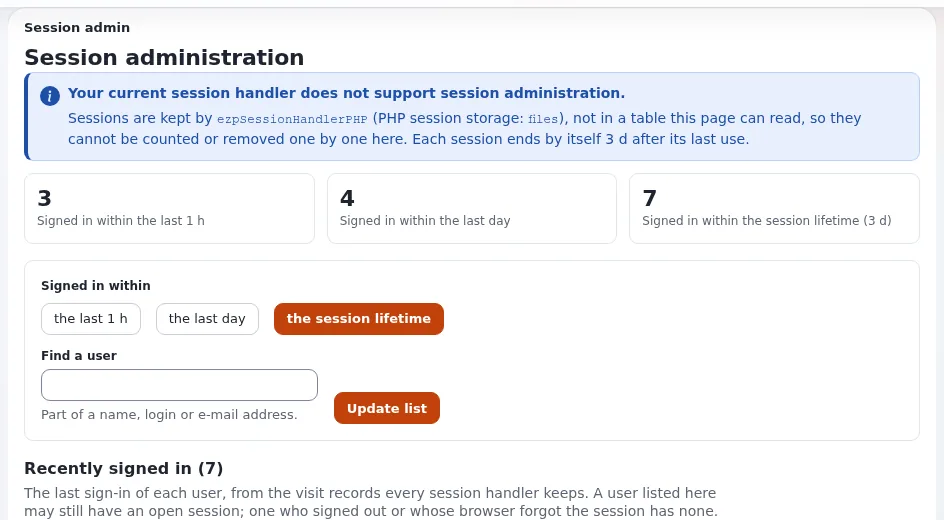

# Lektion 8.4: Sitzungen und Cookies

Eine Sitzung hält einen Browser angemeldet. Ein Administrator muss wissen, wie lange Sitzungen dauern, wie er sieht,
wer angemeldet ist, wie er einen Browser nach einem Vorfall abmeldet und welche Cookie-Einstellungen verhindern, dass
eine Sitzung gestohlen wird. Diese Lektion behandelt **Setup > Sitzungen** mit beiden Arten von Session-Handlern und
die Cookie-Einstellungen aus Kapitel 13.

> **Hinweis**
> Ein Wechsel des Session-Handlers meldet einmal alle ab. Tun Sie das nur auf Ihrer eigenen Schulungsinstallation.

## Auf einen Blick

| | |
|---|---|
| Kurs | [Website-Administration](../README.md) |
| Modul | [Modul 8: Sicherheit](README.md) |
| Dauer | 35 Minuten (15 Präsentation, 20 Übung) |
| Niveau | Fortgeschrittene |
| Zielgruppe | Website-Administratoren |
| Voraussetzungen | [Lektion 8.2](passwoerter-und-anmelderichtlinie.md); ein Administratorkonto, ein Testbenutzer und eine Shell |

## Lernziele

Nach dieser Lektion können die Teilnehmenden:

- sagen, wie lange eine Sitzung standardmäßig dauert und welche Einstellung das ändert;
- erklären, warum **Setup > Sitzungen** mit dem Standard-Handler keine Sitzungen auflisten kann und was die Seite
  stattdessen zeigt;
- auf Sitzungen in der Datenbank umstellen und die Sitzungen eines Benutzers über die Bestätigung entfernen;
- erklären, warum das Entfernen einer Sitzung nicht genügt, um einen Angreifer fernzuhalten;
- Cookie-Einstellungen für eine Website wählen, die nur über HTTPS ausgeliefert wird.

## Hinweise für Trainer

### So präsentieren Sie es

Quellen: [Sitzungen: wer angemeldet ist und wie Sie Browser abmelden](../../../../anleitungen/sitzungen.md) und
[Kapitel 13, 13.7 Sitzungen und Cookies](../../../../installation/13-sicherheitshaertung.md#137-sitzungen-und-cookies).

1. **Was eine Sitzung ist** (2 Minuten). Sie wird bei der ersten Anfrage geöffnet, die sie braucht, und endet
   `site.ini [Session] SessionTimeout` Sekunden nach ihrer letzten Nutzung (standardmäßig 259200, also drei Tage).
2. **Zwei Handler** (4 Minuten). Ein leeres `Handler=` (die Voreinstellung) bedeutet, dass PHP die Sitzungen in seinem
   eigenen Speicher hält: Die Seite **Sitzungsverwaltung** zeigt, wer sich kürzlich angemeldet hat
   (**Kürzlich angemeldet**, mit **die letzte Stunde**, **der letzte Tag**, **die Sitzungsdauer** und
   **Benutzer suchen**), kann aber keine Sitzungen auflisten oder entfernen. Mit `Handler=ezpSessionHandlerDB` liegen
   die Sitzungen in der Tabelle `ezsession`, und die Seite listet und entfernt sie.
3. **Sicher entfernen** (3 Minuten). **Abgelaufene / alte Sitzungen entfernen** meldet niemanden ab.
   **Alle Sitzungen entfernen** meldet nach einer Bestätigung alle ab, auch Sie selbst. Ihre eigene aktuelle Sitzung
   wird aus einer Auswahl nie entfernt.
4. **Allein nicht genug** (2 Minuten). Das Entfernen einer Sitzung meldet einen Browser ab; es sperrt den Benutzer
   nicht. Ändern Sie nach einer Übernahme auch das Passwort (mit `EndOtherSessions`, Lektion 8.2) oder deaktivieren
   Sie das Konto.
5. **Cookies** (4 Minuten). `CookieSecure` (`auto`, oder `true` für Websites nur mit HTTPS), `CookieHttponly=true`,
   `CookieSameSite=Lax` und ein kürzeres `SessionTimeout`, um zu begrenzen, wie lange eine gestohlene Sitzung nützlich
   ist. Getrennte Sitzungs-Cookies pro Siteaccess verhindern, dass eine Anmeldung auf der öffentlichen Website zugleich
   eine Anmeldung in der Administration ist.

### Häufige Fragen

**Sollte jede Website auf Sitzungen in der Datenbank umstellen?** Nur wenn Sie Sitzungen sehen und entfernen müssen.
`ForceStart=enabled` schreibt außerdem für jeden anonymen Besuch eine Zeile; setzen Sie es nur, wenn anonyme
Besucher gezählt werden müssen.

**Benutzer hinter einem HTTPS-Proxy werden auf jeder Seite abgemeldet.** Typischerweise ist `CookieSecure=true`
gesetzt, während der Kernel die Anfrage für einfaches HTTP hält: Dem Proxy wird nicht vertraut, oder er sendet kein
`X-Forwarded-Proto` (Kapitel 13, 13.10).

**Warum nicht `CookieSameSite=Strict`?** Damit geht die Sitzung beim ersten Klick aus einer E-Mail oder von einer
anderen Website auf eine Seite mit Anmeldung verloren, was Benutzer als Abmeldung erleben.

### Stolperfallen

- **Den ganzen Kurs abmelden.** Teilen sich mehrere Teilnehmende eine Installation, meldet
  **Alle Sitzungen entfernen** alle ab. Bei einer Installation pro Person meldet es nur diese Person ab.
- **Den Neustart vergessen.** Auf Velocity braucht ein Wechsel des Handlers ein Deploy, damit die Worker ihn lesen.
- **Abweichende Uhrzeit.** *Time skew detected* in **Letzte Aktivität** bedeutet, dass die Uhren der Webserver
  voneinander abweichen oder `SessionTimeout` gesenkt wurde.

## Praktische Übung

Verwenden Sie Ihre eigene Schulungsinstallation, mit einem Terminal im Wurzelverzeichnis der Installation und zwei
Browsern (oder einem normalen und einem privaten Fenster).

1. Öffnen Sie als Administrator **Setup > Sitzungen**. Lesen Sie den Hinweis zum Handler und die Liste
   **Kürzlich angemeldet**. Probieren Sie die Zeiträume **die letzte Stunde** und **die Sitzungsdauer** aus.
2. Lesen Sie die wirksamen Sitzungseinstellungen:

   ```bash
   php bin/php/console exp:ini get site.ini/Session/Handler
   php bin/php/console exp:ini get site.ini/Session/SessionTimeout
   ```

3. Stellen Sie auf Sitzungen in der Datenbank um:

   ```bash
   php bin/php/console exp:ini set site.ini/Session/Handler ezpSessionHandlerDB global --dry-run
   php bin/php/console exp:ini set site.ini/Session/Handler ezpSessionHandlerDB global
   php bin/php/ezcache.php --clear-tag=ini
   ```

   Führen Sie auf Velocity ein Deploy aus, wie Ihr Trainer es zeigt.
4. Melden Sie sich erneut als Administrator an (alle werden einmal abgemeldet). Melden Sie sich im privaten Fenster
   als Testbenutzer an.
5. Laden Sie **Setup > Sitzungen** neu. Lesen Sie die Zahlen und suchen Sie die Karte des Testbenutzers.
6. Klicken Sie auf der Karte des Testbenutzers auf **Sitzungen**, um seine Sitzungen einzeln zu sehen.
7. Haken Sie die Sitzung des Testbenutzers an, entfernen Sie sie und lesen Sie die Bestätigung, bevor Sie bestätigen.
8. Laden Sie im privaten Fenster eine Seite neu: Der Testbenutzer ist abgemeldet.
9. Klicken Sie auf **Abgelaufene / alte Sitzungen entfernen** und lesen Sie die Meldung.
10. Schreiben Sie auf Papier die `[Session]`-Einstellungen auf, die Sie für eine Website nur mit HTTPS verwenden
    würden, und vergleichen Sie sie mit Kapitel 13, Abschnitt 13.7.

## Erwartetes Ergebnis

- Schritt 1 zeigt den Hinweis, dass die Sitzungen von PHP gehalten werden und dort weder gezählt noch entfernt werden
  können.
- Schritt 5 zeigt Zahlen zu allen Sitzungen und zu angemeldeten Benutzern sowie eine Karte für den Testbenutzer.
- Schritt 8: Der Browser des Testbenutzers ist abgemeldet; die Sitzung des Administrators ist geblieben.
- Schritt 10 enthält `CookieSecure=true`, `CookieHttponly=true`, `CookieSameSite=Lax` und ein gewähltes
  `SessionTimeout`.
- Der Trainer prüft, indem er eine Person erklären lässt, was sie nach einer echten Kontoübernahme noch tun würde.



## Quiz

1. Wie lange dauert eine Sitzung standardmäßig nach ihrer letzten Nutzung?
2. Warum kann **Setup > Sitzungen** auf einer Standardinstallation keine Sitzungen entfernen?
3. Richtig oder falsch: Das Entfernen der Sitzungen eines Benutzers hindert ihn daran, sich erneut anzumelden.
4. Welche Schaltfläche meldet niemanden ab?
   A. **Alle Sitzungen entfernen** B. **Abgelaufene / alte Sitzungen entfernen** C. Ausgewählte entfernen D. Alle
5. Was garantiert `CookieSecure=true`?

<details>
<summary>Antworten</summary>

1. 259200 Sekunden, drei Tage (`site.ini [Session] SessionTimeout`).
2. Der Standard-Handler hält die Sitzungen im eigenen Speicher von PHP, den die Seite nicht auflisten kann
   ([Sitzungen, Abschnitt 1](../../../../anleitungen/sitzungen.md#1-die-seite-ohne-sitzungstabelle-der-standard)).
3. **Falsch.** Es meldet Browser ab; deaktivieren Sie zusätzlich den Benutzer oder ändern Sie das Passwort.
4. **B.** Sie entfernt nur abgelaufene Zeilen.
5. Das Sitzungs-Cookie wird nie über einfaches HTTP gesendet.

</details>

## Weiterführende Literatur

- [Sitzungen: wer angemeldet ist und wie Sie Browser abmelden](../../../../anleitungen/sitzungen.md): die Seite und ihre
  Probleme.
- [Kapitel 13: Sicherheitshärtung für den Produktivbetrieb](../../../../installation/13-sicherheitshaertung.md): die
  Abschnitte 13.7 und 13.10.
- [TLS und HTTPS für Hoster](../../../hosting/sicherheit/tls-und-https.md).

## Verwandte Seiten

- [Modul 8: Sicherheit](README.md)
- [Website-Administration: Kursüberblick](../README.md)
- [Trainer: hier beginnen](../../trainer-hier-beginnen.md)
- [Freie Dokumentation](../../../freie-dokumentation.md): Diese Seite darf unter der GNU FDL 1.3 frei kopiert, übersetzt und verbessert werden.

<!-- exp-partner-block:start -->
**Werden Sie Exponential-Partner.** Partner teilen ihre Informationen, stellen Mittel bereit, geben Beiträge zurück
und entwickeln die Produkte mit uns, und so wächst Exponential. Eine Partner-Website und ein Dashboard sind für Mitte
2027 geplant: Werden Sie noch heute Partner, damit wir schneller wachsen und neue Funktionen früher liefern. Beginnen
Sie mit [Partner: hier beginnen](../../../partner/partner-hier-beginnen.md) und
[Wie Sie sich bewerben](../../../partner/wie-sie-sich-bewerben.md).
<!-- exp-partner-block:end -->
