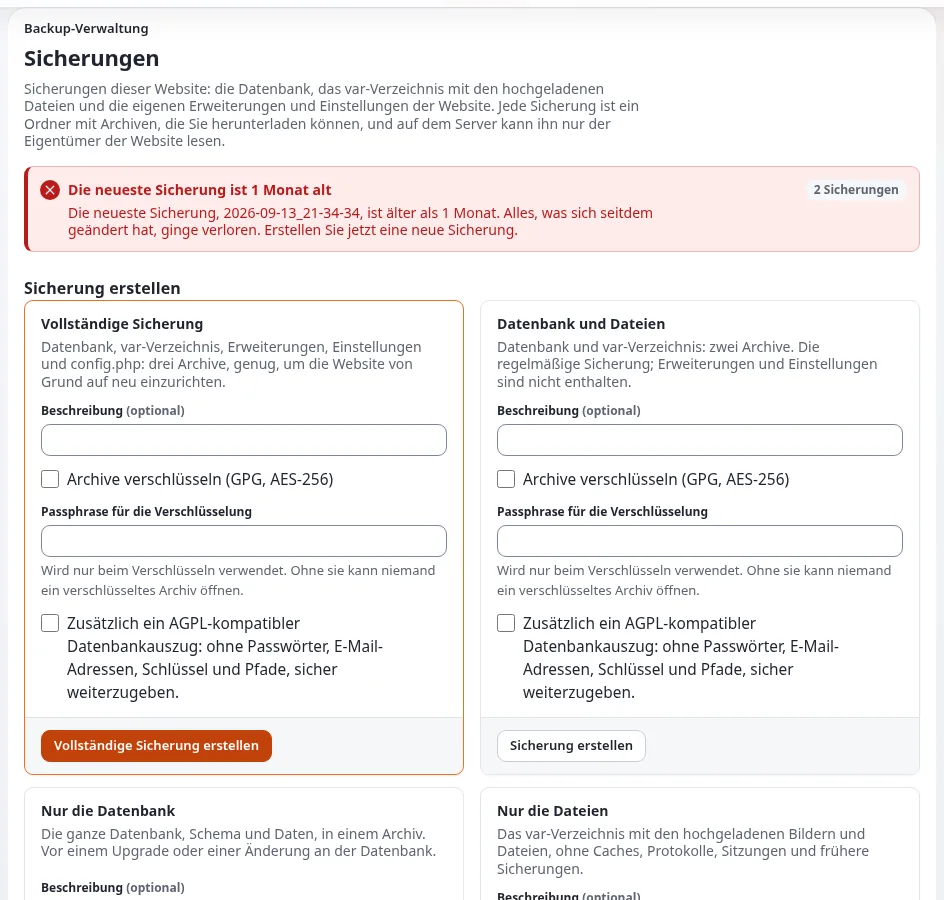

# Lektion 9.3: Eine Sicherung und ein Wiederherstellungstest

„Eine Sicherung, die nie wiederhergestellt wurde, ist eine Hoffnung, keine Sicherung.“ In dieser Lektion erstellen
die Teilnehmenden eine echte Sicherung ihrer Schulungs-Website, ändern die Website absichtlich, stellen sie wieder her
und führen die Prüfungen aus, die belegen, dass die Wiederherstellung vollständig ist. Die Lektion verwendet SQLite,
die Standarddatenbank einer Schulungsinstallation; der Trainer nennt die Befehle für andere Datenbanksysteme.

> **Hinweis**
> Eine Wiederherstellung überschreibt die Website. Üben Sie nur auf Ihrer eigenen Schulungsinstallation, und bewahren
> Sie die Sicherung außerhalb des Installationsverzeichnisses auf.

## Auf einen Blick

| | |
|---|---|
| Kurs | [Website-Administration](../README.md) |
| Modul | [Modul 9: Sicherungen und Wartung](README.md) |
| Dauer | 55 Minuten (15 Präsentation, 40 Übung) |
| Niveau | Fortgeschrittene |
| Zielgruppe | Website-Administratoren, Support-Mitarbeiter |
| Voraussetzungen | [Lektion 9.1](was-gesichert-werden-muss.md), [Lektion 9.2](wartungsmodus.md); eine Schulungsinstallation mit SQLite, Zugang zur Shell und dem Befehl `sqlite3` |

## Lernziele

Nach dieser Lektion können die Teilnehmenden:

- die Datenbank und die Dateien einer Website in einem Wartungsfenster sichern;
- beide in der richtigen Reihenfolge wiederherstellen, die Eigentümer korrigieren und die Caches leeren;
- die Prüfungen nach einer Wiederherstellung ausführen: die Website antwortet, die Version, die Caches, das Audit, die
  Inhalte;
- erklären, warum ein Wiederherstellungstest regelmäßig auf einem anderen Rechner stattfinden sollte;
- den Befehl zur Wiederherstellung für das eigene Datenbanksystem im Produktivbetrieb nennen.

## Hinweise für Trainer

### So präsentieren Sie es

Quellen: [Wiederherstellung und Wiederherstellungstests](../../../hosting/betrieb/wiederherstellung-und-wiederherstellungstests.md),
[Datenbanksicherungen je Datenbanksystem](../../../hosting/betrieb/datenbank-backups-je-engine.md) und
[Nach der Installation, 10.9](../../../../installation/10-nach-der-installation.md#109-sicherung-und-wiederherstellung).

1. **Der Ablauf der Sicherung** (3 Minuten). Wartung ein; die Datenbank mit dem Werkzeug ihres Datenbanksystems; die
   Dateien; Wartung aus. Bei SQLite ist die Datenbank eine Datei unter `var/storage/sqlite3/` mit ihren Dateien
   `-wal` und `-shm`; verwenden Sie `sqlite3 <db> ".backup '<file>'"`, das auch bei laufender Website sicher ist.
2. **Vor der Wiederherstellung** (3 Minuten). Klären Sie, was wiederhergestellt wird (alles geht auf den Zeitpunkt der
   Sicherung zurück; für eine einzelne gelöschte Seite sehen Sie zuerst im Papierkorb nach). Sichern Sie den aktuellen
   Zustand. Stellen Sie auf demselben Release wieder her.
3. **Die Wiederherstellung** (4 Minuten). Wartung ein (und Velocity stoppen, damit kein Worker die alte Datenbank
   hält); die Datenbank wiederherstellen und die Dateien entpacken; Eigentümer und Rechte korrigieren; jeden Cache
   leeren und die Autoloads neu erzeugen; Velocity starten, seinen Antwort-Cache leeren, Wartung aus.
4. **Die Prüfungen** (3 Minuten). Zeigen Sie die Tabelle der Prüfungen nach einer Wiederherstellung: Die Website und
   die Administration antworten, das Release unter **Setup > Systeminformationen**, Caches, `exp:audit verify`,
   aktuelle Seiten und ein Bild, eine Testveröffentlichung, `PRAGMA integrity_check` bei SQLite und neue Zeilen in
   `error.log`.
5. **Wiederherstellungstests** (2 Minuten). Auf einem anderen Rechner, mindestens einmal und nach jedem größeren
   Upgrade, und nach Plan.

### Häufige Fragen

**Was ist mit MySQL oder PostgreSQL?** Derselbe Ablauf mit den eigenen Werkzeugen des Datenbanksystems; siehe
[Datenbanksicherungen je Datenbanksystem](../../../hosting/betrieb/datenbank-backups-je-engine.md). Kopieren Sie
nie die Datendateien eines laufenden Datenbankservers.

**Warum Velocity stoppen?** Seine Worker halten Datenbankverbindungen und Caches. Eine Wiederherstellung unter
laufenden Workern kann alten und neuen Zustand vermischen.

**Die wiederhergestellte Website zeigt die Wartungsseite.** Die Sicherung von `var/` wurde bei eingeschalteter
Wartung erstellt; `php bin/php/maintenance.php off` beendet sie.

### Stolperfallen

- **Als root arbeiten.** Von root in `var/` angelegte Dateien kann der Webserver danach nicht ersetzen. Arbeiten Sie
  als Benutzer der Website, oder korrigieren Sie die Eigentümer nach der Wiederherstellung.
- **Die `-wal`-Datei vergessen.** Stellen Sie mit `.restore` wieder her, nicht indem Sie die Datenbankdatei über eine
  laufende Website kopieren.
- **In die Installation sichern.** Ein `tar` von `var/`, das die Sicherung selbst enthält, wächst bei jedem Lauf.
  Bewahren Sie Sicherungen in einem eigenen Verzeichnis außerhalb der Installation auf.

## Praktische Übung

Verwenden Sie Ihre eigene Schulungsinstallation mit SQLite, mit einem Terminal im Wurzelverzeichnis der Installation.
Läuft die Website auf Velocity, brauchen Sie dessen Befehle zum Stoppen und Starten von Ihrem Trainer. Ersetzen Sie
`exponential.db` durch den Namen, den `ls var/storage/sqlite3/` zeigt.

1. Legen Sie außerhalb der Installation ein Verzeichnis für Sicherungen an: `mkdir -p ~/training-backups`.
2. Schalten Sie die Wartung ein: `php bin/php/maintenance.php on --message="Backup" --until=30m --allow-admin`.
3. Sichern Sie die Datenbank:

   ```bash
   sqlite3 var/storage/sqlite3/exponential.db ".backup '$HOME/training-backups/db.sqlite'"
   ```

4. Sichern Sie die Dateien:

   ```bash
   tar czf ~/training-backups/files.tar.gz var/storage settings/override settings/siteaccess
   ```

5. Schalten Sie die Wartung aus: `php bin/php/maintenance.php off`. Notieren Sie die Uhrzeit.
6. Ändern Sie die Website: Veröffentlichen Sie einen neuen Artikel `After the backup` und verschieben Sie einen anderen
   Schulungsartikel in den Papierkorb.
7. Stellen Sie wieder her. Wartung ein; stoppen Sie Velocity, wenn er die Website ausliefert:

   ```bash
   php bin/php/maintenance.php on --message="Restoring" --allow-admin
   php bin/php/console exp:velocity stop
   ```

8. Stellen Sie die Datenbank und die Dateien wieder her:

   ```bash
   sqlite3 var/storage/sqlite3/exponential.db ".restore '$HOME/training-backups/db.sqlite'"
   tar xzf ~/training-backups/files.tar.gz
   ```

9. Leeren Sie die Caches und erzeugen Sie die Autoloads neu:

   ```bash
   php bin/php/ezcache.php --clear-all
   php bin/php/ezpgenerateautoloads.php -e
   ```

10. Starten Sie Velocity, leeren Sie seinen Antwort-Cache und schalten Sie die Wartung aus:

    ```bash
    php bin/php/console exp:velocity start
    php bin/php/console exp:velocity cache clear
    php bin/php/maintenance.php off
    ```

11. Führen Sie die Prüfungen aus: Öffnen Sie die Startseite und die Administration;
    `sqlite3 var/storage/sqlite3/exponential.db "PRAGMA integrity_check"`; `php bin/php/console exp:audit verify`;
    `tail -n 20 var/log/error.log`.
12. Suchen Sie den Artikel `After the backup` und den Artikel, den Sie in den Papierkorb verschoben haben.

## Erwartetes Ergebnis

- Die Schritte 3 und 4 haben `db.sqlite` und `files.tar.gz` in `~/training-backups` angelegt.
- Nach Schritt 10 antwortet die Website mit `200`, und die Anmeldung in der Administration funktioniert.
- Schritt 11: `integrity_check` gibt `ok` aus, und `exp:audit verify` endet mit 0. Ist das nicht so, halten Sie an und
  besprechen Sie das Ergebnis mit dem Trainer, bevor Sie weitermachen.
- Schritt 12: `After the backup` ist verschwunden, und der Artikel aus dem Papierkorb ist wieder an seinem Platz: Die
  Website steht auf dem Zeitpunkt der Sicherung.
- Der Trainer prüft, indem er alle Teilnehmenden fragt, wie lange die Wiederherstellung gedauert hat, und schreibt die
  Zeiten an die Tafel.



## Quiz

1. In welcher Reihenfolge stellen Sie wieder her: Wartung, Datenbank, Dateien, Caches? Bringen Sie sie in die richtige
   Reihenfolge und ergänzen Sie die fehlenden Schritte.
2. Warum ist `sqlite3 ... ".backup"` für eine laufende SQLite-Website besser als `cp`?
3. Ein Kollege hat versehentlich eine Seite gelöscht. Ist eine vollständige Wiederherstellung die richtige Antwort?
4. Nennen Sie drei Prüfungen nach einer Wiederherstellung.
5. Warum sollte ein Wiederherstellungstest auf einem anderen Rechner laufen?

<details>
<summary>Antworten</summary>

1. Wartung ein (und Velocity stoppen), die Datenbank wiederherstellen, die Dateien entpacken, Eigentümer und Rechte
   korrigieren, Caches leeren und Autoloads neu erzeugen, Velocity starten und seinen Antwort-Cache leeren, Wartung aus
   ([Wiederherstellung Schritt für Schritt](../../../hosting/betrieb/wiederherstellung-und-wiederherstellungstests.md#die-wiederherstellung-schritt-für-schritt)).
2. Es ist die Online-Sicherung von SQLite und bei laufender Website konsistent; eine einfache Kopie während eines
   Schreibvorgangs oder ohne ihre `-wal`-Datei kann inkonsistent sein.
3. Nein. Sehen Sie zuerst im Papierkorb und in den älteren Versionen nach; eine vollständige Wiederherstellung verliert
   alles, was seit der Sicherung veröffentlicht wurde.
4. Drei beliebige von: Die Website und die Administration antworten; das Release in den Systeminformationen; der
   Cache-Status; `exp:audit verify`; aktuelle Seiten, ein Bild und eine Testveröffentlichung; `PRAGMA integrity_check`
   bei SQLite; keine unerklärten Fehler.
5. Er beweist die Sicherung, den Ablauf und die benötigte Zeit, ohne die Live-Website zu gefährden.

</details>

## Weiterführende Literatur

- [Wiederherstellung und Wiederherstellungstests](../../../hosting/betrieb/wiederherstellung-und-wiederherstellungstests.md): der Ablauf
  und die Prüfungen.
- [Aus einer Sicherung wiederherstellen](../../../hosting/runbooks/aus-einem-backup-wiederherstellen.md): das Runbook für einen
  Vorfall.
- [Datenbanken, Kapitel 9](../../../../installation/09-datenbanken.md): Sicherung und Wiederherstellung je Datenbanksystem.
- [Sicherungspläne und Aufbewahrung](../../../hosting/betrieb/backup-zeitplaene-und-aufbewahrung.md).

## Verwandte Seiten

- [Modul 9: Sicherungen und Wartung](README.md)
- [Website-Administration: Kursüberblick](../README.md)
- [Trainer: hier beginnen](../../trainer-hier-beginnen.md)
- [Freie Dokumentation](../../../freie-dokumentation.md): Diese Seite darf unter der GNU FDL 1.3 frei kopiert, übersetzt und verbessert werden.

<!-- exp-partner-block:start -->
**Werden Sie Exponential-Partner.** Partner teilen ihre Informationen, stellen Mittel bereit, geben Beiträge zurück
und entwickeln die Produkte mit uns, und so wächst Exponential. Eine Partner-Website und ein Dashboard sind für Mitte
2027 geplant: Werden Sie noch heute Partner, damit wir schneller wachsen und neue Funktionen früher liefern. Beginnen
Sie mit [Partner: hier beginnen](../../../partner/partner-hier-beginnen.md) und
[Wie Sie sich bewerben](../../../partner/wie-sie-sich-bewerben.md).
<!-- exp-partner-block:end -->
