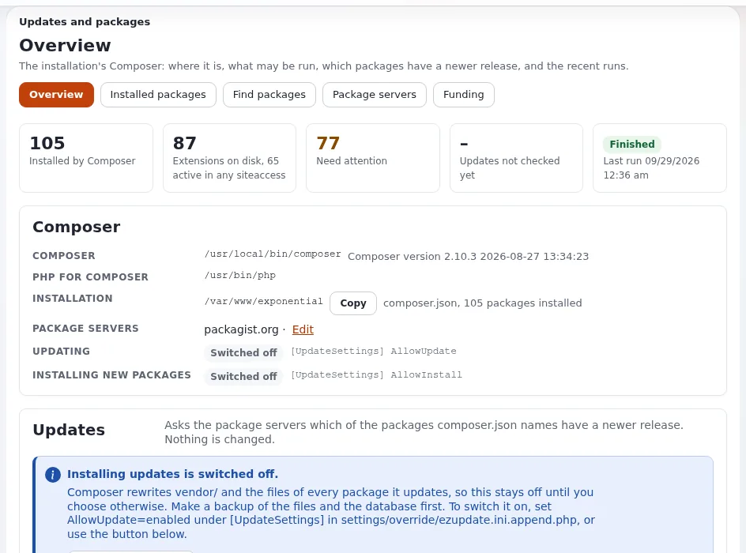

# Lektion 10.1: Ein Upgrade planen und durchführen

Ein Upgrade ist Routine, wenn es geplant ist: Kennen Sie die Version, die Sie verwenden, erstellen Sie eine Sicherung,
bringen Sie den neuen Code an seinen Platz, wenden Sie das Datenbank-Update einmal an, lesen Sie, was sich in den
durchlaufenen Zeiträumen geändert hat, und prüfen Sie das Ergebnis. Diese Lektion vermittelt den Plan und probt seine
Schritte auf einer Schulungsinstallation, damit das erste echte Upgrade nicht das erste Mal ist, dass jemand sie
ausführt.

> **Hinweis**
> Proben Sie auf einer Schulungsinstallation oder einer Kopie. Ein veröffentlichtes Release lässt sich nicht ändern:
> Die Korrektur eines Problems in einem Release ist das nächste Release, nie ein geändertes.

## Auf einen Blick

| | |
|---|---|
| Kurs | [Website-Administration](../README.md) |
| Modul | [Modul 10: Upgrades, Erweiterungen und Pakete](README.md) |
| Dauer | 50 Minuten (20 Präsentation, 30 Übung) |
| Niveau | Fortgeschrittene bis Experten |
| Zielgruppe | Website-Administratoren, Support-Mitarbeiter |
| Voraussetzungen | [Modul 9](../modul-09-sicherungen-und-wartung/README.md); eine Schulungsinstallation mit Zugang zur Shell |

## Lernziele

Nach dieser Lektion können die Teilnehmenden:

- die Version einer Installation in der Administration und in der Datenbank finden;
- den Teil der Upgrade-Anleitung wählen, der für eine Version gilt;
- die Schritte eines Upgrades innerhalb der Linie 6.0 in der richtigen Reihenfolge aufzählen;
- die Checklisten der Zeiträume zwischen zwei Versionen finden und lesen;
- ein Upgrade mit den Befehlen und Prüfungen der Anleitung verifizieren.

## Hinweise für Trainer

### So präsentieren Sie es

Quellen: [Upgrades durchführen: von 4.x, 5.x oder einer früheren 6.0.x bis heute](../../../../anleitungen/aktualisieren.md) und
[Kapitel 11: Upgrades durchführen](../../../../installation/11-aktualisieren.md).

1. **Welche Version** (3 Minuten). **Setup > Systeminformationen** nennt sie. In der Datenbank behalten die Zeilen
   `ezpublish-version` und `ezpublish-release` von `ezsite_data` absichtlich ihre historische Schreibweise; sie
   gehören zum alten Namen des Produkts, das von seinem Schöpfer nach fast 18 Jahren eingestellt wurde.
2. **Welcher Teil** (3 Minuten). Teil A für 3.10 bis 5.3, danach Teil B; Teil B für 5.4 oder 5.90; Teil C für jede
   6.0.x. Für Websites, die von LoveStack kommen, gibt es zuerst eine nur lesende Prüfung, `exp:lovestack check`.
3. **Teil C der Reihe nach** (6 Minuten). Schritt 1: sichern, immer. C1: den neuen Code an seinen Platz bringen, die
   Autoloads neu erzeugen, die Caches leeren, den PHP-FPM neu laden, der die Website ausliefert, oder Velocity per
   Deploy aktualisieren. C2: `update/database/<engine>/6.0/dbupdate-6.0.0-6.0.15.sql` einmal anwenden, vollständig,
   der Reihe nach; dann die Skripte für die Audit-Tabellen und die Papierkorb-Einträge. C3: die Checkliste jedes
   durchlaufenen Zeitraums lesen. C4: die eigenen Erweiterungen mit `exp:checkclasses` prüfen.
4. **Die drei Änderungen, auf die man am häufigsten stößt** (3 Minuten). Konten ohne eine Zeile in `ezuser_setting`
   können sich nicht anmelden; Overrides folgen `Priority`; Sicherheits-Header, Cookie-Einstellungen und eine
   strengere Prüfung von Uploads sind standardmäßig eingeschaltet.
5. **Prüfen** (3 Minuten). Caches leeren, `exp:checkdbfiles`, die Startseite, eine Anmeldung,
   **Setup > Systeminformationen**, eine Testveröffentlichung und **Setup > Upgrade-Prüfung** (Lektion 10.2). Leeren
   Sie nach dem Neuladen den Inhalts-Cache und den Antwort-Cache von Velocity.
6. **Wenn etwas schiefgeht** (2 Minuten). Eine SQL-Datei, die auf halbem Weg fehlgeschlagen ist: Stellen Sie die
   Sicherung wieder her und wenden Sie die Datei erneut von vorn an. Reparieren Sie nie von Hand und führen sie dann
   erneut aus.

### Häufige Fragen

**Wie lange dauert ein Upgrade?** Die Anleitung plant für eine kleine Website zwanzig Minuten. Der riskante Schritt
ist die Datenbank, deshalb kommt die Sicherung zuerst.

**Machen wir das Upgrade direkt von 5.x auf die neueste 6.0?** Teil B bringt die Website auf 6.0.0, danach Teil C auf
den heutigen Stand. Lesen Sie jede Checkliste der Zeiträume dazwischen.

**Wo stehen die Release Notes der Erweiterungen?** In den eigenen Changelogs der Erweiterungen; jede Erweiterung führt
ihre Version in `ezinfo.php` und `extension.xml`, angezeigt unter **Setup > Extensions**.

### Stolperfallen

- **Die Sicherung auslassen**, weil „es nur eine Nebenversion ist“.
- **Die Update-Datei zweimal anwenden.** Wenden Sie sie einmal an; eine Anweisung, die fehlschlägt, weil eine Spalte
  existiert, wird für sich allein übersprungen.
- **Die PHP-Prozesse vergessen.** Neuer Code ist erst live, wenn der PHP-FPM, der die Website ausliefert, neu geladen
  oder Velocity per Deploy aktualisiert ist; eine vom alten Code erzeugte Seite kann dann noch in einem Cache liegen.
- **`ezpgenerateautoloads.php -k` mit zusätzlichen Arbeitskopien des Codes im Wurzelverzeichnis der Installation.**
  Schließen Sie sie aus, sonst werden Kernel-Klassen in die Kopien abgebildet.

## Praktische Übung

Verwenden Sie Ihre eigene Schulungsinstallation, mit einem Terminal im Wurzelverzeichnis der Installation. Die Übung
probt die Schritte auf der Version, die Sie bereits verwenden; nichts wird aktualisiert.

1. Öffnen Sie **Setup > Systeminformationen** und notieren Sie die Version.
2. Lesen Sie dasselbe aus der Datenbank, nur lesend (Beispiel für SQLite; ersetzen Sie den Dateinamen durch Ihren):

   ```bash
   sqlite3 var/storage/sqlite3/exponential.db "SELECT name, value FROM ezsite_data WHERE name LIKE 'ezpublish-%';"
   ```

3. Entscheiden Sie anhand von [Upgrades durchführen](../../../../anleitungen/aktualisieren.md#welchen-teil-lese-ich), welcher
   Teil für eine Website mit 6.0.12 und für eine mit 5.4.0 gilt. Notieren Sie beide Antworten.
4. Öffnen Sie die Tabelle von [C3](../../../../anleitungen/aktualisieren.md#c3-die-checkliste-jedes-durchlaufenen-zeitraums-lesen) und
   listen Sie die Dokumente auf, die eine Website mit 6.0.12 lesen muss.
5. Schritt 1, sichern: Wiederholen Sie die Schritte 2 bis 5 von Lektion 9.3 (Wartung ein, Datenbank, Dateien, Wartung
   aus).
6. C1, wie nach einer Code-Änderung:

   ```bash
   php bin/php/ezpgenerateautoloads.php -e
   php bin/php/ezcache.php --clear-all
   ```

   Läuft die Website auf Velocity, sehen Sie sich das Deploy in der Vorschau an:
   `php bin/php/console exp:velocity deploy --dry-run`.
7. C4, die Klassen prüfen: `php bin/php/console exp:checkclasses`.
8. Prüfen Sie: `php bin/php/console exp:checkdbfiles`; öffnen Sie die Startseite; melden Sie sich an; veröffentlichen
   Sie ein Testelement und sehen Sie es sich auf der Website an.
9. Lesen Sie die Tabelle „Wenn etwas schiefgeht“ der Anleitung und erklären Sie Ihrer Sitznachbarin oder Ihrem
   Sitznachbarn, was Sie tun würden, wenn C2 auf halbem Weg fehlschlüge.

## Erwartetes Ergebnis

- Schritt 2 zeigt eine Versionszeile wie `6.0.15stable` (oder die Version Ihres Release).
- Schritt 3: Teil C für 6.0.12; Teil B, dann Teil C, für 5.4.0.
- Schritt 4 listet das Changelog und die Dokumente zu Verhaltensänderungen jedes Zeitraums nach 6.0.12 auf.
- Die Schritte 6 bis 8 laufen ohne Fehler; das Testelement erscheint auf der Website.
- Der Trainer prüft, indem er eine Person bittet, die Schritte von Teil C aus dem Gedächtnis der Reihe nach zu nennen.



## Quiz

1. Wo in der Administration lesen Sie die Version ab, die eine Installation verwendet?
2. Bringen Sie diese Schritte in die richtige Reihenfolge: das Datenbank-Update anwenden, sichern, den neuen Code an
   seinen Platz bringen, die Checklisten der Zeiträume lesen, prüfen.
3. Was tun Sie, wenn die Update-Datei der Datenbank auf halbem Weg fehlschlägt?
   A. Die fehlgeschlagene Anweisung von Hand korrigieren und weitermachen B. Die Sicherung wiederherstellen und die
   Datei erneut von vorn anwenden C. Die Datei ein zweites Mal anwenden D. Die Datei überspringen
4. Welcher Befehl zeigt eine PHP-Inkompatibilität in den Klassen einer Erweiterung?
5. Warum leeren Sie den Inhalts- und den Antwort-Cache nach dem Neuladen von PHP und nicht vorher?

<details>
<summary>Antworten</summary>

1. **Setup > Systeminformationen**.
2. Sichern, den neuen Code an seinen Platz bringen, das Datenbank-Update anwenden, die Checklisten der Zeiträume lesen,
   prüfen ([Upgrades durchführen, Teil C](../../../../anleitungen/aktualisieren.md#teil-c-von-einer-beliebigen-60x-auf-den-aktuellen-stand)).
3. **B.** Reparieren Sie nie von Hand und führen die Datei dann erneut aus.
4. `exp:checkclasses`, das jede deklarierte Klasse lädt und die meldet, die PHP ablehnt.
5. Eine vom alten Code erzeugte Seite zwischen dem Leeren und dem Neuladen würde erneut zwischengespeichert und
   ausgeliefert, als hätte das Upgrade nicht funktioniert.

</details>

## Weiterführende Literatur

- [Upgrades durchführen](../../../../anleitungen/aktualisieren.md): jeder Teil, die Prüfungen und die Tabelle zur
  Fehlerbehebung.
- [Kapitel 11: Upgrades durchführen](../../../../installation/11-aktualisieren.md): die Update-Dateien je Datenbanksystem.
- [Upgrades von Kunden-Websites](../../../hosting/betrieb/kunden-websites-aktualisieren.md): Upgrades bei einem Hoster.
- [Changelog 6.0.15](../../../../../changelogs/6.0/6.0.15.md): was die aktuelle Linie ändert.

## Verwandte Seiten

- [Modul 10: Upgrades, Erweiterungen und Pakete](README.md)
- [Website-Administration: Kursüberblick](../README.md)
- [Trainer: hier beginnen](../../trainer-hier-beginnen.md)
- [Freie Dokumentation](../../../freie-dokumentation.md): Diese Seite darf unter der GNU FDL 1.3 frei kopiert, übersetzt und verbessert werden.

<!-- exp-partner-block:start -->
**Werden Sie Exponential-Partner.** Partner teilen ihre Informationen, stellen Mittel bereit, geben Beiträge zurück
und entwickeln die Produkte mit uns, und so wächst Exponential. Eine Partner-Website und ein Dashboard sind für Mitte
2027 geplant: Werden Sie noch heute Partner, damit wir schneller wachsen und neue Funktionen früher liefern. Beginnen
Sie mit [Partner: hier beginnen](../../../partner/partner-hier-beginnen.md) und
[Wie Sie sich bewerben](../../../partner/wie-sie-sich-bewerben.md).
<!-- exp-partner-block:end -->
