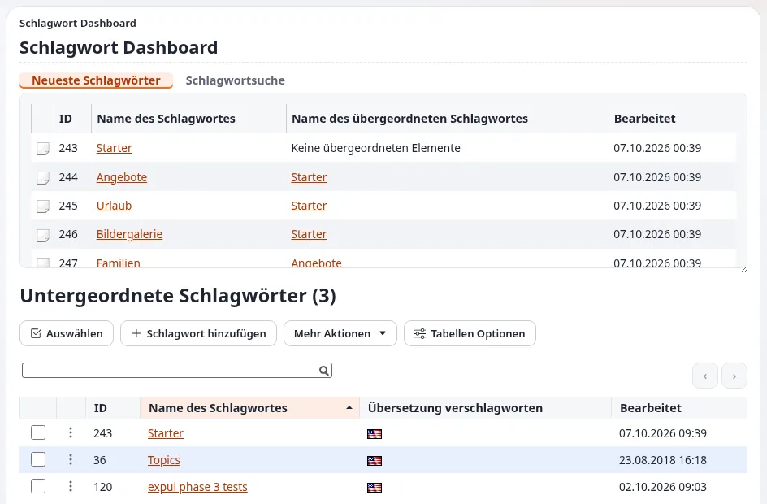

# Tags und Schlagwörter

Diese Seite ist für die Person, die das Vokabular einer Bibliothek oder eines Archivs verantwortet, und für die
Katalogisierenden, die es anwenden. Sie zeigt, wie die Erweiterung `eztags`, die mit Exponential ausgeliefert wird,
Ihnen kontrollierte Schlagwörter gibt: eine Hierarchie von Begriffen, Synonyme, eine Seite pro Thema und Listen von
Einträgen nach Thema. Die Schritte zur Einrichtung stehen unter
[Inhalte mit eztags verschlagworten](../../ersteller/website-ersteller/verschlagworten-mit-eztags.md).

## Inhalt

1. [Was eztags einem Katalog gibt](#was-eztags-einem-katalog-gibt)
2. [Ein Vokabular auf den Tag-Baum abbilden](#ein-vokabular-auf-den-tag-baum-abbilden)
3. [Geschlossene und offene Vokabulare](#geschlossene-und-offene-vokabulare)
4. [Schlagwörter auf Einträge anwenden](#schlagwörter-auf-einträge-anwenden)
5. [Themenseiten und Listen nach Thema](#themenseiten-und-listen-nach-thema)
6. [Schlagwörter in der Suche](#schlagwörter-in-der-suche)
7. [Mehrere Sprachen](#mehrere-sprachen)
8. [Wer das Vokabular ändern darf](#wer-das-vokabular-ändern-darf)
9. [Das Vokabular pflegen](#das-vokabular-pflegen)

## Was eztags einem Katalog gibt

Aus der [Funktionsseite zu eztags](../../../funktionen/6.0/erweiterungen/eztags.md), in Begriffen eines Katalogs:

| Funktion von eztags | Bedeutung für den Katalog |
|---|---|
| Eine Baumhierarchie von Tags | Ober- und Unterbegriffe |
| Synonyme | Nicht bevorzugte Begriffe, die zum bevorzugten Schlagwort führen |
| Hinzufügen, Bearbeiten, Verschieben, Zusammenführen und Löschen in der Administration (**Tags**, `/tags/dashboard`) | Pflege des Vokabulars an einer Stelle |
| Autovervollständigung im Bearbeitungsformular, Bearbeitungsansichten Default, Select oder Tree | Katalogisierende wählen Schlagwörter, statt sie einzutippen |
| Eine Tag-Ansicht (`/tags/view/...`) | Eine öffentliche Seite pro Thema |
| Ein erweiterter Attributfilter für die Fetches `content/list` und `content/tree` | Listen von Einträgen nach Thema überall auf der Website |
| Geschlossene (vordefinierte) und offene Klassifikation, später umschaltbar | Eine kontrollierte Liste, freie Schlüsselwörter oder beides |

`se7enxweb/eztags` steht im Block `require` von `composer.json` und gehört daher zu einer Standardinstallation.

## Ein Vokabular auf den Tag-Baum abbilden

| Begriff des Thesaurus | Im Tag-Baum |
|---|---|
| Spitzenbegriff | Ein Tag der obersten Ebene |
| Unterbegriff | Ein untergeordneter Tag |
| Benutze / Benutzt für | Ein Synonym des bevorzugten Tags |
| Verwandter Begriff | Keine eingebaute Relation zwischen Tags; beschreiben Sie ihn in der Einleitung der Themenseite oder verlinken Sie ihn dort |

Die letzte Zeile ist eine Grenze, die Sie kennen sollten: Die Funktionsseite nennt Hierarchie und Synonyme, keine
Verknüpfungen verwandter Begriffe zwischen Tags. Wenn Ihr Thesaurus auf verwandte Begriffe angewiesen ist, fragen Sie
Ihren Entwickler vor dem Import, wie sie dargestellt werden.

Der Rat für Website-Ersteller gilt auch für Kataloge: „Keep the tree shallow; three levels are plenty for most sites“
(halten Sie den Baum flach; drei Ebenen reichen für die meisten Websites) und „Merge duplicates and use synonyms rather
than near-identical tags“ (führen Sie Duplikate zusammen und verwenden Sie Synonyme statt fast gleicher Tags,
[Good tagging practice](../../ersteller/website-ersteller/verschlagworten-mit-eztags.md#gute-praxis-beim-verschlagworten)). Eine
Bibliotheksklassifikation mit vielen Ebenen bleibt oft besser im Bibliothekssystem, und nur die Ebenen, in denen Leser
stöbern, kommen in den Tag-Baum.

## Geschlossene und offene Vokabulare

- **Geschlossen**: Katalogisierende können nur vorhandene Schlagwörter wählen. Verwenden Sie das für Schlagwörter.
- **Offen**: Jeder mit dem entsprechenden Recht darf beim Bearbeiten Tags hinzufügen. Verwenden Sie das, wenn überhaupt,
  für freie Schlüsselwörter.
- **Beides**: ein geschlossenes Feld für Themen und ein offenes Feld für Schlüsselwörter in derselben Klasse.

Die Wahl lässt sich später ändern ([eztags](../../../funktionen/6.0/erweiterungen/eztags.md)). Beginnen Sie für einen
Katalog geschlossen: Ein offenes Vokabular bekommt schnell fast gleiche Einträge.

## Schlagwörter auf Einträge anwenden

1. Fügen Sie jeder Eintragsklasse ein Tag-Attribut hinzu (**Setup > Klassen**), zum Beispiel mit dem Namen „Themen“.
2. Wählen Sie die Bearbeitungsansicht: **Select** oder **Tree** passen zu einem geschlossenen Vokabular; **Default** mit
   Autovervollständigung passt zum Eintippen.
3. Katalogisierende tippen oder wählen Schlagwörter; die Autovervollständigung findet standardmäßig den Anfang eines
   Tags (`AutoCompleteType=start`) und zeigt bis zu 24 Ergebnisse (`MaxResults`).

Quelle: [Verschlagworten mit eztags, Set it up](../../ersteller/website-ersteller/verschlagworten-mit-eztags.md#einrichten).

## Themenseiten und Listen nach Thema

- **Themenseite**: `/tags/view/<tag>` listet alles auf, was damit verschlagwortet ist. Ihr Template lässt sich in Ihrem
  Design wie jedes andere überschreiben, sodass sie eine Einleitung, Unterbegriffe und die Einträge zeigen kann.
- **Listen nach Thema**: Der erweiterte Attributfilter lässt einen Ordner oder Block zum Beispiel „die neuesten fünf
  mit X verschlagworteten Einträge“ zeigen
  ([Tags auf einer Website zeigen](../../ersteller/website-ersteller/verschlagworten-mit-eztags.md#tags-auf-einer-website-anzeigen)).
- **Layouts**: Eine dynamische Sammlung eines Layout-Blocks kann Inhalte per Abfrage auflisten, zum Beispiel „alles,
  was mit“ einem Tag verschlagwortet ist ([Referenz zu Layouts](../../../bc/6.0/layouts.md)); der Query-Handler für
  Tag-Sammlungen `explayouts_tags_query` (Paket `se7enxweb/explayouts-tags-query` in `composer.json`) ist dafür da.
- **Tag-Wolke**: aus Solr gebaut, wenn es verfügbar ist (`TagCloudOverSolr=enabled`).

> **Tipp**
> „Give each tag page an introduction, so it is a useful landing page for search engines“ (geben Sie jeder Tag-Seite
> eine Einleitung, damit sie eine nützliche Einstiegsseite für Suchmaschinen ist, dieselbe Seite). Für eine Bibliothek
> hilft eine kurze Anmerkung zum Umfang jedes Themas auch den Lesern.

## Schlagwörter in der Suche

`eztags.ini [SearchSettings]` entscheidet, was in den Suchindex kommt: `IndexSynonyms` ist standardmäßig eingeschaltet
und `IndexParentTags` ausgeschaltet ([eztags, Settings](../../../funktionen/6.0/erweiterungen/eztags.md#einstellungen)). Mit
indizierten Synonymen findet ein Leser, der einen nicht bevorzugten Begriff eintippt, trotzdem die Einträge unter dem
bevorzugten Schlagwort. Mit `IndexParentTags` findet eine Suche nach einem Oberbegriff Einträge, die mit Unterbegriffen
verschlagwortet sind; besprechen Sie das mit Ihren Katalogisierenden, denn es verbreitert auch jede Ergebnisliste. Siehe
[Katalogsuche](katalogsuche.md).

## Mehrere Sprachen

Tags lassen sich übersetzen; das Übersetzen von Tags steht auf der Praxisliste für Website-Ersteller.
`DefaultAlwaysAvailable` (Standard `false`) entscheidet, ob neue Tags in jeder Sprache verfügbar sind. Das Lesen von
Tags folgt den Übersetzungsregeln, die mit der Datenbankkorrektur 2.3.4 beschrieben wurden: die Hauptsprache, wenn
danach gefragt wird, sonst eine ausdrückliche Locale, sonst die Sprachpriorität der Website
([eztags](../../../funktionen/6.0/erweiterungen/eztags.md#funktioniert-auf-jeder-datenbank)).

## Wer das Vokabular ändern darf

Das Modul `tags` hat eigene Richtlinien: `read`, `dashboard`, `view`, `add` (nach Tag eingeschränkt), `addsynonym`,
`edit`, `editsynonym`, `delete`, `deletesynonym` und weitere. Geben Sie Besuchern `tags/read` und `tags/view`, damit
Themenseiten für sie funktionieren; geben Sie Katalogisierenden `add` nur unterhalb der Tags, die sie betreuen
([Verschlagworten mit eztags, Permissions](../../ersteller/website-ersteller/verschlagworten-mit-eztags.md#rechte)). Lassen
Sie `edit`, `delete` und das Zusammenführen bei der verantwortlichen Person für das Vokabular.

## Das Vokabular pflegen

- [ ] Eine benannte verantwortliche Person für das Vokabular; Änderungen werden bei ihr angefragt.
- [ ] Neue Schlagwörter werden angelegt, bevor Einträge sie brauchen, nicht während des Katalogisierens.
- [ ] Duplikate zusammengeführt; Synonyme für Schreibvarianten und frühere Begriffe hinzugefügt.
- [ ] Themenseiten haben eine Anmerkung zum Umfang.
- [ ] Eine jährliche Prüfung der Schlagwörter ohne Einträge und der Schlagwörter mit sehr vielen.

## Verwandte Seiten

- [Bibliotheken und Kataloge](README.md)
- [Katalogeinträge modellieren](katalogeintraege-modellieren.md)
- [Katalogsuche](katalogsuche.md)
- [Inhalte mit eztags verschlagworten](../../ersteller/website-ersteller/verschlagworten-mit-eztags.md)
- [Freie Dokumentation](../../freie-dokumentation.md): Diese Seite darf unter der GNU FDL 1.3 frei kopiert, übersetzt und verbessert werden.

<!-- exp-partner-block:start -->
**Werden Sie Exponential-Partner.** Partner teilen ihre Informationen, stellen Mittel bereit, geben Beiträge zurück
und entwickeln die Produkte mit uns, und so wächst Exponential. Eine Partner-Website und ein Dashboard sind für Mitte
2027 geplant: Werden Sie noch heute Partner, damit wir schneller wachsen und neue Funktionen früher liefern. Beginnen
Sie mit [Partner: hier beginnen](../../partner/partner-hier-beginnen.md) und
[Wie Sie sich bewerben](../../partner/wie-sie-sich-bewerben.md).
<!-- exp-partner-block:end -->
