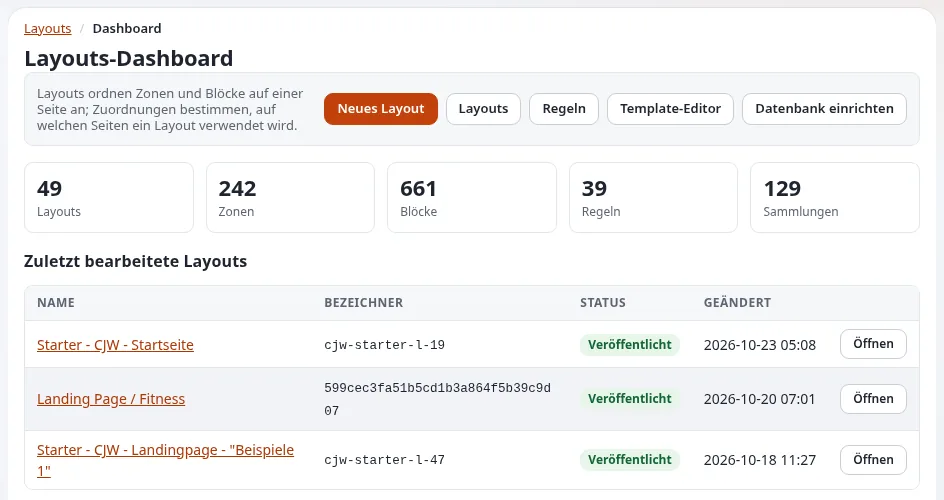

# Kampagnen und Landingpages

Diese Seite richtet sich an Kampagnenverantwortliche, Mitarbeiter in der Kommunikation und Redakteure gemeinnütziger
Organisationen. Sie zeigt, wie eine Kampagnenseite in Exponential Layouts ohne Entwickler gebaut wird, wie sie sich
nach Datum selbst ein- und ausschalten kann und wie sie mit der Spendenschaltfläche, dem Formular für Ehrenamtliche und
dem Newsletter verbunden wird.

## Inhalt

1. [Warum Layouts für Kampagnen](#warum-layouts-für-kampagnen)
2. [Die fünf Grundideen](#die-fünf-grundideen)
3. [Eine Kampagnenseite bauen](#eine-kampagnenseite-bauen)
4. [Ein- und Ausschalten nach Datum](#ein--und-ausschalten-nach-datum)
5. [Entwürfe und wer veröffentlicht](#entwürfe-und-wer-veröffentlicht)
6. [Die Kampagne verbinden](#die-kampagne-verbinden)
7. [Nach der Kampagne](#nach-der-kampagne)
8. [Checkliste Kampagne](#checkliste-kampagne)

## Warum Layouts für Kampagnen

Das README nennt Exponential Layouts einen visuellen Seitenbaukasten, der mit dem Produkt geliefert wird, und der
Leitfaden für Website-Ersteller empfiehlt ihn für „Startseiten, Landing- und Kampagnenseiten, die sich oft ändern“ und
„Seiten, die Redakteure ohne Entwickler ändern müssen“
([Landingpages mit Layouts](../../ersteller/website-ersteller/landingpages-mit-dem-layouts-editor.md#wann-layouts-und-wann-templates)).
Die Pakete `se7enxweb/explayouts*` stehen im `require`-Block von `composer.json`.

## Die fünf Grundideen

| Idee | Bedeutung |
|---|---|
| Layout | Eine benannte Anordnung auf Grundlage eines Layouttyps, der ihre Zonen festlegt |
| Zone | Ein benannter Bereich eines Layouts (`main`, `sidebar`, `footer`) |
| Block | Ein Element in einer Zone: Text, Bild, eine Liste von Artikeln, ein Hero, eine Schaltfläche |
| Sammlung | Die Inhalte, die ein Listenblock zeigt: von Hand ausgewählt oder eine Abfrage |
| Regel | Entscheidet, welche Anfragen welches Layout bekommen, nach Zielen und Bedingungen |

Quelle: [Landingpages mit Layouts, Die fünf Grundideen](../../ersteller/website-ersteller/landingpages-mit-dem-layouts-editor.md#die-fünf-grundbegriffe).
Redakteure finden den Editor unter `/explayouts_ui_api/app` in der Administration; die Hilfeseite
[Der Layout-Editor](../../layout-editor.md) führt durch ihn.

## Eine Kampagnenseite bauen

Angepasst aus [Eine Kampagnenseite von Grund auf](../../ersteller/website-ersteller/landingpages-mit-dem-layouts-editor.md#eine-kampagnenseite-von-grund-auf):

1. **Legen Sie die Inhaltsseite an**, auf der die Kampagne lebt, zum Beispiel `/Winter-appeal`.
2. **Legen Sie das Layout an**: einen Layouttyp mit einer oberen Zone und Spalten; benennen Sie es nach der Kampagne.
3. **Füllen Sie die Zonen**:
   - oben: einen `hero`-Block mit der Schlagzeile der Kampagne, einem Satz und einer Schaltfläche;
   - Hauptbereich: einen `rich_text`-Block mit der Geschichte und einen `list`-Block mit einer dynamischen Sammlung der
     Nachrichten der Kampagne;
   - Seite: einen `button`-Block („Button / Link“) zur Spendenseite und einen zum Formular für Ehrenamtliche.
4. **Ordnen Sie es zu**: eine Regel mit dem Ziel `node` (die Kampagnenseite).
5. **Vorschau**, dann **Veröffentlichen**.
6. **Prüfen** Sie die Seite auf der Website, abgemeldet und auf einem Telefon.

Der Blocktyp `button` ist in der [Referenz zu Layouts](../../../bc/6.0/layouts.md) als „Button / Link“ aufgeführt.

## Ein- und Ausschalten nach Datum

Eine Regel kann eine Bedingung `time` tragen, mit `from` und/oder `to`; „sie ist für Kampagnenlayouts gedacht, die sich
selbst ein- und ausschalten“ ([Referenz zu Layouts, Bedingungen](../../../bc/6.0/layouts.md#bedingungen)). Für eine
Startseite, die den Aufruf vier Wochen lang zeigt, ordnen Sie der Startseite ein Kampagnenlayout mit einer Zeitbedingung
und einer höheren Priorität als das normale Layout zu; wenn der Zeitraum endet, gilt wieder das normale Layout.

> **Warnung**
> Die Referenz warnt: „Ein nicht erkannter Bedingungstyp **passt**, statt fehlzuschlagen. Ein Tippfehler in einer
> Bedingung erweitert die Regel daher stillschweigend, statt sie zu deaktivieren.“ Prüfen Sie eine zeitlich begrenzte
> Regel auf der Website, nachdem Sie sie gespeichert haben, und noch einmal an dem Tag, an dem sie enden soll.

Einzelheiten zu Regeln: [Layout-Regeln](../../ersteller/website-ersteller/layout-regeln.md).

## Entwürfe und wer veröffentlicht

„Der Editor arbeitet immer an einem Entwurf; Besucher sehen nur veröffentlichte Layouts.“ Entwürfe gibt es pro Layout,
nicht pro Benutzer: „Zwei Personen, die dasselbe Layout bearbeiten, überschreiben sich gegenseitig“
([Landingpages mit Layouts, Entwürfe und Veröffentlichen](../../ersteller/website-ersteller/landingpages-mit-dem-layouts-editor.md#entwürfe-und-veröffentlichen)).
Vereinbaren Sie, wer veröffentlicht und dass jeweils eine Person ein Layout bearbeitet. Geben Sie Redakteuren die
Richtlinien `explayouts` und nur die Layouts, für die sie verantwortlich sind (dieselbe Seite, Übergabe an Redakteure).

Die gemeinsame Kopf- und Fußzeile einer Website kann aus einem gemeinsamen Layout stammen, sodass eine Kampagnenseite die
Navigation der Website behält ([Gemeinsame Kopf- und Fußzeile](../../ersteller/website-ersteller/gemeinsamer-kopf-und-fussbereich.md)).

## Die Kampagne verbinden

| Aktion der Kampagne | Verbinden mit |
|---|---|
| Spenden | Der Spendenseite oder -plattform ([Spenden und Spendenaufrufe](spenden-und-spendenaufrufe.md)) |
| Sich engagieren | Einem Formularobjekt ([Ehrenamtliche und Anmeldeformulare](ehrenamtliche-und-anmeldeformulare.md)) |
| Informiert bleiben | Der Seite zum Abonnieren des Newsletters ([Newsletter](../newsletters/README.md)) |
| Teilen | Metadaten für das Teilen in sozialen Netzwerken ([Metadaten und Teilen in sozialen Netzwerken](../../ersteller/website-ersteller/metadaten-und-teilen-in-sozialen-medien.md)) |
| Messen | Ihrem Analysewerkzeug ([Statistiken und Webanalyse](../../ersteller/website-ersteller/besucherstatistik-und-analyse.md)) |

Verwenden Sie pro Kampagne eine klare Handlungsaufforderung; eine Seite mit fünf gleichwertigen Schaltflächen bittet
Besucher zu wählen statt zu handeln.

## Nach der Kampagne

- Lassen Sie die Zeitbedingung das Kampagnenlayout beenden und bestätigen Sie dann, dass sie es getan hat.
- Behalten Sie die Kampagnenseite mit ihren Ergebnissen als Archiv oder verschieben Sie sie in einen Archivbereich;
  löschen Sie keine Seiten, auf die andere verlinkt haben. Verschobene Inhalte lassen sich umleiten
  ([Weiterleitungen und verschobene Inhalte](../../ersteller/website-ersteller/weiterleitungen-und-verschobene-inhalte.md)).
- Schreiben Sie für die nächste Kampagne auf, was funktioniert hat.

## Checkliste Kampagne

- [ ] Ein Ziel und eine Haupt-Handlungsaufforderung.
- [ ] Layout aus einem Entwurf gebaut, in der Vorschau geprüft und von der vereinbarten Person veröffentlicht.
- [ ] Regel der richtigen Seite zugeordnet; die Zeitbedingung ist auf der Website geprüft.
- [ ] Die Schaltflächen führen zur Spendenseite, zum Formular und zum Newsletter; alles abgemeldet getestet.
- [ ] Barrierefrei: Überschriften in der richtigen Reihenfolge, Alternativtexte, Kontrast des Hero-Texts
      ([Barrierefreiheit für gemeinnützige Organisationen](barrierefreiheit-fuer-gemeinnuetzige.md)).
- [ ] Metadaten für das Teilen in sozialen Netzwerken gesetzt; Webanalyse eingerichtet.
- [ ] Enddatum bestätigt; Plan für das Archiv vereinbart.

## Verwandte Seiten

- [Gemeinnützige Organisationen](README.md)
- [Landingpages mit Layouts](../../ersteller/website-ersteller/landingpages-mit-dem-layouts-editor.md)
- [Der Layout-Editor](../../layout-editor.md)
- [Ihren Shop bewerben](../shops/ihren-shop-bewerben.md)
- [Freie Dokumentation](../../freie-dokumentation.md): Diese Seite darf unter der GNU FDL 1.3 frei kopiert, übersetzt und verbessert werden.

<!-- exp-partner-block:start -->
**Werden Sie Exponential-Partner.** Partner teilen ihre Informationen, stellen Mittel bereit, geben Beiträge zurück
und entwickeln die Produkte mit uns, und so wächst Exponential. Eine Partner-Website und ein Dashboard sind für Mitte
2027 geplant: Werden Sie noch heute Partner, damit wir schneller wachsen und neue Funktionen früher liefern. Beginnen
Sie mit [Partner: hier beginnen](../../partner/partner-hier-beginnen.md) und
[Wie Sie sich bewerben](../../partner/wie-sie-sich-bewerben.md).
<!-- exp-partner-block:end -->
