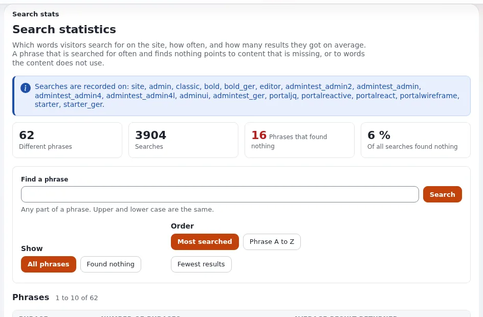

# Suche im Intranet

Diese Seite ist für Intranetverantwortliche, die möchten, dass Mitarbeiter die richtige Seite oder das richtige
Dokument in Sekunden finden. Sie erklärt, was die mit Exponential gelieferte Suche tut, wann sich ein größerer
Suchserver lohnt und wie Sie aus dem lernen, wonach Mitarbeiter suchen. Die technische Einrichtung steht auf den Seiten
[Suche auf der Website](../../../../eng-us/help/creators/website-creators/site-search.md) und
[Suche mit ezfind und Solr](../../../../eng-us/help/creators/website-creators/search-with-ezfind-and-solr.md).

## Inhalt

1. [Die Suche zeigt nur, was eine Person lesen darf](#die-suche-zeigt-nur-was-eine-person-lesen-darf)
2. [Die eingebaute Suchmaschine](#die-eingebaute-suchmaschine)
3. [Wann sich Solr lohnt](#wann-sich-solr-lohnt)
4. [In Dokumenten suchen](#in-dokumenten-suchen)
5. [Der Suche mit Struktur und Tags helfen](#der-suche-mit-struktur-und-tags-helfen)
6. [Aus Suchstatistiken lernen](#aus-suchstatistiken-lernen)
7. [Redakteure und Administratoren](#redakteure-und-administratoren)
8. [Checkliste](#checkliste)
9. [Verwandte Seiten](#verwandte-seiten)

## Die Suche zeigt nur, was eine Person lesen darf

Die wichtigste Eigenschaft für ein Intranet: Suchergebnisse folgen den Berechtigungen. Eine Person findet nur, was sie
lesen darf ([Suche auf der Website, The built-in engine](../../../../eng-us/help/creators/website-creators/site-search.md#the-built-in-engine)).
Die vertraulichen Seiten der Personalabteilung erscheinen nicht in den Ergebnissen eines Vertriebsmitarbeiters, und die
Suchseite braucht keine eigene zusätzliche Berechtigung
([Was Besucher sehen dürfen, Giving visitors more](../../../../eng-us/help/creators/website-creators/visitor-permissions.md#giving-visitors-more)).

Für das Unternehmen bedeutet das, dass ein Suchfeld das ganze Unternehmen bedienen kann. Sie brauchen keine eigene Suche
pro Abteilung, und Sie riskieren nicht, dass Titel eingeschränkter Dokumente über die Ergebnisse nach außen dringen.

## Die eingebaute Suchmaschine

Jede Installation hat eine Suchmaschine, die ihren Index in der Datenbank hält
(`site.ini [SearchSettings] SearchEngine=eZSearchEngine`). Sie indiziert beim Veröffentlichen die Felder, die in jeder
Klasse als **Searchable** markiert sind. Sie braucht keinen zusätzlichen Server und kostet im Betrieb daher nichts
weiter.

Einstellungen, die die intranetverantwortliche Person kennen sollte (`site.ini [SearchSettings]`, ausgelieferte Werte
von der Seite zur Suche auf der Website):

| Einstellung | Ausgeliefert | Was sie für Mitarbeiter bedeutet |
|---|---|---|
| `MaximumSearchLimit` | `30` | höchstens 30 Ergebnisse auf einer Seite |
| `EnableWildcard` | `false` | `polic*` findet „policy“ nicht, außer es wird eingeschaltet; auf großen Websites aufwendig |
| `AllowEmptySearch` | `disabled` | eine leere Suche wird abgelehnt |
| `DelayedIndexing` | `disabled` | neue Inhalte sind sofort durchsuchbar; `enabled` indiziert stattdessen per Cronjob |
| `LogSearchStats` | `disabled` | Suchbegriffe werden nicht aufgezeichnet |

## Wann sich Solr lohnt

`ezfind` verbindet Exponential mit einem Apache-Solr-Server. Es ist in `composer.json` aufgeführt und bleibt inaktiv,
bis es eingeschaltet wird. Der Vergleich von der ezfind-Seite:

| Bedarf | Eingebaute Suchmaschine | Solr |
|---|---|---|
| Seiten nach Wörtern finden | ja | ja |
| Relevanzbewertung und Gewichtung | einfach | ja |
| Facetten (Ergebnisse nach Klasse, Tag, Datum filtern) | nein | ja |
| Sehr viele Objekte | wird langsamer | dafür gebaut |

Solr ist ein eigener Java-Server, der installiert, betrieben, überwacht und gesichert werden muss
([Suche mit ezfind und Solr](../../../../eng-us/help/creators/website-creators/search-with-ezfind-and-solr.md#when-solr-is-worth-it)).
Der Konsolenbefehl `exp:solr` meldet seinen Status und startet oder stoppt ihn
([Befehle zur Serversteuerung](../../../../eng-us/features/6.0/web-server-and-solr-commands.md)).

Eine praktische Regel für die Entscheidung: Beginnen Sie mit der eingebauten Suchmaschine. Wechseln Sie zu Solr, wenn
Mitarbeiter Filter brauchen („nur PDF-Dateien der Personalabteilung aus 2026“), wenn die Zahl der Objekte groß wird oder
wenn die Suche in vielen Dokumenten wichtig ist. Der Wechsel ändert die Suchadresse nicht (`content/search` funktioniert
weiter).

## In Dokumenten suchen

Text in PDF- und Word-Dateien kann in den Index aufgenommen werden. `settings/binaryfile.ini` ordnet PDF dem Handler
`ezpdf` (externes Werkzeug `pstotext`) und Word dem Handler `ezword` (externes Werkzeug `wvWare`) zu; diese Programme
müssen auf dem Server installiert sein
([Dateien und Downloads, Searching inside files](../../../../eng-us/help/creators/website-creators/files-and-downloads.md#searching-inside-files)).
Mit Solr lassen sich ebenfalls Dateiinhalte indizieren.

## Der Suche mit Struktur und Tags helfen

- Markieren Sie nur nützliche Felder als **Searchable**: Titel, Einleitungen, Haupttexte; keine internen Codes.
- Geben Sie Dokumenten klare Titel; der Titel erscheint in den Ergebnissen.
- Verwenden Sie Tags abteilungsübergreifend mit `eztags`; mit Solr lassen sich Tag-Wolken aus der Suche bauen
  ([Verschlagworten mit eztags](../../../../eng-us/help/creators/website-creators/tagging-with-eztags.md)).
- Halten Sie ausgemusterte Dokumente aus den lesbaren Sektionen heraus, damit die Suche keine veralteten Versionen
  anbietet.

## Aus Suchstatistiken lernen

Mit `LogSearchStats=enabled` listet **Setup > Suchstatistiken** (`/search/stats`) jeden Suchbegriff auf, wie oft danach
gesucht wurde und die durchschnittliche Zahl der Ergebnisse. Begriffe, die nichts gefunden haben, zeigen, welche
Inhalte Mitarbeitern fehlen
([Suche auf der Website, Search statistics](../../../../eng-us/help/creators/website-creators/site-search.md#search-statistics)).

> **Hinweis**
> Suchbegriffe können personenbezogene Daten sein; deshalb ist ihre Aufzeichnung standardmäßig ausgeschaltet.
> Entscheiden Sie mit Ihrer Ansprechperson für den Datenschutz, ob Sie sie einschalten und für wie lange
> ([DSGVO-Grundlagen](../sicherheit/dsgvo-grundlagen.md)).

## Redakteure und Administratoren

Redakteure suchen auch in der Administration ([Suchen, für Redakteure](../../suchen.md)). Administratoren finden mit
dem Inhaltsfinder das Objekt hinter einer Objekt-, Knoten- oder Versions-ID, einer Remote-ID oder einem URL-Alias
([Der Inhaltsfinder](../../../../eng-us/features/6.0/content-finder.md)).

Nach einer Migration oder einem Umzug der Datenbank wird der ganze Index mit
`php bin/php/updatesearchindex.php --clean` neu aufgebaut
([Suche auf der Website, Indexing](../../../../eng-us/help/creators/website-creators/site-search.md#indexing)).

## Checkliste

- [ ] Entschieden: eingebaute Suchmaschine oder Solr.
- [ ] Durchsuchbare Felder für jede im Intranet verwendete Klasse geprüft.
- [ ] Suche getestet, angemeldet als Mitglieder zweier verschiedener Abteilungen.
- [ ] Werkzeuge zur Textextraktion installiert, wenn Dateiinhalte durchsuchbar sein müssen.
- [ ] Entscheidung zu Suchstatistiken festgehalten, mit einem Prüftermin.
- [ ] Neuaufbau des Index nach der Migration der Dokumente geplant.

## Verwandte Seiten

- [Suche auf der Website](../../../../eng-us/help/creators/website-creators/site-search.md)
- [Suche mit ezfind und Solr](../../../../eng-us/help/creators/website-creators/search-with-ezfind-and-solr.md)
- [Dokumente und Dateibibliotheken](dokumente-und-dateibibliotheken.md)
- [Such-Backends beim Hosting](../../hosting/grundlagen/such-backends.md)
- [Freie Dokumentation](../../freie-dokumentation.md): Diese Seite darf unter der GNU FDL 1.3 frei kopiert, übersetzt und verbessert werden.

<!-- exp-partner-block:start -->
**Werden Sie Exponential-Partner.** Partner teilen ihre Informationen, stellen Mittel bereit, geben Beiträge zurück
und entwickeln die Produkte mit uns, und so wächst Exponential. Eine Partner-Website und ein Dashboard sind für Mitte
2027 geplant: Werden Sie noch heute Partner, damit wir schneller wachsen und neue Funktionen früher liefern. Beginnen
Sie mit [Partner: hier beginnen](../../partner/partner-hier-beginnen.md) und
[Wie Sie sich bewerben](../../partner/wie-sie-sich-bewerben.md).
<!-- exp-partner-block:end -->
