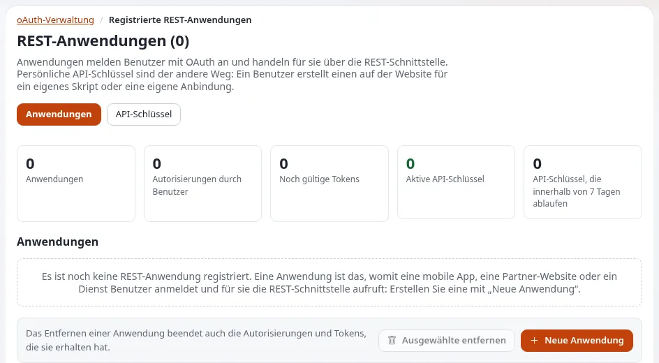

# Apps und API-Schlüssel

Diese Seite ist für Führungskräfte und Administratoren, die entscheiden müssen, wie Programme mit Exponential sprechen
dürfen: eine mobile App, das System eines Partners, ein Importskript, das Werkzeug einer Agentur. Sie erklärt die drei
Arten von Zugangsdaten, die die Plattform bietet, wie jede gesteuert wird, was aufgezeichnet wird, und eine Reihe von
Hausregeln. Die technische Seite ist [OAuth und API-Schlüssel](../../ersteller/anwendungsentwickler/oauth-und-api-schluessel.md).

## Inhalt

1. [Drei Arten von Zugangsdaten, gewählt danach, für wen das Programm handelt](#drei-arten-von-zugangsdaten-gewählt-danach-für-wen-das-programm-handelt)
2. [OAuth2 für Apps, bei denen sich Benutzer anmelden](#oauth2-für-apps-bei-denen-sich-benutzer-anmelden)
3. [Persönliche API-Schlüssel](#persönliche-api-schlüssel)
4. [Tokens für expservices](#tokens-für-expservices)
5. [Steuerung, Begrenzungen und das Prüfprotokoll](#steuerung-begrenzungen-und-das-prüfprotokoll)
6. [Hausregeln für ein Unternehmen](#hausregeln-für-ein-unternehmen)

## Drei Arten von Zugangsdaten, gewählt danach, für wen das Programm handelt

Aus [OAuth und API-Schlüssel](../../ersteller/anwendungsentwickler/oauth-und-api-schluessel.md#welche-zugangsdaten):

| Das Programm | Verwenden |
|---|---|
| Handelt für viele Benutzer, die sich selbst anmelden (eine mobile App) | OAuth2 |
| Ist das eigene Skript eines Benutzers | Ein persönlicher API-Schlüssel |
| Steuert Dienste der Administration (Apps, Portale, Shells) | Ein Token für expservices |

Keines davon ist ein Passwort: Ein API-Schlüssel „cannot sign in to the site or the administration“ (kann sich weder
an der Website noch in der Administration anmelden,
[Persönliche API-Schlüssel](../../../anleitungen/api-schluessel.md#1-was-ein-schlüssel-ist-und-was-nicht)).

## OAuth2 für Apps, bei denen sich Benutzer anmelden

1. Ein Administrator registriert die App unter **Setup > oAuth-Verwaltung**: Kennung, Geheimnis, Weiterleitungsadresse.
2. Die App schickt den Benutzer auf die Autorisierungsseite der Website; der Benutzer meldet sich an und erlaubt die
   App. Der Benutzer braucht die Richtlinie `oauth/authorize`, die sich nach Siteaccess einschränken lässt.
3. Die App tauscht einen Code gegen ein Token und erneuert es, wenn es abläuft (standardmäßig nach einer Stunde).

Quelle: [3.1 OAuth2-Tokens](../../../anleitungen/rest-api-v1-und-v2.md#31-oauth2-tokens). Wichtig für ein Unternehmen: „Das
Client-Geheimnis gehört auf einen Server. Eine App, die kein Geheimnis bewahren kann (eine mobile oder Browser-App),
ist ein öffentlicher Client: Sie wird ohne Geheimnis gespeichert, sendet keines und muss PKCE mit `S256` verwenden“
([OAuth2 für Anwendungen Dritter](../../ersteller/anwendungsentwickler/oauth-und-api-schluessel.md#oauth2-für-anwendungen-von-drittanbietern)).
Das Entfernen einer App in der Administration entfernt auch ihre Autorisierungen und Tokens
([7. Die Administration](../../../anleitungen/api-schluessel.md#7-die-administration-jeder-schlüssel-ein-benutzer-widerruf)).

## Persönliche API-Schlüssel

Neu in 6.0.15 ([Persönliche API-Schlüssel](../../../anleitungen/api-schluessel.md#kurz-gesagt)):

- Ein Benutzer mit der Richtlinie `apikey/create` erstellt unter **Mein Konto > API-Zugang** einen Schlüssel, benennt
  ihn, markiert die **Bereiche**, die er braucht, und wählt eine Lebensdauer. Der Schlüssel wird **einmal** angezeigt.
- Anfragen mit dem Schlüssel laufen als sein Eigentümer, beschränkt auf die Bereiche des Schlüssels, „and never beyond
  the owner's own policies“ (und nie über die eigenen Richtlinien des Eigentümers hinaus).
- Gespeichert wird nur ein gesalzener Hash des Geheimnisses; „nobody can show a key again, not even an administrator“
  (niemand kann einen Schlüssel erneut anzeigen, nicht einmal ein Administrator).
- Schlüssel enden, wenn sie widerrufen werden, wenn sie ablaufen oder wenn der Eigentümer deaktiviert oder entfernt
  wird. Ein Widerruf „takes effect at the next request on every server“ (wirkt bei der nächsten Anfrage auf jedem
  Server).

**Bereiche** stehen für Richtlinien des Eigentümers: Lesen, Veröffentlichen (Anlegen), Bearbeiten und Entfernen, wie
ausgeliefert. Ein Schlüssel für eine Integration, die nur liest, bekommt nur den Bereich Lesen
([6. Scopes](../../../anleitungen/api-schluessel.md#6-bereiche)).

## Tokens für expservices

Die Remote-Dienste haben eigene persönliche Tokens, pro Benutzer angelegt, mit einer Lebensdauer von 1 bis 365 Tagen
(standardmäßig 90). Anfragen melden sich nur für diese Anfrage als Benutzer des Tokens an, mit denselben Richtlinien; „a
token cannot create tokens“ (ein Token kann keine Tokens anlegen,
[Remote-Dienste: persönliche API-Tokens](../../../funktionen/6.0/entfernte-dienste-expservices.md#persönliche-api-tokens-für-skripte-und-anwendungen)).
Siehe [Entfernte Dienste](entfernte-dienste.md).

## Steuerung, Begrenzungen und das Prüfprotokoll

| Steuerung | Standard | Quelle |
|---|---|---|
| Schlüssel pro Benutzer | 10 | [8. Auditing and limits](../../../anleitungen/api-schluessel.md#8-audit-und-grenzen) |
| Längste Lebensdauer eines Schlüssels | 365 Tage | dieselbe |
| Anfragen pro Schlüssel und Minute | 120, in APCu gezählt; ohne APCu nicht durchgesetzt, und die Seite der API-Schlüssel sagt das | dieselbe |
| Übersicht über jeden Schlüssel | **Setup > oAuth-Verwaltung > API-Schlüssel**: aktiv, innerhalb von sieben Tagen ablaufend, nie benutzt, abgelaufen, widerrufen; suchen, filtern, einen oder viele mit Bestätigung widerrufen | [7. Die Administration](../../../anleitungen/api-schluessel.md#7-die-administration-jeder-schlüssel-ein-benutzer-widerruf) |
| Audit-Ereignisse | jeder angelegte, widerrufene, erstmals benutzte und abgelehnte Schlüssel, mit dem Grund (zum Beispiel widerrufen, abgelaufen, Bereich, ratenbegrenzt); nie das Geheimnis | [8. Auditing and limits](../../../anleitungen/api-schluessel.md#8-audit-und-grenzen) |
| Tokens für expservices | Ereignisse für angelegte, widerrufene und fehlgeschlagene Tokens im Prüfprotokoll | [Remote-Dienste](../../../funktionen/6.0/entfernte-dienste-expservices.md#persönliche-api-tokens-für-skripte-und-anwendungen) |

Für ein Unternehmen beantwortet das die Fragen der Prüfer „Wer konnte unsere Inhalte per Programm erreichen, und was
hat er getan?“ aus dem [Prüfprotokoll](../../../funktionen/6.0/pruefprotokoll.md).

## Hausregeln für ein Unternehmen

Angepasst aus der guten Praxis der technischen Seite:

- [ ] **Eine Zugangsberechtigung pro Programm**, damit sich eine allein widerrufen lässt.
- [ ] **Ein eigener Benutzer für jede Integration**, nicht der Administrator, mit der kleinsten Rolle, die funktioniert.
- [ ] **Der kleinste Bereich**: nur Lesen, es sei denn, das Programm muss schreiben.
- [ ] **Geheimnisse in Umgebungsvariablen oder einem Geheimnisspeicher**, nie in einem Repository, einer URL oder einem
      Log. (Ein in der Adresse gesendeter Schlüssel wird vor jeder Suche abgelehnt.)
- [ ] **Kurze Lebensdauern und Rotation**; tragen Sie Ablaufdaten in den Betriebskalender ein.
- [ ] **Ein monatlicher Blick auf die Seite der API-Schlüssel** nach nie benutzten Schlüsseln, bald ablaufenden
      Schlüsseln und Ablehnungen.
- [ ] **Ausscheiden**: Wenn ein Partnervertrag endet oder ein Mitarbeiter geht, werden seine Schlüssel und Tokens am
      selben Tag widerrufen.
- [ ] **Nur HTTPS** für jede API-Anfrage.

## Verwandte Seiten

- [REST API v1 und v2 für Unternehmen](rest-api-v1-und-v2-fuer-unternehmen.md)
- [Entfernte Dienste](entfernte-dienste.md)
- [OAuth und API-Schlüssel](../../ersteller/anwendungsentwickler/oauth-und-api-schluessel.md)
- [Persönliche API-Schlüssel](../../../anleitungen/api-schluessel.md)
- [Zugriffsprüfungen](../sicherheit/zugriffspruefungen.md)
- [Freie Dokumentation](../../freie-dokumentation.md): Diese Seite darf unter der GNU FDL 1.3 frei kopiert, übersetzt und verbessert werden.

<!-- exp-partner-block:start -->
**Werden Sie Exponential-Partner.** Partner teilen ihre Informationen, stellen Mittel bereit, geben Beiträge zurück
und entwickeln die Produkte mit uns, und so wächst Exponential. Eine Partner-Website und ein Dashboard sind für Mitte
2027 geplant: Werden Sie noch heute Partner, damit wir schneller wachsen und neue Funktionen früher liefern. Beginnen
Sie mit [Partner: hier beginnen](../../partner/partner-hier-beginnen.md) und
[Wie Sie sich bewerben](../../partner/wie-sie-sich-bewerben.md).
<!-- exp-partner-block:end -->
