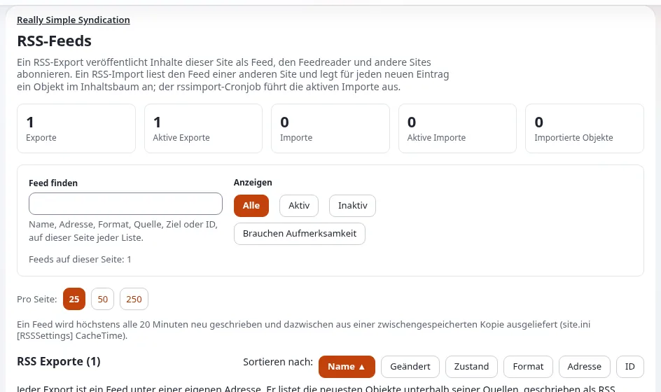

# Feeds und Syndication

Diese Seite ist für Inhaber, Marketingverantwortliche und Administratoren, deren Inhalte reisen sollen: in Feedreader
und Nachrichtenaggregatoren, in Podcast-Verzeichnisse, auf Partnerwebsites oder zwischen mehreren eigenen
Exponential-Installationen. Sie erklärt die Möglichkeiten in geschäftlichen Begriffen und verlinkt die Anleitungen für
die Personen, die sie einrichten.

## Inhalt

1. [Warum Feeds weiterhin wichtig sind](#warum-feeds-weiterhin-wichtig-sind)
2. [Feeds veröffentlichen](#feeds-veröffentlichen)
3. [Podcasts](#podcasts)
4. [Feeds anderer Websites importieren](#feeds-anderer-websites-importieren)
5. [Syndication zwischen Installationen](#syndication-zwischen-installationen)
6. [Das richtige Werkzeug wählen](#das-richtige-werkzeug-wählen)
7. [Checkliste für Feeds](#checkliste-für-feeds)

## Warum Feeds weiterhin wichtig sind

Ein Feed ist eine Standarddatei, die andere Programme ohne Vereinbarung oder API-Schlüssel lesen: Feedreader,
Aggregatoren, Podcast-Apps, Partnerwebsites und Ihre eigenen Newsletter-Werkzeuge. Für ein kleines Unternehmen ist er
der günstigste Weg, andere Ihre neuesten Neuigkeiten, Produkte oder Folgen zeigen zu lassen. Die README führt Feeds als
RSS, ATOM, iTunes RSS und OPML unter den Hauptfunktionen von Exponential auf.

## Feeds veröffentlichen

Aus [RSS-Feeds für Ihre Website](../../ersteller/website-ersteller/rss-feeds-fuer-ihre-website.md):

| | Export | Import |
|---|---|---|
| Was | Ein Feed, den diese Website veröffentlicht | Der Feed einer anderen Website, in diese Website gelesen |
| Adresse | `/rss/feed/<address>` | keine; er legt Objekte an |
| Formate | RSS 1.0, RSS 2.0, Atom, OPML, Apple Podcasts | was die andere Website anbietet |
| Braucht einen Cronjob | nein | ja |

Einen Export einzurichten dauert unter **Setup > RSS** wenige Minuten: ein Name und eine Adresse, Quellen (ein Ordner,
die aufzulistende Klasse, welche Felder Titel und Beschreibung werden), ein Format und eine Zahl von Einträgen. Die
Karte des Exports zeigt, wann die zwischengespeicherte Kopie zuletzt geschrieben wurde, und kennzeichnet Exporte, die
Aufmerksamkeit brauchen. Die Anleitung für Administratoren ist
[RSS-Feeds: Exporte veröffentlichen und Importe lesen](../../../anleitungen/rss-feeds.md).

Die Remote-Dienste können außerdem „RSS, Atom and JSON Feed output of any subtree“ erzeugen (Ausgabe jedes Teilbaums
als RSS, Atom und JSON Feed, [Entfernte Dienste](entfernte-dienste.md#was-sich-darüber-erledigen-lässt)).

> **Tipp**
> Fügen Sie im Seitenkopf einen Autodiscovery-Link und auf Ihrer Nachrichtenseite einen sichtbaren Feed-Link hinzu,
> damit Leser und Browser den Feed finden
> ([Browser und Leser ihn finden lassen](../../ersteller/website-ersteller/rss-feeds-fuer-ihre-website.md#browser-und-feedreader-ihn-finden-lassen)).

## Podcasts

Ein RSS-Export kann als **Apple Podcasts (RSS 2.0 + iTunes)** geschrieben werden, damit „a show published here can be
submitted to Apple without a hand written feed“ (eine hier veröffentlichte Sendung ohne handgeschriebenen Feed bei Apple
eingereicht werden kann, [RSS: Feeds für Apple Podcasts](../../../funktionen/6.0/rss-podcast-und-feed-liste.md)).
Kanalfelder wie Inhaber, Artwork und Kategorie werden im Exportformular ausgefüllt; die Kennung jeder Folge ist die
Remote-ID des Objekts, die „never changes, so readers do not see old episodes as new“ (sich nie ändert, sodass Leser alte
Folgen nicht als neu sehen). Eine Folge ohne abspielbare Audiodatei wird ausgelassen, da Apple sie ablehnt.

## Feeds anderer Websites importieren

Ein Import liest den Feed einer anderen Website und legt daraus gewöhnliche Objekte in einem Ordner Ihrer Wahl an; er
braucht den Cronjob `rssimport`, und „nothing is read without it“ (ohne ihn wird nichts gelesen). Das Entfernen des
Imports behält die Objekte. Der Rat der Anleitung ist klar: „Only import feeds you are allowed to republish“
(importieren Sie nur Feeds, die Sie weiterveröffentlichen dürfen,
[Einen Feed importieren](../../ersteller/website-ersteller/rss-feeds-fuer-ihre-website.md#einen-feed-importieren)).

## Syndication zwischen Installationen

Die Erweiterung `syndication`, die die `composer.json` im Wurzelverzeichnis verlangt, „exports part of the content tree
of one site as a feed, and another site imports it, kept in step by cron“ (exportiert einen Teil des Inhaltsbaums einer
Website als Feed, eine andere Website importiert ihn, per Cron synchron gehalten,
[syndication](../../../funktionen/6.0/erweiterungen/syndication.md)). Sie unterstützt:

- **Syndication in eine Richtung**, „for example shared content or authentication data between separate databases and
  client sites“ (zum Beispiel gemeinsame Inhalte oder Authentifizierungsdaten zwischen getrennten Datenbanken und
  Kundenwebsites);
- **Syndication in beide Richtungen**, „for example forums, portal networks, social platforms and large e-commerce
  networks“ (zum Beispiel Foren, Portalnetzwerke, soziale Plattformen und große E-Commerce-Netzwerke).

Was ein Unternehmen wissen sollte:

| Thema | Aus der Quelle |
|---|---|
| Transport | Zwischengespeichertes XML und Binärdateien, über eine SOAP-Schnittstelle ausgeliefert |
| Schutz | Seit 1.2.0 kann ein Import einen Login und ein Passwort senden, sodass die exportierende Website ihren Endpunkt mit HTTP-Zugriffskontrolle schützen kann |
| Betrieb | Eine Seite Syndication in der Administration zeigt, was exportiert und importiert wird, wann die Cronjobs zuletzt liefen und was Aufmerksamkeit braucht; Konsolenbefehle zeigen den Status und führen Exporte und Importe aus |
| Last | Der Cronjob für den Export wird alle 3 Minuten empfohlen, „since it carries much load once running“ (da er viel Last trägt, sobald er läuft) |
| Datenbanken | Seit 1.3.1 lassen sich seine Tabellen auf jeder Datenbank anlegen, die Exponential unterstützt, nicht nur auf MySQL |

Typische geschäftliche Verwendungen: eine Zentrale, die Neuigkeiten an Websites von Niederlassungen auf eigenen
Installationen liefert; eine Gruppe von Vereinen, die einen Veranstaltungskalender teilen; ein Hersteller, der
Produktinhalte an Händler liefert, die eigene Exponential-Websites betreiben
([Verkaufen über Netzwerke und Partner](verkaufen-ueber-netzwerke-und-partner.md)).

## Das richtige Werkzeug wählen

| Sie möchten | Verwenden |
|---|---|
| Jeder darf Ihre neuesten Einträge lesen | Einen Export als RSS oder Atom |
| Ihre Sendung in Podcast-Apps | Einen Export für Apple Podcasts |
| Eine Liste Ihrer Feeds für Leser | Einen OPML-Export ([OPML-Exporte](../../../bc/6.0/opml.md)) |
| Die Neuigkeiten einer anderen Website auf Ihrer zeigen | Einen RSS-Import |
| Inhalte mit einer anderen Exponential-Installation teilen, synchron gehalten | `syndication` |
| Inhalte für Ihre eigene App | Die REST API ([Headless mit der REST API](headless-mit-der-rest-api.md)) |
| Mehrere Marken in einer Installation | Kein Feed nötig: Teilen Sie Inhalte direkt ([Inhalte zwischen Marken teilen](../multisite/inhalte-zwischen-marken-teilen.md)) |

## Checkliste für Feeds

- [ ] Jeder Export hat eine Quelle, eine Adresse und ein Format und ist aktiv.
- [ ] Links im Feed zeigen auf den öffentlichen Siteaccess, in der richtigen Sprache.
- [ ] Der Seitenkopf verlinkt den Feed für Autodiscovery.
- [ ] `robots.txt` sperrt `/rss/feed/` nicht, wenn Feeds gefunden werden sollen.
- [ ] Importe laufen per Cron in einen Ordner, den Redakteure prüfen, und nur aus Quellen, die Sie weiterveröffentlichen
      dürfen.
- [ ] Endpunkte der Syndication sind geschützt, und ihre Zugangsdaten sind außerhalb der Versionsverwaltung.

## Verwandte Seiten

- [Verkaufen über Netzwerke und Partner](verkaufen-ueber-netzwerke-und-partner.md)
- [RSS-Feeds für Ihre Website](../../ersteller/website-ersteller/rss-feeds-fuer-ihre-website.md)
- [RSS-Feeds: Exporte veröffentlichen und Importe lesen](../../../anleitungen/rss-feeds.md)
- [syndication](../../../funktionen/6.0/erweiterungen/syndication.md)
- [Feeds für Neuerwerbungen (Bibliotheken)](../bibliotheken/feeds-fuer-neuerwerbungen.md)
- [Freie Dokumentation](../../freie-dokumentation.md): Diese Seite darf unter der GNU FDL 1.3 frei kopiert, übersetzt und verbessert werden.

<!-- exp-partner-block:start -->
**Werden Sie Exponential-Partner.** Partner teilen ihre Informationen, stellen Mittel bereit, geben Beiträge zurück
und entwickeln die Produkte mit uns, und so wächst Exponential. Eine Partner-Website und ein Dashboard sind für Mitte
2027 geplant: Werden Sie noch heute Partner, damit wir schneller wachsen und neue Funktionen früher liefern. Beginnen
Sie mit [Partner: hier beginnen](../../partner/partner-hier-beginnen.md) und
[Wie Sie sich bewerben](../../partner/wie-sie-sich-bewerben.md).
<!-- exp-partner-block:end -->
