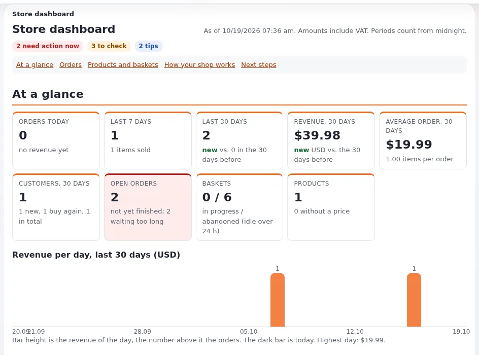

# Einen Shop im Alltag betreiben

Diese Seite richtet sich an Shop-Verantwortliche und Inhaber nach dem Start. Sie gibt Routinen für jeden Tag, jede
Woche, jeden Monat und jedes Jahr, damit nichts vergessen wird, wenn im Shop viel los ist oder jemand im Urlaub ist.
Passen Sie die Listen an Ihren Shop an und bewahren Sie sie dort auf, wo das Team sie sieht.

## Inhalt

1. [Jeden Tag](#jeden-tag)
2. [Eine Bestellung bearbeiten](#eine-bestellung-bearbeiten)
3. [Retouren und Erstattungen](#retouren-und-erstattungen)
4. [Kundenfragen](#kundenfragen)
5. [Jede Woche](#jede-woche)
6. [Jeden Monat](#jeden-monat)
7. [Jedes Jahr](#jedes-jahr)
8. [Wenn die zuständige Person abwesend ist](#wenn-die-zuständige-person-abwesend-ist)

## Jeden Tag

Öffnen Sie **Shop** in der Administration; das Dashboard ist die erste Seite
([Shop-Dashboard und Berichte](shop-uebersicht-und-berichte.md)).

- [ ] **Zu erledigen** (im Dashboard „Wartet auf Sie“): Bearbeiten Sie die Bestellungen, die auf den Shop warten, die ältesten zuerst.
- [ ] Bestellungen, die als zu lange wartend hervorgehoben sind: handeln Sie oder kontaktieren Sie den Kunden.
- [ ] Bestellungen mit **Payment failed**: Prüfen Sie, ob der Kunde es erneut versucht hat.
- [ ] **Nächste Schritte**: Lesen Sie alles Neue.
- [ ] Der Posteingang für Bestellmails (die Adresse in `AdminEmail`): nichts Unerwartetes.

## Eine Bestellung bearbeiten

Mit den mitgelieferten Status ([Bestellungen und Bestellstatus](bestellungen-und-bestellstatus.md)) durchläuft eine
typische Paketbestellung diese Schritte:

1. **Pending** oder **Paid**, je nach Zahlungsschritt. Mit PayPal ist der bei der Zahlung gesetzte Status der aus
   `PaymentMadeOrderStatusID` ([Zahlungen mit PayPal](zahlungen-mit-paypal.md#bestellstatus-nach-der-zahlung)).
2. Prüfen Sie die Bestellung: Artikel, Optionen, Anschrift, einen eventuellen Kommentar des Kunden.
3. **Packed**, wenn das Paket fertig ist; **Backordered** oder **On hold**, wenn etwas fehlt.
4. **Shipped**, wenn es das Haus verlässt; notieren Sie die Sendungsnummer des Versanddienstleisters für Kundenfragen
   (der Shop hat dafür standardmäßig kein Feld, vereinbaren Sie also, wohin sie kommt).
5. **Completed**, wenn es zugestellt ist, oder bei Abholbestellungen **Ready for pickup** und dann **Completed**.

Nutzen Sie die Spaltensortierung der Bestellliste, um Bestellungen nach Datum, Status oder Wert abzuarbeiten
([Sortierung der Bestellliste](../../../../eng-us/features/6.0/order-list-sorting.md)).

> **Tipp**
> Ändern Sie den Status in dem Moment, in dem die Arbeit erledigt ist, nicht am Ende des Tages. Die offenen
> Bestellungen und Wartezeiten des Dashboards sind nur so genau wie die Status.

## Retouren und Erstattungen

1. Der Kunde möchte zurücksenden: Setzen Sie **Return requested**.
2. Die Ware kommt an: Setzen Sie **Returned**.
3. Führen Sie die Erstattung im Konto bei Ihrem Zahlungsanbieter durch (eine Statusänderung bewegt kein Geld).
4. Setzen Sie **Refunded** oder **Partially refunded**.

Erstattete Bestellungen fallen aus den Umsatzzahlen heraus; teilweise erstattete Bestellungen zählen als abgeschlossen
([Shop-Dashboard und Bestellstatus](../../../../eng-us/features/6.0/store-dashboard.md#order-statuses-for-the-whole-lifecycle)).
Mit ezauthorize gibt es in der Administration ein Erstattungsmodul ([Kartenzahlungen und PCI-Grundlagen](kartenzahlungen-und-pci-grundlagen.md)).

## Kundenfragen

| Frage | Wo Sie nachsehen |
|---|---|
| „Wo ist meine Bestellung?“ | Bestellansicht: Status und Statusverlauf |
| „Ich habe meine Bestätigung verloren“ | Schicken Sie den Beleg-Link erneut, wenn dauerhafte Belege eingeschaltet sind ([Bestellbelege und Bestätigungsmails](bestellbelege-und-bestaetigungsmails.md)) |
| „Mir wurde Geld abgebucht, aber ich habe keine Bestellung“ | Das Konto beim Anbieter, dann die Bestellliste nach Pending oder Payment failed |
| „Bitte ändern Sie meine Anschrift“ | Prüfen Sie die Anschrift in der Bestellansicht und vereinbaren Sie im Team, wie eine Änderung behandelt wird, bevor die Bestellung auf Shipped steht |
| „Schicken Sie mir keine Angebote mehr“ | Der Abmeldelink oder die E-Mail-Einstellungen des Kunden ([Mail-Einstellungen](../../../../eng-us/features/6.0/mail-preferences.md)) |

## Jede Woche

- [ ] Die Viertelstunden-Durchsicht unter [Shop-Dashboard und Berichte](shop-uebersicht-und-berichte.md#eine-wöchentliche-durchsicht).
- [ ] Archivieren Sie abgeschlossene Bestellungen, die älter als Ihre Rückgabefrist sind (`shop/archiveorder`).
- [ ] Aktualisieren Sie Produkte: neue Artikel, ausverkaufte Artikel ausgeblendet, Preise geprüft.
- [ ] Lesen Sie die Logs oder bitten Sie den Hoster um eine Zusammenfassung ([Log-Viewer](../../../../eng-us/features/6.0/log-viewer.md)).

## Jeden Monat

- [ ] Monatsabschlusszahlen aus **Shop > Statistik** für Ihre Buchhaltung.
- [ ] Suchbegriffe ohne Ergebnisse ([Suche auf der Website](../../../../eng-us/help/creators/website-creators/site-search.md)).
- [ ] Eine Newsletter-Ausgabe an Abonnenten, die eingewilligt haben ([Newsletter](../newsletter/README.md)).
- [ ] Prüfen Sie, ob die Backups gelaufen sind und die Cronjobs (einschließlich der Warenkorb-Bereinigung) laufen ([Cronjobs](../../../anleitungen/cronjobs.md)).
- [ ] Fragen Sie den Hoster oder Partner nach Updates für Exponential und die Erweiterungen ([Sicherheitsupdates und Offenlegung](../../../../eng-us/help/businesses/security/security-updates-and-disclosure.md)).
- [ ] Die Vorlage [Monatliche Betriebscheckliste](../vorlagen/monatliche-betriebscheckliste.md).

## Jedes Jahr

- [ ] USt-Sätze und -Regeln stimmen noch; fragen Sie Ihren Steuerberater nach Änderungen.
- [ ] Die Länder der Rangliste entsprechen der Herkunft der Bestellungen ([Ländergruppen und Regionen](laendergruppen-und-regionen.md)).
- [ ] Rollen und Mitarbeiterkonten überprüft ([Zugriffsprüfungen](../../../../eng-us/help/businesses/security/access-reviews.md)).
- [ ] Alte Bestellungen und Kundendaten nach Ihren Aufbewahrungsregeln behandelt ([Aufbewahrung und Löschung von Daten](../../../../eng-us/help/businesses/security/data-retention-and-deletion.md)).
- [ ] Eine Wiederherstellungsübung ([Wiederherstellungsübungen](../zuverlaessigkeit/wiederherstellungsuebungen.md)).
- [ ] Vertrag und Gebühren des Zahlungsanbieters mit Alternativen verglichen.
- [ ] Die [Checkliste: Jahresrückblick](../vorlagen/checkliste-jahresrueckblick.md).

## Wenn die zuständige Person abwesend ist

Schreiben Sie eine einseitige Übergabe für die Vertretung:

- wie man sich anmeldet (mit dem eigenen Konto und zweistufiger Anmeldung, nie mit einem geteilten);
- den Statusweg mit der Bedeutung jedes Status für Ihren Shop;
- wo das Portal des Versanddienstleisters und das Konto beim Zahlungsanbieter sind und wer erstatten darf;
- wen man beim Hoster anruft, wenn die Website nicht erreichbar ist ([Runbook: Website nicht erreichbar](../../hosting/runbooks/website-nicht-erreichbar.md));
- den Abschnitt „So funktioniert Ihr Shop“ des Shop-Dashboards, ausgedruckt.

## Verwandte Seiten

- [Bestellungen und Bestellstatus](bestellungen-und-bestellstatus.md)
- [Ihre Website pflegen](../../../../eng-us/help/creators/website-creators/maintaining-your-website.md)
- [Betrieb einer Site: Caches, Cronjobs, Sicherungen und Reparaturen](../../../anleitungen/betrieb-einer-website.md)
- [Freie Dokumentation](../../freie-dokumentation.md): Diese Seite darf unter der GNU FDL 1.3 frei kopiert, übersetzt und verbessert werden.

<!-- exp-partner-block:start -->
**Werden Sie Exponential-Partner.** Partner teilen ihre Informationen, stellen Mittel bereit, geben Beiträge zurück
und entwickeln die Produkte gemeinsam mit uns weiter, und so wächst Exponential. Eine Partner-Website und ein
Dashboard sind für Mitte 2027 geplant: Werden Sie bitte schon heute Partner, damit wir schneller wachsen und neue
Funktionen früher liefern können. Beginnen Sie mit [Partner: hier beginnen](../../partner/partner-hier-beginnen.md) und
[Wie Sie sich bewerben](../../partner/wie-sie-sich-bewerben.md).
<!-- exp-partner-block:end -->
