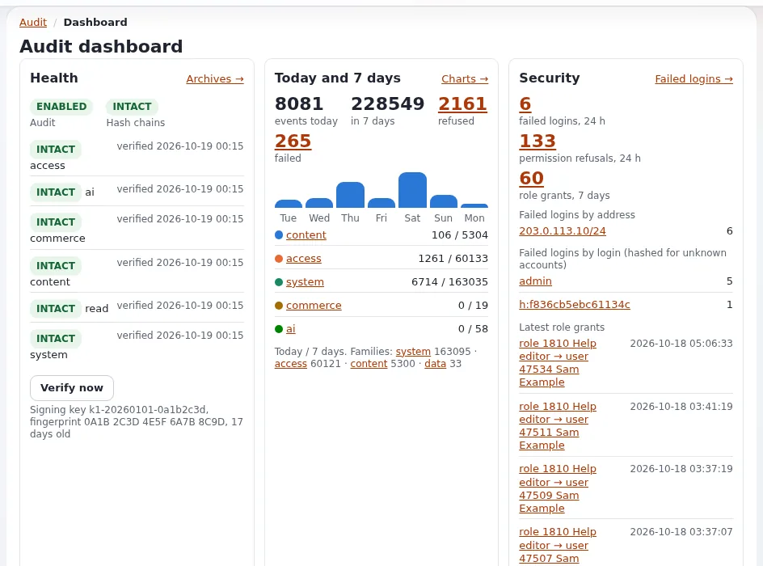

# Compliance-Nachweise aus dem Audit-Trail

Diese Seite richtet sich an Inhaber, Compliance-Mitarbeiter und Führungskräfte, die einem Prüfer, einem Kunden oder dem
eigenen Vorstand zeigen müssen, dass die Website kontrolliert betrieben wird: wer was wann geändert hat und dass das
Protokoll selbst nicht verändert wurde. Der Audit-Trail von Exponential wurde genau dafür gebaut. Die Seite erklärt, was
er Ihnen bietet und wie Sie Nachweise übergeben.



> **Warnung**
> Grundlagen, keine Rechtsberatung. Ob Audit-Aufzeichnungen ein bestimmtes Gesetz, eine Norm oder einen Vertrag
> erfüllen, entscheiden Sie mit Ihrem Berater oder Prüfer. Der Audit-Leitfaden selbst sagt dasselbe über seine Aufgaben
> zum Datenschutz ([Audit: Aufgaben zu Datenschutz und DSGVO](../../../../eng-us/bc/6.0/audit.md#412-privacy-and-gdpr-tasks)).

## Inhalt

1. [Was der Audit-Trail ist](#was-der-audit-trail-ist)
2. [Was er aufzeichnet](#was-er-aufzeichnet)
3. [Warum man dem Protokoll vertrauen kann](#warum-man-dem-protokoll-vertrauen-kann)
4. [Nachweise an einen Prüfer übergeben](#nachweise-an-einen-prüfer-übergeben)
5. [Alarme: der Nachweis, dass jemand hinschaut](#alarme-der-nachweis-dass-jemand-hinschaut)
6. [Abzustimmende Einstellungen](#abzustimmende-einstellungen)
7. [Häufige Anfragen nach Nachweisen](#häufige-anfragen-nach-nachweisen)

## Was der Audit-Trail ist

Seit 6.0.15 zeichnet Exponential sicherheitsrelevante Ereignisse in einem manipulationssicheren Log auf. „Das Log ist
standardmäßig eingeschaltet, braucht keine Einrichtung und lässt sich in der Administration oder auf der Kommandozeile
lesen.“ Es wird im Reiter **Audit** gelesen (`/audit/dashboard`) ([Der Audit-Trail](../../../../eng-us/features/6.0/audit-trail.md)).

## Was er aufzeichnet

| Kanal | Beispiele |
|---|---|
| `content` | veröffentlichen, verschieben, kopieren, entfernen, verbergen, Sektionen, Zustände, Papierkorb, Versionen, URL-Aliase, Klassen, Inhaltsjobs |
| `access` | Anmeldung, fehlgeschlagene Anmeldung, verweigerte Ansicht, Kontosperre, Rollenzuweisung, Zurücksetzen des Passworts |
| `system` | Schreiben von Einstellungen, Cache-Leerungen, Cronjob-Läufe, Befehle, Paketinstallationen, Wartung, Deployments |
| `commerce` | Bestellungen, Zahlungen (nie Kartendaten), USt, Währungen, Rabatte, Exporte und Importe |
| `read` | stichprobenartige Aufrufe, Suchen und Downloads, nur wenn eingeschaltet |

Quelle: [Der Audit-Trail](../../../../eng-us/features/6.0/audit-trail.md#what-is-recorded). Passwörter, Tokens,
Reparaturschlüssel und Geheimnisse werden nie aufgezeichnet; Adressen werden gekürzt und Sessions gehasht.

## Warum man dem Protokoll vertrauen kann

- **Hash-Kette**: Jeder Datensatz trägt den Hash des vorherigen Datensatzes.
- **Signierte Manifeste**: Tagesdateien werden geschlossen, archiviert und in Manifesten aufgeführt, die mit einem HMAC
  signiert sind.
- **Prüfung**: `./console exp:audit verify` meldet, ob etwas bearbeitet oder abgeschnitten wurde, und endet mit dem
  Code 1, wenn eine Kette gebrochen ist.
- **Zugriff auf das Log**: Nur Rollen mit `audit/read` sehen es; in einer neuen Installation hat nur Administrator
  dieses Recht, und ein verweigerter Versuch wird selbst aufgezeichnet.
- **Wenn das Log nicht geschrieben werden kann**: Standardmäßig läuft die Website weiter, und der Fehler wird
  protokolliert und angezeigt; `OnWriteFailure=refuse` verweigert stattdessen sicherheitsrelevante Aktionen, für
  Organisationen, in denen eine nicht aufgezeichnete Änderung schlimmer ist als eine verweigerte.

Quelle: [Der Audit-Trail](../../../../eng-us/features/6.0/audit-trail.md).

## Nachweise an einen Prüfer übergeben

1. Stimmen Sie die Frage ab: welcher Zeitraum, welche Ereignisse (zum Beispiel „alle Rollenzuweisungen 2026“).
2. Führen Sie `exp:audit verify` aus und bewahren Sie die Ausgabe als Nachweis auf, dass die Kette intakt war.
3. Exportieren Sie die Datensätze. In der Administration liefert **Audit > Export** CSV, JSON Lines oder JSON, gestreamt
   oder im Hintergrund. Auf der Kommandozeile enthält ein **Paket** die Datensätze so, wie sie geschrieben wurden, und ein
   Manifest mit dem Filter, der Anzahl, einem sha256 und einem HMAC: „Das ist es, was Sie einem Prüfer übergeben“
   ([Audit-Leitfaden, Exportieren](../../../../eng-us/bc/6.0/audit.md#exporting)).
4. Prüfen Sie den Export, bevor Sie ihn herausgeben: Er kann personenbezogene Daten von Mitarbeitern und Benutzern
   enthalten. Geben Sie nur heraus, was die Frage braucht.
5. Halten Sie fest, was Sie wem und wann übergeben haben, und löschen Sie lokale Kopien, wenn sie nicht mehr gebraucht
   werden.

```text
EVIDENCE HANDOVER RECORD
Request from: ______________   Question: ______________________________
Period: __________ to __________   Events / channels: ______________
Chain verified on: __________ by: __________ result: intact / broken
Export format: bundle / csv / jsonl   File sha256: ______________________
Handed to: ______________ on: __________   Copies deleted on: __________
```

## Alarme: der Nachweis, dass jemand hinschaut

Alarmregeln achten auf Brute-Force-Anmeldungen, die Vergabe einer Administratorrolle, außerhalb der Arbeitszeit
geschriebene Einstellungen, Massenlöschungen, das Ausschalten des Audits und eine gebrochene Kette
([Der Audit-Trail](../../../../eng-us/features/6.0/audit-trail.md#why-you-want-it)). Alarmmails gehen an die `AdminEmail` der
Website, sofern Sie keine anderen Empfänger nennen: Benutzer, Gruppen, Rollen oder Adressen
([Audit-Leitfaden, Alarme](../../../../eng-us/bc/6.0/audit.md#45-alerts-and-their-recipients)).

- [ ] Alarme erreichen eine namentlich benannte Person oder Gruppe, die sie liest.
- [ ] Jeder Alarm wird beantwortet, und die Antwort wird festgehalten (zum Beispiel in Ihrem Ticketsystem).
- [ ] `./console exp:audit alerts recipients` wird nach personellen Veränderungen geprüft.

## Abzustimmende Einstellungen

| Thema | Standard | Möglichkeiten | Quelle |
|---|---|---|---|
| Aufbewahrung | 90 Tage live, 730 Tage archiviert | länger für Compliance (die Referenzkonfiguration bewahrt zehn Jahre auf), kürzer für strengen Datenschutz | [Aufbewahrung von Logs und Daten](../../hosting/sicherheit/aufbewahrung-von-logs-und-daten.md#das-prüfprotokoll) |
| Datenschutz | standardmäßig Datenminimierung, Pseudonymisierung nach 90 Tagen | strenger pro Feld | [Audit: strenger Datenschutz](../../../../eng-us/bc/6.0/audit.md#64-strict-privacy) |
| Langfristige Nachweise | Archive auf dem Server | Write-once-Speicher, signierte Prüfpunkte, die vom Server weg gesendet werden | [Audit: Compliance](../../../../eng-us/bc/6.0/audit.md#66-compliance-long-retention) |
| Zentrale Überwachung | keine | Syslog, signierter Webhook, Mail; Weiterleitung an ein SIEM | [Audit: Weiterleitung an ein SIEM](../../../../eng-us/bc/6.0/audit.md#65-siem-forwarding) |
| Schlüssel | in `settings/override/audit.ini.append.php` | sichern Sie sie; bewahren Sie jeden Signaturschlüssel so lange auf wie die Archive, die er signiert hat | [Der Audit-Trail](../../../../eng-us/features/6.0/audit-trail.md#try-it-in-two-minutes) |

Aufbewahrung und Datenschutz ziehen in entgegengesetzte Richtungen; legen Sie das Gleichgewicht mit Ihrem Berater fest
und schreiben Sie es in Ihren Aufbewahrungsplan ([Aufbewahrung und Löschung von Daten](aufbewahrung-und-loeschung-von-daten.md)).

## Häufige Anfragen nach Nachweisen

| Anfrage | Wo die Antwort steht |
|---|---|
| Wer hat Administratorzugriff, und seit wann? | Rollenzuweisungen im Kanal `access`, dazu die Rollenseiten ([Zugriffsprüfungen](zugriffspruefungen.md)) |
| Wer hat diese Seite geändert? | der Kanal `content`, nach Objekt gefiltert |
| Wurden Updates eingespielt? | Deployments und Paketinstallationen im Kanal `system` |
| Wurde die Bestellung eines Kunden geändert? | der Kanal `commerce` |
| Welche Daten haben wir exportiert? | Export-Ereignisse wie `data.export.csv`, die die Zeilenzahl festhalten, nie die Werte ([Gesammelte Informationen](../../../anleitungen/gesammelte-informationen.md)) |
| Hat jemand versucht einzubrechen? | fehlgeschlagene Anmeldungen und die Brute-Force-Alarme im Kanal `access` |
| Hat sich eine Einwilligung geändert? | das Einwilligungsprotokoll für Mails und das Audit-Ereignis `access.user.consent.change` ([Die Checkliste zu den Gesetzen](../../../spezifikationen/6.0/mail-einstellungen-compliance.md)) |

## Verwandte Seiten

- [Audit-Trail für den Betrieb](../zuverlaessigkeit/audit-trail-fuer-den-betrieb.md)
- [Audit-Trail für Hoster](../../hosting/sicherheit/pruefprotokoll.md)
- [KPIs aus Logs und Audit](../../fuehrung/kennzahlen-aus-logs-und-audit.md)
- [Freie Dokumentation](../../freie-dokumentation.md): Diese Seite darf unter der GNU FDL 1.3 frei kopiert, übersetzt und verbessert werden.

<!-- exp-partner-block:start -->
**Werden Sie Exponential-Partner.** Partner teilen ihre Informationen, stellen Mittel bereit, geben Beiträge zurück
und entwickeln die Produkte mit uns, und so wächst Exponential. Eine Partner-Website und ein Dashboard sind für Mitte
2027 geplant: Werden Sie noch heute Partner, damit wir schneller wachsen und neue Funktionen früher liefern. Beginnen
Sie mit [Partner: hier beginnen](../../partner/partner-hier-beginnen.md) und
[Wie Sie sich bewerben](../../partner/wie-sie-sich-bewerben.md).
<!-- exp-partner-block:end -->
