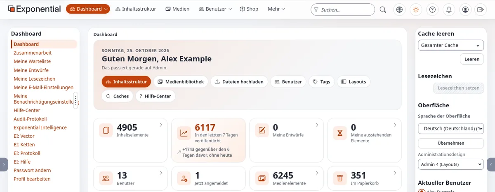

# Unternehmen: hier beginnen

Dieser Bereich ist für Organisationen, die auf das Web angewiesen sind, um Geld zu verdienen oder den Menschen zu
dienen, für die sie da sind: Online-Shops und kleine Läden, Unternehmen mit einem Intranet oder einem Extranet für
Partner, Mitgliederorganisationen, Newsletter, Bibliotheken und Kataloge, gemeinnützige Organisationen, kleine Gruppen
und Vereine, Marken mit mehreren Websites und Sprachen und alle, die eine Webanwendung brauchen, die mit geringen
Wartungskosten und wenigen Problemen im Betrieb weiterläuft.

Er ist in erster Linie für Inhaber, Führungskräfte und Entscheider geschrieben. Jede Seite sagt in einfacher Sprache,
was ein Unternehmen bekommt und was es tun muss, und verweist dann auf die technischen Seiten für diejenigen, die die
Arbeit machen: einen Entwickler, einen Hoster oder einen Partner.

> **Hinweis**
> Jede Tatsache in diesem Bereich stammt aus dem Exponential-Repository, aus einer Live-Demonstrationsinstallation
> oder von <https://exponential.earth>, und die Seite, aus der sie stammt, ist verlinkt.
> Der Bereich nennt keine Kunden und zitiert keine Marktstatistiken. Wo eine Seite Kosten berechnet, ist jede Eingabe
> als Beispielannahme gekennzeichnet, die Sie durch Ihre eigenen Zahlen ersetzen.

## Inhalt

1. [Exponential in einer Minute](#exponential-in-einer-minute)
2. [Warum Unternehmen sich darauf verlassen](#warum-unternehmen-sich-darauf-verlassen)
3. [Finden Sie Ihre Art von Organisation](#finden-sie-ihre-art-von-organisation)
4. [Betrieb ohne Überraschungen](#betrieb-ohne-überraschungen)
5. [Geld: Kosten, Ertrag und Risiko](#geld-kosten-ertrag-und-risiko)
6. [Eine erste Woche für ein Unternehmen, das prüft](#eine-erste-woche-für-ein-unternehmen-das-prüft)
7. [Weitere Bereiche dieser Hilfe](#weitere-bereiche-dieser-hilfe)

## Exponential in einer Minute

Exponential ist „ein professionelles PHP-Anwendungsframework mit fortgeschrittenen Funktionen eines CMS (Content
Management System)“, dessen bemerkenswerteste Eigenschaft „sein vollständig anpassbares und erweiterbares
Inhaltsmodell ist“ (`README.md`, „What does Exponential provide for end users building websites?“).
Für ein Unternehmen heißt das:

| Was Sie brauchen | Was Exponential mitbringt | Quelle |
|---|---|---|
| Eine Website, die Ihre Mitarbeiter von überall aktualisieren können | Administration und Bearbeitung im Browser | `README.md` |
| Einen Online-Shop | „Advanced e-Commerce Stores (Built in)“ | `README.md`, „Main Exponential features“ |
| Bereiche nur für Mitarbeiter und nur für Partner | „Fine grained role based permissions system“ (fein abgestuftes rollenbasiertes Berechtigungssystem) | ebenda |
| Eine Freigabe, bevor etwas öffentlich wird | „Content approval and scheduled publication“ (Freigabe von Inhalten und zeitgesteuerte Veröffentlichung) | ebenda |
| Mehrere Websites und Sprachen | „Multi-site support“, „Advanced multi-lingual support“ | ebenda |
| Apps und andere Systeme, die Ihre Inhalte lesen | „A headless CRUD REST API“ | ebenda |
| Seiten, die Ihr Marketingteam selbst gestalten kann | Exponential Layouts, ein visueller Seitenbaukasten | `README.md`, „Exponential Layouts“ |
| Hilfe beim Schreiben und Übersetzen | Exponential Intelligence, ein Schreibassistent, der nur Entwürfe schreibt | `README.md`, „Exponential Intelligence“ |
| Einen eigenen schnellen Server | Exponential Velocity | `README.md`, „How Exponential is served“ |

Die Software ist freie Software unter der GNU General Public License, Version 2 oder später, es gibt also keine
Lizenzgebühr ([Lizenzen für Käufer erklärt: GPL-Code, GFDL-Dokumentation](../geschaeft/lizenzen-fuer-kaeufer.md)).
Geleitet wird sie vom Unternehmen 7x und betrieben von der gemeinnützigen Exponential Foundation
([Wer ist 7x?](../wer-ist-7x.md), [Wer ist die Exponential Foundation?](../wer-ist-die-exponential-foundation.md)).

## Warum Unternehmen sich darauf verlassen

Die Kurzfassung, erklärt in [Warum Unternehmen sich auf Exponential verlassen](warum-unternehmen-sich-auf-exponential-verlassen.md):

- **Eine langlebige Codebasis.** Der Copyright-Vermerk reicht von 1998 bis 2026, und das Projekt erklärt, dass es
  „über sein Lebensende 2021 hinausgekommen ist und überlebt hat“ (`README.md`, „Exponential Project Status“; [Wer ist 7x?](../wer-ist-7x.md#kurz-gesagt)). Inhalte und
  Investitionen von vor Jahren laufen weiter.
- **Veröffentlichte Versionen ändern sich nie.** Eine Korrektur kommt als nächstes Release, nie als stillschweigend
  berichtigte Kopie (`SECURITY.md`, zitiert in
  [Die Support-Zusage](../wer-ist-die-exponential-foundation.md#die-zusage-zur-unterstützung)).
- **Wenige bewegliche Teile.** SQLite braucht keinen Datenbankserver, PHP 8.0 oder neuer auf fast jedem
  Betriebssystem genügt, und jeder gängige Webserver funktioniert
  ([Anforderungen](../hosting/grundlagen/anforderungen-auf-einen-blick.md)).
- **Schnell unter Last.** Die Cache-Korrekturen der Linie 6.0.15 machen die Anwendung auch unter Apache oder Nginx
  schnell, und Velocity hebt die Obergrenze weiter an (`README.md`, „The part that matters even if you never run
  Velocity“).
- **Belege, wenn etwas schiefgeht.** Ein manipulationssicheres Prüfprotokoll, Log-Viewer und Fehlerreferenzen
  ([Zuverlässigkeit](zuverlaessigkeit/README.md)).

## Finden Sie Ihre Art von Organisation

| Sie sind | Beginnen Sie mit |
|---|---|
| Ein Online-Shop oder ein kleiner Laden | [Online-Shops](shops/README.md) |
| Ein Unternehmen, das ein Intranet für seine Mitarbeiter braucht | [Intranets](intranets/README.md) |
| Ein Unternehmen, das Informationen mit Partnern, Händlern, Lieferanten oder Kunden teilt | [Extranets und Partnerportale](extranets/README.md) |
| Ein Verein, ein Berufsverband oder jemand mit Mitgliedern | [Mitgliederwebsites](mitglieder/README.md) |
| Herausgeber eines Newsletters | [Newsletter](newsletters/README.md) |
| Eine Bibliothek, ein Archiv oder jemand mit einem Katalog | [Bibliotheken und Kataloge](bibliotheken/README.md) |
| Eine gemeinnützige oder wohltätige Organisation | [Gemeinnützige Organisationen](gemeinnuetzige/README.md) |
| Eine kleine Gruppe oder ein Verein, von Ehrenamtlichen geführt | [Kleine Gruppen und Vereine](vereine/README.md) |
| Eine Marke oder Gruppe mit mehreren Websites | [Marken mit Multisite](multisite/README.md) |
| Ein Unternehmen, das in mehreren Sprachen verkauft | [Mehrsprachige Unternehmen](mehrsprachig/README.md) |
| Ein Unternehmen mit einer mobilen App oder anderen Systemen, die die Inhalte nutzen | [Mobil und headless](mobil-und-headless/README.md) |
| Eine Behörde oder öffentliche Stelle | Der eigene Bereich [Behörden](../verwaltung/verwaltungen-hier-beginnen.md) |

Nicht sicher? [Welcher Bereich passt zu Ihrer Organisation?](welcher-bereich-zu-ihrer-organisation-passt.md) stellt einige
Fragen und weist Ihnen den richtigen Ort. [Wie Unternehmen mit Exponential online verkaufen](wie-unternehmen-online-verkaufen.md)
erklärt die drei Kanäle: Website-Anwendungen, mobile Apps und Netzwerke.

## Betrieb ohne Überraschungen

Der größte Teil der Kosten einer Website liegt nicht im Aufbau, sondern im jahrelangen Betrieb. Der Bereich
[Zuverlässigkeit](zuverlaessigkeit/README.md) behandelt, was eine Website für Kunden erreichbar hält:

- [Warum Stabilität wichtig ist](zuverlaessigkeit/warum-stabilitaet-wichtig-ist.md) und [Verfügbarkeit in der Praxis](zuverlaessigkeit/verfuegbarkeit-in-der-praxis.md);
- [Backups, die sich wiederherstellen lassen](zuverlaessigkeit/backups-die-sich-wiederherstellen-lassen.md) und [Wiederherstellungsübungen](zuverlaessigkeit/wiederherstellungsuebungen.md);
- [Velocity für Unternehmen](zuverlaessigkeit/velocity-fuer-unternehmen.md) und [unterbrechungsfreie Deployments](zuverlaessigkeit/unterbrechungsfreie-deployments.md);
- [Caching für Verfügbarkeit](zuverlaessigkeit/caching-fuer-verfuegbarkeit.md) und [Lastspitzen planen](zuverlaessigkeit/lastspitzen-planen.md);
- [Monitoring](zuverlaessigkeit/health-checks-und-monitoring.md) und [Störungsbehandlung für kleine Teams](zuverlaessigkeit/stoerungsbehandlung-fuer-kleine-teams.md);
- [Aktualisierungen ohne Überraschungen](zuverlaessigkeit/aktualisierungen-ohne-ueberraschungen.md).

## Geld: Kosten, Ertrag und Risiko

- [Gesamtbetriebskosten](kosten/gesamtbetriebskosten.md) und [wofür Sie nicht bezahlen](kosten/wofuer-sie-nicht-bezahlen.md).
- [Die Rendite der Stabilität](kosten/rendite-der-stabilitaet.md), mit durchgerechneten Beispielen für einen
  [kleinen Shop](kosten/durchgerechnetes-beispiel-kleiner-shop.md), ein [Intranet](kosten/durchgerechnetes-beispiel-intranet.md) und eine
  [gemeinnützige Organisation](kosten/durchgerechnetes-beispiel-gemeinnuetzige-organisation.md) sowie einem [Arbeitsblatt zu den Kosten eines Ausfalls](kosten/arbeitsblatt-kosten-eines-ausfalls.md).
- [Sicherheitsgrundlagen für Unternehmen](sicherheit/sicherheitsgrundlagen-fuer-unternehmen.md) und [DSGVO-Grundlagen](sicherheit/dsgvo-grundlagen.md)
  (Grundlagen, keine Rechtsberatung).
- [Hosting auswählen](auswahl/hosting-auswaehlen.md) und [einen Partner auswählen](auswahl/einen-partner-auswaehlen.md).

## Eine erste Woche für ein Unternehmen, das prüft

| Tag | Tun | Lesen |
|---|---|---|
| 1 | Aufschreiben, was die Website leisten muss und was Sie eine Stunde Ausfall kostet | [Vorlage für Projektbeschreibungen](vorlagen/vorlage-fuer-projektbeschreibungen.md), [Arbeitsblatt: Kosten eines Ausfalls](kosten/arbeitsblatt-kosten-eines-ausfalls.md) |
| 2 | Ihren Bereich oben finden und seine ersten Seiten lesen | die README des Bereichs |
| 3 | Eine laufende Installation ansehen: die Demo oder eine Testinstallation mit SQLite | [Erste Schritte](../erste-schritte.md), [Ein Rundgang durch die Administration](../rundgang-durch-die-administration.md) |
| 4 | Entscheiden, wer sie betreibt: Sie selbst, ein Hoster oder ein Partner | [Hosting auswählen](auswahl/hosting-auswaehlen.md), [Fragen an einen Partner](auswahl/fragen-an-einen-partner.md) |
| 5 | Die Anforderungen und den Bewertungsbogen ausfüllen und über ein Pilotprojekt entscheiden | [Checkliste Anforderungen](vorlagen/checkliste-anforderungen.md), [Bewertungsbogen für Anbieter](vorlagen/bewertungsbogen-fuer-anbieter.md) |

Die vollständige Lesereihenfolge steht im [Lesepfad](lesepfad-fuer-unternehmen.md). Kurze Antworten finden Sie in der
[FAQ](faq-fuer-unternehmen.md), und die Begriffe sind im [Glossar](glossar-fuer-unternehmen.md) erklärt.

## Weitere Bereiche dieser Hilfe

| Bereich | Für |
|---|---|
| [Vertrieb und Marketing](../geschaeft/vertrieb-und-marketing-hier-beginnen.md) | Menschen, die Exponential und Exponential-Projekte verkaufen |
| [Projektleiter](../fuehrung/projektleiter-hier-beginnen.md) | Ein Exponential-Projekt planen und durchführen |
| [Website-Ersteller](../ersteller/website-ersteller/website-ersteller-hier-beginnen.md) | Die Website bauen |
| [Anwendungsentwickler](../ersteller/anwendungsentwickler/anwendungsentwickler-hier-beginnen.md) | Eigene Anwendungen und Integrationen bauen |
| [Hosting-Anbieter](../hosting/hosting-anbieter-hier-beginnen.md) | Exponential für Kunden betreiben |
| [Presse](../presse/presse-hier-beginnen.md) | Journalisten und Rezensenten |

## Verwandte Seiten

- [Warum Unternehmen sich auf Exponential verlassen](warum-unternehmen-sich-auf-exponential-verlassen.md)
- [Lesepfad für Unternehmen](lesepfad-fuer-unternehmen.md)
- [Welcher Bereich passt zu Ihrer Organisation?](welcher-bereich-zu-ihrer-organisation-passt.md)
- [Wie Unternehmen mit Exponential online verkaufen](wie-unternehmen-online-verkaufen.md)
- [Für wen Exponential ist: Personas und Branchen](../geschaeft/fuer-wen-exponential-ist.md)
- [Freie Dokumentation](../freie-dokumentation.md): Diese Seite darf unter der GNU FDL 1.3 frei kopiert, übersetzt und verbessert werden.

<!-- exp-partner-block:start -->
**Werden Sie Exponential-Partner.** Partner teilen ihre Informationen, stellen Mittel bereit, geben Beiträge zurück
und entwickeln die Produkte mit uns, und so wächst Exponential. Eine Partner-Website und ein Dashboard sind für Mitte
2027 geplant: Werden Sie noch heute Partner, damit wir schneller wachsen und neue Funktionen früher liefern. Beginnen
Sie mit [Partner: hier beginnen](../partner/partner-hier-beginnen.md) und
[Wie Sie sich bewerben](../partner/wie-sie-sich-bewerben.md).
<!-- exp-partner-block:end -->
