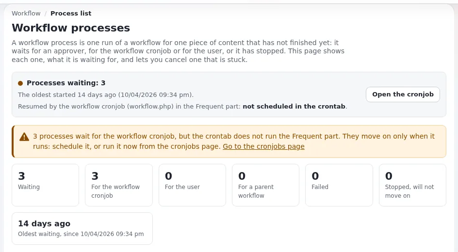

# Übergabe bei Wechsel der Ehrenamtlichen

Diese Seite ist für den scheidenden und den neuen Web-Koordinator oder Administrator eines Vereins, einer Gesellschaft
oder einer anderen ehrenamtlich geführten Gruppe. Vorstände wechseln alle ein bis zwei Jahre; die Website sollte nicht
jedes Mal neu aufgebaut werden müssen. Diese Seite listet, was übergeben wird, die Funktionen von Exponential, die
die Übergabe sauber machen, und was zu tun ist, wenn der vorherige Administrator nicht mehr erreichbar ist.

## Inhalt

1. [Was eine Übergabe umfasst](#was-eine-übergabe-umfasst)
2. [Vor der Übergabe](#vor-der-übergabe)
3. [Konten stilllegen](#konten-stilllegen)
4. [Ändern, wem Inhalte gehören](#ändern-wem-inhalte-gehören)
5. [Rollen hängen an Gruppen, nicht an Personen](#rollen-hängen-an-gruppen-nicht-an-personen)
6. [Wenn niemand das Administratorpasswort kennt](#wenn-niemand-das-administratorpasswort-kennt)
7. [Nachlesen, was vor Ihnen geschah](#nachlesen-was-vor-ihnen-geschah)
8. [Nach der Übergabe](#nach-der-übergabe)
9. [Checkliste für die Übergabe](#checkliste-für-die-übergabe)

## Was eine Übergabe umfasst

| Bereich | Übergeben werden |
|---|---|
| Zugänge außerhalb der Website | Domain-Registrar, Hosting-Konto, Mail-Konto, Passwortmanager |
| Zugänge innerhalb der Website | Administratorrolle für die Neuen, Stilllegung der Konten der Ausscheidenden |
| Inhalte | Wem welche Seiten gehören; wer welche Sektion bearbeitet |
| Wissen | Der kurze Leitfaden für Redakteure, die Hausregeln, wo die Backups liegen, die monatliche Routine |
| Offene Arbeit | Entwürfe, ausstehende Freigaben, unbeantwortete Formulareinsendungen |

Der in [Die Website an Redakteure übergeben](../../../../eng-us/help/creators/website-creators/handing-over-to-editors.md#the-editor-guide)
beschriebene Leitfaden für Redakteure ist das zentrale Dokument: Er nennt „Rollen, nicht ... Personen, die gehen
könnten“.

## Vor der Übergabe

- [ ] Aktualisieren Sie den Leitfaden für Redakteure und die Liste, wer was tut.
- [ ] Erstellen Sie ein frisches Backup und bestätigen Sie, dass es sich wiederherstellen lässt
      ([Backups und Wiederherstellungen](../../../../eng-us/help/creators/website-creators/backups-and-restores.md)).
- [ ] Notieren Sie offene Entwürfe und ausstehende Freigaben; wartende Workflow-Prozesse stehen unter **Setup >
      Workflow-Prozesse** ([Workflows](../../../anleitungen/workflows.md)).
- [ ] Bearbeiten oder exportieren Sie offene Formulareinsendungen ([Formulare und Rückmeldungen von Mitgliedern](formulare-und-rueckmeldungen-von-mitgliedern.md#aufräumen)).
- [ ] Stellen Sie Formularempfänger und den Newsletter-Absender auf Funktionsadressen um, wenn sie noch auf eine
      Person zeigen.

## Konten stilllegen

**Benutzerkonten > Benutzerkonten prüfen** (`user/hygiene`) listet Konten mit Filtern wie **Nie angemeldet**, **Seit
N Tagen nicht gesehen** (standardmäßig 180), **Deaktiviert** und **Gesperrt** und kann angehakte Konten nach einer
Bestätigung **Deaktivieren**, **Aktivieren** und **Entsperren**
([Benutzerkonten prüfen](../../../../eng-us/features/6.0/user-hygiene.md)).

Deaktivieren Sie lieber, als zu entfernen: „Ein Benutzerobjekt kommt in Exponential nie in den Papierkorb ... das
Entfernen ist endgültig“ (dieselbe Seite). Ein deaktiviertes Konto behält die Inhalte und die Historie der Person und
kann sich wieder anmelden, wenn sie zurückkommt.

**Deaktivieren und verschieben** geht weiter: Es deaktiviert Konten und verschiebt alle ihre Platzierungen in eine
einzige verborgene Gruppe ohne Rollen und merkt sich, wo sie waren; **Reaktivieren und zurückverschieben** macht es
rückgängig. Die Funktion muss eingeschaltet werden: Ausgeliefert wird `site.ini [UserSettings] DeactivateAndMove=disabled`,
und ein Administrator schaltet sie ein
([Deaktivieren und verschieben](../../../../eng-us/features/6.0/user-hygiene.md#deactivate-and-move)). Für eine Gruppe, deren
Ehrenamtliche oft zurückkehren, hält sie die Benutzerliste sauber, ohne jemanden zu verlieren.

## Ändern, wem Inhalte gehören

Jedes Inhaltsobjekt hat einen Eigentümer, und Rollen können das Bearbeiten auf die eigenen Inhalte beschränken (die
Einschränkung `Owner`). Wenn jemand geht, verwenden Sie **„Change owner“** im Kontextmenü eines Knotens, mit einer
Vorschau auf jedes Objekt, das die Änderung erreicht, für ein einzelnes Objekt oder einen ganzen Teilbaum. Dafür sind die
Richtlinien `owner/change` (und `owner/subtree` für einen Teilbaum) nötig, und jede Änderung wird im Audit als
`content.ezownerchange.change` festgehalten
([Den Eigentümer von Inhalten ändern](../../../anleitungen/eigentuemer-aendern.md)). Die Erweiterung `ezownerchange` wird von
`composer.json` vorausgesetzt, und „bei neuen Installationen ist sie eingeschaltet“ (dieselbe Anleitung).

## Rollen hängen an Gruppen, nicht an Personen

Wenn Rollen Benutzergruppen zugewiesen sind („Redakteure“, „Formularleser“), besteht eine Übergabe darin, Personen
zwischen Gruppen zu verschieben: Der Neue tritt „Redakteure“ bei, der Ausscheidende wird deaktiviert. Rollen, die
einzelnen Personen zugewiesen sind, müssen einzeln gefunden und neu zugewiesen werden
([Rollen, Richtlinien und nicht aktivierte Benutzer](../../../anleitungen/rollen-und-richtlinien.md)). Siehe auch
[Gemeinsam bearbeiten mit Ehrenamtlichen](gemeinsam-bearbeiten-mit-ehrenamtlichen.md#wenige-einfache-rollen).

Jederzeit zwei Administratoren: Der neue wird hinzugefügt, bevor der scheidende stillgelegt wird.

## Wenn niemand das Administratorpasswort kennt

Das passiert, wenn der einzige Administrator gegangen ist. Jemand mit Zugang zum Server kann mit
`bin/php/resetuserpassword.php` ein neues Passwort setzen, zum Beispiel ein neues Passwort mit 20 Zeichen für `admin`
erzeugen; „das erzeugte Passwort wird einmal ausgegeben“
([Ein Benutzerpasswort auf der Kommandozeile zurücksetzen](../../../../eng-us/features/6.0/reset-user-password.md)).
Dafür braucht es Zugang zum Server, ein Grund mehr, das Hosting-Konto in den Händen der Gruppe zu halten.

> **Warnung**
> Ändern Sie das Passwort jedes Kontos, das das vorherige Team gemeinsam genutzt hat, und schalten Sie für die neuen
> Administratoren die zweistufige Anmeldung ein ([Zweistufige Anmeldung](../../../anleitungen/zwei-faktor-anmeldung.md)).

## Nachlesen, was vor Ihnen geschah

Der Audit-Trail hält Anmeldungen und Abweisungen, Änderungen an Inhalten, Schreibvorgänge an Einstellungen und mehr
fest, ist standardmäßig eingeschaltet und lässt sich in der Administration oder auf der Kommandozeile lesen
([Der Audit-Trail](../../../../eng-us/features/6.0/audit-trail.md)). Ein neuer Administrator sieht, welche Konten zuletzt aktiv
waren und was sich in den letzten Monaten geändert hat, ohne fragen zu müssen. Die Logdateien stehen im Log-Viewer
([Log-Viewer](../../../../eng-us/features/6.0/log-viewer.md)).

## Nach der Übergabe

- [ ] Die Neuen melden sich an, richten die zweistufige Anmeldung ein und bearbeiten eine Testseite.
- [ ] Konten der Ausscheidenden deaktiviert (oder deaktiviert und verschoben); ihre Inhalte bei Bedarf einem neuen
      Eigentümer zugeordnet.
- [ ] Der Leitfaden für Redakteure nennt die neuen Rolleninhaber.
- [ ] Die monatliche Routine hat bei jeder Aufgabe neue Namen
      ([Monatliche Betriebscheckliste](../vorlagen/monatliche-betriebscheckliste.md)).
- [ ] Ein Termin für die Prüfung der nächsten Übergabe steht im Kalender der Gruppe.

## Checkliste für die Übergabe

| Punkt | Scheidend | Neu | Erledigt |
|---|---|---|---|
| Zugang zum Domain-Registrar übertragen | | | |
| Zugang zum Hosting-Konto übertragen | | | |
| Mail- und Newsletter-Absenderadressen sind Funktionsadressen | | | |
| Zugang zum Passwortmanager übertragen | | | |
| Backup erstellt und Wiederherstellung getestet | | | |
| Neuer Administrator hinzugefügt, zweistufige Anmeldung eingeschaltet | | | |
| Konten der Ausscheidenden deaktiviert, Rollen über Gruppen geprüft | | | |
| Eigentümer von Inhalten bei Bedarf geändert | | | |
| Offene Entwürfe, Freigaben und Formulareinsendungen übergeben | | | |
| Leitfaden für Redakteure und Hausregeln aktualisiert | | | |

## Verwandte Seiten

- [Vereine und kleine Gruppen](README.md)
- [Gemeinsam bearbeiten mit Ehrenamtlichen](gemeinsam-bearbeiten-mit-ehrenamtlichen.md)
- [Zugriffsprüfungen](../sicherheit/zugriffspruefungen.md)
- [Benutzerkonten und Passwörter](../sicherheit/benutzerkonten-und-passwoerter.md)
- [Freie Dokumentation](../../freie-dokumentation.md): Diese Seite darf unter der GNU FDL 1.3 frei kopiert, übersetzt und verbessert werden.

<!-- exp-partner-block:start -->
**Werden Sie Exponential-Partner.** Partner teilen ihre Informationen, stellen Mittel bereit, geben Beiträge zurück
und entwickeln die Produkte gemeinsam mit uns weiter, und so wächst Exponential. Eine Partner-Website und ein
Dashboard sind für Mitte 2027 geplant: Werden Sie bitte schon heute Partner, damit wir schneller wachsen und neue
Funktionen früher liefern können. Beginnen Sie mit [Partner: hier beginnen](../../partner/partner-hier-beginnen.md) und
[Wie Sie sich bewerben](../../partner/wie-sie-sich-bewerben.md).
<!-- exp-partner-block:end -->
