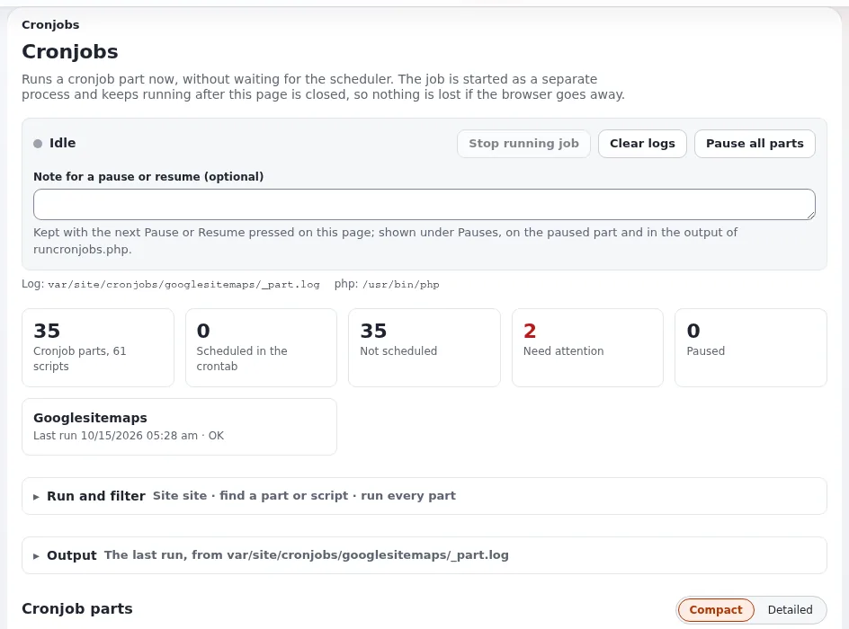

# Cronjobs und Hintergrundjobs

Diese Seite richtet sich an Führungskräfte, die wissen wollen, was im Hintergrund läuft, und an den Administrator, der es
einplant. Ein großer Teil der Arbeit einer Website geschieht außerhalb von Seitenanfragen: Benachrichtigungen versenden,
freigegebene Inhalte veröffentlichen, umfangreiche Entfernungen abschließen, das Prüfprotokoll indizieren, Newsletter
versenden, Sitemaps erstellen. Wenn diese Arbeit stoppt, geht zunächst nichts sichtbar kaputt, und genau deshalb braucht
sie Aufmerksamkeit. Die vollständige Anleitung ist
[Cronjobs: ausführen, planen und verfolgen](../../../anleitungen/cronjobs.md).



## Inhalt

1. [Warum Hintergrundarbeit für ein Unternehmen wichtig ist](#warum-hintergrundarbeit-für-ein-unternehmen-wichtig-ist)
2. [Was läuft, in Teilen](#was-läuft-in-teilen)
3. [Einplanen](#einplanen)
4. [Wissen, dass es gelaufen ist](#wissen-dass-es-gelaufen-ist)
5. [Inhaltsjobs: große Operationen im Hintergrund](#inhaltsjobs-große-operationen-im-hintergrund)
6. [Anhalten während geplanter Arbeiten](#anhalten-während-geplanter-arbeiten)
7. [Mehrere Server und Testkopien](#mehrere-server-und-testkopien)
8. [Checkliste](#checkliste)

## Warum Hintergrundarbeit für ein Unternehmen wichtig ist

„Cronjobs erledigen die Arbeit, auf die niemand wartet: geplante Inhalte veröffentlichen, Feeds importieren, Warenkörbe
aufräumen, Newsletter versenden, Sitemaps erstellen“
([Betrieb einer Site, Cronjobs ausführen](../../../anleitungen/betrieb-einer-website.md#3-cronjobs-ausführen)). Beispiele für stille
Ausfälle, wenn sie stoppen:

| Wenn das stoppt | Bemerkt das Unternehmen |
|---|---|
| Der Workflow-Cronjob | Freigegebene Inhalte werden nie veröffentlicht: „Ohne diesen Cronjob werden freigegebene Inhalte nie veröffentlicht“ ([Workflows](../../../anleitungen/workflows.md#kurz-gesagt)) |
| Benachrichtigungen | Abonnenten bekommen keine Mails über Aktualisierungen mehr |
| Der Teil `audit` | Das Audit wird nicht indiziert, Alarmregeln werden nicht ausgewertet, Tagesarchive werden nicht geschrieben ([Prüfprotokoll](../../../../eng-us/features/6.0/audit-trail.md#try-it-in-two-minutes)) |
| Inhaltsjobs | Im Hintergrund gestartete umfangreiche Entfernungen oder Kopien kommen nicht voran |
| Newsletter-Teile | Ausgaben werden nicht versendet ([Newsletter](../newsletter/README.md)) |
| Sitemap-Teile | Suchmaschinen sehen eine veraltete Sitemap |

## Was läuft, in Teilen

Skripte sind in **Teile** gruppiert, von denen jeder nach eigenem Zeitplan läuft. Der mitgelieferte Teil `frequent` aus
`settings/cronjob.ini` ([Cronjobs, Teile und Skripte](../../../anleitungen/cronjobs.md#1-teile-skripte-und-der-globale-teil)):

```ini
[CronjobPart-frequent]
Scripts[]=notification.php
Scripts[]=workflow.php
Scripts[]=contentjobs.php
Scripts[]=audit.php
Scripts[]=mailbounces.php
```

Andere Teile (`infrequent` und solche, die Erweiterungen hinzufügen, etwa Newsletter- und Sitemap-Teile) übernehmen
langsamere Arbeit. Jedes Skript setzt während des Laufs eine Sperre, sodass sich ein zweiter Lauf desselben Skripts
nicht mit dem ersten überschneidet.

**Setup > Cronjobs** (`/setup/cronjobs`, Richtlinie `setup/managecronjobs`) zeigt eine Karte pro Teil: ob die Crontab ihn
ausführt, seinen Zeitplan in Worten, seinen nächsten und letzten Lauf und den Befehl, der ihn ausführt
([Cronjobs, kurz gesagt](../../../anleitungen/cronjobs.md#kurz-gesagt)).

## Einplanen

Cronjobs werden vom Planer des Servers (der Crontab) gestartet. Die Seite **Setup > Cronjobs** schlägt die Zeilen zum
Installieren vor. Ein üblicher Ausgangspunkt aus der Betriebsanleitung ist der Teil `frequent` alle paar Minuten und der
Teil `infrequent` einmal pro Stunde oder pro Tag ([Betrieb einer Site](../../../anleitungen/betrieb-einer-website.md#3-cronjobs-ausführen)):

```
*/5 * * * * cd /path/to/installation && php runcronjobs.php --siteaccess=site frequent >> var/log/cron-frequent.log 2>&1
17 * * * *  cd /path/to/installation && php runcronjobs.php --siteaccess=site infrequent >> var/log/cron-infrequent.log 2>&1
```

Ersetzen Sie Pfad und Siteaccess durch Ihre eigenen. Was installiert ist, zeigt `php bin/php/console crontab:list`.
Control-Panels für Shared Hosting bieten meist eine Cron-Seite für dieselben Zeilen
([Cron und Shell-Zugang](../../hosting/control-panels/cron-und-shell-zugang.md)).

> **Hinweis**
> Velocity hat einen eigenen Planer, doch er führt Handler von Velocity-Anwendungen aus, „kein beliebiges
> PHP-Kommandozeilenskript“; die eigenen periodischen Jobs von Exponential laufen über `runcronjobs.php`
> ([Velocity-Planer](../../../../eng-us/features/6.0/velocity-scheduler.md)).

## Wissen, dass es gelaufen ist

Drei Signale, vom günstigsten zum gründlichsten:

1. **Setup > Systeminformationen** lässt seine Cronjobs-Prüfung fehlschlagen, wenn kein Lauf gefunden wird oder der
   letzte „mehr als zwei Tage her“ ist ([Systeminformationen, Zustandsprüfungen](../../../anleitungen/systeminformationen.md#3-zustandsprüfungen)).
   Die Kommandozeilenvariante endet mit dem Exit-Status 1, sodass ein Monitoring es bemerkt
   ([Health-Checks und Monitoring](health-checks-und-monitoring.md)).
2. **Setup > Cronjobs** zeigt den letzten Lauf jedes Teils und unter **Letzte Ausführungen** deren Ergebnisse; Probleme
   sind Zeilen mit Wörtern wie *error* oder *failed*, „ein Hinweis, kein Urteil“
   ([Cronjobs, letzte Ausführungen](../../../anleitungen/cronjobs.md#10-letzte-ausführungen-und-wie-probleme-gezählt-werden)).
3. **Das Prüfprotokoll** zeichnet jeden Lauf eines Teils als `system.cronjob.run` oder `system.cronjob.fail` auf, gleich
   wer ihn gestartet hat (derselbe Abschnitt).

Nehmen Sie die Prüfung von `crontab:list` und der Datumsangaben im Cron-Log in die wöchentliche Routine auf
([Verfügbarkeit in der Praxis](verfuegbarkeit-in-der-praxis.md#jede-woche)).

## Inhaltsjobs: große Operationen im Hintergrund

Das Entfernen, Kopieren oder Verschieben eines großen Teilbaums „lief früher innerhalb einer einzigen Webanfrage und
konnte am Zeitlimit, am Speicherlimit oder an einer riesigen Transaktion scheitern“. Ab 6.0.15 kann eine solche Operation
als **Inhaltsjob** laufen: „ein Hintergrund-Worker, der in Stapeln arbeitet, nach jedem Stapel einen Checkpoint setzt und
genau dort weitermacht, wo er aufgehört hat, sogar nach einem `kill -9`“ ([Inhaltsjobs](../../../../eng-us/features/6.0/content-jobs.md)).

Für ein Unternehmen bedeutet das:

- Ein Redakteur, der einen großen Bereich entfernt, riskiert keine halb fertige Operation mehr.
- **content/jobs** listet alle Jobs mit dem, der sie gestartet hat, dem Fortschritt und der verbleibenden Zeit; ein Job
  lässt sich abbrechen oder fortsetzen.
- Ein Teilbaum, an dem ein Job arbeitet, wird für einen anderen Job abgelehnt.
- Das Prüfprotokoll zeichnet den Job als übergeordnetes Ereignis von allem auf, was seine Stapel getan haben.
- Jobs werden vom Skript `contentjobs` des Teils `frequent` fortgesetzt, der deshalb laufen muss.

## Anhalten während geplanter Arbeiten

Cronjobs laufen in einer Shell und werden vom Wartungsmodus **nicht** angehalten
([Anleitung zum Wartungsmodus](../../../anleitungen/wartungsmodus.md#10-installationen-cronjobs-und-bereitstellungen)). Halten Sie für
einen Import, eine Migration oder eine Aktualisierung die Teile an, die nicht laufen dürfen: **Setup > Cronjobs** hält
einen Teil oder alle an, bis jemand sie fortsetzt, zeichnet auf, wer was warum angehalten hat, und `runcronjobs.php`
lässt angehaltene Teile aus, gleich wer es startet ([Cronjob-Teile anhalten](../../../../eng-us/features/6.0/cronjob-pause.md)).
Setzen Sie sie fort, wenn die Arbeit erledigt ist, und nehmen Sie „Cronjobs fortsetzen“ in die Abschluss-Checkliste des
Wartungsfensters auf.

## Mehrere Server und Testkopien

- **Mehrere Webserver**: Installieren Sie die Crontab nur auf einem Server, sonst laufen dieselben Jobs doppelt; die
  Skriptsperre gilt nur lokal auf jedem Server
  ([Mehrere Web-Knoten](../../hosting/betrieb/mehrere-web-knoten.md#cron-ausrollen-wartung-und-logs)).
- **Wiederhergestellte Kopien und Testrechner**: Installieren Sie keine Crontab, „sonst laufen Benachrichtigungen,
  Newsletter und Inhaltsjobs gegen echte Adressen“
  ([Wiederherstellungsübungen](wiederherstellungsuebungen.md#die-kopie-still-und-vertraulich-halten)).

## Checkliste

- [ ] Die Teile `frequent` und `infrequent` (und alle Teile von Erweiterungen, die Sie nutzen) stehen in der Crontab
      eines Servers.
- [ ] **Setup > Systeminformationen** zeigt keine fehlgeschlagene Cronjobs-Prüfung.
- [ ] Jemand sieht sich **Setup > Cronjobs** wöchentlich an, und fehlgeschlagene Läufe sofort.
- [ ] Geplante Arbeiten halten die Teile an, die nicht laufen dürfen, und setzen sie danach fort.
- [ ] Testkopien haben keine Crontab.
- [ ] Redakteure wissen, dass umfangreiche Entfernungen und Verschiebungen als Inhaltsjobs laufen können.

## Verwandte Seiten

- [Cronjobs](../../../anleitungen/cronjobs.md)
- [Cronjobs (Hosting)](../../hosting/betrieb/cronjobs.md)
- [Inhaltsjobs](../../../../eng-us/features/6.0/content-jobs.md)
- [Freie Dokumentation](../../freie-dokumentation.md): Diese Seite darf unter der GNU FDL 1.3 frei kopiert, übersetzt und verbessert werden.

<!-- exp-partner-block:start -->
**Werden Sie Exponential-Partner.** Partner teilen ihre Informationen, stellen Mittel bereit, geben Beiträge zurück
und entwickeln die Produkte mit uns, und so wächst Exponential. Eine Partner-Website und ein Dashboard sind für Mitte
2027 geplant: Werden Sie noch heute Partner, damit wir schneller wachsen und neue Funktionen früher liefern. Beginnen
Sie mit [Partner: hier beginnen](../../partner/partner-hier-beginnen.md) und
[Wie Sie sich bewerben](../../partner/wie-sie-sich-bewerben.md).
<!-- exp-partner-block:end -->
