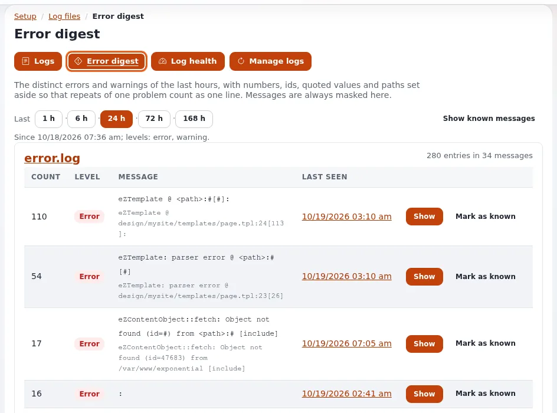

# Logs und Fehlerreferenzen

Diese Seite richtet sich an Führungskräfte, die den Kundensupport leiten, und an die Administratoren, die
Fehlermeldungen beantworten. Sie erklärt, wie eine Fehlerseite zu den genauen Log-Zeilen der fehlgeschlagenen Anfrage
führt, welche Logs es gibt und wofür jedes da ist und wie Logs klein und frei von personenbezogenen Daten der Kunden
gehalten werden. Die technischen Anleitungen sind
[Einen Fehler anhand seiner Referenz finden](../../../anleitungen/fehler-anhand-der-referenz-finden.md) und
[Der Log-Viewer](../../../../eng-us/features/6.0/log-viewer.md).

## Inhalt

1. [Von der Meldung eines Kunden zur Ursache](#von-der-meldung-eines-kunden-zur-ursache)
2. [Was Support-Mitarbeiter fragen sollten](#was-support-mitarbeiter-fragen-sollten)
3. [Die Logs und wofür jedes da ist](#die-logs-und-wofür-jedes-da-ist)
4. [Logs ohne Shell lesen](#logs-ohne-shell-lesen)
5. [Logs bleiben klein](#logs-bleiben-klein)
6. [Personenbezogene Daten in Logs](#personenbezogene-daten-in-logs)
7. [Checkliste](#checkliste)

## Von der Meldung eines Kunden zur Ursache

Wenn eine Seite fehlschlägt, zeigt die Fehlerseite von Exponential eine **Referenz** wie `ERR-0123456789` und schreibt
dieselbe Referenz zusammen mit den Einzelheiten des Fehlers in `error.log`
([Einen Fehler anhand seiner Referenz finden](../../../anleitungen/fehler-anhand-der-referenz-finden.md#kurz-gesagt)).

Der Weg von der Meldung zur Ursache ist kurz:

1. Der Kunde nennt dem Support die Referenz, ungefähr den Zeitpunkt und was er gerade getan hat.
2. Ein Administrator öffnet **Setup > Logdateien**, fügt die Referenz unter **Fehlerreferenz** ein und klickt auf
   **Suchen**.
3. Die Seite zeigt den Eintrag und jede Zeile derselben Anfrage (gleiche Adresse und gleicher Client, innerhalb von zwei
   Sekunden) aus allen Kernel-Logs in zeitlicher Reihenfolge.
4. **Das Audit dieses Moments** öffnet das Prüfprotokoll zum selben Zeitpunkt: Eine Bearbeitung, eine Veröffentlichung oder
   eine Änderung an Einstellungen kurz vor dem Fehler ist oft die Ursache.

Dasselbe in einer Shell: `php bin/php/console exp:logs --reference=ERR-0123456789`. Exit-Code 1 bedeutet, dass sie nicht
gefunden wurde.

> **Tipp**
> Nehmen Sie eine Zeile in Ihren Leitfaden für den Kundenservice auf: „Wenn Sie eine Fehlerseite sehen, schicken Sie uns
> bitte die Referenz, die mit ERR- beginnt.“ So wird aus einer vagen Beschwerde eine Reparatur.

## Was Support-Mitarbeiter fragen sollten

| Fragen Sie nach | Warum |
|---|---|
| Der auf der Fehlerseite angezeigten Referenz | Findet die genaue Anfrage in den Logs |
| Der Uhrzeit, so genau wie möglich | Ohne Referenz suchen Sie stattdessen nach der Zeit |
| Der Adresse der Seite (aus dem Browser kopiert) | Grenzt die Suche auf eine Seite ein |
| Was der Kunde kurz davor getan hat (ein Formular abgeschickt, bezahlt, sich angemeldet) | Weist auf den betroffenen Teil der Website hin |
| Ob es beim erneuten Versuch wieder passiert | Unterscheidet einen einmaligen von einem dauerhaften Fehler |

Fragen Sie Kunden **nicht** nach Passwörtern, und fügen Sie keine unmaskierten Log-Zeilen in ein Ticket ein: Sie können
E-Mail- und IP-Adressen von Kunden enthalten
([Einen Fehler finden, teilen, was Sie gefunden haben](../../../anleitungen/fehler-anhand-der-referenz-finden.md#5-weitergeben-was-sie-gefunden-haben)).

Wird die Referenz nicht gefunden, ist das Log vielleicht schon wegrotiert, oder der Fehler ist auf einem anderen Server
passiert: Jeder Server führt sein eigenes `var/log`
([Einen Fehler finden, ihn finden](../../../anleitungen/fehler-anhand-der-referenz-finden.md#2-sie-finden)).

## Die Logs und wofür jedes da ist

Exponential trennt echte Fehler vom Rauschen, damit es sich weiterhin lohnt, `error.log` zu lesen
([Anfrage-Logs](../../../../eng-us/features/6.0/request-logs.md)):

| Log | Was es enthält | Wen es betrifft |
|---|---|---|
| `error.log` | Nur echte Fehler: ein Datenbankfehler, ein Template, das sich nicht kompilieren lässt, ein PHP-Fehler | Den Betrieb, jede Woche |
| `404.log` | Nicht gefundene Seiten, mit dem Grund | Das Web-Team: defekte Links, verschobene Inhalte |
| `security.log` | Anfragen, die nach Sondierungen oder Angriffen aussehen, mit jedem Status | Den Betrieb, monatlich; achten Sie auf Häufungen und auf Angriffe, die ein `200` bekommen haben |
| `deprecated.log` | Code, den eine spätere PHP-Version ablehnen wird | Entwickler, vor dem nächsten PHP-Upgrade ([Betrieb einer Site](../../../anleitungen/betrieb-einer-website.md#php-deprecations-und-größe-der-logdateien)) |
| Cronjob-Logs | Ausgabe der geplanten Jobs | Den Betrieb, wenn ein Job nicht gelaufen ist |
| Das Prüfprotokoll | Wer was getan hat: Anmeldungen, Inhalte, Einstellungen, Bestellungen | Führungskräfte, Sicherheit, Compliance ([Prüfprotokoll für den Betrieb](audit-trail-fuer-den-betrieb.md)) |

## Logs ohne Shell lesen

**Setup > Logdateien** (Richtlinie `setup/logs`) zeigt jedes Log der Installation in der Administration: die
Kernel-Logs, die Logs jeder Website, die Logs, die Erweiterungen schreiben, und ihre Rotationen. Die Seite hat einen
Navigator über alle Dateien, Filter nach Zeit, Stufe und Adresse, eine Suche und für jede Ansicht einen **Permalink**,
den Sie einer Kollegin oder einem Kollegen schicken können ([Der Log-Viewer](../../../../eng-us/features/6.0/log-viewer.md#in-short)).

Zwei Übersichtsseiten sparen Zeit
([Überblick über die Überwachung](../../hosting/betrieb/ueberblick-ueber-die-ueberwachung.md#seiten-für-einen-menschen)):

- **Zustand der Logs**: von Logs belegter Plattenplatz, die am schnellsten wachsenden Logs, Dateien, die der Webserver
  nicht schreiben kann.
- **Fehlerübersicht**: die verschiedenen Fehler und Warnungen der letzten 24 Stunden, gruppiert und gezählt.

## Logs bleiben klein

Ein Log, das die Festplatte füllt, kann eine Website lahmlegen. Exponential rotiert jedes Log für Sie
([Log-Rotation](../../../../eng-us/features/6.0/log-rotation.md#in-short)):

- Wenn ein Log über `site.ini [FileSettings] LogFileMaxSize` (ab Werk 2 MB) hinauswächst, wird es nach `.1`, `.2`, `.3`
  rotiert.
- `LogFileRotateCount` (ab Werk 3) gibt an, wie viele Archive behalten werden. Mit den Standardwerten belegt ein Log
  höchstens 8 MB auf der Festplatte
  ([Betrieb einer Site](../../../anleitungen/betrieb-einer-website.md#php-deprecations-und-größe-der-logdateien)).
- Rotation auf Abruf: `php bin/php/console exp:logs --rotate-all`; alte Archive: `--prune`; beides mit `--dry-run`.

Legen Sie mit Ihrem Betrieb fest, wie lange Logs für Ihr Unternehmen und Ihre gesetzlichen Pflichten aufbewahrt werden
müssen, und stellen Sie die Rotation passend ein. Der Hosting-Bereich behandelt die Aufbewahrung:
[Aufbewahrung von Logs und Daten](../../hosting/sicherheit/aufbewahrung-von-logs-und-daten.md).

## Personenbezogene Daten in Logs

Logs können personenbezogene Daten enthalten, etwa IP- und E-Mail-Adressen. Exponential maskiert sie auf dem Bildschirm
standardmäßig:

- Der Log-Viewer und seine Downloads maskieren E-Mail- und IP-Adressen sowie Tokens. Nur ein Benutzer mit der Richtlinie
  `setup/unmasklogs` kann das abschalten, und zwar nur für sich selbst, und ein Permalink trägt den Schalter für die
  Demaskierung nie mit
  ([Einen Fehler finden](../../../anleitungen/fehler-anhand-der-referenz-finden.md#kurz-gesagt)).
- Das Prüfprotokoll kürzt Adressen, hasht Sitzungen und zeichnet nie Passwörter oder Tokens auf
  ([Prüfprotokoll](../../../../eng-us/features/6.0/audit-trail.md#why-you-want-it)).

Das ist eine technische Schutzmaßnahme, keine Rechtsberatung. Zu Ihren Pflichten siehe
[DSGVO-Grundlagen](../sicherheit/dsgvo-grundlagen.md) und fragen Sie Ihren Datenschutzbeauftragten oder Ihren Anwalt.

## Checkliste

- [ ] Support-Mitarbeiter wissen, dass sie nach der Referenz `ERR-`, der Uhrzeit und der Adresse der Seite fragen.
- [ ] Mindestens zwei Personen können **Setup > Logdateien** nach Referenz durchsuchen.
- [ ] Jemand liest jede Woche die Fehlerübersicht und jeden Monat `security.log`.
- [ ] Log-Rotation und Aufbewahrung entsprechen Ihren geschäftlichen und gesetzlichen Anforderungen.
- [ ] Nur die Personen, die es brauchen, haben `setup/unmasklogs`.

## Verwandte Seiten

- [Health-Checks und Monitoring](health-checks-und-monitoring.md)
- [Störungsbehandlung für kleine Teams](stoerungsbehandlung-fuer-kleine-teams.md)
- [Log-Viewer und Log-Rotation (Hosting)](../../hosting/betrieb/log-viewer-und-log-rotation.md)
- [Freie Dokumentation](../../freie-dokumentation.md): Diese Seite darf unter der GNU FDL 1.3 frei kopiert, übersetzt und verbessert werden.

<!-- exp-partner-block:start -->
**Werden Sie Exponential-Partner.** Partner teilen ihre Informationen, stellen Mittel bereit, geben Beiträge zurück
und entwickeln die Produkte mit uns, und so wächst Exponential. Eine Partner-Website und ein Dashboard sind für Mitte
2027 geplant: Werden Sie noch heute Partner, damit wir schneller wachsen und neue Funktionen früher liefern. Beginnen
Sie mit [Partner: hier beginnen](../../partner/partner-hier-beginnen.md) und
[Wie Sie sich bewerben](../../partner/wie-sie-sich-bewerben.md).
<!-- exp-partner-block:end -->
