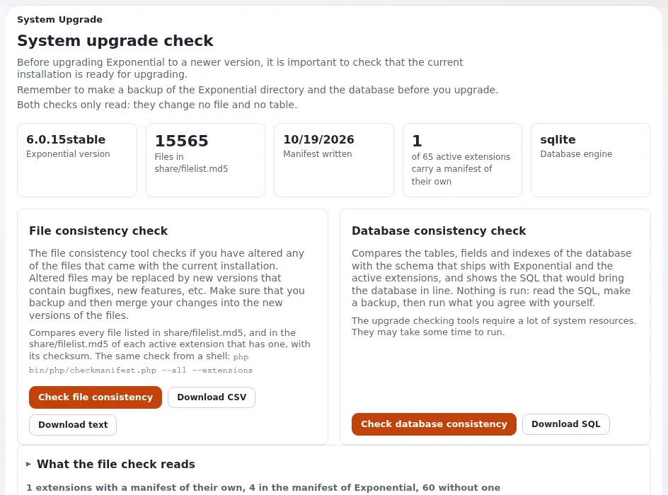

# Upgrade-Prüfung und Dateikonsistenz

Diese Seite richtet sich an Führungskräfte, die einen Nachweis wollen, dass die Dateien und die Datenbank einer Website
zu dem Release passen, von dem sie glauben, dass es läuft, und an den Administrator, der die Prüfungen ausführt. Sie
erklärt, was die Upgrade-Prüfung vergleicht, was jeder Befund für ein Unternehmen bedeutet und wann Sie sie ausführen.
Die vollständige Anleitung ist [Die Upgrade-Prüfung](../../../anleitungen/upgrade-pruefung.md); das Manifest dahinter beschreibt
[Prüfung der Dateikonsistenz](../../../../eng-us/features/6.0/file-consistency-check.md).



## Inhalt

1. [Was sie beweist](#was-sie-beweist)
2. [Die beiden Prüfungen](#die-beiden-prüfungen)
3. [Die Befunde zu Dateien lesen](#die-befunde-zu-dateien-lesen)
4. [Die Befunde zur Datenbank lesen](#die-befunde-zur-datenbank-lesen)
5. [Wann Sie sie ausführen](#wann-sie-sie-ausführen)
6. [In einer Shell](#in-einer-shell)
7. [Sicherheit](#sicherheit)
8. [Checkliste](#checkliste)

## Was sie beweist

Jedes Release von Exponential liefert eine Liste der Prüfsummen seiner Dateien mit, `share/filelist.md5`. Die
Upgrade-Prüfung vergleicht die Installation mit dieser Liste und mit dem Schema des Releases. Für ein Unternehmen
beantwortet das Ergebnis drei Fragen
([Prüfung der Dateikonsistenz, warum Sie sie wollen](../../../../eng-us/features/6.0/file-consistency-check.md#why-you-want-it)):

- **Vor einer Aktualisierung**: Hat jemand Release-Dateien von Hand geändert, die eine Aktualisierung überschreiben
  würde?
- **Nach einer Aktualisierung**: Ist etwas zurückgeblieben oder von Hand bearbeitet worden?
- **Nach einer Störung**: Wurde eine Datei verändert, ohne dass es jemand bemerkt hat?

## Die beiden Prüfungen

Beide stehen unter **Setup > Upgrade-Prüfung** (`/setup/systemupgrade`), wofür die Richtlinie `setup/setup` nötig ist
([Die Upgrade-Prüfung](../../../anleitungen/upgrade-pruefung.md#1-die-seite-öffnen)):

| Prüfung | Vergleicht | Typische Dauer auf dem Demonstrationsserver |
|---|---|---|
| **Überprüfe Dateikonsistenz** | Jede Datei in `share/filelist.md5` und im Manifest jeder aktiven Erweiterung, die eines mitbringt, mit ihrer Prüfsumme | Etwa 8.600 Dateien in etwa einer Sekunde bei warmem Datei-Cache |
| **Überprüfe Datenbankkonsistenz** | Die Tabellen, Felder und Indizes der Datenbank mit den Schemadateien von Exponential und der aktiven Erweiterungen | Etwa 0,1 Sekunden unter SQLite |

Die Zeiten stammen aus der Anleitung ([Abschnitte 3 und 6](../../../anleitungen/upgrade-pruefung.md#3-die-prüfung-der-dateikonsistenz-ausführen));
eine größere Website oder ein ausgelasteter Server braucht länger. Jede Prüfung zeigt ihre eigene Dauer an.

„**Beide Prüfungen lesen nur.** Es wird keine Datei geschrieben und kein SQL ausgeführt. Das SQL, das die
Datenbankprüfung zeigt, ist Text zum Lesen“ ([Die Upgrade-Prüfung, kurz gesagt](../../../anleitungen/upgrade-pruefung.md#kurz-gesagt)).

## Die Befunde zu Dateien lesen

Aus [Die Upgrade-Prüfung, jeder Befund und was zu tun ist](../../../anleitungen/upgrade-pruefung.md#4-jeder-befund-und-was-zu-tun-ist),
aus geschäftlicher Sicht:

| Befund | Was er für das Unternehmen bedeutet | Was zu tun ist |
|---|---|---|
| **Geändert** | Eine Release-Datei weicht von der ausgelieferten ab. Eine Aktualisierung ersetzt sie, und die Änderung geht verloren. | Wurde sie absichtlich geändert, lassen Sie Ihren Entwickler die Änderung in einen Override, ein Design oder eine eigene Erweiterung verlagern. Wollte niemand sie ändern, stellen Sie sie aus dem Release wieder her. |
| **Fehlt** | Eine Release-Datei ist nicht vorhanden; etwas kann fehlschlagen. | Kopieren Sie sie aus dem Release zurück. |
| **Nicht lesbar** | Der Webserver kann eine Datei nicht lesen. | Korrigieren Sie Eigentümer und Rechte. |
| **Nicht aufgeführt**, **Fehlerhafte Zeilen**, **Nicht in Reihenfolge** | Hinweise zur Liste selbst. | Auf einer installierten Website nichts; sie halten eine Aktualisierung nicht auf. |

Die Ergebniszeile ist grün („Überprüfung der Dateikonsistenz ist in Ordnung.“) oder orange („Warnung, es ist nicht
sicher ein Upgrade durchzuführen ohne die Änderungen in den folgende Dateien zu überprüfen“).

> **Tipp**
> Eine Liste „geänderter“ Dateien ist zugleich eine Karte der Stellen, an denen Ihre Website von Handänderungen abhängt.
> Jede davon ist ein künftiger Aufwand bei Aktualisierungen. Bitten Sie Ihren Entwickler, sie nach und nach in Ihre
> eigene Erweiterung oder Ihr eigenes Design zu verlagern.

## Die Befunde zur Datenbank lesen

Aus [Die Upgrade-Prüfung, Datenbankkonsistenz](../../../anleitungen/upgrade-pruefung.md#6-die-prüfung-der-datenbankkonsistenz-ausführen):

| Befund | Was er bedeutet | Was zu tun ist |
|---|---|---|
| **Fehlende Tabelle** | Eine Funktion, die sie nutzt, schlägt fehl, bis sie da ist | Führen Sie nach einem Backup ihre CREATE-Anweisung aus |
| **Tabelle nicht im Schema** | Meist eine Tabelle Ihrer eigenen oder einer entfernten Erweiterung | Lassen Sie sie, sofern Sie nicht wissen, dass ihre Daten nicht mehr gebraucht werden |
| **Tabelle einer nicht aktiven Extension** | Gehört zu einer installierten, inaktiven Erweiterung | Lassen Sie sie, oder aktivieren Sie die Erweiterung |
| **Geänderte Tabelle** | Felder oder Indizes weichen von der ausgelieferten Definition ab | Lesen Sie jede Anweisung; mit **Entfernt etwas** markierte Anweisungen können Daten entfernen |
| **Engine-Hinweise** | Unterschiede, für die die Engine kein SQL schreibt | Nichts; sie lassen die Prüfung nicht fehlschlagen |

Die Seite führt nie SQL aus. Jede Anweisung wird von einem Menschen geprüft und, wenn überhaupt, nach einem Backup
ausgeführt.

## Wann Sie sie ausführen

| Zeitpunkt | Warum |
|---|---|
| Vor der Planung einer Aktualisierung | Handänderungen werden zu Aufgaben im Plan ([Aktualisierungen ohne Überraschungen](aktualisierungen-ohne-ueberraschungen.md)) |
| Auf der Probekopie, nach der Aktualisierung | Belegt, dass die Probe nichts zurückgelassen hat |
| Auf der Live-Website, nach der Aktualisierung | Der Prüfschritt der Anleitung ([Upgrade, das Upgrade prüfen](../../../anleitungen/aktualisieren.md#das-upgrade-überprüfen)) |
| Nach einem Sicherheitsvorfall | Zeigt, ob Release-Dateien verändert wurden ([Störungsbehandlung für kleine Teams](stoerungsbehandlung-fuer-kleine-teams.md)) |
| Einmal im Quartal | Eine schnelle Zustandsprüfung der Installation |

Laden Sie den Bericht jedes Mal herunter (**CSV herunterladen** oder **Text herunterladen** für die Dateien,
**SQL herunterladen** für die Datenbank) und bewahren Sie ihn beim Aktualisierungsprotokoll auf. Er ist der Nachweis,
dass die Prüfung durchgeführt wurde und was sie gefunden hat.

## In einer Shell

Dieselben Befunde zu Dateien, im Wurzelverzeichnis der Installation
([Die Upgrade-Prüfung, in einer Shell](../../../anleitungen/upgrade-pruefung.md#7-dasselbe-in-einer-shell)):

```bash
php bin/php/checkmanifest.php --all                 # exit 0 when nothing is modified or missing
php bin/php/checkmanifest.php --all --extensions    # also every extension with its own manifest
php bin/php/checkmanifest.php --all --extensions --csv > report.csv
```

Der Befehl braucht weder Kernel noch Einstellungen noch Datenbank und verwendet dieselbe Klasse wie die Seite, sodass
die Befunde übereinstimmen. Sein Exit-Status macht ihn für eine automatische Prüfung nach jedem Deployment nutzbar.

## Sicherheit

Aus [Die Upgrade-Prüfung, Sicherheit](../../../anleitungen/upgrade-pruefung.md#sicherheit):

- Beide Prüfungen und alle Downloads lesen nur; die Seite hat keine Schaltfläche, die eine Datei schreibt oder die
  Datenbank ändert.
- Jeder Lauf und jeder Download wird im Prüfprotokoll als `system.upgrade.run` festgehalten, mit dem Ergebnis und der
  Anzahl der Unterschiede ([Prüfprotokoll für den Betrieb](audit-trail-fuer-den-betrieb.md)).

## Checkliste

- [ ] Vor jeder Aktualisierung wird die Upgrade-Prüfung ausgeführt und ihr Bericht gespeichert.
- [ ] Jede Datei mit **Geändert** hat eine verantwortliche Person und einen Plan: behalten, in eigenen Code verlagern
      oder wiederherstellen.
- [ ] Die Prüfung wird nach der Aktualisierung erneut ausgeführt, auf der Kopie und auf der Live-Website.
- [ ] Datenbankanweisungen werden nur nach einem Backup ausgeführt und nachdem ein Mensch sie gelesen hat.
- [ ] Nach einem Sicherheitsvorfall ist die Dateiprüfung Teil der Untersuchung.

## Verwandte Seiten

- [Aktualisierungen ohne Überraschungen](aktualisierungen-ohne-ueberraschungen.md)
- [Die Upgrade-Prüfung](../../../anleitungen/upgrade-pruefung.md)
- [Prüfung der Dateikonsistenz](../../../../eng-us/features/6.0/file-consistency-check.md)
- [Freie Dokumentation](../../freie-dokumentation.md): Diese Seite darf unter der GNU FDL 1.3 frei kopiert, übersetzt und verbessert werden.

<!-- exp-partner-block:start -->
**Werden Sie Exponential-Partner.** Partner teilen ihre Informationen, stellen Mittel bereit, geben Beiträge zurück
und entwickeln die Produkte mit uns, und so wächst Exponential. Eine Partner-Website und ein Dashboard sind für Mitte
2027 geplant: Werden Sie noch heute Partner, damit wir schneller wachsen und neue Funktionen früher liefern. Beginnen
Sie mit [Partner: hier beginnen](../../partner/partner-hier-beginnen.md) und
[Wie Sie sich bewerben](../../partner/wie-sie-sich-bewerben.md).
<!-- exp-partner-block:end -->
