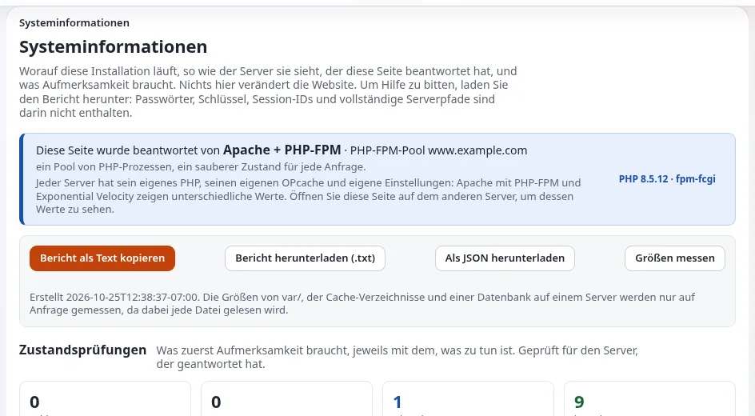

# Verfügbarkeit in der Praxis

Diese Seite richtet sich an Führungskräfte, die wissen müssen, was „die Website am Laufen halten“ bedeutet, und an die
Person, die es tut. Sie stellt eine Routine dar, von täglich bis vierteljährlich, mit den mitgelieferten Werkzeugen für
jeden Schritt. Nichts davon braucht zusätzliche Software: Die Befehle und Seiten kommen mit Exponential. Die technischen
Einzelheiten stehen unter [Betrieb einer Site](../../../anleitungen/betrieb-einer-website.md) und auf den
[Betriebsseiten für Hoster](../../hosting/betrieb/README.md).

## Inhalt

1. [Verfügbarkeit ist eine Gewohnheit](#verfügbarkeit-ist-eine-gewohnheit)
2. [Wer was tut](#wer-was-tut)
3. [Jeden Tag](#jeden-tag)
4. [Jede Woche](#jede-woche)
5. [Jeden Monat](#jeden-monat)
6. [Jedes Quartal](#jedes-quartal)
7. [Vor und nach jeder Änderung](#vor-und-nach-jeder-änderung)
8. [Es aufschreiben](#es-aufschreiben)

## Verfügbarkeit ist eine Gewohnheit

Die meisten Ausfälle entstehen nicht durch ein dramatisches Versagen. Sie entstehen aus Kleinigkeiten, die niemand
bemerkt hat: eine volle Festplatte, ein abgelaufenes Zertifikat, ein Cronjob, der nicht mehr läuft, ein Backup, das nie
fertig wurde, eine Änderung an einem Freitag ohne Weg zurück. Eine kurze Routine fängt so etwas früh ab.

> **Hinweis**
> Diese Seite legt kein Verfügbarkeitsziel fest. Die Zahlen eines solchen Versprechens sind eine geschäftliche
> Entscheidung, und das Projekt veröffentlicht keine
> ([Zustandsprüfungen und Verfügbarkeit](../../hosting/betrieb/zustandspruefungen-und-verfuegbarkeit.md#verfügbarkeit-in-einem-hosting-tarif)).
> Legen Sie Ihr eigenes Ziel mit Ihrem Hosting-Partner fest und halten Sie es dann mit dieser Routine ein.

## Wer was tut

Benennen Sie für jede Rolle eine Person und eine Vertretung. In einer kleinen Organisation kann eine Person mehrere
Rollen innehaben.

| Rolle | Verantwortlich für |
|---|---|
| Inhaber der Website | Entscheidet, wann die Website offline sein darf, genehmigt Aktualisierungen, spricht während einer Störung mit Kunden |
| Betrieb | Führt die Prüfungen unten aus, legt Backups an, spielt Aktualisierungen ein |
| Hosting-Partner | Der Server, das Netzwerk, das Betriebssystem und PHP, sofern sie nicht Ihre sind |
| Redakteure | Melden alles Seltsame, das sie in der Administration sehen |

Betreibt Ihr Hosting-Partner den Server, vereinbaren Sie schriftlich, welche der Prüfungen unten er übernimmt und wie er
Ihnen das Ergebnis mitteilt ([Grundlagen zu Verträgen und SLAs](../auswahl/grundlagen-zu-vertraegen-und-slas.md)).

## Jeden Tag

Automatisieren Sie diese Punkte; ein Mensch muss nur die Alarme lesen.

- Ein externer Monitor ruft die Startseite und die Anmeldeseite der Administration über HTTPS ab und alarmiert eine
  Person, wenn eine davon fehlschlägt ([Health-Checks und Monitoring](health-checks-und-monitoring.md)).
- Das geplante Backup läuft, und sein Erfolg oder Misserfolg wird gemeldet
  ([Backups, die sich wiederherstellen lassen](backups-die-sich-wiederherstellen-lassen.md)).
- Die Cronjobs laufen nach ihrem Zeitplan ([Cronjobs und Hintergrundjobs](cronjobs-und-hintergrundjobs.md)).
- Wo Exponential Velocity die Website ausliefert, startet sein Watchdog den Server nach einem Absturz neu
  ([Velocity für Unternehmen](velocity-fuer-unternehmen.md)).

## Jede Woche

Die wöchentliche Checkliste der Betriebsanleitung dauert ein paar Minuten
([Betrieb einer Site, eine wöchentliche Checkliste](../../../anleitungen/betrieb-einer-website.md#10-eine-wöchentliche-checkliste)):

1. `php bin/php/cache.php status --allow-root-user` endet mit `PASS`.
2. `php bin/php/audit.php status --allow-root-user` zeigt jede Kette als `intact`.
3. `tail -n 50 var/log/error.log` zeigt nichts Neues, das Sie nicht verstehen.
4. `php bin/php/console crontab:list` zeigt weiterhin Ihre Cron-Einträge.
5. Ein Backup aus den letzten sieben Tagen existiert und wurde mindestens einmal auf einem anderen Rechner
   wiederhergestellt.

Werfen Sie zusätzlich einen Blick auf **Setup > Systeminformationen** (`/setup/info`): Ihre Zustandsprüfungen listen
Fehlschläge und Warnungen zuerst auf, jeweils mit dem, was zu tun ist
([Systeminformationen](../../../anleitungen/systeminformationen.md#3-zustandsprüfungen)), und auf
**Setup > Logdateien > Fehlerübersicht**, die die Fehler der letzten 24 Stunden gruppiert und zählt
([Überblick über die Überwachung](../../hosting/betrieb/ueberblick-ueber-die-ueberwachung.md#seiten-für-einen-menschen)).

## Jeden Monat

Die [Checkliste für den monatlichen Betrieb](../../hosting/checklisten/checkliste-fuer-den-monatlichen-betrieb.md) des Hosting-Bereichs ist ein
gutes Vorbild. Kurz gefasst:

- [ ] Neue Exponential-Releases sind bekannt; Sicherheitskorrekturen darunter sind eingespielt oder eingeplant.
- [ ] Sicherheitsupdates für Betriebssystem und PHP sind eingespielt, und die PHP-Version wird noch unterstützt.
- [ ] Ein Backup wurde auf einem anderen Rechner wiederhergestellt ([Wiederherstellungsübungen](wiederherstellungsuebungen.md)).
- [ ] Der Plattenplatz für Speicher, Caches, Logs und Datenbank liegt im Plan.
- [ ] `security.log` und das Prüfprotokoll zeigen nichts Unerwartetes; Konten ausgeschiedener Personen sind entfernt.
- [ ] Zertifikate sind länger gültig als die Erneuerungsfrist.
- [ ] Ein kurzer Bericht geht an den Inhaber der Website: Verfügbarkeit laut externer Prüfung, Störungen, Updates,
      Wachstum des Plattenplatzes.

Die Fassung für Unternehmen, fertig zum Kopieren, ist die Vorlage
[Monatliche Betriebscheckliste](../vorlagen/monatliche-betriebscheckliste.md).

## Jedes Quartal

- Bewerten Sie Ihren Betrieb mit dem [Bewertungsbogen Zuverlässigkeit](bewertungsbogen-zuverlaessigkeit.md) und vergleichen Sie
  mit dem letzten Quartal.
- Proben Sie eine Störung mit dem Plan aus
  [Störungsbehandlung für kleine Teams](stoerungsbehandlung-fuer-kleine-teams.md).
- Überprüfen Sie, wer Administratorrechte hat ([Zugriffsprüfungen](../sicherheit/zugriffspruefungen.md)).
- Prüfen Sie die Termine Ihrer Spitzen im nächsten Quartal und planen Sie dafür
  ([Lastspitzen planen](lastspitzen-planen.md)).
- Gehen Sie das Risikoregister mit Ihrer Projektleitung durch
  ([Risikomanagement für Exponential-Projekte](../../fuehrung/risikomanagement.md)).

## Vor und nach jeder Änderung

Die meisten Störungen folgen auf eine Änderung. Machen Sie diese Schritte zur Regel für jede Aktualisierung, jedes
Deployment, jeden Import und jede Änderung an Einstellungen:

| Vorher | Nachher |
|---|---|
| Ein Backup anlegen | Die Startseite, eine tiefe Unterseite und die Administration öffnen |
| Die Release Notes lesen ([Aktualisierungen ohne Überraschungen](aktualisierungen-ohne-ueberraschungen.md)) | `var/log/error.log` und **Setup > Systeminformationen** ansehen |
| Bei einer Aktualisierung die Upgrade-Prüfung ausführen ([Upgrade-Prüfung und Dateikonsistenz](upgrade-pruefung-und-dateikonsistenz.md)) | Die Caches in der richtigen Reihenfolge leeren ([Unterbrechungsfreie Deployments](unterbrechungsfreie-deployments.md)) |
| Ein Wartungsfenster öffnen, wenn sich die Datenbank oder viele Dateien ändern ([Wartungsmodus und geplante Arbeiten](wartungsmodus-und-geplante-arbeiten.md)) | Das Fenster schließen und den Inhaber der Website informieren |
| Wissen, wie Sie es rückgängig machen würden | Eine Zeile ins Änderungsprotokoll schreiben |

> **Tipp**
> Vermeiden Sie Änderungen kurz vor einem Wochenende, einem Feiertag oder einer Verkaufsspitze. Eine Änderung, die
> vorgenommen wird, während das Team anwesend ist, lässt sich beheben, solange das Problem klein ist.

## Es aufschreiben

Führen Sie ein kurzes Betriebsprotokoll: Datum, was geprüft oder geändert wurde, von wem und mit welchem Ergebnis. Das
kostet eine Minute pro Eintrag und zahlt sich am ersten schlechten Tag aus. Das Prüfprotokoll zeichnet bereits viele
Aktionen für Sie auf, etwa geschriebene Einstellungen, geleerte Caches, Deployments und Wartung
([Prüfprotokoll für den Betrieb](audit-trail-fuer-den-betrieb.md)), aber es zeichnet nicht auf, was Sie geprüft und für in
Ordnung befunden haben.

## Verwandte Seiten

- [Health-Checks und Monitoring](health-checks-und-monitoring.md)
- [Zustandsprüfungen und Verfügbarkeit](../../hosting/betrieb/zustandspruefungen-und-verfuegbarkeit.md)
- [Betrieb einer Site](../../../anleitungen/betrieb-einer-website.md)
- [Freie Dokumentation](../../freie-dokumentation.md): Diese Seite darf unter der GNU FDL 1.3 frei kopiert, übersetzt und verbessert werden.

<!-- exp-partner-block:start -->
**Werden Sie Exponential-Partner.** Partner teilen ihre Informationen, stellen Mittel bereit, geben Beiträge zurück
und entwickeln die Produkte mit uns, und so wächst Exponential. Eine Partner-Website und ein Dashboard sind für Mitte
2027 geplant: Werden Sie noch heute Partner, damit wir schneller wachsen und neue Funktionen früher liefern. Beginnen
Sie mit [Partner: hier beginnen](../../partner/partner-hier-beginnen.md) und
[Wie Sie sich bewerben](../../partner/wie-sie-sich-bewerben.md).
<!-- exp-partner-block:end -->
