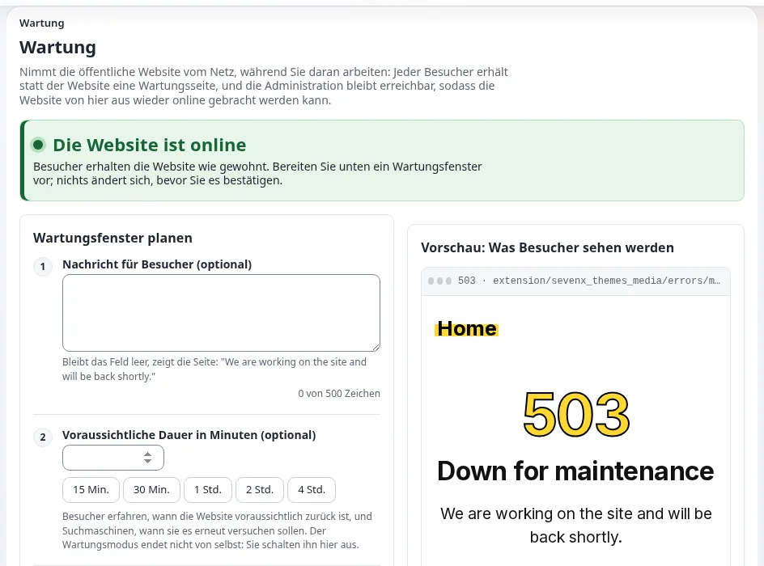

# Wartungsmodus und geplante Arbeiten

Diese Seite richtet sich an Inhaber und Führungskräfte, die entscheiden, wann die Website offline sein darf, und an den
Administrator, der sie vom Netz nimmt. Sie erklärt, was Kunden und Suchmaschinen sehen, wie Sie ein Wartungsfenster
planen und ankündigen, wie Sie es ein- und ausschalten und welche Regeln verhindern, dass aus einem kurzen Fenster ein
Ausfall wird. Die vollständige Anleitung ist
[Wartungsmodus: die Site vom Netz nehmen und zurückholen](../../../anleitungen/wartungsmodus.md).



## Inhalt

1. [Warum eine saubere Wartungsseite wichtig ist](#warum-eine-saubere-wartungsseite-wichtig-ist)
2. [Was Kunden und Suchmaschinen sehen](#was-kunden-und-suchmaschinen-sehen)
3. [Ein Wartungsfenster planen](#ein-wartungsfenster-planen)
4. [Ein- und ausschalten](#ein--und-ausschalten)
5. [Wer trotzdem hineinkommt](#wer-trotzdem-hineinkommt)
6. [Notfälle](#notfälle)
7. [Was der Wartungsmodus nicht anhält](#was-der-wartungsmodus-nicht-anhält)
8. [Sicherheitsregeln](#sicherheitsregeln)

## Warum eine saubere Wartungsseite wichtig ist

Manche Arbeiten erfordern, dass die Website eine Weile offline ist: eine Aktualisierung, ein großer Datenimport, eine
Datenbankmigration, eine Wiederherstellung. Ohne Wartungsmodus stoßen Besucher in dieser Zeit auf Fehler und halb
geänderte Seiten. Mit ihm bekommen sie eine klare Nachricht und eine voraussichtliche Uhrzeit, und Suchmaschinen erfahren,
dass sie später wiederkommen sollen, statt Ihre Seiten aus dem Index zu werfen.

Der Wartungsmodus ist Teil jeder Installation. Die Installer verwenden denselben Mechanismus, „damit eine Website, die
gerade installiert wird, nie eine halb aufgebaute Seite ausliefert“
([Funktion Wartungsmodus](../../../funktionen/6.0/wartungsmodus.md)).

## Was Kunden und Suchmaschinen sehen

Solange die Wartung eingeschaltet ist, bekommt jede Seitenanfrage eine einzige Wartungsseite mit diesen Headern
([Anleitung zum Wartungsmodus, was er tut](../../../anleitungen/wartungsmodus.md#1-was-der-wartungsmodus-tut)):

| Header | Bedeutung |
|---|---|
| `503 Service Unavailable` | „Vorübergehend nicht verfügbar“, nicht „verschwunden“ |
| `Retry-After` | Sekunden bis zum voraussichtlichen Ende, oder 120, wenn keines angegeben ist |
| `Cache-Control: no-store ...` | Kein Cache, kein Proxy und kein Browser behält die Wartungsseite nach dem Fenster |
| `X-Robots-Tag: noindex` | Die Wartungsseite selbst wird nicht indiziert |

„Ein 503 mit `Retry-After` ist die Antwort, die Suchmaschinen als ‚komm später wieder‘ verstehen: Die Seiten behalten
ihren Platz im Index“ (derselbe Abschnitt). Bilder, Stile und Skripte werden weiterhin ausgeliefert.

Die Prüfung läuft als Erstes im Front-Controller, noch vor den Einstellungen und der Datenbank, sodass die Wartungsseite
„nichts braucht, was während des Fensters kaputt sein könnte: kein Template, keine INI-Datei, keine
Datenbankverbindung“ (derselbe Abschnitt).

## Ein Wartungsfenster planen

| Schritt | Was zu entscheiden ist |
|---|---|
| Zeitpunkt | Eine ruhige Stunde für Ihre Kunden, nie kurz vor einem Sale oder einem Newsletter-Versand ([Lastspitzen planen](lastspitzen-planen.md)) |
| Dauer | Eine realistische Schätzung plus Puffer; proben Sie die Arbeit an einer Kopie, um sie zu kennen |
| Nachricht | Was passiert und wann die Website zurück ist, in den Worten der Kunden: „Wir aktualisieren den Shop. Ab 06:00 UTC sind wir mit dem neuen Bestellablauf zurück.“ |
| Ankündigung | Informieren Sie Kunden, Mitglieder und Mitarbeiter vorab: ein Hinweis auf der Website, eine Zeile im Newsletter, soziale Medien |
| Backup | Ein frisches Backup, bevor das Fenster öffnet ([Backups, die sich wiederherstellen lassen](backups-die-sich-wiederherstellen-lassen.md)) |
| Cronjobs | Welche geplanten Jobs während der Arbeit nicht laufen dürfen ([Cronjobs und Hintergrundjobs](cronjobs-und-hintergrundjobs.md)) |
| Wer entscheidet | Wer das Fenster verlängern darf und wer stattdessen ein Zurückrollen beschließen darf |

> **Hinweis**
> „Die Wartung endet nie von selbst, wenn die voraussichtliche Zeit verstrichen ist“
> ([Anleitung zum Wartungsmodus](../../../anleitungen/wartungsmodus.md#kurz-gesagt)). Das voraussichtliche Ende ist ein
> Versprechen an die Kunden, kein Timer. Ihr Monitoring sollte alarmieren, wenn ein Fenster überzogen wird
> ([Health-Checks und Monitoring](health-checks-und-monitoring.md#prüfungen-von-außen)).

## Ein- und ausschalten

**In der Administration**: **Setup > Wartung** (`/setup/maintenance`). Das Formular fragt nach einer optionalen
Nachricht, einer optionalen voraussichtlichen Dauer (ein Klick für 15 Minuten bis 4 Stunden) und danach, wer trotzdem
hineinkommt. Eine Vorschau zeigt die echte Seite, und eine erforderliche Bestätigung schützt die Schaltfläche
**Website offline nehmen**. **Website wieder online bringen** beendet die Wartung
([Anleitung zum Wartungsmodus, kurz gesagt](../../../anleitungen/wartungsmodus.md#kurz-gesagt)).

**In einer Shell** (Optionen abgeglichen mit `bin/php/maintenance.php`):

```bash
php bin/php/maintenance.php on --message="Back at 06:00" --until=2h --allow-admin --allow-root-user
php bin/php/maintenance.php status --allow-root-user
php bin/php/maintenance.php off --allow-root-user
```

Ohne `--allow-admin` ist auch die Administration offline
([Anleitung zum Wartungsmodus, von der Kommandozeile](../../../anleitungen/wartungsmodus.md#6-über-die-kommandozeile)).
`--allow-root-user` ist nur nötig, wenn Sie als root arbeiten.

Jedes Ein- und Ausschalten wird im Prüfprotokoll als `system.maintenance.change` aufgezeichnet, und die Seite listet die
letzten acht auf ([Anleitung zum Wartungsmodus, das Audit](../../../anleitungen/wartungsmodus.md#13-letzte-änderungen-und-das-audit)).

## Wer trotzdem hineinkommt

- **Die Administration**: immer erreichbar, wenn die Wartung über die Seite eingeschaltet wird; in einer Shell nur mit
  `--allow-admin`.
- **Ihre eigene Adresse**: ein Häkchen auf der Seite, damit Sie Ihre Arbeit prüfen können, während Kunden die
  Wartungsseite sehen.
- **Andere Adressen**: für Tester, die die neue Website vor allen anderen sehen müssen. Jede Adresse wird exakt
  verglichen; Adressbereiche werden nicht unterstützt
  ([Anleitung zum Wartungsmodus, Schritt 3](../../../anleitungen/wartungsmodus.md#schritt-3-wer-weiterhin-zugang-hat)).

## Notfälle

Wenn etwas vor den Augen der Kunden Seiten kaputt macht und Sie eine Minute zum Nachsehen brauchen, ist der
Notfallablauf der Anleitung ein einziger Befehl
([Anleitung zum Wartungsmodus, ein Notfall](../../../anleitungen/wartungsmodus.md#ein-notfall)):

```bash
php bin/php/maintenance.php on --message="We are fixing a problem. Back shortly." --allow-admin --allow-ip=<your address>
```

Reparieren Sie, prüfen Sie von Ihrer Adresse aus, und schalten Sie die Wartung dann aus. Eine kurze, ehrliche
Wartungsseite ist für Kunden und Suchmaschinen besser als eine Flut von Fehlern. Siehe
[Störungsbehandlung für kleine Teams](stoerungsbehandlung-fuer-kleine-teams.md).

Wenn sonst nichts funktioniert, ist der Zustand eine einzige Datei: „Das Löschen der Datei beendet die Wartung: Das ist
der Weg zurück hinein, wenn sonst nichts funktioniert“
([Anleitung zum Wartungsmodus](../../../anleitungen/wartungsmodus.md#kurz-gesagt)). Die Datei ist `var/maintenance.json`.

## Was der Wartungsmodus nicht anhält

- **Cronjobs** laufen in einer Shell und laufen weiter. „Halten Sie die Crontab selbst an, wenn ein Job nicht laufen darf,
  während Sie die Website ändern“
  ([Anleitung zum Wartungsmodus, Cronjobs](../../../anleitungen/wartungsmodus.md#10-installationen-cronjobs-und-bereitstellungen)).
  Cronjob-Teile lassen sich auch unter **Setup > Cronjobs** anhalten
  ([Cronjob-Teile anhalten](../../../funktionen/6.0/cronjobs-pausieren.md)).
- **Deployments** (`exp:velocity deploy`) schalten die Wartung weder ein noch aus; öffnen Sie das Fenster zuerst selbst.
- **Ein CDN oder Reverse Proxy** hält möglicherweise noch Seiten von vor dem Fenster; leeren Sie es, wenn sich Inhalte
  geändert haben.
- **Mehrere Webserver**: Der Zustand ist eine Datei im Verzeichnis `var/` jedes Servers; schalten Sie die Wartung auf
  jedem Server ein und aus
  ([Mehrere Web-Knoten](../../hosting/betrieb/mehrere-web-knoten.md#cron-ausrollen-wartung-und-logs)).

## Sicherheitsregeln

Aus der [Sicherheits-Checkliste](../../../anleitungen/wartungsmodus.md#sicherheits-checkliste) der Anleitung, aus geschäftlicher
Sicht:

Vor dem Einschalten:

- [ ] Sie erreichen die Administration weiterhin, oder Ihre Adresse ist zugelassen, oder Sie haben eine Shell.
- [ ] Die Nachricht sagt in den Worten der Kunden, wann die Website zurück ist.
- [ ] Cronjobs, die während des Fensters nicht laufen dürfen, sind gestoppt oder angehalten.
- [ ] Ein frisches Backup existiert.

Vor dem Ausschalten:

- [ ] Es läuft keine Installation (das Banner würde es anzeigen).
- [ ] Die Website funktioniert von einer zugelassenen Adresse aus.

Nach dem Ausschalten:

- [ ] Die Startseite antwortet für alle mit `200`, über jeden Server.
- [ ] Caches vor der Website sind geleert, wenn sich Inhalte geändert haben.
- [ ] Kunden und Mitarbeiter wissen, dass die Arbeit erledigt ist.

## Verwandte Seiten

- [Aktualisierungen ohne Überraschungen](aktualisierungen-ohne-ueberraschungen.md)
- [Wartungsmodus für Website-Ersteller](../../ersteller/website-ersteller/wartungsmodus.md)
- [Wartungsmodus (Hosting)](../../hosting/betrieb/wartungsmodus.md)
- [Freie Dokumentation](../../freie-dokumentation.md): Diese Seite darf unter der GNU FDL 1.3 frei kopiert, übersetzt und verbessert werden.

<!-- exp-partner-block:start -->
**Werden Sie Exponential-Partner.** Partner teilen ihre Informationen, stellen Mittel bereit, geben Beiträge zurück
und entwickeln die Produkte mit uns, und so wächst Exponential. Eine Partner-Website und ein Dashboard sind für Mitte
2027 geplant: Werden Sie noch heute Partner, damit wir schneller wachsen und neue Funktionen früher liefern. Beginnen
Sie mit [Partner: hier beginnen](../../partner/partner-hier-beginnen.md) und
[Wie Sie sich bewerben](../../partner/wie-sie-sich-bewerben.md).
<!-- exp-partner-block:end -->
