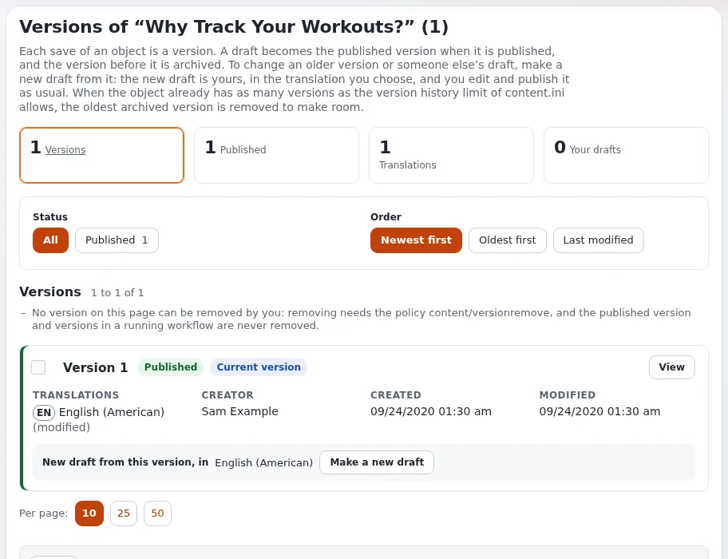
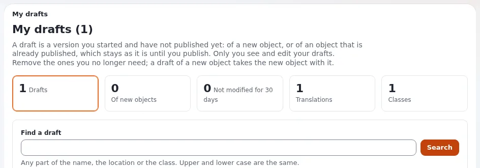
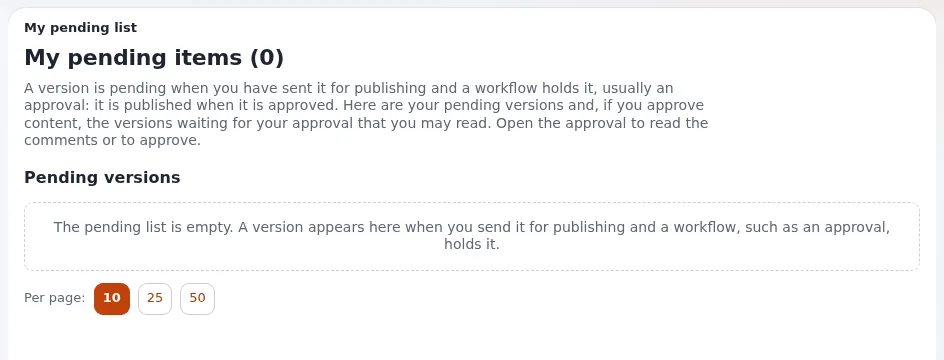
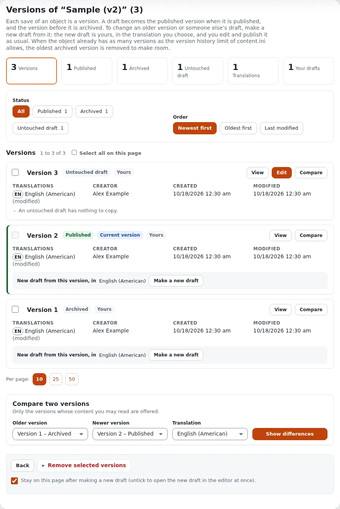
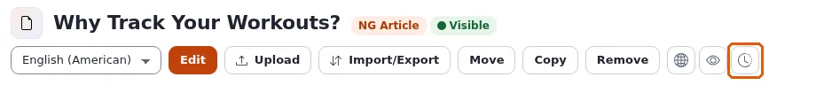
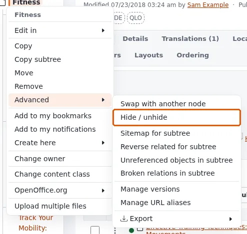
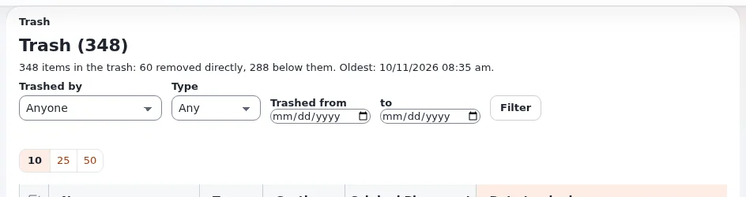

# Veröffentlichen, Versionen und der Papierkorb

Diese Seite ist für Redakteure. Sie erklärt, was zwischen dem Klick auf **Bearbeiten** und der sichtbaren Änderung
auf der Site geschieht, wie Sie zu einer früheren Version zurückkehren, wie Sie ein Objekt verstecken, ohne es zu
entfernen, und wie Sie ein entferntes Objekt zurückholen.

## Entwürfe und Versionen

Jedes Speichern eines Objekts ist eine **Version**. Wenn Sie auf **Bearbeiten** klicken, entsteht eine neue Version
als **Entwurf**: Nur Sie sehen sie, und die Site zeigt weiter die veröffentlichte Version, bis Sie veröffentlichen.

| Status | Bedeutung |
|---|---|
| **Entwurf** | In Arbeit. Nur sein Ersteller sieht und bearbeitet ihn. |
| **Ausstehend** | Zur Veröffentlichung geschickt, aber von einem Workflow zurückgehalten, meist einer Freigabe. |
| **Veröffentlicht** | Die Version, die die Site zeigt. Ein Objekt hat immer nur eine veröffentlichte Version. |
| **Archiviert** | Eine früher veröffentlichte Version. Sie wird aufbewahrt, damit Sie zu ihr zurückkehren können. |

Wird ein Entwurf veröffentlicht, wird die zuvor veröffentlichte Version archiviert. Eine Site bewahrt pro Objekt
eine begrenzte Zahl von Versionen auf; ist die Grenze erreicht, wird die älteste archivierte Version entfernt, um
Platz zu schaffen.

## Veröffentlichen

Klicken Sie im Bearbeitungsformular auf **Zur Veröffentlichung schicken**. Auf den meisten Sites ist die Änderung
sofort sichtbar. Verwendet Ihre Site für Ihre Rolle oder diesen Bereich der Site eine **Freigabe**, wird die Version
stattdessen **ausstehend** und erst veröffentlicht, wenn jemand sie freigibt.

Um ohne Veröffentlichen aufzuhören:

- **Entwurf speichern und beenden** behält den Entwurf für später;
- **Entwurf verwerfen** wirft ihn nach einer Bestätigung weg.

### Meine Entwürfe

**Meine Entwürfe** (auf dem Dashboard und in der linken Spalte des Dashboards) listet die Entwürfe auf, die Sie
begonnen und noch nicht veröffentlicht haben. Öffnen Sie einen, um daran weiterzuarbeiten, oder entfernen Sie die,
die Sie nicht mehr brauchen. Das Entfernen des Entwurfs eines neuen Objekts entfernt auch dieses neue Objekt, das ja
nie veröffentlicht wurde.

### Meine Warteliste

**Meine Warteliste** listet die Versionen auf, die Sie zur Veröffentlichung geschickt haben und die ein Workflow
noch zurückhält, sowie, falls Sie Inhalte freigeben, die Versionen, die auf Ihre Freigabe warten. Öffnen Sie die
Freigabe, um ihre Kommentare zu lesen oder freizugeben.

Alle Einzelheiten finden Sie unter [Meine Entwürfe und meine Warteliste](../anleitungen/entwuerfe-und-ausstehende-objekte.md).

## Zu einer früheren Version zurückkehren

Klicken Sie auf der Seite des Objekts auf **Versionen verwalten** (die runde Schaltfläche mit einer Uhr) oder wählen
Sie **Versionen verwalten** in der linken Spalte des Bearbeitungsformulars. Die Versionsseite öffnet sich:

- **Übersicht**: wie viele Versionen es gibt, veröffentlichte, archivierte und Ihre Entwürfe.
- **Filter und Reihenfolge**: alle Versionen oder nur einen Status zeigen, die neuesten oder die ältesten zuerst.
- Jede Version hat **Ansehen** (ihren Inhalt anzeigen), **Vergleichen** und **Neuen Entwurf machen**.
- **Zwei Versionen vergleichen**: Wählen Sie eine ältere und eine neuere Version sowie eine Übersetzung und klicken
  Sie auf **Unterschiede anzeigen**. Die Änderungen werden Feld für Feld markiert.

Um einen älteren Text zurückzuholen, wählen Sie seine Übersetzung unter **Neuer Entwurf aus dieser Version, in** und
klicken Sie auf **Neuen Entwurf machen**. Aus dieser Version entsteht ein neuer Entwurf; prüfen Sie ihn und
veröffentlichen Sie ihn wie gewohnt. Die aktuelle Version ändert sich erst, wenn Sie veröffentlichen. Das
funktioniert auch mit dem Entwurf einer anderen Person: Der neue Entwurf gehört Ihnen.

Versionen, die Sie nicht mehr brauchen, können Sie markieren und mit **Ausgewählte Versionen entfernen** entfernen.
Die veröffentlichte Version lässt sich auf diese Weise nie entfernen.

Alle Einzelheiten finden Sie unter [Versionen eines Objekts](../anleitungen/inhaltsverlauf.md).

## Ein Objekt verstecken

Ein verstecktes Objekt bleibt in der Administration, wird aber auf der Site nicht angezeigt, ebenso wenig alles
darunter. Verwenden Sie das für Inhalte, die noch nicht fertig sind oder eine Zeit lang nicht gebraucht werden.

- Öffnen Sie im Baum das Menü des Objekts und wählen Sie **Fortgeschritten** > **Verstecken / Zeigen**.
- Kreuzen Sie in einer Liste **Unterelemente** Objekte an und wählen Sie **Weitere Aktionen** > **Auswahl
  verstecken** oder **Auswahl einblenden**.

Versteckte Objekte sind im Baum und in Listen gekennzeichnet, und die Plakette neben dem Typ auf der Seite des
Objekts zeigt seine Sichtbarkeit.

## Entfernen und wiederherstellen

**Entfernen** auf der Seite eines Objekts (oder in seinem Menü, oder **Ausgewählte entfernen** für mehrere Objekte)
fragt nach einer Bestätigung und verschiebt das Objekt dann mit allem darunter in den **Papierkorb**. Objekte im
Papierkorb sind nicht auf der Site.

Hat ein Objekt mehr als einen Ort, bleibt es beim Entfernen eines Orts an seinen anderen Stellen erhalten; in den
Papierkorb kommt es erst, wenn sein letzter Ort entfernt wird.

### Der Papierkorb

Der **Papierkorb** steht unten im Baum in der linken Spalte. Er listet die entfernten Objekte auf, mit der Angabe,
wer sie entfernt hat, wann und wo sie sich befanden. Filter grenzen die Liste nach der Person, die sie entfernt hat,
nach ihrem Typ und nach dem Datum ein.

- **Wiederherstellen** holt ein Objekt zurück. Gibt es seine ursprüngliche Stelle noch, kehrt es dorthin zurück;
  liegt diese Stelle ebenfalls im Papierkorb, stellen Sie zuerst das übergeordnete Objekt wieder her; andernfalls
  wählen Sie eine neue Stelle.
- **Ausgewählte entfernen** löscht Objekte endgültig. **Papierkorb leeren** löscht alles darin. Beides lässt sich
  nicht rückgängig machen.

Ihre Rolle entscheidet, ob Sie aus dem Papierkorb wiederherstellen oder löschen dürfen.

## Mehr erfahren

- [Inhalte erstellen und bearbeiten](inhalte-bearbeiten.md)
- [Versionen eines Objekts](../anleitungen/inhaltsverlauf.md)
- [Meine Entwürfe und meine Warteliste](../anleitungen/entwuerfe-und-ausstehende-objekte.md)

<!-- exp-partner-block:start -->
**Werden Sie Exponential-Partner.** Partner teilen ihre Informationen, stellen Mittel bereit, geben Beiträge zurück
und entwickeln die Produkte mit uns, und so wächst Exponential. Eine Partner-Website und ein Dashboard sind für Mitte
2027 geplant: Werden Sie noch heute Partner, damit wir schneller wachsen und neue Funktionen früher liefern. Beginnen
Sie mit [Partner: hier beginnen](partner/partner-hier-beginnen.md) und
[Wie Sie sich bewerben](partner/wie-sie-sich-bewerben.md).
<!-- exp-partner-block:end -->
