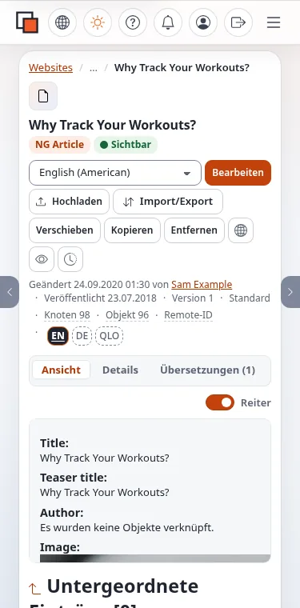

# Eine Erklärung zur Barrierefreiheit schreiben

Diese Seite richtet sich an Projektverantwortliche, die Koordination Barrierefreiheit und die Redaktion, die die
Erklärung veröffentlicht. Exponential liefert **keine Vorlage für eine Erklärung zur Barrierefreiheit** mit; das Projekt
nennt das als Lücke gegenüber der Richtlinie über barrierefreie Websites
([Standards zur Barrierefreiheit: EN 301 549](../../../standards/barrierefreiheit.md#en-301-549)). Die folgende Gliederung
folgt der Leitlinie von W3C WAI, Developing an Accessibility Statement (<https://www.w3.org/WAI/planning/statements/>).
Veröffentlicht Ihr Land eine Mustererklärung, verwenden Sie dieses Muster; es hat Vorrang.

> **Hinweis** Diese Seite beschreibt Funktionen und übliche Praxis; sie ist keine Rechtsberatung. Prüfen Sie das für
> Ihre Organisation geltende Recht mit Ihrer Rechtsberatung.

## Inhalt

1. [Bevor Sie schreiben](#bevor-sie-schreiben)
2. [Eine Gliederung](#eine-gliederung)
3. [Was Sie über das CMS sagen](#was-sie-über-das-cms-sagen)
4. [Die Erklärung in Exponential veröffentlichen](#die-erklärung-in-exponential-veröffentlichen)
5. [Aktuell halten](#aktuell-halten)
6. [Verwandte Seiten](#verwandte-seiten)

## Bevor Sie schreiben

Sie brauchen das Ergebnis einer Bewertung Ihrer Website (siehe „Ihr öffentliches Design mit WCAG-EM prüfen“), eine
Liste bekannter Probleme mit einem Plan und einen Kontakt, auf den tatsächlich jemand antwortet.

## Eine Gliederung

| Abschnitt | Inhalt |
|---|---|
| Selbstverpflichtung | die Selbstverpflichtung der Stelle und die Website, für die die Erklärung gilt (ihre Adresse) |
| Standard und Status | der Standard (zum Beispiel WCAG 2.2 AA) und der Status: vollständig, teilweise oder nicht konform, wie Ihr Recht es formuliert |
| Bekannte Einschränkungen | jedes Problem in einfachen Worten, wo es auftritt und welche Alternative inzwischen angeboten wird |
| Plan | was bis wann behoben wird |
| Rückmeldung und Kontakt | wie man eine Barriere meldet oder Inhalte in einem anderen Format anfordert: E-Mail, Telefon, Formular |
| Durchsetzungsverfahren | die Stelle, an die man sich wenden kann, wenn die Antwort nicht zufriedenstellt, sofern Ihr Recht eine nennt |
| Technische Informationen | die Technologien, auf die sich die Website stützt (HTML, CSS, JavaScript) |
| Bewertung | wie die Website bewertet wurde (Selbstbewertung oder extern), wann und von wem |
| Datum | Datum der Erklärung und ihrer letzten Überprüfung |

## Was Sie über das CMS sagen

Die meisten Erklärungen müssen das CMS gar nicht erwähnen: Sie betreffen die öffentliche Website. Wenn Sie es erwähnen,
halten Sie sich an die Worte des Projekts:

- das Administrationsdesign admin4 ist gegen WCAG 2.2 AA entworfen und getestet und vom Projekt mit „Teilweise erfüllt“
  bewertet;
- die Konformität mit EN 301 549 und Section 508 ist „nicht geprüft“;
- es gibt kein VPAT und keinen Accessibility Conformance Report.

Schreiben Sie nie, die Website sei barrierefrei, „weil sie ein barrierefreies CMS verwendet“.

## Die Erklärung in Exponential veröffentlichen

1. Legen Sie die Erklärung als normales Inhaltsobjekt an (einen Artikel oder einen Ordner mit Text in Ihrem
   Inhaltsbaum), in jedem Sprach-Siteaccess der Website.
2. Geben Sie ihr einen stabilen, lesbaren URL-Alias, zum Beispiel `/accessibility`, damit sich die Adresse in Ihrer
   Fußzeile und in Berichten nie ändert
   ([URL-Aliase und sprechende URLs](../../ersteller/website-ersteller/url-aliasse-und-sprechende-urls.md)). Ein globaler Alias
   lässt sich auch unter Setup > URL-Übersetzer setzen
   ([Globale URL-Aliase](../../../anleitungen/urls-und-aliase.md#3-globale-url-aliase)).
3. Verlinken Sie sie aus der Fußzeile jeder Seite: in Ihrem Pagelayout oder der gemeinsamen Fußzeile
   ([Gemeinsamer Kopf- und Fußbereich](../../ersteller/website-ersteller/gemeinsamer-kopf-und-fussbereich.md)).
4. Bieten Sie ein Rückmeldeformular an, bauen Sie es mit dem Informationssammler
   ([Ein Kontaktformular bauen](../../ersteller/website-ersteller/ein-kontaktformular-bauen.md)) und nennen Sie in der
   Datenschutzerklärung, was mit den Nachrichten geschieht.
5. Schreiben Sie die Erklärung selbst barrierefrei: echte Überschriften, einfache Sprache, keine Informationen nur in
   einem PDF.

## Aktuell halten

- Überprüfen Sie sie mindestens einmal im Jahr und nach jeder wesentlichen Änderung (Neugestaltung, neue Erweiterung,
  neuer Dienst).
- Bewahren Sie frühere Fassungen auf: Die Versionsseite des Objekts behält sie (`/content/history/<object id>`), im
  Rahmen der Grenze des Versionsverlaufs ([Versionen eines Objekts](../../../anleitungen/inhaltsverlauf.md)).
- Aktualisieren Sie die Datumszeile bei jeder Überprüfung.

## Verwandte Seiten

- W3C WAI, [Eine Erklärung zur Barrierefreiheit entwickeln](https://www.w3.org/WAI/planning/statements/)
- [Standards zur Barrierefreiheit](../../../standards/barrierefreiheit.md)
- [Die Barrierefreiheit Ihrer Website testen](../../ersteller/website-ersteller/barrierefreiheit-testen.md)
- [Freie Dokumentation](../../freie-dokumentation.md): Diese Seite darf unter der GNU FDL 1.3 frei kopiert, übersetzt und verbessert werden.

<!-- exp-partner-block:start -->
**Werden Sie Exponential-Partner.** Partner teilen ihre Informationen, stellen Mittel bereit, geben Beiträge zurück
und entwickeln die Produkte mit uns, und so wächst Exponential. Eine Partner-Website und ein Dashboard sind für Mitte
2027 geplant: Werden Sie noch heute Partner, damit wir schneller wachsen und neue Funktionen früher liefern. Beginnen
Sie mit [Partner: hier beginnen](../../partner/partner-hier-beginnen.md) und
[Wie Sie sich bewerben](../../partner/wie-sie-sich-bewerben.md).
<!-- exp-partner-block:end -->
