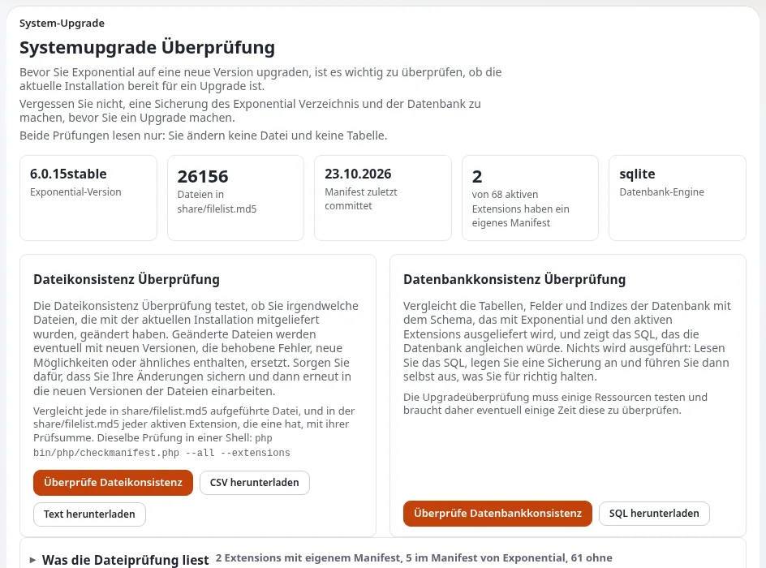

# Kosten für Upgrades und Wartung über die Lebensdauer einer Website

Diese Seite richtet sich an Projektleitungen und Personen mit Budgetverantwortung, die die wiederkehrenden Kosten dafür
planen, eine Website sicher und aktuell zu halten. Sie erklärt die Arten von Updates, die eine Exponential-Website
erhält, die Werkzeuge, die sie günstiger machen, was sie teuer macht und wie Sie sie in ein Budget aufnehmen. Die Fakten
stammen aus `SECURITY.md`, [Aktualisieren](../../../../anleitungen/aktualisieren.md)
und [Quellcodeverwaltung und Releases](../../../../standards/versionsverwaltung-und-releases.md).



## Inhalt
1. [Arten von Updates](#arten-von-updates)
2. [Werkzeuge, die die Arbeit verringern](#werkzeuge-die-die-arbeit-verringern)
3. [Was Upgrades teuer macht](#was-upgrades-teuer-macht)
4. [Updates budgetieren](#updates-budgetieren)
5. [Vertragsklauseln, die die Kosten steuern](#vertragsklauseln-die-die-kosten-steuern)
6. [Fallstricke](#fallstricke)

## Arten von Updates

| Update | Häufigkeit | Quelle |
|---|---|---|
| Sicherheits- und Fehlerkorrekturen von Exponential | als nächste Version 6.0.x veröffentlicht; veröffentlichte Tags ändern sich nie | `SECURITY.md`, [Tags sind dauerhaft](../../../../standards/versionsverwaltung-und-releases.md#tags-sind-dauerhaft) |
| Erweiterungen | jede hat eigene Releases und ein eigenes Changelog | [Leitfaden zu Erweiterungen](../../../../anleitungen/extensions.md) |
| PHP | PHP-Versionen verlieren mit der Zeit die Sicherheitsunterstützung; Exponential 6.0.15 läuft unter PHP 8.0 bis 8.5 | [Anforderungen](../../../../installation/02-voraussetzungen.md#22-php) |
| Betriebssystem und Datenbank | wie Ihre Plattform es verlangt | [Runbook zum PHP-Upgrade](../../../hosting/runbooks/php-upgrade.md) |
| Von einer älteren Linie (4.x, 5.x) | einmalig, als Projekt | [Aktualisieren, Teile A und B](../../../../anleitungen/aktualisieren.md#welchen-teil-lese-ich) |

Nur die Linie 6.0.x erhält Sicherheitskorrekturen; 5.x, 4.x und älter werden nicht unterstützt (`SECURITY.md`). Eine
Website auf einer alten Linie bringt ein Upgrade-Projekt als Kostenposten in Ihr Modell.

## Werkzeuge, die die Arbeit verringern

| Werkzeug | Was es tut | Dokumentation |
|---|---|---|
| **Setup > Upgrade-Prüfung** | vergleicht Dateien mit dem Release und prüft die Datenbank vor einem Upgrade | [Upgrade-Prüfung](../../../../anleitungen/upgrade-pruefung.md) |
| **Setup > Updates and packages** (ezupdate) | findet, prüft und installiert Updates von Composer-Paketen mit Probeläufen | [Automatisierte Updates mit ezupdate](../../../hosting/betrieb/automatische-updates-mit-ezupdate.md) |
| Wartungsmodus | nimmt die Website für das Upgrade-Fenster sauber vom Netz | [Wartungsmodus](../../../../anleitungen/wartungsmodus.md) |
| Changelogs | sagen, was sich je Version geändert hat | [Changelog 6.0.15](../../../../../changelogs/6.0/6.0.15.md) |
| Vom Deployment verwaltete Konfiguration | sperrt Einstellungen und Templates im Produktivbetrieb, sodass Änderungen über Releases laufen | [Vom Deployment verwaltet](../../../../funktionen/6.0/durch-deployment-verwaltet.md) |

## Was Upgrades teuer macht

- **Geänderte Kernel-Dateien.** Mitgelieferte Dateien bearbeiten, statt Overrides und Erweiterungen zu verwenden; die
  Upgrade-Prüfung listet solche Dateien auf.
- **Eigene Erweiterungen und Templates.** Ihr eigener PHP-Code ist beim Wechsel von alten PHP-Versionen „der größte
  Teil der Arbeit“ ([Kapitel 14](../../../../installation/14-migration-von-4x.md)); prüfen Sie ihn bei jedem Upgrade
  ([Aktualisieren, C4](../../../../anleitungen/aktualisieren.md#c4-ihre-eigenen-extensions-prüfen)).
- **Jahrelang Versionen überspringen.** Dann gelten die Checklisten mehrerer Zeiträume auf einmal
  ([Aktualisieren, C3](../../../../anleitungen/aktualisieren.md#c3-die-checkliste-jedes-durchlaufenen-zeitraums-lesen)).
- **Nicht gepflegte Erweiterungen Dritter.** Prüfen Sie ihr Alter und ihre Lizenz, bevor Sie sie übernehmen.
- **Keine Staging-Umgebung.** Dann wird jedes Upgrade in der Produktion getestet.

## Updates budgetieren

```text
Line                                     Per year (your estimate)
Applying 6.0.x releases on staging+prod  <number of releases you plan to apply> x <hours each> x <rate>
Extension updates                        <...>
PHP / OS / database updates              <...>
Regression testing (incl. accessibility) <...>
Upgrade project from an old line         <one-off, if applicable>
Contingency for custom code changes      <...>
```

Raten Sie die Zahl der Releases pro Jahr nicht anhand dieser Seite: Sehen Sie sich die Release-Daten im Repository an
([Die Roadmap: was bereits geliefert wurde](../../../projekt/roadmap.md#was-bereits-geliefert-wurde)) und planen Sie
mit Ihrem Lieferanten.

## Vertragsklauseln, die die Kosten steuern

- Veröffentlichte Sicherheitskorrekturen von Exponential werden innerhalb einer von Ihnen festgelegten Frist eingespielt
  ([SLA-Optionen](../../../hosting/geschaeft/sla-optionen-fuer-exponential-hosting.md)).
- Kleinere Updates innerhalb von 6.0.x sind in der Wartungsgebühr enthalten; größere Upgrades werden gesondert angeboten.
- Eigener Code wird in Git aufbewahrt, an Sie geliefert und folgt den Coding Standards des Projekts
  ([Coding Standards](../../../../standards/programmierstandards.md)).
- Keine Bearbeitung mitgelieferter Kernel-Dateien.
- Eine Staging-Umgebung für jedes Update.

## Fallstricke

- Den Start budgetieren, aber nicht die nächsten fünf Jahre an Updates.
- „Keine Lizenzgebühr“ als „keine Wartungskosten“ behandeln.
- Einen Lieferanten Änderungen in einem privaten Fork halten lassen, was jedes Upgrade zu einer Verhandlung macht.

## Verwandte Seiten
- [Gesamtbetriebskosten: Übersicht](README.md)
- [Aktualisieren](../../../../anleitungen/aktualisieren.md)
- [Partner: Kunden aktuell halten](../../../partner/kunden-websites-aktuell-halten.md)
- [Freie Dokumentation](../../../freie-dokumentation.md): Diese Seite darf unter der GNU FDL 1.3 frei kopiert, übersetzt und verbessert werden.

<!-- exp-partner-block:start -->
**Werden Sie Exponential-Partner.** Partner teilen ihre Informationen, stellen Mittel bereit, geben Beiträge zurück
und entwickeln die Produkte mit uns, und so wächst Exponential. Eine Partner-Website und ein Dashboard sind für Mitte
2027 geplant: Werden Sie noch heute Partner, damit wir schneller wachsen und neue Funktionen früher liefern. Beginnen
Sie mit [Partner: hier beginnen](../../../partner/partner-hier-beginnen.md) und
[Wie Sie sich bewerben](../../../partner/wie-sie-sich-bewerben.md).
<!-- exp-partner-block:end -->
