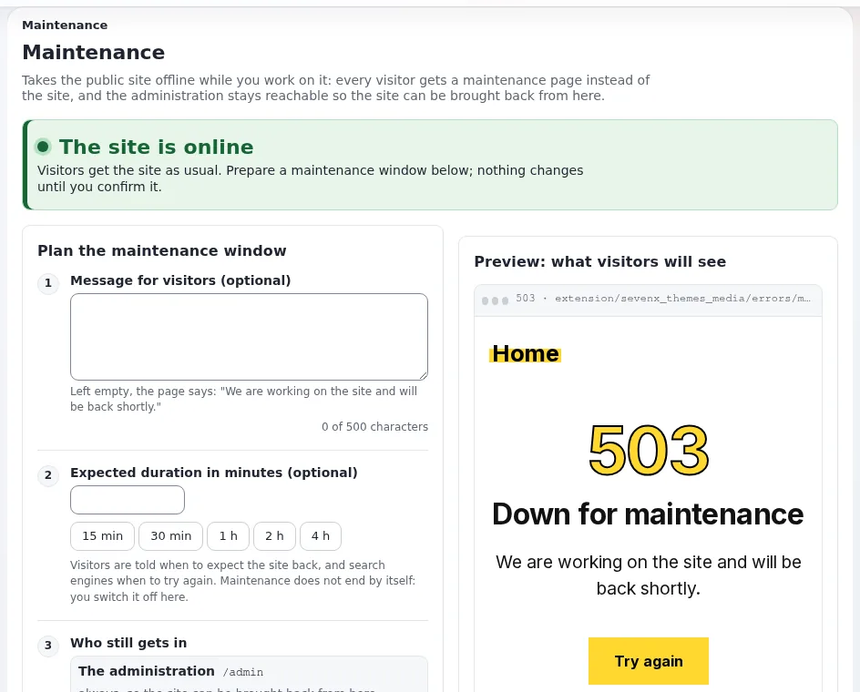

# Wartungsfenster

Diese Seite richtet sich an Verantwortliche für Dienste und Administratoren, die eine Ausfallzeit einer öffentlichen
Website planen: eine Aktualisierung, eine Datenbankmigration, einen großen Import. Der Wartungsmodus von Exponential
beantwortet jeden Besucher mit einer Seite 503 und einem Header `Retry-After`, während Sie arbeiten. Das Werkzeug ist
unter [Wartungsmodus](../../../../anleitungen/wartungsmodus.md) beschrieben; diese Seite behandelt Planung und Kommunikation.



## Inhalt
1. [Vor dem Wartungsfenster](#vor-dem-wartungsfenster)
2. [Das Wartungsfenster öffnen](#das-wartungsfenster-öffnen)
3. [Während des Wartungsfensters](#während-des-wartungsfensters)
4. [Das Wartungsfenster schließen](#das-wartungsfenster-schließen)
5. [Mit der Öffentlichkeit kommunizieren](#mit-der-öffentlichkeit-kommunizieren)
6. [Verwandte Seiten](#verwandte-seiten)

## Vor dem Wartungsfenster

- **Freigabe**: Das Wartungsfenster ist Teil der freigegebenen Änderung ([Änderungsmanagement und Änderungsbeiräte](aenderungsmanagement-und-aenderungsbeiraete.md)).
- **Zeitpunkt**: Wählen Sie eine Zeit geringer Nutzung; Ihre Webstatistik oder das Zugriffs-Log sagen Ihnen, wann.
  Vermeiden Sie Zeiten, in denen die Öffentlichkeit auf die Website angewiesen ist (Fristen, Wahlen, Notlagen).
- **Ankündigung**: ein Hinweis auf der Website und an die Redaktion einige Tage vorher (siehe unten).
- **Datensicherung** erstellt und geprüft ([Was zu sichern ist](../datensicherung-und-wiederherstellung/was-gesichert-werden-muss.md)).
- **Shell-Zugang** geprüft, damit Sie die Wartung immer beenden können, auch wenn ein Browser es nicht kann.
- **Cronjobs**: Entscheiden Sie, welche während des Wartungsfensters nicht laufen dürfen
  ([Cronjobs während der Wartung pausieren](../../aufgaben/betrieb/cronjobs-waehrend-der-wartung-anhalten.md)).

## Das Wartungsfenster öffnen

In der Administration unter **Setup > Wartung** (`/setup/maintenance`): die Meldung für Besucher, die erwartete Dauer
(15 Minuten bis 4 Stunden mit einem Klick), wer weiterhin hineinkommt (die Administration unter `/admin` immer; Ihre
eigene Adresse mit einem Häkchen; weitere Adressen), die Bestätigung, **Website offline nehmen**. Eine Vorschau zeigt
die Seite, die Besucher erhalten.

Oder in der Shell:

```bash
php bin/php/maintenance.php on --message="We are upgrading the site. Back at 06:00 UTC." --until=2h --allow-admin --allow-root-user
php bin/php/maintenance.php status --allow-root-user
curl -sI https://www.example.gov/ | head -1      # HTTP/1.1 503 Service Unavailable
```

Besucher erhalten eine 503 mit `Retry-After`, `Cache-Control: no-store` und `noindex`, sodass Suchmaschinen die echte
Seite behalten. Das Einschalten leert die Caches vor `index.php`; unter Velocity pausieren die Antwort-Caches während
der Wartung ([Funktion Wartungsmodus](../../../../funktionen/6.0/wartungsmodus.md)).

## Während des Wartungsfensters

- Testende, deren Adressen Sie aufgeführt haben, sehen die echte Website; alle anderen sehen die Wartungsseite.
- Das erwartete Ende ist kein Zeitgeber: Die Wartung endet nie von selbst. Die Seite warnt, sobald das Ende
  überschritten ist.
- Die REST-API ist ebenfalls ein Front-Controller und antwortet mit 503; lassen Sie die Adressen der API-Clients zu,
  auf die Sie angewiesen sind, oder halten Sie das Wartungsfenster kurz.

## Das Wartungsfenster schließen

1. Prüfen Sie die Website von einer zugelassenen Adresse aus.
2. **Website wieder online bringen** unter **Setup > Wartung** oder `php bin/php/maintenance.php off --allow-root-user`.
3. Leeren Sie die Caches vor der Website, wenn sich Inhalte oder Code geändert haben; unter Velocity:
   `./console exp:velocity cache clear --allow-root-user`.
4. `curl -s -o /dev/null -w '%{http_code}\n' https://www.example.gov/` antwortet über jeden Server mit 200.
5. Führen Sie die pausierten Cronjob-Teile aus (**Setup > Cronjobs**).

Jedes Umschalten wird als `system.maintenance.change` aufgezeichnet; **Letzte Änderungen** auf der Seite listet die
letzten acht auf. Fügen Sie sie dem Änderungsdatensatz hinzu.

## Mit der Öffentlichkeit kommunizieren

| Wann | Was | Wo |
|---|---|---|
| Einige Tage vorher | Datum, Uhrzeit, erwartete Dauer, Alternativen (Telefon, Schalter) | ein Hinweis auf der Website; die sozialen Kanäle, die Ihre Organisation nutzt |
| Während | die Meldung der Wartungsseite: wann die Website zurück ist, in einfachen Worten | `--message` oder das Meldungsfeld der Seite |
| Danach | nichts, außer das Wartungsfenster hat länger gedauert oder sich für die Nutzenden etwas geändert | ein Hinweis |

Halten Sie das eigene Design der Wartungsseite barrierefrei und in den Sprachen der Website; die Seite ist die
`errors/maintenance.html` des Themes, wenn eine aktive Erweiterung eine hat, sonst `share/maintenance.html`.

## Verwandte Seiten
- [Wartungsmodus und geplante Ausfallzeiten](../verfuegbarkeit/wartungsmodus-und-geplante-ausfallzeiten.md)
- [Die Website für eine Aktualisierung in den Wartungsmodus versetzen](../../aufgaben/betrieb/die-site-fuer-ein-upgrade-in-den-wartungsmodus-versetzen.md)
- [Die Website wieder online bringen](../../aufgaben/betrieb/die-site-wieder-online-bringen.md)
- [Wartungsmodus (Hosting)](../../../hosting/betrieb/wartungsmodus.md)
- [Freie Dokumentation](../../../freie-dokumentation.md): Diese Seite darf unter der GNU FDL 1.3 frei kopiert, übersetzt und verbessert werden.

<!-- exp-partner-block:start -->
**Werden Sie Exponential-Partner.** Partner teilen ihre Informationen, stellen Mittel bereit, geben Beiträge zurück
und entwickeln die Produkte mit uns, und so wächst Exponential. Eine Partner-Website und ein Dashboard sind für Mitte
2027 geplant: Werden Sie noch heute Partner, damit wir schneller wachsen und neue Funktionen früher liefern. Beginnen
Sie mit [Partner: hier beginnen](../../../partner/partner-hier-beginnen.md) und
[Wie Sie sich bewerben](../../../partner/wie-sie-sich-bewerben.md).
<!-- exp-partner-block:end -->
