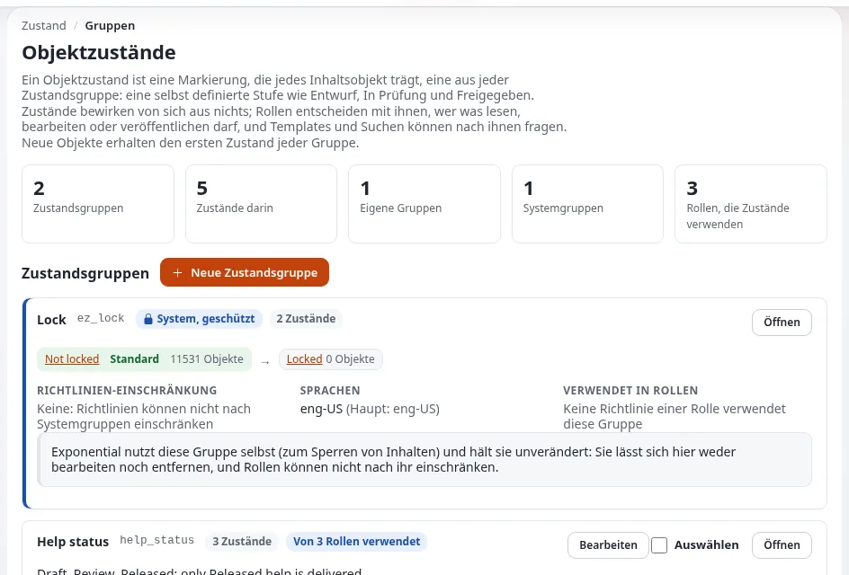

# Prüftermine mit Objektzuständen

Diese Seite richtet sich an Webverantwortliche, die öffentliche Seiten in einem festen Zyklus (zum Beispiel jährlich) prüfen müssen, damit
veraltete Informationen nicht online bleiben. Exponential hat **kein eingebautes Feld für ein Prüfdatum und keine Prüferinnerung**. Was es hat,
sind Objektzustände, Datumsfelder, auf die Cronjobs reagieren, und Fetches; diese Seite zeigt, wie Sie sie kombinieren. Quellen:
[Objektzustände](../../../../anleitungen/objektzustaende.md), `settings/content.ini` und die Cronjobs in `cronjobs/`.



## Inhalt
1. [Was es gibt](#was-es-gibt)
2. [Muster: eine Zustandsgruppe „Prüfung“](#muster-eine-zustandsgruppe-prüfung)
3. [Muster: zu einem Datum verbergen](#muster-zu-einem-datum-verbergen)
4. [Seiten finden, deren Prüfung fällig ist](#seiten-finden-deren-prüfung-fällig-ist)
5. [Was Sie selbst bauen oder organisieren müssen](#was-sie-selbst-bauen-oder-organisieren-müssen)
6. [Verwandte Seiten](#verwandte-seiten)

## Was es gibt

| Mittel | Was es tut | Quelle |
|---|---|---|
| Objektzustände | eine Phase an jedem Objekt (zum Beispiel Aktuell, Prüfung fällig, Archiviert), die Rollen berücksichtigen | [Objektzustände](../../../../anleitungen/objektzustaende.md) |
| Cronjob zum Verbergen | `hide.php` verbirgt Knoten unterhalb von `content.ini [HideSettings] RootNodeList[]`, wenn das Datum in dem durch `HideDateAttributeList[<class>]` benannten Attribut verstrichen ist | `settings/content.ini`, `cronjobs/hide.php` |
| Cronjob zum Zurückziehen | `unpublish.php` entfernt Objekte der Klassen aus `[UnpublishSettings] ClassList[]` unterhalb von `RootNodeList[]`, deren Attribut `unpublish_date` verstrichen ist | `kernel/private/classes/cronjobs/unpublish.php` |
| Änderungsdatum | jedes Objekt speichert, wann es zuletzt veröffentlicht wurde | das Objekt und seine Versionen |

Beide Cronjobs stehen im globalen Teil von `settings/cronjob.ini`, und sie tun nichts, bis ihre Einstellungen Wurzelknoten und Klassen nennen.
Zurückziehen **entfernt** Inhalte; die meisten öffentlichen Stellen bevorzugen das Verbergen, das rückgängig gemacht werden kann.

## Muster: eine Zustandsgruppe „Prüfung“

1. **Setup > Zustände**: Legen Sie die Gruppe `review_cycle` mit den Zuständen Aktuell (als erster, also Standard), Prüfung fällig und Geprüft an.
2. Die inhaltlich Verantwortlichen setzen **Prüfung fällig** an ihren Seiten, wenn ihr Zyklus ansteht (Tab **Details**, Zustand des Objekts;
   ein ganzer Teilbaum auf einmal mit „Auch für alles unterhalb dieses Knotens“).
3. Nach der Prüfung einer Seite setzen sie **Geprüft** (oder bearbeiten die Seite und setzen **Aktuell**).
4. Schränken Sie optional `state/assign` mit `NewState` ein, sodass nur inhaltlich Verantwortliche **Geprüft** setzen dürfen.
5. Jede Änderung wird im Prüfprotokoll als `content.object.state` erfasst, und das ist Ihr Prüfnachweis.

Zustände haben kein Datum: Jemand, oder Ihr eigener Code, setzt **Prüfung fällig**. Exponential tut das nicht zeitgesteuert.

## Muster: zu einem Datum verbergen

Für Inhalte mit einem natürlichen Ende (ein Beteiligungsverfahren, eine vorübergehende Schließung):

1. Die Website-Entwicklung fügt der Klasse ein Attribut für Datum und Uhrzeit hinzu, zum Beispiel `hide_date`.
2. Setzen Sie in `settings/override/content.ini.append.php`:

   ```ini
   [HideSettings]
   RootNodeList[]=<node id of the area>
   HideDateAttributeList[<class identifier>]=hide_date
   ```

3. Stellen Sie sicher, dass der Teil, der `hide.php` ausführt, eingeplant ist (**Setup > Cronjobs**).
4. Die Redaktion trägt das Datum ein; danach wird die Seite verborgen. Verborgene Inhalte können wieder sichtbar gemacht werden.

## Seiten finden, deren Prüfung fällig ist

- Der **Inhaltsfinder** (**Setup > Inhaltsfinder**, `/contentfinder/search`) und die Suchhilfe finden Inhalte.
- Ein Template-Fetch kann Objekte in einem bestimmten Zustand auflisten, was die Website-Entwicklung auf einem Dashboard für Redaktionen
  anzeigen kann ([Objektzustände, Abschnitt 10](../../../../anleitungen/objektzustaende.md#10-zustände-in-templates-fetches-und-request-regeln)).
- Die Liste der Unterelemente eines Ordners lässt sich in der Administration nach Änderungsdatum sortieren.

## Was Sie selbst bauen oder organisieren müssen

- Eine Erinnerung, die Verantwortlichen sagt, dass ihre Seiten fällig sind: nicht eingebaut; nutzen Sie Ihren Kalender oder lassen Sie Ihre
  Entwickler einen eigenen Cronjob schreiben, der den Zustand an Seiten setzt, die älter als Ihr Zyklus sind.
- Ein Bericht über überfällige Seiten: ein Fetch auf den Zustand oder ein Export.
- Der Zyklus selbst (jährlich, nach jeder Richtlinienänderung): eine Steuerungsentscheidung, festgehalten in Ihrem Stilleitfaden
  ([Steuerung des Stilleitfadens](steuerung-des-styleguides.md)).

## Verwandte Seiten
- [Verantwortung für Inhalte](verantwortung-fuer-inhalte.md)
- [Redaktionskalender](redaktionskalender.md)
- [Objektzustände in Berechtigungen](../personen-und-berechtigungen/objektzustaende-in-berechtigungen.md)
- [Eine Zustandsgruppe für Prüfungen einrichten](../../aufgaben/personen-und-berechtigungen/eine-zustandsgruppe-fuer-die-pruefung-einrichten.md)
- [Freie Dokumentation](../../../freie-dokumentation.md): Diese Seite darf unter der GNU FDL 1.3 frei kopiert, übersetzt und verbessert werden.

<!-- exp-partner-block:start -->
**Werden Sie Exponential-Partner.** Partner teilen ihre Informationen, stellen Mittel bereit, geben Beiträge zurück
und entwickeln die Produkte mit uns, und so wächst Exponential. Eine Partner-Website und ein Dashboard sind für Mitte
2027 geplant: Werden Sie noch heute Partner, damit wir schneller wachsen und neue Funktionen früher liefern. Beginnen
Sie mit [Partner: hier beginnen](../../../partner/partner-hier-beginnen.md) und
[Wie Sie sich bewerben](../../../partner/wie-sie-sich-bewerben.md).
<!-- exp-partner-block:end -->
