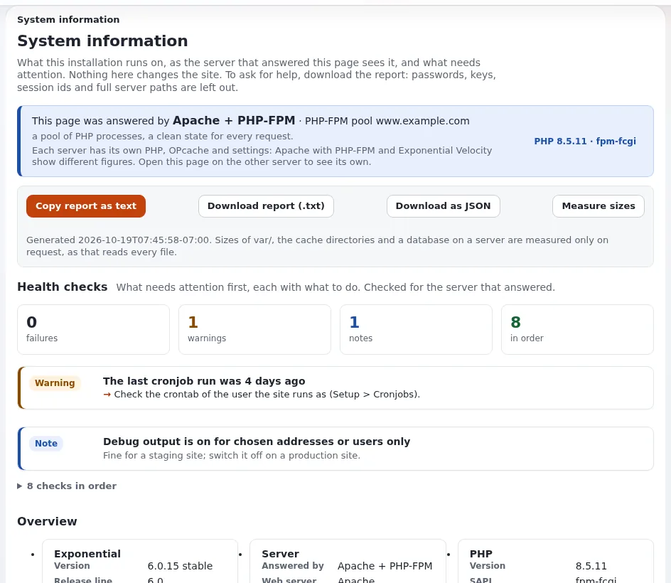

# Systeminformationen und Zustandsprüfungen

Diese Seite richtet sich an die Administration und IT-Teams, die ein schnelles, verlässliches Bild vom Zustand einer
Installation brauchen, und an alle, die eine Support-Anfrage vorbereiten. **Setup > Systeminformationen**
(`/setup/info`, erfordert `setup/system_info`) liest und ändert nichts. Referenz:
[Systeminformationen](../../../../anleitungen/systeminformationen.md).



## Inhalt
1. [Welcher Server geantwortet hat](#welcher-server-geantwortet-hat)
2. [Die Zustandsprüfungen](#die-zustandsprüfungen)
3. [Die Übersicht und der Bericht](#die-übersicht-und-der-bericht)
4. [Von der Shell und in der Überwachung](#von-der-shell-und-in-der-überwachung)
5. [Verwandte Seiten](#verwandte-seiten)

## Welcher Server geantwortet hat

Die Seite nennt zuerst den Server dieser Anfrage: Apache mit PHP-FPM (und seinem Pool), Exponential Velocity,
FrankenPHP oder den eingebauten Server von PHP. Jeder hat sein eigenes PHP, OPcache und eigene Einstellungen; öffnen
Sie die Seite daher über jede Engine, die Sie betreiben.

## Die Zustandsprüfungen

Fehler und Warnungen stehen zuerst, jeweils mit dem, was zu tun ist. Eine Auswahl aus dem Leitfaden:

| Prüfung | Fehler oder Warnung, wenn |
|---|---|
| PHP-Version | unter dem Minimum (Fehler); ein Zweig ohne Sicherheitsunterstützung (Warnung) |
| PHP-Erweiterungen | eine, die der Kernel oder der Datenbanktreiber braucht, fehlt (Fehler) |
| OPcache | aus, voll oder Trefferquote unter 90 % bei Apache und FPM |
| memory_limit | unter 128M (Fehler), unter 256M (Warnung) |
| var-Verzeichnis | `var/`, Cache oder Speicher nicht beschreibbar (Fehler) |
| Freier Speicherplatz | unter 1 GB oder 5 % (Fehler), unter 5 GB oder 10 % (Warnung) |
| Debug-Ausgabe | für jeden Besucher eingeschaltet (Fehler) |
| display_errors | PHP zeigt Fehler in der Seite an |
| Caches | View-Caching oder Template-Kompilierung ausgeschaltet |
| Cronjobs | kein Lauf gefunden, oder der letzte liegt mehr als zwei Tage zurück |
| E-Mail | `Transport=file` (Hinweis: es wird nichts gesendet); SMTP ohne Server (Fehler) |
| Datenbank | keine Verbindung (Fehler); nicht UTF-8 (Warnung) |
| Zeitzone | keine gesetzt |

Für eine öffentliche Website ist eine rote **Debug-Ausgabe** oder **display_errors** ein Sicherheitsbefund (interne
Einzelheiten werden der Öffentlichkeit gezeigt); beheben Sie das vor allem anderen.

## Die Übersicht und der Bericht

Übersichtskarten: Exponential (Version, die installierte Version der Datenbank, Siteaccesses, Erweiterungen), Server,
PHP, OPcache und APCu, Datenbank, Speicher, Caches, Cronjobs, E-Mail, Gebietsschema und Zeit, Maschine. Weiter unten:
aktive Erweiterungen, PHP-Einstellungen, Website-Adressen, Siteaccesses, der rollenabhängige HTTP-Cache,
Datenbankabfragen und Verbindung.

**Bericht herunterladen (.txt)**, **Als JSON herunterladen** und **Bericht als Text kopieren** liefern denselben Bericht
für eine Support-Anfrage oder eine Änderungsdokumentation. Passwörter, Schlüssel, Tokens, Sitzungs-IDs, Zugangsdaten in
Adressen und vollständige Serverpfade sind nie darin enthalten
([Systeminformationen, Abschnitt 7](../../../../anleitungen/systeminformationen.md#7-was-niemals-angezeigt-wird)). Trotzdem verrät
die Seite viel über die Installation: Geben Sie `setup/system_info` nur der Administration.

## Von der Shell und in der Überwachung

```bash
./console exp:system:info --allow-root-user            # the text report
./console exp:system:info --json --allow-root-user     # JSON
./console exp:system:info --sizes --allow-root-user    # with directory and database sizes
```

Der Befehl berichtet über das PHP der Kommandozeile (OPcache ist dort meist aus; das ist keine Warnung) und endet mit
1, wenn eine Prüfung fehlschlägt, sodass ein Überwachungsagent oder ein Bereitstellungsskript ihn verwenden kann. Rufen
Sie die Seite zusätzlich im Browser auf, für das PHP des Webservers.

## Verwandte Seiten
- [Systeminformationen für eine Support-Anfrage lesen](../../../../../eng-us/help/government/tasks/operations/read-system-information-for-a-support-request.md)
- [Überwachung im Überblick](ueberwachung-im-ueberblick.md)
- [Den Host härten](../hosting/den-host-haerten.md)
- [Leitfaden Systeminformationen](../../../../anleitungen/systeminformationen.md)
- [Freie Dokumentation](../../../freie-dokumentation.md): Diese Seite darf unter der GNU FDL 1.3 frei kopiert, übersetzt und verbessert werden.

<!-- exp-partner-block:start -->
**Werden Sie Exponential-Partner.** Partner teilen ihre Informationen, stellen Mittel bereit, geben Beiträge zurück und
entwickeln die Produkte mit uns, und so wächst Exponential. Eine Partner-Website und ein Dashboard sind für Mitte 2027
geplant: Werden Sie noch heute Partner, damit wir schneller wachsen und neue Funktionen früher liefern. Beginnen Sie mit
[Partner: hier beginnen](../../../partner/partner-hier-beginnen.md) und [Wie Sie sich bewerben](../../../partner/wie-sie-sich-bewerben.md).
<!-- exp-partner-block:end -->
