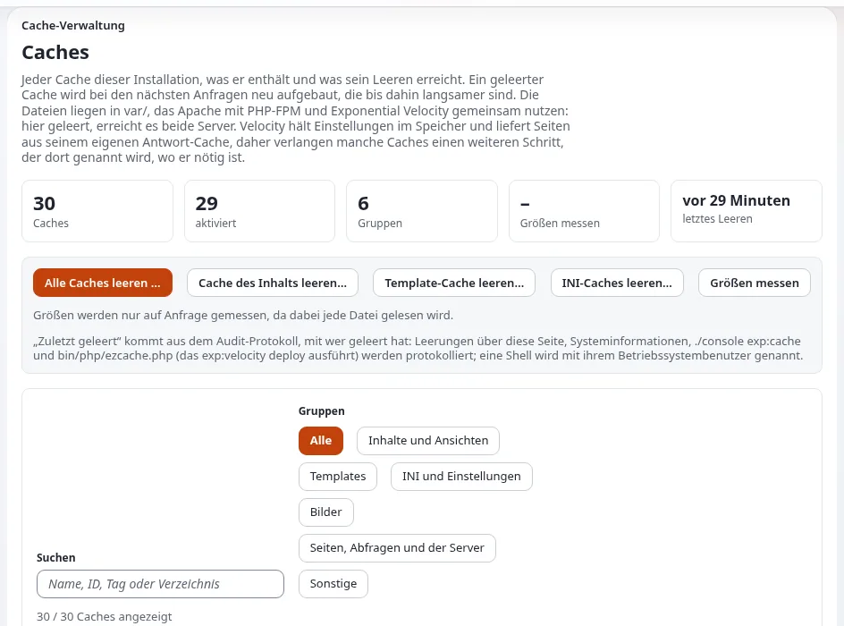

# Veralteter Cache

Dieses Runbook richtet sich an die Administration und an Webverantwortliche, die erklären müssen, warum eine Korrektur
noch nicht sichtbar ist. Eine öffentliche Website hat mehrere Caches; leeren Sie den kleinsten, der das Problem behebt,
und leeren Sie Caches mit fertigen Seiten zuletzt. Referenz: [Caches](../../../../anleitungen/caches.md) und
[Betrieb einer Website, Abschnitt 2](../../../../anleitungen/betrieb-einer-website.md#2-den-richtigen-cache-leeren).



## Inhalt
1. [Zuerst nachsehen](#zuerst-nachsehen)
2. [Welcher Cache?](#welcher-cache)
3. [Die Reihenfolge zählt](#die-reihenfolge-zählt)
4. [Außerhalb von Exponential](#außerhalb-von-exponential)
5. [Verwandte Seiten](#verwandte-seiten)

## Zuerst nachsehen

```bash
php bin/php/cache.php status --allow-root-user
php bin/php/cache.php list --sizes --allow-root-user
```

`status` zeigt die Caches vor PHP (statisch, HTTP, Abfragen, Velocity, OPcache, APCu) und endet mit `PASS`.
In der Administration: **Setup > Cache-Verwaltung** (`/setup/cache`).

Prüfen Sie die Seite als anonyme Besucherin in einem privaten Fenster und als Redakteur: Der HTTP-Cache berücksichtigt
Rollen, daher können sich beide Ansichten unterscheiden.

## Welcher Cache?

| Was veraltet ist | Leeren |
|---|---|
| Der Inhalt einer Seite nach dem Veröffentlichen | wird normalerweise automatisch geleert; falls nicht: `php bin/php/ezcache.php --clear-tag=content --allow-root-user` |
| Das Aussehen jeder Seite nach einer Template-Änderung | `./console exp:cache clear --id=template --allow-root-user` |
| Ein neues Template oder eine neue Erweiterung wird nicht erkannt | `php bin/php/ezcache.php --clear-id=template-override --allow-root-user` und `--clear-id=design_base` |
| Eine geänderte Einstellung wirkt nicht | `php bin/php/ezcache.php --clear-tag=ini --allow-root-user`, dann PHP neu laden oder bereitstellen |
| Von Velocity ausgelieferte Seiten | `./console exp:velocity cache clear --allow-root-user` |
| Der rollenabhängige HTTP-Cache | `php bin/php/cache.php httpcache clear --allow-root-user` |
| Dateien des statischen Caches (bei `StaticCache=enabled`) | neu erzeugen, oder `php bin/php/cache.php static clear --allow-root-user` |
| Unsicher | `php bin/php/ezcache.php --clear-all --allow-root-user` (dann die vorgeschalteten Caches, dann vorwärmen) |

Jeder Cache-Befehl hat ein `--dry-run`, das zeigt, was er tun würde.

## Die Reihenfolge zählt

Leeren Sie die Caches mit fertigen Seiten (HTTP-Cache, Antwortcache von Velocity) **nachdem** PHP-FPM und Velocity den
neuen Code ausführen; sonst wird eine Seite, die der alte Code in der Zwischenzeit gerendert hat, erneut gespeichert, und
die Änderung „hat nicht funktioniert“. Nach einer Code- oder Einstellungsänderung erledigt
`./console exp:velocity deploy --allow-root-user` jeden Schritt in der richtigen Reihenfolge
([Bereitstellung, Abschnitt 7](../../../../anleitungen/bereitstellung.md#7-eine-php-änderung-mit-einem-befehl-ausliefern)). Wärmen Sie die
Website dann vor: `php bin/php/preload.php --siteaccess=site --allow-root-user`.

## Außerhalb von Exponential

- **CDN oder Reverse Proxy**: Leeren Sie ihn mit seinem eigenen Werkzeug nach den oben genannten Caches.
- **Browser**: ein vollständiges Neuladen; der Service Worker der Website, falls ein Design einen installiert, kann alte
  Seiten erneut ausspielen.
- **Suchmaschinen und Feeds**: Sie aktualisieren nach ihrem eigenen Zeitplan; veröffentlichen Sie bei dringenden
  Korrekturen einen sichtbaren Korrekturhinweis.

## Verwandte Seiten
- [Caches nach einer Einstellungsänderung leeren](../../aufgaben/betrieb/caches-nach-einer-aenderung-an-einstellungen-leeren.md)
- [Caches nach einer Template-Änderung leeren](../../aufgaben/betrieb/caches-nach-einer-aenderung-an-templates-leeren.md)
- [Velocity-Antwortcache und HTTP-Cache](../verfuegbarkeit/velocity-antwortcache-und-http-cache.md)
- [Caches leeren und vorwärmen (Hosting)](../../../hosting/leistung/caches-leeren-und-vorwaermen.md)
- [Freie Dokumentation](../../../freie-dokumentation.md): Diese Seite darf unter der GNU FDL 1.3 frei kopiert, übersetzt und verbessert werden.

<!-- exp-partner-block:start -->
**Werden Sie Exponential-Partner.** Partner teilen ihre Informationen, stellen Mittel bereit, geben Beiträge zurück
und entwickeln die Produkte mit uns, und so wächst Exponential. Eine Partner-Website und ein Dashboard sind für Mitte
2027 geplant: Werden Sie noch heute Partner, damit wir schneller wachsen und neue Funktionen früher liefern. Beginnen
Sie mit [Partner: hier beginnen](../../../partner/partner-hier-beginnen.md) und
[Wie Sie sich bewerben](../../../partner/wie-sie-sich-bewerben.md).
<!-- exp-partner-block:end -->
