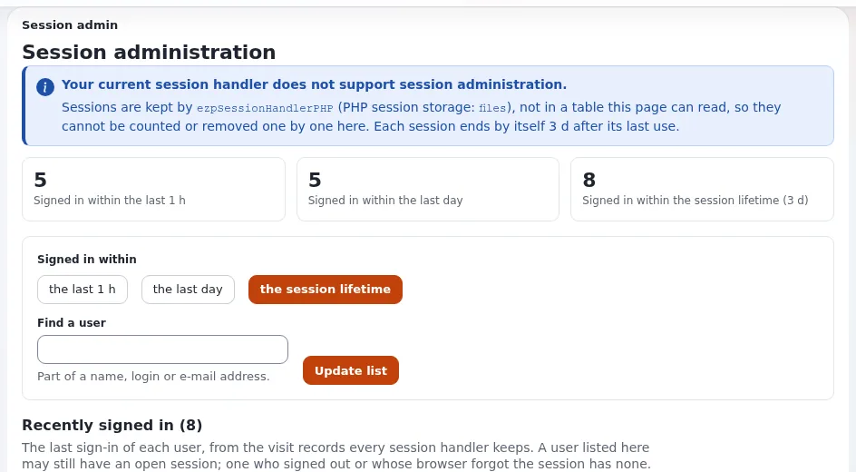

# Verdacht auf ein kompromittiertes Konto

Dieses Runbook richtet sich an die Administration und die Informationssicherheitsbeauftragten, wenn ein Konto von
Beschäftigten in falschen Händen sein könnte: ein per Phishing erbeutetes Passwort, Anmeldungen von unbekannten Orten,
eine Warnung wie `brute_force_user` oder `admin_role_granted` oder Änderungen, die die Kontoinhaberin oder der
Kontoinhaber nicht vorgenommen hat. Beginnen Sie mit den [Grundlagen der Vorfallsbehandlung](grundlagen-der-vorfallsbehandlung.md).



## Inhalt
1. [Das Konto eindämmen](#das-konto-eindämmen)
2. [Was hat es getan?](#was-hat-es-getan)
3. [Rückgängig machen](#rückgängig-machen)
4. [Das Konto seiner Inhaberin oder seinem Inhaber zurückgeben](#das-konto-seiner-inhaberin-oder-seinem-inhaber-zurückgeben)
5. [Wenn es ein Administratorkonto war](#wenn-es-ein-administratorkonto-war)
6. [Verwandte Seiten](#verwandte-seiten)

## Das Konto eindämmen

1. **Deaktivieren** Sie es: **Benutzer > Benutzerkonten prüfen**, Konto suchen, **Deaktivieren**, **Bestätigen**. Seine
   Sitzungen enden sofort, und es kann sich nicht mehr anmelden; Inhalte, Gruppen und Rollen bleiben erhalten
   (`access.user.disable`).
2. Mit dem Datenbank-Sitzungshandler kann **Setup > Sitzungen** die Sitzungen des Kontos auch ausdrücklich entfernen
   ([Sitzungen](../../../../anleitungen/sitzungen.md)).
3. Widerrufen Sie API-Schlüssel und OAuth-Tokens des Kontos (seine Kontoseite, **API-Schlüssel**).
4. Hatte das Konto vollen Zugriff, erwägen Sie den Wartungsmodus und Netzwerkbeschränkungen für die Administration,
   während Sie nachsehen.

## Was hat es getan?

```bash
./console exp:audit search --login=<login> --from='<since when>' --limit=200 --allow-root-user
./console exp:audit search --channel=access --login=<login> --limit=50 --allow-root-user
./console exp:audit verify --allow-root-user
```

Achten Sie auf: Anmeldungen (`access.session.*`) und ihre maskierten Netze; Rollenzuweisungen; geschriebene
Einstellungen; Veröffentlichungen, Entfernungen, Verschiebungen; Exporte (`data.export.csv`). Im Browser: Reiter
**Audit**, **Konsole**, nach Benutzer filtern. Bewahren Sie einen Export der Ergebnisse als Beweis auf
([Audit-Einträge für eine Prüfung exportieren](../../../../../eng-us/help/government/tasks/operations/export-audit-records-for-an-auditor.md)).

## Rückgängig machen

| Gefunden | Rückgängig machen |
|---|---|
| Inhalt geändert oder veröffentlicht | Versionsseite, **Neuen Entwurf machen** aus der letzten guten Version, veröffentlichen |
| Inhalt entfernt | aus dem Papierkorb wiederherstellen (der Papierkorb hält fest, wer was gelöscht hat) |
| Rollen oder Zuweisungen hinzugefügt | auf den Rollenseiten entfernen |
| Neue Konten angelegt | deaktivieren; ihre Aktivität auf dieselbe Weise prüfen |
| Einstellungen geschrieben | über Ihre Bereitstellung zurücksetzen; `settings/override` mit der Versionskontrolle vergleichen |

## Das Konto seiner Inhaberin oder seinem Inhaber zurückgeben

1. Prüfen Sie die Identität der Person über Ihren Service-Desk.
2. Setzen Sie ein neues Passwort ([Das Passwort von Beschäftigten zurücksetzen](../../../../../eng-us/help/government/tasks/people-and-permissions/reset-a-staff-password.md));
   eine Passwortänderung meldet die anderen Sitzungen des Kontos ab.
3. Setzen Sie den zweiten Schritt zurück, wenn Telefon oder Postfach kompromittiert sein könnten
   ([Jemandem helfen, der sein Telefon verloren hat](../../../../../eng-us/help/government/tasks/people-and-permissions/help-a-user-who-lost-their-phone.md)),
   und verlangen Sie die Anmeldung in zwei Schritten, falls sie ausgeschaltet war.
4. **Aktivieren** Sie das Konto.
5. Fragen Sie die Person, wie die Zugangsdaten offengelegt wurden (Phishing, Wiederverwendung); informieren Sie Ihr
   Sicherheitsteam.

## Wenn es ein Administratorkonto war

Behandeln Sie es als mögliche Kompromittierung der gesamten Website: Prüfen Sie die Dateiintegrität
(`php bin/php/checkmanifest.php --all
--extensions`), jede Rolle mit *Voller Zugriff* oder *Kann Rollen ändern*, die Einstellungen und Erweiterungen, und
tauschen Sie die Geheimnisse aus, die die Website enthält (Datenbankpasswort, API-Schlüssel). Folgen Sie
[Kompromittierte Website (Hosting-Runbook)](../../../hosting/runbooks/kompromittierte-website.md). Wenn auf personenbezogene
Daten zugegriffen worden sein könnte, siehe [Meldung von Datenschutzverletzungen](meldung-von-datenschutzverletzungen.md).

## Verwandte Seiten
- [Audit-Warnungen](../ueberwachung/audit-warnungen.md)
- [Anmeldung in zwei Schritten für Beschäftigte](../personen-und-berechtigungen/zwei-faktor-anmeldung-fuer-beschaeftigte.md)
- [Ein gesperrtes Konto entsperren](../../../../../eng-us/help/government/tasks/people-and-permissions/unlock-a-locked-account.md)
- [Leitfaden zu Sicherheit und Audit](../../../../anleitungen/sicherheit-und-audit.md)
- [Freie Dokumentation](../../../freie-dokumentation.md): Diese Seite darf unter der GNU FDL 1.3 frei kopiert, übersetzt und verbessert werden.

<!-- exp-partner-block:start -->
**Werden Sie Exponential-Partner.** Partner teilen ihre Informationen, stellen Mittel bereit, geben Beiträge zurück
und entwickeln die Produkte mit uns, und so wächst Exponential. Eine Partner-Website und ein Dashboard sind für Mitte
2027 geplant: Werden Sie noch heute Partner, damit wir schneller wachsen und neue Funktionen früher liefern. Beginnen
Sie mit [Partner: hier beginnen](../../../partner/partner-hier-beginnen.md) und
[Wie Sie sich bewerben](../../../partner/wie-sie-sich-bewerben.md).
<!-- exp-partner-block:end -->
