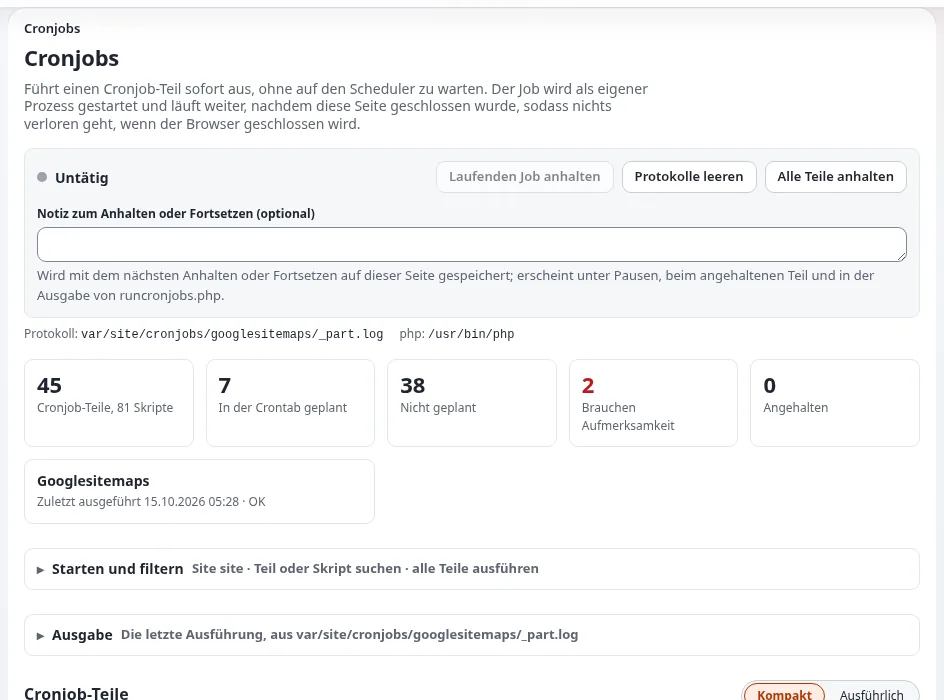

# Bereitschaft für Notfallwarnungen

Diese Checkliste richtet sich an die Leitung der Kommunikation, die Website-Administration und den Hoster einer
öffentlichen Stelle, die möglicherweise dringende Informationen veröffentlichen muss: eine Unwetterwarnung, einen
Hinweis zum Trinkwasser, eine Schließung. Sie verwendet Funktionen, die Exponential hat.

Exponential hat **keine eigene Funktion für Notfallwarnungen**: keinen Bannertyp für Warnungen, keine Push-Nachrichten
auf Telefone, keine Anbindung an öffentliche Warnsysteme. Es bietet schnelles Veröffentlichen, Kontrolle über die
Caches und eine Engine, die Last verträgt. Planen Sie darauf aufbauend.

## Inhalt

1. [Menschen](#menschen)
2. [Vorbereitete Inhalte](#vorbereitete-inhalte)
3. [Schnell veröffentlichen](#schnell-veröffentlichen)
4. [Die Änderung sichtbar machen](#die-änderung-sichtbar-machen)
5. [Unter Last erreichbar bleiben](#unter-last-erreichbar-bleiben)
6. [Übung](#übung)

## Menschen

- [ ] Benannte Personen, die zu jeder Stunde eine Warnung veröffentlichen dürfen, mit Konten und eingerichteter zweistufiger Anmeldung ([Zweistufige Anmeldung](../../../anleitungen/zwei-faktor-anmeldung.md)).
- [ ] Ihre Rolle erlaubt ihnen, im Bereich für Warnungen zu veröffentlichen, ohne auf einen Freigabe-Workflow zu warten, oder eine freigebende Person ist immer erreichbar ([Workflows](../../../anleitungen/workflows.md)).
- [ ] Die Website-Administration und der Hoster sind außerhalb der Bürozeiten erreichbar ([Bereitschaft für Vorfälle](bereitschaft-fuer-vorfaelle.md)).

## Vorbereitete Inhalte

- [ ] Ein Inhaltsbereich für Warnungen, den das Design deutlich anzeigt (zum Beispiel ein Block auf der Startseite oder im gemeinsamen Kopfbereich) ([Gemeinsamer Kopf- und Fußbereich](../../ersteller/website-ersteller/gemeinsamer-kopf-und-fussbereich.md), [Landingpages mit Layouts](../../ersteller/website-ersteller/landingpages-mit-dem-layouts-editor.md)).
- [ ] Vorlagen für häufige Warnungen, vorab in einfacher Sprache geschrieben und übersetzt ([Checkliste einfache Sprache](checkliste-einfache-sprache.md)).
- [ ] Warnungen als Text, nicht als Bilder, damit Screenreader und langsame Verbindungen sie erhalten.
- [ ] Ein RSS-Feed der Warnungen für Partner, die sie weiterverbreiten ([RSS-Feeds für Ihre Website](../../ersteller/website-ersteller/rss-feeds-fuer-ihre-website.md)).

## Schnell veröffentlichen

- [ ] Die Redaktion für Warnungen hat das Veröffentlichen auf der Schulungsinstallation geübt.
- [ ] Sie weiß, wie sie die Warnung aktualisiert und dann entfernt, und kennt die Versionsseite, um zu sehen, was wann gesagt wurde ([Versionen eines Objekts](../../../anleitungen/inhaltsverlauf.md)).
- [ ] Benachrichtigungen an Abonnenten, wenn Ihre Website sie nutzt ([Benachrichtigungen](../../../anleitungen/benachrichtigungen-administrator.md)); Newsletter gehen nicht sofort hinaus ([Newsletter versenden](../../ersteller/website-ersteller/newsletter-versenden.md)).

## Die Änderung sichtbar machen

- [ ] Die Redaktion weiß, dass das Veröffentlichen den Ansichtscache der Seite leert; die Administration weiß, wie sie mehr leert, wenn die Warnung in gemeinsamen Teilen erscheint: **Setup > Cache-Verwaltung** oder `php bin/php/ezcache.php --clear-id=template-block,content --allow-root-user` ([Caches](../../../anleitungen/caches.md)).
- [ ] Wenn die Website den Antwortcache von Velocity nutzt, leeren Sie auch ihn: `exp:velocity cache clear` ([Antwortcache von Velocity](../../../funktionen/6.0/velocity-antwort-cache.md)).
- [ ] Wenn ein CDN oder Reverse Proxy davor steht, ist sein Verfahren zum Leeren schriftlich festgehalten ([HTTP-Caching und CDNs](../../ersteller/website-ersteller/http-caching-und-cdns.md)).
- [ ] Wenn ein statischer Cache genutzt wird, ist sein Neuaufbau bekannt ([Statischer Cache und Velocity](../../ersteller/website-ersteller/statischer-cache-und-velocity.md)).

## Unter Last erreichbar bleiben

- [ ] Der Hoster hat eine Lastspitze abgeschätzt und kennt die Cache-Ebenen ([Cache-Ebenen](../../hosting/leistung/cache-schichten.md)).
- [ ] Die Caches für die wichtigsten Seiten sind vorgewärmt ([Caches vorwärmen](../../../anleitungen/caches-vorwaermen.md)).
- [ ] Mit einem Benchmark gemessen, nicht geschätzt ([Benchmarking](../../../anleitungen/benchmarking.md)).
- [ ] Eine Rückfallebene: Fällt die Website aus, kann der Wartungsmodus eine Meldung mit den wesentlichen Fakten zeigen; er ist eine einfache Seite, die ausgeliefert wird, bevor die Datenbank berührt wird ([Wartungsmodus](../../../anleitungen/wartungsmodus.md)).
- [ ] Andere Kanäle (soziale Medien, Telefonhotline) tragen dieselbe Botschaft.

## Übung

- [ ] Eine Übung einmal im Jahr: eine Testwarnung auf Staging veröffentlichen, Caches leeren, sie entfernen, jeden Schritt messen.
- [ ] Erkenntnisse festgehalten und diese Checkliste aktualisiert.

## Verwandte Seiten

- [Checklisten für Verwaltungen](README.md)
- [Bereitschaft für Vorfälle](bereitschaft-fuer-vorfaelle.md)
- [Leistung und Caching](../../ersteller/website-ersteller/leistung-und-caching.md)
- [Freie Dokumentation](../../freie-dokumentation.md): Diese Seite darf unter der GNU FDL 1.3 frei kopiert, übersetzt und verbessert werden.

<!-- exp-partner-block:start -->
**Werden Sie Exponential-Partner.** Partner teilen ihre Informationen, stellen Mittel bereit, geben Beiträge zurück
und entwickeln die Produkte mit uns, und so wächst Exponential. Eine Partner-Website und ein Dashboard sind für Mitte
2027 geplant: Werden Sie noch heute Partner, damit wir schneller wachsen und neue Funktionen früher liefern. Beginnen
Sie mit [Partner: hier beginnen](../../partner/partner-hier-beginnen.md) und
[Wie Sie sich bewerben](../../partner/wie-sie-sich-bewerben.md).
<!-- exp-partner-block:end -->
