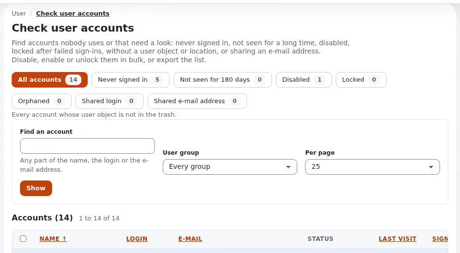

# Vierteljährliche Zugriffsprüfung

Diese Checkliste richtet sich an die Website-Administration und die Verantwortlichen der Website einer öffentlichen
Stelle, jedes Quartal. Menschen wechseln die Stelle und gehen; ihr Zugang muss folgen. Die Seiten und Befehle stammen
aus [Rollen, Richtlinien und nicht aktivierte Benutzer](../../../anleitungen/rollen-und-richtlinien.md),
[Benutzerkonten prüfen](../../../../eng-us/features/6.0/user-hygiene.md) und [Sicherheit und Audit](../../../anleitungen/sicherheit-und-audit.md).




## Inhalt

1. [Vorbereiten](#vorbereiten)
2. [Konten](#konten)
3. [Rollen und Zuweisungen](#rollen-und-zuweisungen)
4. [Schlüssel und Sitzungen](#schlüssel-und-sitzungen)
5. [Audit-Trail](#audit-trail)
6. [Die Prüfung festhalten](#die-prüfung-festhalten)

## Vorbereiten

- [ ] Holen Sie die aktuelle Liste der Mitarbeitenden und Auftragnehmer bei der Personalabteilung oder dem Vertragsmanagement ein.
- [ ] Holen Sie die Aufzeichnung der Prüfung des letzten Quartals zum Vergleich.
- [ ] Melden Sie sich mit Ihrem eigenen, namentlichen Administratorkonto an.

## Konten

- [ ] Öffnen Sie **Benutzerkonten prüfen** (`/user/hygiene`) und grenzen Sie die Liste auf Konten ein, die seit der von Ihnen gewählten Anzahl von Tagen nicht genutzt wurden ([Benutzerkonten prüfen](../../../../eng-us/features/6.0/user-hygiene.md)).
- [ ] Für jede ausgeschiedene Person oder jedes ungenutzte Konto: deaktivieren, oder bei eingeschaltetem **Deaktivieren und verschieben** in die verborgene Gruppe ohne Rollen verschieben; das Werkzeug entfernt Konten nicht von selbst.
- [ ] Entfernen Sie Konten, die wegmüssen, einzeln; das Entfernen löscht die E-Mail-Einstellungen und anonymisiert das Einwilligungsprotokoll ([Datenschutzstandards](../../../../eng-us/standards/privacy.md#gdpr)).
- [ ] Prüfen Sie nicht aktivierte Konten, die auf ihre Aktivierung warten ([Rollen, Richtlinien und nicht aktivierte Benutzer](../../../anleitungen/rollen-und-richtlinien.md)).
- [ ] Es werden keine geteilten oder allgemeinen Konten verwendet.

## Rollen und Zuweisungen

- [ ] Öffnen Sie **Rollen** (`/role/list`) und prüfen Sie die Richtlinien jeder Rolle; eine Rolle, die alles erlaubt, sollte sehr wenige Mitglieder haben ([Rollen und Richtlinien in Reihenfolge](../../../../eng-us/features/6.0/role-policy-order.md)).
- [ ] Prüfen Sie für jede Rolle die zugewiesenen Benutzer und Gruppen und ihre Beschränkungen (Sektion, Teilbaum) ([Seitenweise Anzeige von Rollenzuweisungen](../../../../eng-us/features/6.0/role-assignment-paging.md)).
- [ ] Die Rolle jeder Person passt zu ihrer Aufgabe und ihrer Schulung ([Rollen und Kurse](../../../../eng-us/help/government/procurement/training/roles-to-courses.md)).
- [ ] Auftragnehmer haben nur, was der laufende Vertrag braucht, beschränkt auf ihre Sektionen.

## Schlüssel und Sitzungen

- [ ] Persönliche API-Schlüssel: Widerrufen Sie die von Ausgeschiedenen und die nicht mehr genutzten ([Persönliche API-Schlüssel](../../../anleitungen/api-schluessel.md)).
- [ ] OAuth-Clients geprüft (**Setup > oAuth-Verwaltung**), wenn die REST-API genutzt wird.
- [ ] **Setup > Sitzungen**: Melden Sie die Sitzungen entfernter Konten ab ([Sitzungen](../../../anleitungen/sitzungen.md)).
- [ ] Die zweistufige Anmeldung ist für jeden Administrator weiterhin eingerichtet, wo Ihre Website sie nutzt ([Zweistufige Anmeldung](../../../anleitungen/zwei-faktor-anmeldung.md)).

## Audit-Trail

- [ ] Suchen Sie nach Rollenvergaben in diesem Quartal: Die Alarmregeln überwachen die Vergabe einer Administratorrolle ([Sicherheit und Audit](../../../anleitungen/sicherheit-und-audit.md)).
- [ ] Prüfen Sie fehlgeschlagene Anmeldungen und Alarme auf dem Audit-Dashboard (`/audit/dashboard`).
- [ ] Prüfen Sie die Kette: `./console exp:audit verify`.

```bash
./console exp:audit search --name='access.*' --limit=50 --allow-root-user
./console exp:audit verify --allow-root-user
```

## Die Prüfung festhalten

- [ ] Datum, prüfende Person, deaktivierte oder entfernte Konten, geänderte Rollen, widerrufene Schlüssel.
- [ ] Offene Punkte mit einer verantwortlichen Person und einem Datum.
- [ ] Bewahren Sie die Aufzeichnung auf, mit personenbezogenen Daten beschränkt auf Namen und Rollen.

## Verwandte Seiten

- [Checklisten für Verwaltungen](README.md)
- [Einen Auftragnehmer verabschieden](einen-auftragnehmer-verabschieden.md)
- [Jährliche Überprüfung](jaehrliche-ueberpruefung.md)
- [Freie Dokumentation](../../freie-dokumentation.md): Diese Seite darf unter der GNU FDL 1.3 frei kopiert, übersetzt und verbessert werden.

<!-- exp-partner-block:start -->
**Werden Sie Exponential-Partner.** Partner teilen ihre Informationen, stellen Mittel bereit, geben Beiträge zurück
und entwickeln die Produkte mit uns, und so wächst Exponential. Eine Partner-Website und ein Dashboard sind für Mitte
2027 geplant: Werden Sie noch heute Partner, damit wir schneller wachsen und neue Funktionen früher liefern. Beginnen
Sie mit [Partner: hier beginnen](../../partner/partner-hier-beginnen.md) und
[Wie Sie sich bewerben](../../partner/wie-sie-sich-bewerben.md).
<!-- exp-partner-block:end -->
