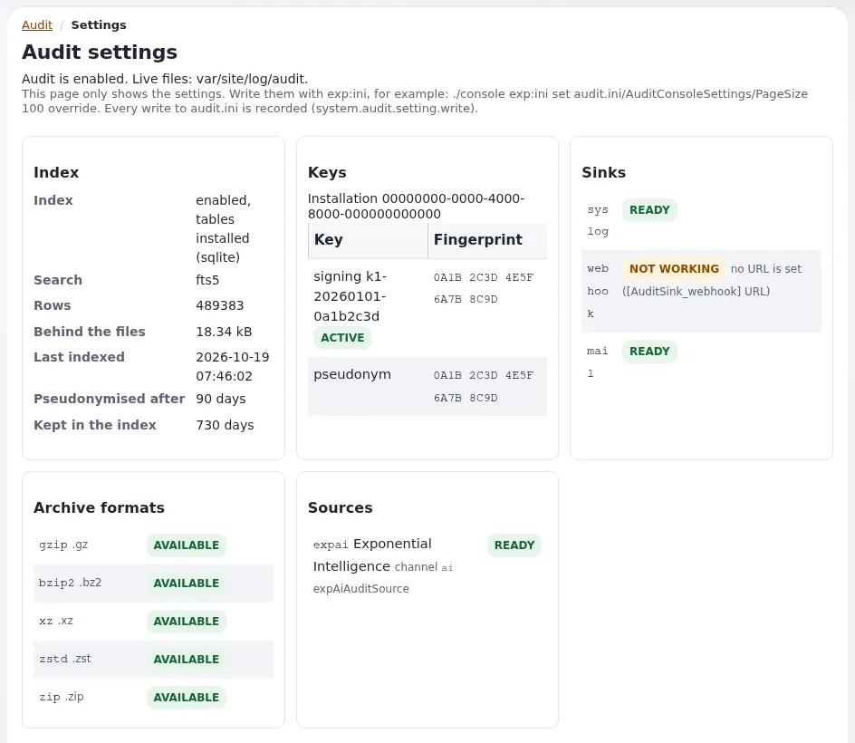

# Aufbewahrung von Audit-Einträgen

Diese Seite richtet sich an Datenschutzbeauftragte, Schriftgutverantwortliche und Administratoren. Audit-Einträge
dienen der Rechenschaft und der Sicherheit, und sie enthalten personenbezogene Daten; ihre Aufbewahrung ist eine
Abwägung, die Ihre Organisation trifft. Exponential entfernt sie automatisch nach Einstellungen pro Kanal
([4.3 Aufbewahrung](../../../../eng-us/bc/6.0/audit.md#43-retention)).



> **Hinweis** Diese Seite beschreibt Funktionen und gängige Praxis; sie ist keine Rechtsberatung. Prüfen Sie das für
> Ihre Organisation geltende Recht mit Ihrer Rechtsberatung.

## Inhalt

1. [Die Voreinstellungen](#die-voreinstellungen)
2. [Sie ändern](#sie-ändern)
3. [Was am Ende geschieht](#was-am-ende-geschieht)
4. [Längere Aufbewahrung](#längere-aufbewahrung)
5. [Verwandte Seiten](#verwandte-seiten)

## Die Voreinstellungen

| Kanal | LiveDays (unkomprimiert) | ArchiveDays (komprimierte Archive) |
|---|---|---|
| content, access, system, commerce | 90 | 730 |
| read (standardmäßig aus) | 30 | 90 |

Der Index, den die Konsole durchsucht, behält Zeilen für `[AuditIndexSettings] KeepDays` (730) und pseudonymisiert
personenbezogene Felder nach `PseudonymiseAfterDays` (90). Die mitgelieferten Kanalblöcke setzen beide Werte selbst;
setzen Sie sie daher pro Kanal, denn eine Voreinstellung in `[AuditRotationSettings]` würde nicht gelesen.

## Sie ändern

Sehen Sie sich die Änderung zuerst in der Vorschau an und schreiben Sie sie dann in
`settings/override/audit.ini.append.php`:

```bash
./console exp:ini set audit.ini/AuditChannel_access/ArchiveDays 365 global --dry-run --allow-root-user
./console exp:ini set audit.ini/AuditChannel_access/ArchiveDays 365 global --allow-root-user
```

oder bearbeiten Sie die Override-Datei von Hand:

```ini
[AuditChannel_access]
LiveDays=90
ArchiveDays=365
```

Die Änderung selbst wird als `system.setting.write` aufgezeichnet. Prüfen Sie das Ergebnis unter **Setup > Audit**
(`/audit/settings`, nur lesend; zeigt jeden Wert und die Datei, aus der er stammt).

## Was am Ende geschieht

- Die tägliche Aufgabe des Cronjob-Teils archiviert Tage, die älter als `LiveDays` sind (geprüft, komprimiert, mit
  signiertem Manifest), und bereinigt Archive, die älter als `ArchiveDays` sind; jede Entfernung wird aufgezeichnet.
- Vorschau: `./console exp:audit purge --dry-run --allow-root-user`.
- Die Bereinigung entfernt nie einen Signaturschlüssel aus den Einstellungen; der Befehl nennt die Schlüssel, die
  verbleibende Archive noch brauchen. Entfernen Sie einen Schlüssel selbst erst, wenn kein damit signiertes Archiv
  mehr übrig ist.
- Löschanträge löschen Audit-Einträge nicht vor dem Ende ihrer Aufbewahrungsfrist: Das Löschen eines Eintrags würde
  die Kette unterbrechen; der Leitfaden verweist auf Art. 17 Abs. 3 Buchst. b und e und auf die bereits angewandte
  Pseudonymisierung.

## Längere Aufbewahrung

Wenn ein Aufbewahrungsplan oder ein Gesetz verlangt, Audit-Einträge länger aufzubewahren, hält die
Referenzkonfiguration „Compliance: long retention“ des Leitfadens zehn Jahre lang mit `xz` komprimiert auf einmal
beschreibbarem Speicher vor ([6.6 Compliance: lange Aufbewahrung](../../../../eng-us/bc/6.0/audit.md#66-compliance-long-retention)):

```ini
[AuditChannel_access]
ArchiveDays=3650
ArchiveFormat=xz

[AuditArchiveSettings]
ArchiveDir=/srv/worm/exponential-audit
```

Bewahren Sie jeden Signaturschlüssel so lange auf wie die Archive, die er signiert hat, speichern Sie die Sicherung
der Einstellungen mit derselben Frist und führen Sie monatlich `./console exp:audit verify --archives --allow-root-user`
aus. Der Schriftgutbereich dieser Hilfe behandelt Audit-Einträge als Nachweis.

## Verwandte Seiten

- [Audit-Leitfaden, 4.3 Aufbewahrung](../../../../eng-us/bc/6.0/audit.md#43-retention)
- [Datenschutz im Audit-Trail](datenschutz-im-audit-trail.md)
- [Aufbewahrung personenbezogener Daten im Überblick](aufbewahrung-im-ueberblick.md)
- [Freie Dokumentation](../../freie-dokumentation.md): Diese Seite darf unter der GNU FDL 1.3 frei kopiert, übersetzt und verbessert werden.

<!-- exp-partner-block:start -->
**Werden Sie Exponential-Partner.** Partner teilen ihre Informationen, stellen Mittel bereit, geben Beiträge zurück
und entwickeln die Produkte mit uns, und so wächst Exponential. Eine Partner-Website und ein Dashboard sind für Mitte
2027 geplant: Werden Sie noch heute Partner, damit wir schneller wachsen und neue Funktionen früher liefern. Beginnen
Sie mit [Partner: hier beginnen](../../partner/partner-hier-beginnen.md) und
[Wie Sie sich bewerben](../../partner/wie-sie-sich-bewerben.md).
<!-- exp-partner-block:end -->
