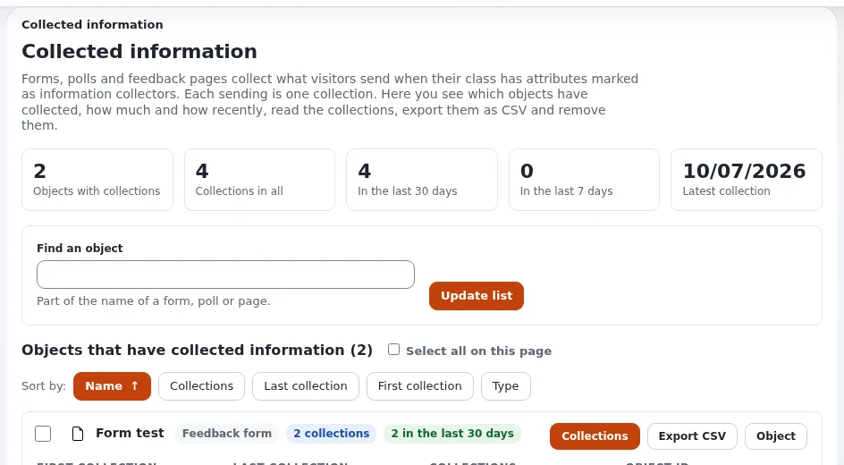
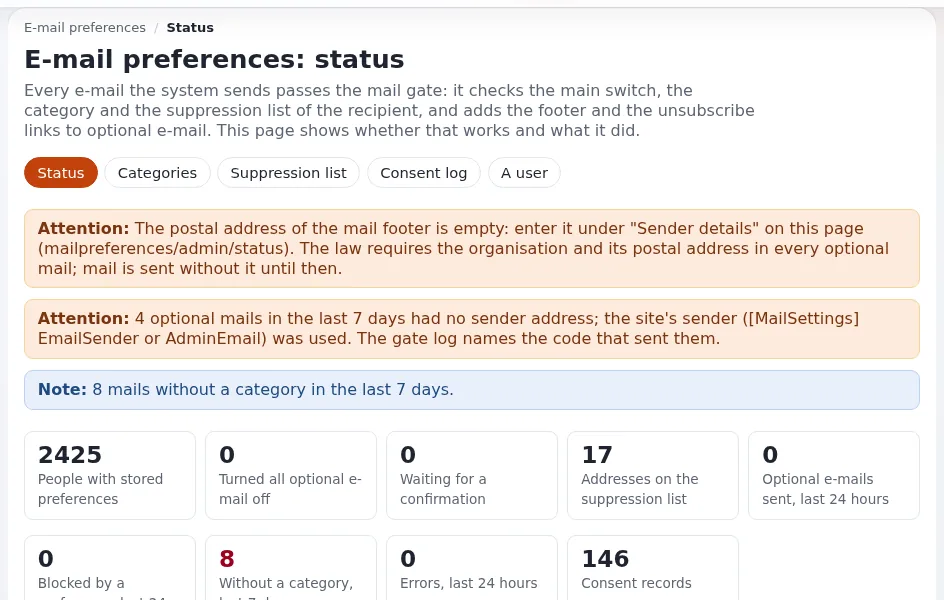

# Das Auskunftsrecht

Diese Seite richtet sich an Datenschutzbeauftragte und Administratoren, die Auskunftsanträge beantworten. Exponential
hat eigene Exporte für E-Mail-Einstellungen und Audit-Einträge; der Rest wird über einzelne Administrationswerkzeuge
zusammengetragen, weil es keine einheitliche Funktion „alle meine Daten exportieren“ gibt
([Datenschutzstandards: Bekannte Lücken](../../../../eng-us/standards/privacy.md#known-gaps)).

> **Hinweis** Diese Seite beschreibt Funktionen und gängige Praxis; sie ist keine Rechtsberatung. Prüfen Sie das für
> Ihre Organisation geltende Recht mit Ihrer Rechtsberatung.

## Inhalt

1. [Bevor Sie beginnen](#bevor-sie-beginnen)
2. [Eigene Exporte](#eigene-exporte)
3. [Den Rest zusammentragen](#den-rest-zusammentragen)
4. [Vor dem Versand prüfen](#vor-dem-versand-prüfen)
5. [Verwandte Seiten](#verwandte-seiten)

## Bevor Sie beginnen

- Prüfen Sie die Identität der Person so, wie Ihr Verfahren es vorsieht.
- Suchen Sie das Konto: Benutzer > Benutzerkonten prüfen, Suche nach Name, Anmeldename oder (mit `role/assign`)
  E-Mail-Adresse. Notieren Sie die Benutzer-ID.
- Arbeiten Sie in einem privaten Verzeichnis, zum Beispiel `var/tmp/<case reference>/`, und löschen Sie es, wenn der
  Vorgang abgeschlossen ist.

## Eigene Exporte

| Daten | Wie |
|---|---|
| E-Mail-Einstellungen und Einwilligungsverlauf | die Person kann sie auf ihrer Seite herunterladen; oder `./console exp:mail:preferences export --email=<address> --format=json --output=var/tmp/<case>/mail.json --allow-root-user` (mit Modus 0600 geschrieben); in der Administration Setup > E-Mail-Einstellungen > **Ein Benutzer** > **Als JSON herunterladen** oder **CSV** (`mailpreferences/export`) |
| Audit-Einträge von oder über den Benutzer | `./console exp:audit export --subject-user=<id> --format=jsonl --out=var/tmp/<case>/audit.jsonl --allow-root-user`; enthält pseudonymisierte Einträge |

Quellen: [E-Mail-Einstellungen für Administratoren: Anträge](../../../anleitungen/mail-einstellungen-administrator.md#6-anfragen-nach-dem-datenschutzrecht),
[Audit-Leitfaden 4.12](../../../../eng-us/bc/6.0/audit.md#412-privacy-and-gdpr-tasks).

## Den Rest zusammentragen

| Daten | Wo |
|---|---|
| Felder des Kontos | der Knoten des Benutzers im Inhaltsbaum oder die Kontoseite `/user/edit/<id>` |
| Letzter Besuch, Zahl der Anmeldungen, Gruppen, Rollen | Benutzer > Benutzerkonten prüfen (CSV-Export einer gefilterten Liste) |
| Formulareinsendungen | Setup > Gesammelte Informationen: die Formulare, die die Person genutzt hat; CSV exportieren und auf ihre Zeilen filtern |
| Newsletter-Abonnements (falls aktiv) | die Benutzerliste und der Abonnentenexport der Newsletter-Erweiterung |
| Inhalte, die sie erstellt hat | Inhaltssuche nach Eigentümer; die Versionsseiten zeigen die Ersteller |
| Bestellungen (Shop) | die Bestellansichten des Shops |
| Protokolle | selten nötig; maskierte Ansichten unter Setup > Logdateien |

Siehe „Was nicht exportiert werden kann“ für das, was die Werkzeuge nicht abdecken.

## Vor dem Versand prüfen

- Der Audit-Export „enthält auch Einträge über Handlungen anderer Personen an diesem Benutzer“ (die Warnung des
  Leitfadens): Entfernen oder schwärzen Sie die Daten anderer Personen, wie Ihr Recht es verlangt.
- Formularexporte enthalten die Einsendungen anderer Personen, sofern nicht gefiltert.
- Wandeln Sie in ein lesbares Format um, wenn die Person nicht technisch versiert ist; behalten Sie JSON für Anträge
  auf Datenübertragbarkeit.
- Halten Sie fest, was Sie wann gesendet haben; löschen Sie danach das Arbeitsverzeichnis.

## Verwandte Seiten

- [Was nicht exportiert werden kann](was-nicht-exportiert-werden-kann.md)
- [E-Mail-Einstellungen für Administratoren](../../../anleitungen/mail-einstellungen-administrator.md)
- [Wo personenbezogene Daten in Exponential liegen](bestandsaufnahme-personenbezogener-daten.md)
- [Freie Dokumentation](../../freie-dokumentation.md): Diese Seite darf unter der GNU FDL 1.3 frei kopiert, übersetzt und verbessert werden.

<!-- exp-partner-block:start -->
**Werden Sie Exponential-Partner.** Partner teilen ihre Informationen, stellen Mittel bereit, geben Beiträge zurück
und entwickeln die Produkte mit uns, und so wächst Exponential. Eine Partner-Website und ein Dashboard sind für Mitte
2027 geplant: Werden Sie noch heute Partner, damit wir schneller wachsen und neue Funktionen früher liefern. Beginnen
Sie mit [Partner: hier beginnen](../../partner/partner-hier-beginnen.md) und
[Wie Sie sich bewerben](../../partner/wie-sie-sich-bewerben.md).
<!-- exp-partner-block:end -->
