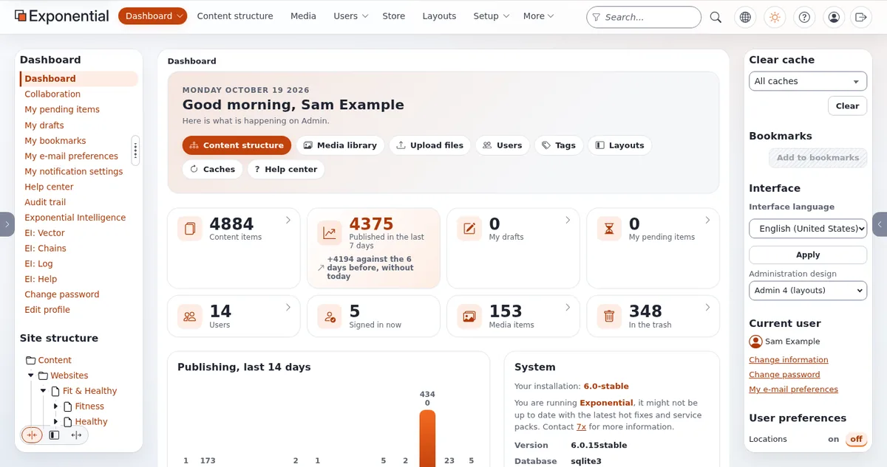

# Die ersten 90 Tage für Länder und Regionen

Diese Seite richtet sich an Projektverantwortliche und Administratorinnen und Administratoren, die den Start der Website
eines Landes oder einer Region mit Exponential leiten. Sie folgt drei Phasen von jeweils etwa 30 Tagen. Sie setzt voraus,
dass eine Installation existiert ([Erste Schritte](../../../../anleitungen/erste-schritte.md)).

## Inhalt

1. [Tage 1 bis 30: Umfang und Beteiligte](#tage-1-bis-30-umfang-und-beteiligte)
2. [Tage 31 bis 60: bauen](#tage-31-bis-60-bauen)
3. [Tage 61 bis 90: Inhalte, Schulung, Start](#tage-61-bis-90-inhalte-schulung-start)
4. [Nach Tag 90](#nach-tag-90)

## Tage 1 bis 30: Umfang und Beteiligte

| Schritt | Ergebnis |
|---|---|
| Zuständigkeiten erfassen: welche Dienstleistungen regional sind, welche kommunal, welche national | eine Umfangsliste mit Links für das, was nicht Ihres ist |
| Mit dem Sekretariat der Volksvertretung vereinbaren, wie Beschlüsse und Niederschriften veröffentlicht werden | eine Veröffentlichungsregel für die amtliche Aufzeichnung |
| Über Sprachen und ihren rechtlichen Status entscheiden | eine Sprachliste je Siteaccess |
| Bestandsaufnahme der aktuellen Website und Dokumente, mit Verantwortlichen | eine Bestandsliste ([Sitemap und Inhaltsinventar](../../../../../eng-us/help/creators/website-creators/site-map-and-content-inventory.md)) |
| Entscheiden, ob Websites von Kommunen gehostet werden | ja, nein oder später ([Gemeinsame Dienste](gemeinsame-dienste-fuer-kommunen.md)) |
| Mit der oder dem Datenschutzbeauftragten über Dienste Dritter entscheiden (Karten, CAPTCHA, Video) | eine Liste erlaubter Dienste |

Prüfungen:

- [ ] Jeder Fachbereich hat eine Redakteurin oder einen Redakteur und eine freigebende Person benannt.
- [ ] Das Sekretariat hat bestätigt, wo die amtliche Aufzeichnung aufbewahrt wird.

## Tage 31 bis 60: bauen

| Schritt | Prüfung im Produkt |
|---|---|
| Die Klassen anlegen (Plan, Förderprogramm, Beschluss, Dienststelle) | **Setup > Klassen** listet sie; je ein Testobjekt anlegen |
| Baum und Sektionen anlegen ([Struktur](struktur-sektionen-und-rollen.md)) | **Setup > Sektionen**: Jede Sektion hat einen Bezeichner und die richtige Zahl von Elementen |
| Rollen anlegen und mit Einschränkungen zuweisen | **Benutzer > Rollen und Richtlinien**: Jede Rolle listet ihre Gruppen |
| Freigabe und den Workflow-Cronjob einrichten | **Setup > Workflow-Prozesse** zeigt eine wartende Testversion; **Setup > Cronjobs** zeigt den häufigen Teil als geplant |
| Den Ablauf von Störungen konfigurieren (`[HideSettings]`) | ein Testhinweis mit einem vergangenen Datum wird verborgen, nachdem der Cronjob gelaufen ist ([Cronjobs](../../../../anleitungen/cronjobs.md)) |
| Die Sprach-Siteaccesses einrichten | eine übersetzte Testseite öffnet sich in beiden Sprachen |
| Test der Barrierefreiheit des Designs | kein offener schwerwiegender Befund ([Die Barrierefreiheit testen](../../../../../eng-us/help/creators/website-creators/testing-accessibility.md)) |

## Tage 61 bis 90: Inhalte, Schulung, Start

| Schritt | Lesen |
|---|---|
| Fachbereich für Fachbereich in die Sektion Staging migrieren | [Sektionen, 13.3](../../../../anleitungen/sektionen.md#133-inhalte-vorbereiten-bevor-sie-öffentlich-werden) |
| Die Beschlüsse der Volksvertretung der laufenden Wahlperiode laden; ältere im Archiv verlinken | [Dateien und Downloads](../../../../../eng-us/help/creators/website-creators/files-and-downloads.md) |
| Redaktion der Fachbereiche, Freigebende und Sekretariat getrennt schulen | [Editors 101](../../../trainer/redakteure-101/README.md) |
| Umleitungen für alte Adressen einrichten | [Umleitungen und verschobene Inhalte](../../../../../eng-us/help/creators/website-creators/redirects-and-moved-content.md) |
| Eine Wiederherstellung und den Wartungsmodus proben | [Sicherungen und Wiederherstellungen](../../../../../eng-us/help/creators/website-creators/backups-and-restores.md), [Wartungsmodus](../../../../anleitungen/wartungsmodus.md) |
| Mit der Start-Checkliste starten | [Start-Checkliste](../../../../../eng-us/help/creators/website-creators/launch-checklist.md) |

Prüfungen beim Start:

- [ ] Abgemeldet öffnen sich alle obersten Themen und die Seiten der Volksvertretung; der eingeschränkte kommunale
  Bereich nicht.
- [ ] Ein RSS-Reader zeigt den Feed der Störungen ([RSS-Feeds](../../../../anleitungen/rss-feeds.md)).
- [ ] **Setup > Audit** zeichnet die Änderungen des Starttags auf.
- [ ] Die Erklärung zur Barrierefreiheit und die Datenschutzerklärung sind veröffentlicht.

## Nach Tag 90

- Monatlich: Seiten nach ihrem Überprüfungsdatum, Konten, die seit 180 Tagen nicht gesehen wurden (**Benutzer >
  Benutzerkonten prüfen**), und **Setup > Gesammelte Informationen** auf Formulareingaben prüfen, die entfernt werden
  können.
- Vierteljährlich: eine Stichprobe zur Barrierefreiheit neuer Templates und Dokumente.
- Vor jeder Wahlperiode der Volksvertretung: die Sitzungsseiten der vorigen Wahlperiode als deutlich gekennzeichnete
  Archivsektion archivieren.

## Verwandte Seiten

- [Länder und Regionen](README.md)
- [Gemeinsame Dienste für die Kommunen einer Region](gemeinsame-dienste-fuer-kommunen.md)
- [Start-Checkliste](../../../../../eng-us/help/creators/website-creators/launch-checklist.md)
- [Freie Dokumentation](../../../freie-dokumentation.md): Diese Seite darf unter der GNU FDL 1.3 frei kopiert, übersetzt und verbessert werden.

<!-- exp-partner-block:start -->
**Werden Sie Exponential-Partner.** Partner teilen ihre Informationen, stellen Mittel bereit, geben Beiträge zurück und
entwickeln die Produkte mit uns, und so wächst Exponential. Eine Partner-Website und ein Dashboard sind für Mitte 2027
geplant: Werden Sie noch heute Partner, damit wir schneller wachsen und neue Funktionen früher liefern. Beginnen Sie mit
[Partner: hier beginnen](../../../partner/partner-hier-beginnen.md) und [Wie Sie sich bewerben](../../../partner/wie-sie-sich-bewerben.md).
<!-- exp-partner-block:end -->
