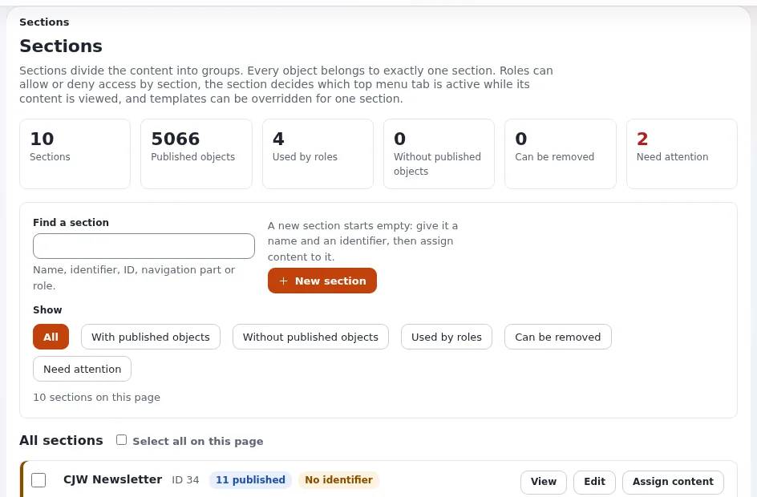

# Struktur, Sektionen und Rollen für den öffentlichen Gesundheitsdienst

Diese Seite richtet sich an Administratorinnen und Administratoren sowie Website-Ersteller der Website des
öffentlichen Gesundheitsdienstes. Hinweise durchlaufen eine medizinische Prüfung; Warnungen gehen sofort von einem
Bereitschaftsteam hinaus. Die Mechanismen sind unter [Sektionen](../../../../anleitungen/sektionen.md),
[Rollen und Richtlinien](../../../../anleitungen/rollen-und-richtlinien.md) und [Workflows](../../../../anleitungen/workflows.md)
beschrieben.



## Inhalt

1. [Der Inhaltsbaum](#der-inhaltsbaum)
2. [Sektionen](#sektionen)
3. [Rollen](#rollen)
4. [Die Prüfung und ihre Ausnahmen](#die-prüfung-und-ihre-ausnahmen)
5. [Prüfungen](#prüfungen)

## Der Inhaltsbaum

```text
Home                     shows current alerts at the top
├── Alerts               Alert objects (current and ended)
├── Health A to Z        Health topic objects
├── Staying healthy      prevention, vaccination, screening
├── Find a service       Clinic objects, booking links
├── For professionals    guidance, protocols, reporting duties
├── Data and reports
├── News and media
└── About us
```

## Sektionen

| Sektion | Enthält | Prüfung |
|---|---|---|
| `advice` | Health A to Z, Staying healthy, For professionals | medizinische Prüfung |
| `alerts` | Alerts | keine (Bereitschaftsteam), nur Audit |
| Standard | Find a service, Nachrichten, über uns, Daten | Prüfung durch die Kommunikation, falls gewünscht |

Alle öffentlich: Fügen Sie `advice` und `alerts` der Richtlinie `content/read` der Rolle Anonymous hinzu. Leitlinien für
Fachleute sind meist öffentlich; schränken Sie nur ein, was eingeschränkt werden muss, mit einer Sektion, die Anonymous
nicht lesen kann.

## Rollen

| Rolle | Richtlinien | Zugewiesen an |
|---|---|---|
| Gesundheitsredaktion | `content/create`, `content/edit`, `content/versionread` eingeschränkt nach Sektion `advice` | Autorinnen und Autoren von Inhalten |
| Medizinische Prüfung | `content/read`, `content/versionread`, `content/diff` für die Sektion `advice` | Medizinerinnen und Mediziner, die freigeben (Freigebende) |
| Veröffentlichung Warnungen | `content/create`, `content/edit`, `content/hide` eingeschränkt nach Sektion `alerts`, dazu `content/translate` | das Bereitschaftsteam für Warnungen |
| Übersetzung | `content/translate`, `content/edit` eingeschränkt nach Sprache (ihren Sprachen) | Übersetzerinnen und Übersetzer |
| Kommunikation | `content/*` eingeschränkt nach Sektion Standard | Kommunikation |
| Webteam | `content/*`, `section/assign`, `rss/edit` | das Webteam |

Die Einschränkung **Sprache** hält Übersetzerinnen und Übersetzer bei ihren Sprachen
([Inhaltssprachen](../../../../anleitungen/inhaltssprachen.md)).

## Die Prüfung und ihre Ausnahmen

| Inhalt | Einstellungen des Ereignisses *Freigeben* |
|---|---|
| Gesundheitshinweise | **Betroffene Sektionen** `advice`; **Gruppen, die Content freigeben** Medizinische Prüfung; **Betroffene Sprachen** alle, oder nur die Ausgangssprache, wenn Übersetzungen von den Übersetzenden geprüft werden |
| Warnungen | nicht betroffen (Sektion `alerts` nicht aufgeführt); jede Veröffentlichung im Audit-Protokoll aufgezeichnet |
| Berichtigungen von Hinweisen durch das Webteam | das Webteam unter **Gruppen ausschließen** nur, wenn Ihre medizinische Governance es erlaubt |

Freigegebene Hinweise veröffentlicht der Workflow-Cronjob: Prüfen Sie, dass **Setup > Workflow-Prozesse** ihn als
geplant zeigt (*alle 5 Minuten* im häufigen Teil ist üblich), sonst warten geprüfte Hinweise.

## Prüfungen

- [ ] Eine Person, die Warnungen veröffentlicht, veröffentlicht eine Warnung, und sie erscheint sofort auf der
  Startseite.
- [ ] Eine Änderung der Gesundheitsredaktion wartet auf die medizinische Prüfung, die sie unter
  **Mein Konto > Zusammenarbeit** sieht.
- [ ] Eine Übersetzerin oder ein Übersetzer kann nur in ihre oder seine Sprachen übersetzen.
- [ ] Jede Person, die Warnungen veröffentlicht, hat die zweistufige Anmeldung, und mindestens zwei Personen können zu
  jeder Stunde Warnungen veröffentlichen.

## Verwandte Seiten

- [Öffentliche Gesundheit](README.md)
- [Schwerpunkte der Anforderungen für den öffentlichen Gesundheitsdienst](schwerpunkte-der-anforderungen.md)
- [Entwürfe und ausstehende Objekte](../../../../anleitungen/entwuerfe-und-ausstehende-objekte.md)
- [Freie Dokumentation](../../../freie-dokumentation.md): Diese Seite darf unter der GNU FDL 1.3 frei kopiert, übersetzt und verbessert werden.

<!-- exp-partner-block:start -->
**Werden Sie Exponential-Partner.** Partner teilen ihre Informationen, stellen Mittel bereit, geben Beiträge zurück und
entwickeln die Produkte mit uns, und so wächst Exponential. Eine Partner-Website und ein Dashboard sind für Mitte 2027
geplant: Werden Sie noch heute Partner, damit wir schneller wachsen und neue Funktionen früher liefern. Beginnen Sie mit
[Partner: hier beginnen](../../../partner/partner-hier-beginnen.md) und [Wie Sie sich bewerben](../../../partner/wie-sie-sich-bewerben.md).
<!-- exp-partner-block:end -->
