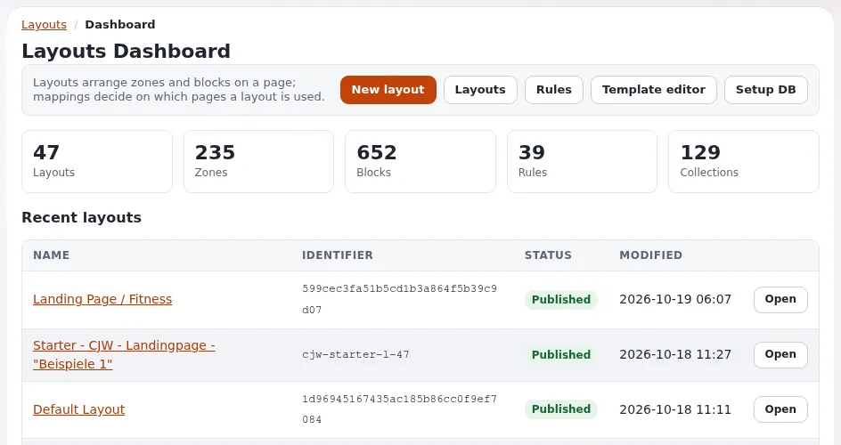

# Tagesordnungen, Gesetzentwürfe und Abstimmungsergebnisse

Diese Seite richtet sich an die Parlamentsverwaltung, die Redaktion, Website-Ersteller und Projektverantwortliche eines
Parlaments oder einer gesetzgebenden Versammlung. Sie beschreibt, wie Sie die drei Kernbestandteile der Aufzeichnung mit
den Klassen aus [Inhaltsmodell für Parlamente](inhaltsmodell.md) und den Rollen aus
[Struktur, Sektionen und Rollen für Parlamente](struktur-sektionen-und-rollen.md) veröffentlichen. Jede genannte
Produktfunktion ist auf der daneben verlinkten Seite dokumentiert.

## Inhalt

1. [Tagesordnungen](#tagesordnungen)
2. [Ein Gesetzentwurf durch seine Stadien](#ein-gesetzentwurf-durch-seine-stadien)
3. [Abstimmungen](#abstimmungen)
4. [Berichtigungen](#berichtigungen)
5. [Feeds und Weiterverwendung](#feeds-und-weiterverwendung)

## Tagesordnungen

| Schritt | Tun |
|---|---|
| Planen | Objekte Sitzung für die Sitzungstage der Wahlperiode anlegen, unterhalb von `Business > <year> > <month>`; Status *geplant* |
| Die Tagesordnung veröffentlichen | die Sitzung bearbeiten: Tagesordnungspunkte im Feld Tagesordnung mit Links zu Gesetzentwürfen und Vorlagen; das Dokument der Tagesordnung (File) verknüpfen; Status *Tagesordnung veröffentlicht*; **Zur Veröffentlichung schicken** |
| Änderung während des Tages | bearbeiten und erneut veröffentlichen; die Änderung oben in die Tagesordnung schreiben („Punkt 4 abgesetzt“) |
| Nach der Sitzung | das Protokoll (File) und die Abstimmungsergebnisse verknüpfen; Status *Aufzeichnung vollständig* |

Tagesordnungspunkte verlinken über das Beziehungsfeld **Gesetzentwürfe auf der Tagesordnung** auf Objekte
Gesetzentwurf, sodass jede Seite eines Gesetzentwurfs die Sitzungen auflisten kann, auf deren Tagesordnung er stand (ein
Fetch der umgekehrt verknüpften Objekte im Template, `fetch( 'content', 'reverse_related_objects', ... )`).

## Ein Gesetzentwurf durch seine Stadien

1. **Einbringung.** Legen Sie das Objekt Gesetzentwurf an: Nummer, Titel, Einbringende (eine Beziehung zu Objekten
   Mitglied), Zusammenfassung, den ersten gedruckten Text als Objekt der Klasse File, verknüpft unter **Fassungen des
   Textes**. Stadium *eingebracht*.
2. **Jedes Stadium.** Bearbeiten Sie den Gesetzentwurf: Setzen Sie **Stadium**, verknüpfen Sie den neuen gedruckten Text
   und die Änderungsanträge als Objekte der Klasse File. Jede Veröffentlichung erzeugt eine neue Version der Seite des
   Gesetzentwurfs, sodass ihr Verlauf zeigt, wann sich das Stadium geändert hat
   ([Versionen eines Objekts](../../../../anleitungen/inhaltsverlauf.md)).
3. **Ausschuss.** Verknüpfen Sie den Ausschussordner; der Bericht des Ausschusses ist ein mit dem Gesetzentwurf
   verknüpftes Objekt der Klasse File.
4. **Ergebnis.** Stadium *angenommen* (oder *erledigt*, *zurückgezogen*), mit einem Link auf das im amtlichen
   Verkündungsblatt veröffentlichte Gesetz, wo es eines gibt.

Ersetzen Sie einen früheren gedruckten Text nicht durch einen späteren im selben Objekt der Klasse File: Jede gedruckte
Fassung ist ein eigenes Objekt mit eigener Adresse, weil jede zitiert wird.

## Abstimmungen

| Feld | Füllen mit |
|---|---|
| Titel | „Abstimmung über <Drucksachennummer>, <Stadium>“ oder die Kurzform der Frage |
| Datum und Uhrzeit | wann die Abstimmung geschlossen wurde |
| Gesetzentwurf | das Objekt Gesetzentwurf |
| Frage | die gestellte Frage |
| Ergebnis, Zahlen | wie verkündet |
| Stimmen der Mitglieder | die Matrix mit Mitglied und Stimme, wo Stimmen je Mitglied aufgezeichnet werden |
| Amtliche Aufzeichnung | die Aufzeichnung der Parlamentsverwaltung als Datei (PDF oder CSV) |

Veröffentlichen Sie Abstimmungen nur aus der amtlichen Aufzeichnung, nie aus im Plenum angefertigten Notizen. Kommen die
Stimmen je Mitglied aus einem Abstimmungssystem, vermeidet ein Import, der die Matrix füllt und den Export des Systems
anhängt, Tippfehler; dieser Import ist eine Entwicklungsaufgabe
([REST API v1 und v2](../../../../anleitungen/rest-api-v1-und-v2.md)).

Ein Abstimmungsergebnis ist mit dem Gesetzentwurf verknüpft; Templates auf der Seite des Gesetzentwurfs listen seine
Abstimmungen auf, und auf der Seite eines Mitglieds die Abstimmungen, die das Mitglied nennen (umgekehrte Beziehungen
funktionieren, wenn Mitglieder verknüpft sind, nicht wenn sie nur als Namen in einer Matrix stehen: entscheiden Sie,
was Sie brauchen).

## Berichtigungen

| Situation | Tun |
|---|---|
| Eine falsche Zahl oder ein falscher Name in einem Abstimmungsergebnis | aus der amtlichen Aufzeichnung berichtigen; einen Berichtigungshinweis mit Datum hinzufügen; die frühere Version bleibt |
| Ein falsches Dokument verknüpft | das richtige verknüpfen, veröffentlichen; das falsche Objekt der Klasse File verborgen halten, nicht entfernen, sofern es nicht weg muss |
| Rechtswidrig veröffentlichte personenbezogene Daten | sie und die Versionen, die sie enthalten, nach dem Verfahren für Berichtigungen der Aufzeichnung entfernen ([Versionen eines Objekts](../../../../anleitungen/inhaltsverlauf.md)) |

Jede Änderung steht im Audit-Protokoll ([Audit-Protokoll](../../../../funktionen/6.0/pruefprotokoll.md)).

## Feeds und Weiterverwendung

| Feed | Wie |
|---|---|
| Tagesordnungen, Gesetzentwürfe, Abstimmungen | ein RSS-Export je Ordner unter **Setup > RSS** ([RSS-Feeds](../../../../anleitungen/rss-feeds.md)) |
| Benachrichtigungen | Personen mit einem Konto folgen einem Ordner oder einem Gesetzentwurf mit **Benachrichtigen** ([Benachrichtigungen: der Leitfaden für Benutzer](../../../../funktionen/6.0/benachrichtigungen.md)) |
| Daten | die Dateien der amtlichen Aufzeichnung; die REST-API |

## Verwandte Seiten

- [Parlamente](README.md)
- [Inhaltsmodell für Parlamente](inhaltsmodell.md)
- [Ratssitzungen und örtliche Dienstleistungen](../kommunen/ratssitzungen-und-oertliche-dienstleistungen.md)
- [Freie Dokumentation](../../../freie-dokumentation.md): Diese Seite darf unter der GNU FDL 1.3 frei kopiert, übersetzt und verbessert werden.

<!-- exp-partner-block:start -->
**Werden Sie Exponential-Partner.** Partner teilen ihre Informationen, stellen Mittel bereit, geben Beiträge zurück
und entwickeln die Produkte mit uns, und so wächst Exponential. Eine Partner-Website und ein Dashboard sind für Mitte
2027 geplant: Werden Sie noch heute Partner, damit wir schneller wachsen und neue Funktionen früher liefern. Beginnen
Sie mit [Partner: hier beginnen](../../../partner/partner-hier-beginnen.md) und
[Wie Sie sich bewerben](../../../partner/wie-sie-sich-bewerben.md).
<!-- exp-partner-block:end -->
